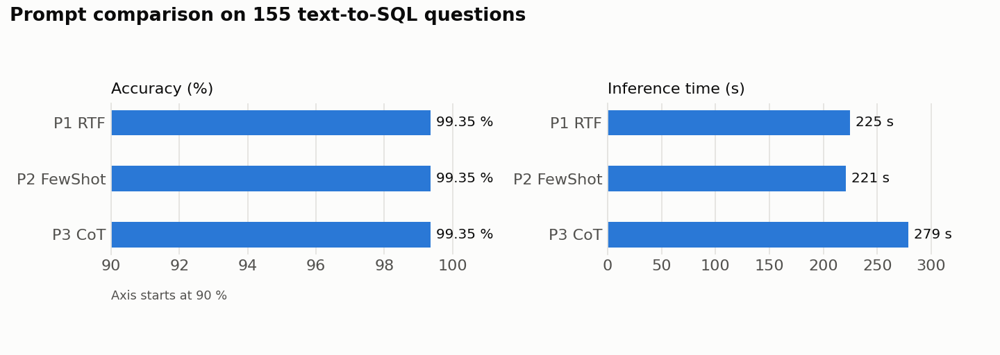

# Task 2 – Comparing the Prompts

## What I did

I took the three prompts from Task 1 (P1 RTF, P2 Few-Shot, P3 CoT) and used each one to translate the 155 restaurant questions into SQL. Following the hint, every prompt ran in a **new session**, so no prompt could benefit from what the model had seen before. The model only got the questions (without the answers) and saved its SQL into a CSV file.

I measured the **inference time** as the time from sending the prompt until the finished file was saved. To score the predictions, I used the evaluation script from the assignment: a query counts as correct only if it returns exactly the expected rows.

## Results

| Prompt | Correct | Accuracy | Inference time | Time per question |
|---|---|---|---|---|
| P1 RTF | 154 / 155 | 99.35 % | 225 s | 1.4 s |
| P2 Few-Shot | 154 / 155 | 99.35 % | 221 s | 1.4 s |
| P3 CoT | 154 / 155 | 99.35 % | 279 s | 1.8 s |

## What it shows

**All three prompts solved the problem equally well.** Each one got 154 of 155 questions right, and none of them produced invalid SQL. Interestingly, all three failed on the same question: *"What is the lifes greates illusion?"*. It is not a question about restaurants, so every prompt returned an empty result. The expected answer, however, is a list of 2,696 restaurants (the Bay Area with a rating above 2.3), and nothing in the question points to that. I think this is a mistake or a trap in the dataset rather than a weakness of the prompts.

**The difference is in speed.** RTF and Few-Shot took almost exactly the same time. CoT took about **25 % longer** (almost a minute more). That makes sense, because CoT has to work through several analysis steps for every question before writing the SQL. In this task, though, the extra thinking brought no extra accuracy.

**The SQL itself was almost the same.** Few-Shot and CoT produced exactly the same queries. RTF differed only in the order of the conditions (street before city instead of city before street), which doesn't change the result. It looks like the examples in the Few-Shot prompt set the "style" of the SQL, but not its meaning.

**Why are the results so similar?** I think it's mainly because all three prompts contain the same clear rules: which columns to return, how to tell a city from a region, what "best" means. Once these rules are written down, the task becomes fairly mechanical, and the choice of framework stops mattering much. Prompts with fewer rules would probably show bigger differences.

**Conclusion:** for this problem, the simplest prompts (RTF and Few-Shot) are the best choice. They are just as accurate as CoT and noticeably faster.

## Limitations

- Each prompt ran only once, so the times can vary somewhat. The difference between RTF and Few-Shot (4 s) is probably just chance, but the difference for CoT is too large to be noise.
- The measured time covers the whole session, including reading the input and writing the file, not only the model generating text.
- My first CoT run hit a technical problem unrelated to the prompt. A leftover file from an earlier failed attempt made the agent's first write fail, so it had to generate the whole output twice (549 s). I therefore replaced it with a clean rerun of the same prompt in a new session. The SQL was identical, only the time changed. This is analysed further in Task 4.

## Files

- `predictions/P1_RTF.csv`, `P2_FewShot.csv`, `P3_CoT.csv`: the predicted SQL from each prompt
- `results/all_predictions.csv`: all predictions in one file with the prompt and model metadata, plus whether each question was answered correctly
- `results/summary.csv`: the results table
- `results/comparison.png`: the chart
- `evaluate_all.py`, `plot_results.py`: the scripts for scoring and drawing the chart
