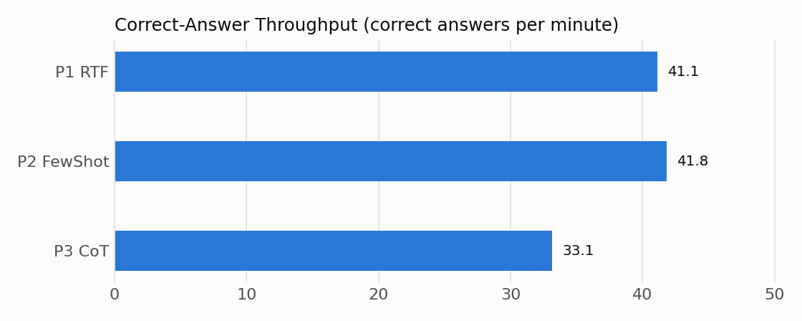

# Task 3 – A New Metric: Correct-Answer Throughput (CAT)

## The problem with exact match

In Task 2, all three prompts scored exactly the same accuracy: 154/155. Judging by the original metric, it doesn't matter which prompt we use. But that isn't true, because CoT took about 25 % longer to reach the same result. Exact match also has a second weakness: it is all-or-nothing. A query that is almost right gets the same zero as a completely wrong one.

So I wanted a metric that captures two things exact match ignores: **how close** a wrong answer is, and **how long** it took to get the answers.

## The metric

**CAT = how many correct answers a prompt produces per minute.**

```
CAT = (F1_1 + F1_2 + … + F1_155) / inference time in minutes
```

For each question I don't count just 0 or 1. Instead I compute the **F1 score over the returned rows**, so a partly correct answer earns partial credit. If both the prediction and the expected result are empty, the answer counts as fully correct.

**Why partial credit makes sense.** Take *"what is a restaurant in vallejo with a rating above 2?"*. If the model forgets the rating filter, it returns all 10 correct restaurants plus 139 extra ones, and F1 = 0.13. If it picks the wrong city, none of the rows are correct, and F1 = 0. Exact match gives both answers 0, but the first mistake is clearly smaller.

**Why time belongs in the metric.** In practice, a prompt also has to be fast. If two prompts are equally accurate, the one that gets there in half the time is better. CAT puts this into one easy-to-read number.

## Results

| Prompt | Accuracy | Mean F1 | Time | **CAT** |
|---|---|---|---|---|
| P1 RTF | 99.35 % | 0.99 | 3.7 min | **41.1** |
| P2 Few-Shot | 99.35 % | 0.99 | 3.7 min | **41.8** |
| P3 CoT | 99.35 % | 0.99 | 4.6 min | **33.2** |



- **CAT separates the prompts where accuracy can't.** RTF and Few-Shot give about 41–42 correct answers per minute, CoT only about 33.
- **The gap between RTF and Few-Shot is very small** (a single run can't tell whether it's real; Task 4 tests it). CoT, however, is clearly worse, even though it was equally accurate.
- **Mean F1 came out the same as accuracy.** The only wrong answer (the "illusion" question) was completely wrong (F1 = 0), and all the others were completely right, so partial credit had nothing to reward here. With weaker prompts or a weaker model, the two metrics would differ.

## Complement or replacement?

CAT **complements** the original metric; it doesn't replace it. On its own it could be misleading, because a very fast prompt with weak answers could still get a decent score. So I would always report it **together with accuracy**: accuracy says whether a prompt is good enough, and CAT says which of the good-enough prompts is the most practical.

The F1 part alone, on the other hand, could replace exact match, because it carries more information: a perfect answer still gets 1, but an almost-correct one no longer gets 0.

## Limitations

The time comes from a single run of each prompt, so the small differences (RTF vs. Few-Shot) are not reliable. Repeating the runs would give a fairer comparison, which I'll look at in Task 4.

## Files

- `metric.py`: implementation of the metric
- `results/per_question_f1.csv`: F1 for every question and prompt
- `results/metric_summary.csv`, `results/cat.png`: the results table and chart
