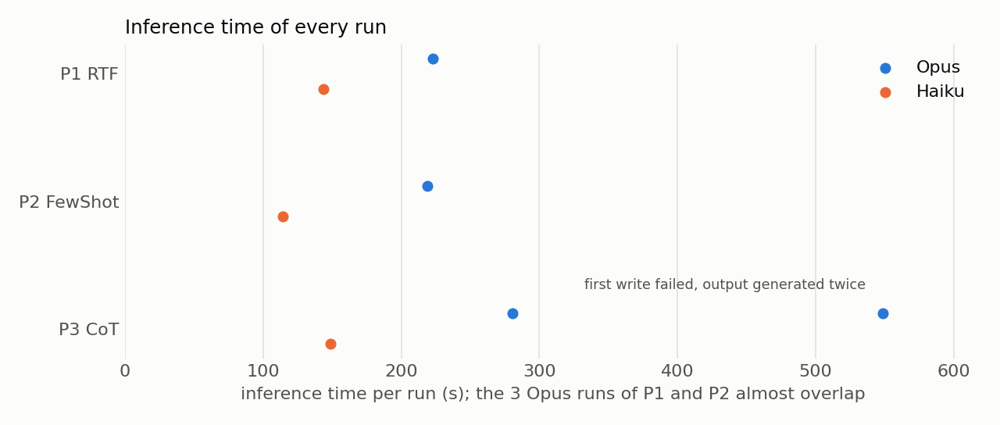
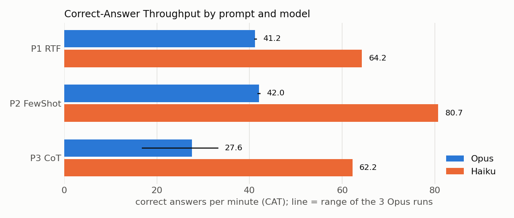

# Task 4 – Detailed Comparison of the Prompts

## What I did

One run per prompt (Tasks 2 and 3) is not enough to tell whether the differences are real, so I repeated the experiment:

- **Opus:** each prompt 3 times;
- **Haiku** (a smaller, faster model): each prompt once, to see the effect of the model.

Every run used a new session. The runs went one after another, so they couldn't slow each other down. I also checked that no agent looked at the correct answers or executed any SQL.

## Results

| Model | Prompt | Runs | Accuracy | Time | CAT (correct / min) |
|---|---|---|---|---|---|
| Opus | P1 RTF | 3 | 154/155 | 224 s | 41.2 |
| Opus | P2 Few-Shot | 3 | 154/155 | 220 s | 42.0 |
| Opus | P3 CoT | 3 | 154/155 | 549 / 279 / 281 s | 27.6 |
| Haiku | P1 RTF | 1 | 154/155 | 144 s | 64.2 |
| Haiku | P2 Few-Shot | 1 | 154/155 | 115 s | 80.7 |
| Haiku | P3 CoT | 1 | 154/155 | 149 s | 62.2 |

## Is the difference statistically significant?

**Accuracy: no.** Every run got exactly the same 154 questions right. Cochran's Q and McNemar's tests give p = 1, so there is no difference between the prompts or between the models.

**Time: yes.** Welch t-tests on the Opus runs:

| Comparison | Difference | p-value |
|---|---|---|
| CoT vs. RTF | CoT 25 % slower | 0.003 |
| CoT vs. Few-Shot | CoT 27 % slower | 0.002 |
| Few-Shot vs. RTF | Few-Shot 2 % faster | 0.008 |

I left out the 549 s CoT run, because it was slow for a technical reason (see below). With it included, the t-tests are not significant (p = 0.48), but the Kruskal-Wallis test still is (p = 0.027).

**CoT is significantly slower. Few-Shot is slightly faster, but 4 seconds don't matter in practice.**

## Why?

**The prompt.** All three prompts contain the same rules, so the task becomes almost mechanical and every prompt reaches the same accuracy. The examples in Few-Shot make the output stable: it produced exactly the same SQL in every run, and so did CoT. RTF changed the order of conditions between runs, though the results stayed the same. CoT is slower because it also writes an analysis for every question, so it has more text to generate.

**The model.** Haiku was just as accurate as Opus and 35–50 % faster. For such a clear task, the bigger model brings no advantage.

**The coding agent.** The biggest single effect came from the agent, not from a prompt. In the first CoT run, a leftover file from an earlier failed attempt made the agent's first write fail, so it had to generate the whole output twice. That's why the run took 549 s instead of about 280 s. The measured time therefore reflects the agent's whole workflow, not just the model.

**The dataset.** The only wrong answer, the "illusion" question, can't be answered correctly from the question itself. So all prompts and models hit the same 154/155 ceiling.

## Conclusion

- The prompts **don't differ in accuracy**. They differ only in **speed**, and CoT is the slowest.
- **The best choice for this task is Few-Shot on Haiku**: just as accurate, the fastest, and its output is the same every time.
- The differences are small because the shared rules did most of the work. On a harder task, the frameworks would probably differ more.

## Limitations

- Only 3 runs on Opus and 1 on Haiku, so the tests are weak.
- The time includes the agent's whole workflow, not only the model.

## Files

- `runs/`: predictions from every run
- `analysis.py`: evaluation, statistical tests and charts
- `results/`: tables and charts
