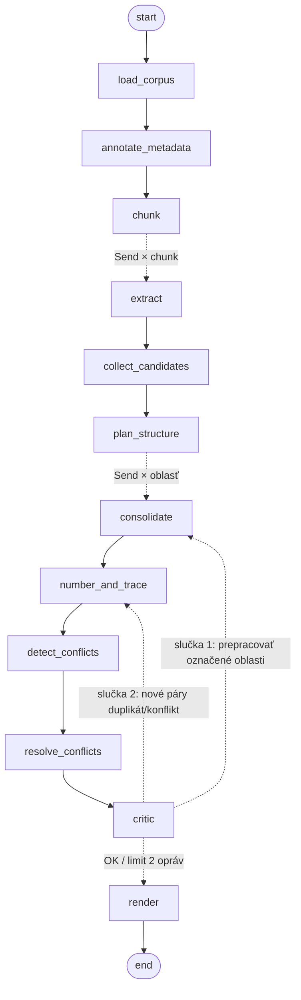

# Task 1 – Agentická sieť na spresňovanie softvérových požiadaviek

## 1. Spustenie

```bash
pip install -r requirements.txt                # testované na Python 3.13, LangGraph 1.2
cp .env.example .env                           # sem patrí OPENAI_API_KEY
mkdir -p output
python main.py --input data/corpus | tee output/run.log
python main.py --diagram                       # vypíše graf siete v Mermaid formáte
```

Sieti zadávam iba cestu k adresáru s korpusom. Všetky súbory `.txt`, `.eml` a `.md` si nájde sama,
aj v podadresároch, takže nový korpus stačí nakopírovať do iného priečinka. V kóde nie sú žiadne
názvy súborov ani nič špecifické pre tento korpus. Typ dokumentu, dátum, kapitoly dokumentu,
glosár aj priority sieť odvodzuje z textu.

Výsledkom je `output/requirements.md`, čo je dokument na čítanie. Vedľa neho vznikne
`requirements.json` s rovnakými dátami, z ktorého sa dajú požiadavky ďalej strojovo spracovať
alebo porovnávať medzi behmi. Počas behu sieť vypisuje postup po uzloch (počty kandidátov,
požiadaviek, nájdených konfliktov, verdikty kritika), takže je hneď vidieť, kde sa čo deje.

Každú odpoveď modelu si sieť ukladá do `output/.cache/`. Cache pribudla po tom, čo prvý beh po
asi 20 minútach extrakcie spadol na výpadku siete a všetko by sa muselo spracovať odznova. Teraz
beh po páde pokračuje tam, kde skončil. Pri ladení navyše nanovo prebehnú len uzly, ktorých prompt
alebo vstup sa zmenil, a opakovaný beh dá rovnaký výsledok. Celý beh bez cache trvá približne
30–40 minút. Opakovaný beh z cache trvá asi 3 sekundy a dá identický dokument (overené
porovnaním výstupov). Prepínač `--no-cache` vynúti nové volania modelov.

## 2. Architektúra

Ako základ používam map‑reduce pipeline (extrahuj → štruktúruj → zlúč → over). Princíp, ktorý
sa cez celý návrh opakuje: **čo sa dá spočítať, počíta kód, a LLM robí iba jazykovú prácu
a úsudok.** Dátum, typ a autoritu dokumentov, overenie citácií, dôkaz priority, pokrytie aj
trasovanie preto rieši kód. Každé rozhodnutie LLM, ktoré by niečo zmazalo, ešte skontroluje kód
alebo iný model.



| Uzol | Typ / model | Úloha |
|---|---|---|
| `load_corpus` | kód | načítanie súborov, ID `D01…` |
| `annotate_metadata` | kód | typ dokumentu, dátum (hlavičky e‑mailov, „Date:“, názov súboru), tier autority: zápisnica 3 > e‑mail/interview/survey 2 > draft/reference 1 |
| `chunk` | kód | delenie po odsekoch, úseky do 12 000 znakov |
| `extract` | LLM `gpt-5-nano`, paralelne | atomickí kandidáti s doslovnou citáciou; nezmysly a položky mimo rozsahu označí s dôvodom |
| `collect_candidates` | kód | ID `C001…`; **overenie citácie** voči zdroju; **dôkaz priority** z textu (značka `[* High/Medium Priority]` v odseku, inak modálne slovo v citácii alebo v uvodzujúcej vete odseku, inak Should) |
| `plan_structure` | LLM `gpt-5-mini` + kód | oblasti (kapitoly) a glosár; priradenie kandidátov po dávkach; oblasť s viac ako 20 % kandidátov sa rozdelí |
| `consolidate` | LLM `gpt-5-mini`, paralelne po oblastiach | zlúčenie rovnakých potrieb, názov, odsek, priorita; konflikty nerieši (zapíše obe strany). Kód potom vynúti: značka high → Must, Must bez opory v zdroji → Should |
| `number_and_trace` | kód | ID `REQ-<OBLASŤ>-NNN`; zdroje a citácie z kandidátov; **kontrola pokrytia** (každý kandidát je v požiadavke alebo v blackliste); **kontrola vernosti** (obsah zlúčeného kandidáta sa objavuje v texte požiadavky) |
| `detect_conflicts` | kód + LLM `gpt-6-luna` | TF‑IDF vyberie pre každú požiadavku 6 najpodobnejších (~850 párov namiesto všetkých ~23 000); LLM posúdi páry po dávkach: conflict / tension / duplicate |
| `resolve_conflicts` | kód + LLM `gpt-5.6-luna` (verifier), `gpt-5-mini` (fúzia) | duplikát: zlúčiť, ak verifier potvrdí, že sa nič nestratí, inak spojiť texty (a overiť kódom); konflikt: **verifier ho musí potvrdiť**, inak vznikne *open issue*; víťaza určí tier autority, potom dátum, porazený ide do blacklistu |
| `critic` | LLM `gpt-5.6-luna` | revízia podľa OS3–OS9; nález `rewrite` ide konsolidátoru danej oblasti, `duplicate`/`conflict` do automatického riešenia |
| `render` | kód | Markdown + JSON |

## 3. Kľúčové rozhodnutia (a čo ich vyvolalo)

Ladenie siete trvalo 8 behov (tabuľka v sekcii 6). Po každom behu porovnávam výstup s korpusom
a každý mechanizmus nižšie je odpoveďou na konkrétne zlyhanie, nie na teoretické riziko.

1. **Lacný model na veľa volaní, silné modely na úsudok.** Na 22 extrakcií stačí `gpt-5-nano`:
   580 z 582 jeho citácií je doslova v zdroji. Najsilnejší `gpt-6-luna` posudzuje konflikty
   a nezávislý `gpt-5.6-luna` overuje každé rozhodnutie, ktoré by niečo zmazalo.
2. **Trasovanie a úplnosť počíta kód.** LLM vracia iba ID kandidátov, ktoré zlúčil. Zdroje
   a citácie dopočítavam v kóde, takže model si zdroj nemôže vymyslieť. Nepokrytí kandidáti
   a „pohltený“ obsah sa vracajú do slučky ako konkrétna spätná väzba.
3. **Priorita z textu zdroja, nie z odhadu LLM.** Extraktor označil 310 z 582 kandidátov ako
   Must, hoci draft píše prevažne „should“ a explicitné značky priority má len pri vybraných
   požiadavkách. Prioritu preto hľadám priamo v texte. Rozloženie Must/Should/Could 90/22/0
   z behu 2 sa tým ustálilo na 34/163/13 a pri každej požiadavke je vypísaný dôkaz.
4. **Konflikty po pároch.** Jedno volanie, ktoré dostalo ~260 požiadaviek naraz, prehliadlo
   aj zjavný rozpor („avoid denormalized reporting schemas“ verzus „reporting warehouse“).
   Kód preto vyberie podobné páry a LLM posúdi každý pár zvlášť. Je to postup známy
   z deduplikácie záznamov (blocking).
5. **Zmazať je drahšie než ponechať.** Párová detekcia zo začiatku označovala za konflikt aj
   rozdiel priority či pravidlo s výnimkou a mazala platné požiadavky. Preto (a) detektor
   priority nevidí, (b) pozná kategóriu *tension* a (c) zmazanie musí potvrdiť nezávislý model.
   Nepotvrdené prípady idú do sekcie „Open issues“ s tým, čo treba vyjasniť so stakeholdermi.
6. **Duplikáty spájať, nie zahadzovať.** „Georgia Annual Report“ sa stratil, hoci bol
   trasovaný. Kontrola vernosti po konsolidácii nič nenašla, obsah sa teda strácal až pri
   zlučovaní duplikátov, kde ostal len text „víťaza“. Prísny verifier potom odmietal všetky
   zlúčenia. Riešením je fúzia: jedna požiadavka s detailmi oboch, prijatá až po kontrole kódom.
7. **Cielená a obmedzená spätná väzba.** Kritik vracia na prepracovanie iba chybné oblasti
   (cez `Send`). Páry duplikát/konflikt rieši kód, lebo konsolidátor vidí len svoju oblasť.
   Najviac 2 opravy, aby sieť vždy skončila.
8. **Konzistencia a robustnosť.** Všetky paralelné konsolidátory dostanú rovnaký glosár.
   Výstupy LLM sú štruktúrované (Pydantic). Oblasti nad 20 % kandidátov sa delia, lebo v behu 2
   vzniklo z 203 kandidátov iba 18 požiadaviek. Zlyhanie jedného volania nezastaví beh a cache
   umožní pokračovať.

## 4. Splnenie špecifikácie siete (ANS)

| Spec | Splnenie |
|---|---|
| ANS1 ≥ 3 LLM uzly | `extract`, `plan_structure`, `consolidate`, `detect_conflicts`, `critic` (+ verifier a fúzia v `resolve_conflicts`) |
| ANS2 ≥ 1 deterministický uzol | `load_corpus`, `annotate_metadata`, `chunk`, `collect_candidates`, `number_and_trace`, `render` |
| ANS3 spätná väzba | `critic` → `consolidate` a `critic` → `number_and_trace` (`route_after_critic`), poháňané aj deterministickými kontrolami pokrytia a vernosti |
| ANS4 ≥ 3 modely | `gpt-5-nano`, `gpt-5-mini`, `gpt-5.6-luna`, `gpt-6-luna` |
| ANS5 LangGraph | `StateGraph`, reducery, `Send` fan‑out, podmienené hrany ([graph.py](req_network/graph.py)) |

## 5. Splnenie špecifikácie výstupu (OS)

| Spec | Prvok siete |
|---|---|
| OS1 jeden dokument | `render`: úvod, stupnica priorít, glosár, zdroje, požiadavky po oblastiach, matica trasovania, blacklist, open issues, report z generovania |
| OS2 unikátne ID | `REQ-<OBLASŤ>-NNN`, `BL-NNN`, `OI-NNN`, `Dnn` |
| OS3 bez duplikátov | prompt konsolidátora; párová detekcia, overenie verifierom a fúzia; kritik |
| OS4 trasovanie | overené citácie; zdroje počíta kód; „Evidence“ pri každej požiadavke; matica trasovania |
| OS5 názov + odsek | schéma a prompt predpisujú názov (3–8 slov) a odsek (3–6 viet); kritik kontroluje |
| OS6 priorita + stupnica | stupnica a pravidlá v dokumente; dôkaz priority z textu; vynútenie v kóde; „Priority evidence“ pri požiadavke |
| OS7 konzistencia | zdieľaný glosár; štýl „The system shall…“; detekcia, overenie a riešenie konfliktov; open issues |
| OS8 úplnosť | extrakcia po chunkoch; kontroly pokrytia a vernosti → slučka |
| OS9 blacklist | z extrakcie, konsolidácie a potvrdených konfliktov, vždy s fázou a dôvodom |

## 6. Výsledky

Výstup: [output/requirements.md](output/requirements.md) (+ `requirements.json`, `run.log`).

| | Hodnota |
|---|---|
| Vstup | 20 dokumentov, 22 chunkov → 582 kandidátov |
| **Požiadavky** | **210** v 15 oblastiach; Must 34 / Should 163 / Could 13 |
| Zlúčené duplikáty / blacklist / open issues | 8 (fúziou) / 3 / 10 |
| Pokrytie kandidátov | 100 % (0 nepokrytých) |
| **Nezávislá kontrola úplnosti** (55 bodov ručne z korpusu: OE, CO, UD, kapitoly draftu 8–15, témy e‑mailov) | **55/55** |

Úplnosť neberiem len z vlastných kontrol siete. Mimo siete mám zoznam 55 kľúčových požiadaviek
ručne vybraných z korpusu a po každom behu overujem, či sa vo výstupe nachádzajú. Práve táto
kontrola odhalila stratu „Georgia Annual Report“, ktorú vnútorné kontroly siete neodhalili.

Vývoj počas ladenia (extrakcia je vo všetkých behoch rovnaká, mení sa zvyšok siete):

| Beh | Požiadavky | M/S/C | Blacklist | Úplnosť | Problém → zmena |
|---|---|---|---|---|---|
| 1 | – | – | – | – | výpadok DNS → disková cache |
| 2 | 112 | 90/22/0 | 7 | – | preplnená oblasť, chybné riešenie konfliktov konsolidátorom → delenie oblastí, konflikty rieši kód |
| 3 | 246 | 170/74/2 | 2 | 55/55 | rozpor neodhalený, priority bez opory → párová detekcia, priorita z textu |
| 4 | 200 | 33/158/9 | 10 | 55/55 | mazanie platných požiadaviek → verifier, tension, open issues |
| 5 | 202 | 33/159/10 | 3 | 54/55 | stratený „Georgia Annual Report“ → kontrola vernosti zlúčenia |
| 6 | 202 | 33/159/10 | 3 | 54/55 | kontrola po konsolidácii bez nálezu, obsah sa strácal pri zlučovaní duplikátov → overenie duplikátov |
| 7 | 217 | 34/170/13 | 3 | 55/55 | verifier odmietol všetky zlúčenia, ostali takmer‑duplikáty → fúzia |
| **8** | **210** | **34/163/13** | **3** | **55/55** | finálny |

## 7. Slabiny a obmedzenia

- Kritik ani po 2 opravách výstup neschválil. Hlási ešte niekoľko čiastočných prekryvov
  a nejednotných formulácií. Výhrady sú zapísané vo výstupe a limit kôl je zámerný.
- Napätie „avoid denormalized reporting schemas“ verzus „historical reporting warehouse“
  (`REQ-SYS-006`, `REQ-SYS-009`) sieť vo finálnom behu nezachytila. Zachytila len príbuzné OI‑010.
- Blacklist je krátky, pretože korpus nemá nezmyselné požiadavky. Súkromné debaty
  v e‑mailoch nie sú požiadavky, takže ich extraktor ignoruje.
- Výber párov je lexikálny (TF‑IDF), takže rozpor bez spoločného slovníka môže uniknúť.
  Model na embeddingy nie je medzi povolenými modelmi.
- Tiery autority sú heuristika (`AUTHORITY` v [config.py](req_network/config.py)) a pri inom
  type korpusu ich treba prehodnotiť.
- Kontrola vernosti nahlásila 1 falošne pozitívny nález a 1 citácia nie je doslovne v zdroji
  (je vo výstupe označená).
