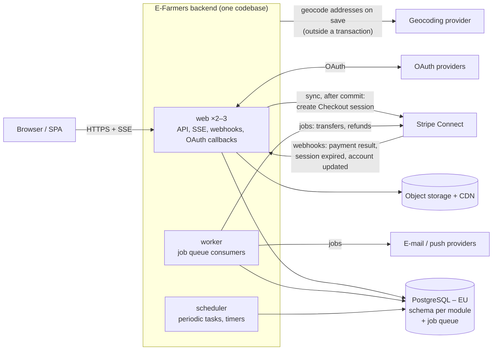
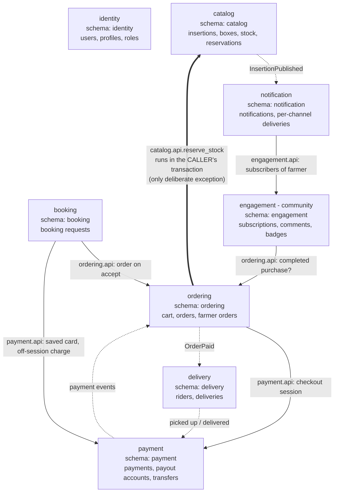

# ADR-001: Architecture style for E-Farmers – modular monolith

| | |
|---|---|
| **Status** | Accepted |
| **Date** | 2026-10-29 |
| **Deciders** | Filip |
| **Consulted** | AI coding assistant |
| **Source** | Architecture discussion – [Task_1/NOTES.md](../Task_1/NOTES.md) |

> **TL;DR.** E-Farmers will be a **modular monolith** with one PostgreSQL database, running on plain EU
> managed services. The hard parts of the system are domain problems: stock under contention,
> marketplace payments and timers. One codebase with one transactional database solves them most
> simply and safely, and a small team can run it. **The main trigger to revisit** is several independent
> teams, or load or regulation diverging between parts of the system. Then move gradually to services,
> starting with Notification.

## Context and problem statement

E-Farmers is a regional marketplace that connects local farmers with customers
([requirements](../Tasks/data/EFarmers.txt), 36 user stories).

- Farmers publish *insertions* with sellable *boxes*.
- Customers buy boxes through a cart and an online payment, or *book* seasonal products from a
  calendar. The farmer then accepts or declines the booking.
- *Riders* deliver orders to customers' homes.
- One account can be customer, farmer and rider at once.
- Integrations: Stripe, e-mail and push providers, OAuth, geocoding.
- The platform operates in the EU and serves users in the EU, so GDPR applies.

**Question:** which architecture style gives correct money and stock handling and fast, simple delivery
for a small team, while leaving a path for growth?

### Requirements that shaped the decision

| User stories | What makes them hard | Driver / consequence |
|---|---|---|
| US 14–17, 33 – cart, order, payment | Stock and order must change together. One cart pays several farmers. | **D1** – one ACID transaction |
| US 18, 21, 32 – booking, farmer accepts/declines | Human approval, deadlines, deferred payment | **D1**, **D5** – timers as testable state transitions |
| US 24–27, 34 – riders and delivery | Two riders accept at once; pickup and confirmation deadlines | **D1** (atomic assignment), **D5** (timers) |
| US 19, 20, 35, 36 – subscriptions, notifications | One insertion notifies N subscribers via external providers | **D4** – worker + outbox; Notification is the first module to extract |
| US 4, 9, 10, 23, 31 – owner-only edits, comments by buyers | Authorization per owner and purchase | **D3** – checks in the backend; main reason A3 rates *Weak* |
| US 1, 29 – e-mail and OAuth registration | Auth from a library or a hosted service | **D2** – decides between A1 and the hybrid |

### Assumptions

**This decision is valid only while these assumptions hold. If any of them stops holding, revisit this
ADR.**

1. Regional marketplace: low thousands of users and low hundreds of farmers.
2. Seasonal peaks of about **10× normal load**, concentrated on the same boxes.
3. A small team of **2–4 developers** with limited operations capacity.
4. Marketplace payments go through **Stripe Connect**. The platform does not hold third-party funds itself.

## Decision drivers (in priority order)

1. **D1** – Correctness of money and stock: no overselling, no paid order without goods.
2. **D2** – Simplicity for a small team and speed of delivery.
3. **D3** – Security model: the database is reachable only through the backend, so access is denied by default.
4. **D4** – Operating burden and cost.
5. **D5** – Testability and debuggability of business logic with timers.
6. **D6** – Path to services later.
7. **D7** – Scaling and vendor lock-in. Explicitly the lowest priority at regional scale.

## Considered options

- **A1 – Modular monolith:** one backend split into domain modules, one PostgreSQL database with a
  schema per module, a background worker.
- **A2 – Microservices, event-driven:** 6 services plus an off-the-shelf IdP. Each service has its own
  database, services talk through RabbitMQ, and checkout is an orchestrated saga.
- **A3 – Serverless / BaaS (Supabase):** the frontend talks directly to Postgres via the auto-API,
  protected by RLS. Logic sits in SQL functions and Edge Functions; background work uses
  `pg_cron`/`pgmq`.
- **Hybrid:** A1 for all domain logic. Supabase provides only managed Postgres, Auth and Storage, and
  its auto-API is switched off.

### Comparison

Ratings: **Strong**, **Acceptable** or **Weak** under the assumptions above.

| Driver | A1 Modular monolith | A2 Microservices | A3 Supabase BaaS | Hybrid |
|---|---|---|---|---|
| **D1** Money & stock | **Strong** – one ACID transaction | **Weak** – saga, compensations, tombstones | **Strong** – one DB, transactions in SQL functions | **Strong** – as A1 |
| **D2** Simplicity & delivery | **Strong** – one codebase, auth from the framework library | **Weak** – outbox, inbox, contracts and tracing before any feature | **Acceptable** – fast CRUD, but core logic in PL/pgSQL and hand-made workers | **Acceptable** – A1 plus a second identity store to sync and a foreign JWT |
| **D3** Security model | **Strong** – only the backend touches the DB | **Acceptable** – private DBs, checks repeated in every service | **Weak** – exposed DB; one forgotten policy means a leak | **Strong** – auto-API off, grants revoked |
| **D4** Ops & cost* | **Strong** – 3 process types, 1 DB; baseline | **Weak** – ~9 deployables; infra ≈ 3–5× A1, team ≈ 2× | **Strong** – no servers; infra ≈ A1 or lower | **Acceptable** – infra ≈ A1, but nobody can log in when the external auth is down; we pay for an unused platform |
| **D5** Testability | **Strong** – standard tooling, fake clock | **Acceptable** – contract tests, tracing, heavy local setup | **Weak** – pgTAP, PL/pgSQL, poor debugging | **Strong** – as A1 |
| **D6** Path to services | **Strong** – module seams and outbox ready | **Strong** – already distributed | **Weak** – exit means rewriting the core (≈ 2–4 developer-months) | **Strong** – as A1 |
| **D7** Scaling & lock-in | **Acceptable** – scales as a whole, enough for 10× peaks; minimal lock-in | **Strong** – scales per service (shared DB cluster caveat) | **Weak** – platform limits, locked into the architectural style | **Acceptable, weaker than A1** – Auth and Storage tied to one US vendor; bcrypt hashes portable |

\* *Relative estimates (October 2026) from unofficial pricing summaries – Task 1
[F9](../Task_1/NOTES.md#f9), [L2](../Task_1/NOTES.md#l2), [C1](../Task_1/NOTES.md#c1). Absolute figures
are omitted because they age quickly. Re-check them before budgeting.*

**Reading the table.** Ratings are not added up. Options are compared **driver by driver in priority
order** (D1 → D2 → …): the first driver where they differ decides, and lower drivers only break ties.

- A1 is the only option rated *Strong* in all of the top five drivers.
- **Hybrid vs. A1:** tie on D1. A1 wins at **D2**. The hybrid is also weaker on D4 and D7.
- **A3** loses at D2 and D3.
- **A2** loses at D1.

## Decision outcome

**Chosen option: A1 – modular monolith on plain EU managed services.**

Reasons: see the comparison. The real bottleneck at peak is one "hot" box row. Its throughput depends on
how long the lock is held, not on the architecture ([Q3](../Task_1/NOTES.md#q3)).

The decision includes:
- **8 modules**, each with its own PostgreSQL schema and a public `api/` (module view below).
- **3 process types from one codebase:** `web` (2–3 stateless replicas), `worker`, `scheduler`.
- **Rule: no network I/O inside a DB transaction.**
  - Synchronous external calls run in `web`, after the transaction commits. Example: creating the Stripe
    Checkout session after stock is reserved.
  - Asynchronous side effects are enqueued as jobs inside the business transaction (the PostgreSQL job
    queue is the transactional outbox), and `worker` executes them. Examples: e-mail, push, transfers.
- **Managed EU infrastructure:** PostgreSQL, S3-compatible storage with a CDN, the framework's auth
  library with OAuth, SSE for the notification centre and rider offers ([C2](../Task_1/NOTES.md#c2);
  capacity not verified yet, see open question 6), and Stripe Connect Express.

#### Deployment view – why it is a *monolith* (processes and infrastructure)

#### Module view – why it is *modular* (boundaries and allowed dependencies)

Legend:
- **Solid arrow:** call through the target module's `api/`. If the call goes over the network, it runs
  after the caller's transaction commits.
- **Dashed arrow:** domain event through the job queue (outbox).
- **Bold arrow:** the shared transaction (unit of work), [Q8](../Task_1/NOTES.md#q8).
- **Two kinds of allowed dependencies are not drawn**, to keep the diagram readable:
  1. Every module may read the current user and roles via `identity.api`.
  2. **`notification` and `engagement` may subscribe to domain events of any module.** Examples: the
     notification centre shows booking accepted/declined (US 21, 32) and order or delivery status;
     badges (US 28) react to sales. This applies to events only, never to direct calls. Event types are
     published as part of the producer's `api/`.
- **Any other dependency not drawn is forbidden.**
- There are no cross-schema foreign keys. Order items store price and name snapshots.

### Consequences

**Positive:**
- Overselling and double rider assignment are prevented by atomic conditional updates in one transaction.
- The outbox comes for free with the job queue.
- Timers are conditional state transitions, so they are safe on several instances.
- The footprint is small: 3 process types and 1 database.

**Negative, risks and mitigations** ([A1 final assessment](../Task_1/NOTES.md#a1-final)):

| Negative / risk | Mitigation |
|---|---|
| The application scales only as a whole, so notification fan-out competes with checkout. | Separate job queues with limited concurrency. Extract Notification first. |
| One deploy for everything. | CI with tests, staged rollout. |
| Module boundaries rely on discipline and can erode under deadline pressure. | Confirmation checks 1–3. The shared transaction is documented as the only exception. |
| A single database. | Lock-safe migrations, retention for job and notification tables, point-in-time recovery. |
| Auth and realtime are built from libraries. | The framework's mature auth library. SSE carries only signals, and the client fetches current state after reconnect ("signal + fetch", [L3](../Task_1/NOTES.md#l3)). Capacity is still to be verified (open question 6). |
| Money edge cases: refunds, transfer reversals, disputes. | Nightly Stripe ↔ DB reconciliation; admin back-office from day one. |
| State machines get stuck (orders, bookings, deliveries). | State-history tables, alerts on stuck entities, fake clock in tests. |
| External services fail (Stripe, e-mail, OAuth). | Graceful degradation: checkout disabled with a clear message, notifications retried later. |

### Confirmation

These checks run in CI on every pull request; #8 runs before launch.

| # | Check | Proves |
|---|---|---|
| 1 | **Architecture test** (import-linter / ArchUnit / dependency-cruiser, depending on the stack): imports only through `api/`, only along the module-view arrows or the two legend rules. | D6 |
| 2 | **Migration test:** a query over `pg_constraint` fails if a foreign key points into another module's schema. | D6 |
| 3 | **SQL lint:** a module's queries must not reference another module's schema. | D6 |
| 4 | **Parallel overselling test** (Testcontainers, real Postgres): 50 concurrent checkouts for a box with quantity 10. Exactly 10 succeed and stock never goes negative. Concurrent multi-box carts listing the same boxes in opposite order must produce **zero deadlock errors** (SQLSTATE `40P01`). Sorted locking must prevent deadlocks; the retry on `40P01` is only a safety net and must not fire in this test. | D1 |
| 5 | **Parallel rider-accept test:** N riders accept the same delivery and exactly one wins. | D1 |
| 6 | **No network I/O in a transaction:** the Stripe, e-mail and push clients throw in tests when called with a DB transaction open. | D1 |
| 7 | **Outbox and timer tests:** a rollback enqueues no job; each timer transition is run with a fake clock and twice gives no extra effect; a duplicate Stripe webhook causes one effect. | D1, D5 |
| 8 | **Hot-row load test:** one box at a 10× peak meets the agreed latency target. | Assumption 2 |

### When to revisit

| Trigger (usually a broken assumption) | Re-evaluate towards |
|---|---|
| About 15+ developers in 3+ teams; scaling diverges (national scale, live rider GPS); payments need regulatory isolation (assumptions 1–3) | **A2, incrementally:** Notification → Payment → Delivery |
| 1–2 developers must validate the idea within weeks; mostly CRUD; strong SQL skills | **A3**, as a throw-away prototype |
| The chosen stack lacks mature auth/OAuth, or realtime becomes central | **Hybrid** |
| The platform has to hold funds itself (assumption 4) | **Revisit the payment model first** |

## Why the other options were rejected

- **A2:** it replaces the single checkout transaction with a saga and needs outbox, inbox and tracing
  everywhere. On a shared database cluster it is no more available than A1 – costs without benefits at
  our size ([F1–F9](../Task_1/NOTES.md#f1)).
- **A3:** for the core domain it is largely A1 written in SQL, with an exposed database and an API layer
  rebuilt as versioned SQL views ([L6](../Task_1/NOTES.md#l6)).
- **Hybrid:** with mature framework auth, it saves days but adds a second identity store and a login
  dependency on an external service ([H1](../Task_1/NOTES.md#h1)).

## Related decisions (should get their own ADRs)

**Status of ADR-002 to ADR-009:** *agreed in Task 1, ADR not written yet.* Until an ADR exists, the
agreed decision below is binding, and the linked Task 1 point is the full source. **ADR-010:** *not
decided yet.*

| Proposed ADR | Already agreed in Task 1 | Source |
|---|---|---|
| ADR-002 Marketplace payments | Stripe Connect Express with separate charges and transfers. The farmer is paid on hand-over and the rider on delivery. | [Q5](../Task_1/NOTES.md#q5), [Q7](../Task_1/NOTES.md#q7) |
| ADR-003 Checkout and stock reservation | Atomic, sorted, all-or-nothing reservation at checkout with no network I/O inside the transaction. Stock is released only after the Stripe session ends. Instant payment methods only, without manual capture. | [Q1](../Task_1/NOTES.md#q1), [Q3](../Task_1/NOTES.md#q3), [Q4](../Task_1/NOTES.md#q4), [Q6](../Task_1/NOTES.md#q6) |
| ADR-004 Booking payment flow | The card is saved at booking and charged off-session when the farmer accepts, with a 24 h payment-link fallback. The farmer must answer within 48 h. SEPA is allowed only here. | [Q2](../Task_1/NOTES.md#q2), [Q6](../Task_1/NOTES.md#q6) |
| ADR-005 Background processing and timers | Transactional outbox via the job queue with idempotent consumers. Every timer is a conditional state transition. | [Q9](../Task_1/NOTES.md#q9), [Q11](../Task_1/NOTES.md#q11) |
| ADR-006 Delivery and dispatch | One delivery per farmer order. The first atomic accept wins. At most one active delivery per rider in the MVP. Dispatch has a terminal give-up state. | [Delivery model](../Task_1/NOTES.md#delivery-model), [Q10](../Task_1/NOTES.md#q10), [Q11](../Task_1/NOTES.md#q11) |
| ADR-007 Identity, roles, authorization | Roles live in profile tables and are read from the DB, not the token. Ownership is enforced in the query and answers 404. Accounts are linked only when both e-mails are verified. | [Q12](../Task_1/NOTES.md#q12), [Q13](../Task_1/NOTES.md#q13) |
| ADR-008 Notification delivery | One delivery record per recipient and channel, with per-recipient retry, rate limit, digest and shuffled recipients. **Changed by this ADR:** subscribers are read in batches through `engagement.api`. This replaces the cross-schema `INSERT … SELECT FROM engagement.subscription` from Q9. | [Q9](../Task_1/NOTES.md#q9), [Q14](../Task_1/NOTES.md#q14), [S4](../Task_1/NOTES.md#s4) |
| ADR-009 Personal data (GDPR) | Data stays in the EU. An erasure process covers all stores; accounting records are pseudonymised. | [L4](../Task_1/NOTES.md#l4) |
| ADR-010 Technology stack | **Not decided yet.** The stack determines the auth library, the job queue library and the architecture-test tool. | [C4](../Task_1/NOTES.md#c4) #14 |

## Open questions

These do not change the decision. The full list is in [Task 1, C4](../Task_1/NOTES.md#c4).

1. **The technology stack is not chosen yet** (ADR-010).
2. **The assumptions** (scale, peaks, team) must be confirmed with the client.
3. **Is a mobile app planned?** If yes, API versioning matters from day one.
4. **Legal confirmation** is needed that Connect with separate charges and transfers keeps the platform
   outside PSD2 licensing.
5. **The latency target** for check #8 must be agreed with the client.
6. **SSE details.** Task 1 named SSE in the recommendation ([C2](../Task_1/NOTES.md#c2)) without
   analysing it. Still to verify: the number of concurrent connections at peak, behaviour behind the
   load balancer with 2–3 `web` replicas, and reconnect / missed-event handling.

*Format: [MADR](https://adr.github.io/madr/). Full discussion: [Task_1/NOTES.md](../Task_1/NOTES.md) –
[A1](../Task_1/NOTES.md#q1), [A2](../Task_1/NOTES.md#a2-1), [A3](../Task_1/NOTES.md#a3-1),
[comparison](../Task_1/NOTES.md#c1).*
