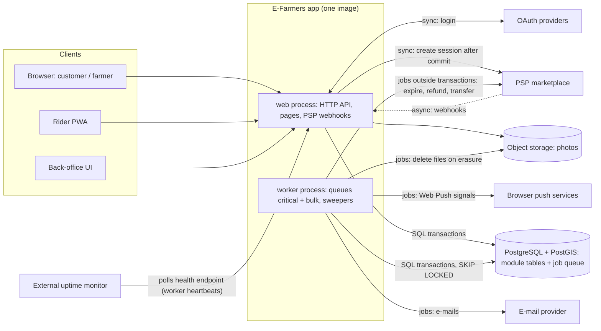
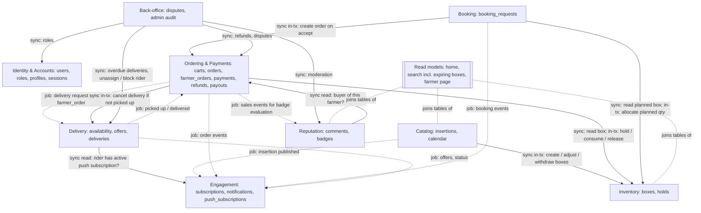

# ADR-001: Architecture style of E-Farmers – Modular monolith

| | |
|---|---|
| **Status** | Accepted |
| **Date** | 2026-10-29 |
| **Deciders** | Filip |
| **Consulted** | AI coding assistant (Claude) |
| **Source** | [Architecture discussion notes](NOTES.md) – IDs below link to them |

> **TL;DR.** E-Farmers will be built as a **modular monolith**: one codebase run as a `web` and a `worker` process on one managed
> EU PostgreSQL that also holds the job queue. It is the only option rated Strong on all three top drivers – correctness of money and
> stock, operability for 3–4 developers without ops, and security by construction; it loses only on time to MVP to a BaaS.
> Revisit when several teams need independent releases or when live GPS tracking of riders nationwide is introduced.

## Context and problem statement
- Marketplace connecting local farmers with customers: farmers publish insertions with boxes (finite quantity, expiry date), customers
  buy from a cart or book seasonal products from a calendar, independent riders deliver.
- Roles are cumulative on one account: customer, + farmer, + rider ([R1](NOTES.md#r1)); a minimal back-office is an implicit
  requirement ([R6](NOTES.md#r6)).
- Integrations: PSP with a marketplace/connected-accounts model (payments, webhooks, refunds, transfers), OAuth providers, e-mail
  provider, browser push services (Web Push/VAPID), object storage for photos ([A1.6](NOTES.md#a1-6)); an external uptime monitor
  ([A3.6](NOTES.md#a3-6), [C2](NOTES.md#c2)).
- GDPR applies because the operator is established in the EU (Art. 3(1)) – not legal advice, verify ([R4](NOTES.md#r4)).

**Question:** which architecture style lets a small team implement E-Farmers so that money and stock stay correct?

### Requirements that shaped the decision
| Requirements / user stories | What makes them hard | Driver |
|---|---|---|
| US 11, 14, 16, 31 – boxes in carts, expiring | two customers buy the last box; holds vs. expiry ([R3](NOTES.md#r3), [A1.2](NOTES.md#a1-2)) | D1 |
| US 16, 17 – multi-farmer checkout and payment | PSP webhooks as truth, late payments, refunds, payouts per responsible party ([A1.7](NOTES.md#a1-7), [A1.8](NOTES.md#a1-8)) | D1 |
| US 18, 21, 32 – booking with farmer approval | human approval, deadlines, paid only after acceptance ([A1.3](NOTES.md#a1-3)) | D1, D2 |
| US 26, 27, 34 – rider offers and delivery | two riders claim one delivery, capacity per rider, no-shows ([A1.15](NOTES.md#a1-15)) | D1 |
| US 19, 35, 36 – subscriptions, notification centre | fan-out to all subscribers of a farmer, unsubscribe race, retries without duplicates; bursts compete with checkout ([A1.5](NOTES.md#a1-5), [A1.17](NOTES.md#a1-17)) | D2 → `bulk` queue, Engagement extracted first |
| US 1, 12, 24, 29 – e-mail/OAuth login, role upgrades | stale roles, account pre-hijacking ([A1.16](NOTES.md#a1-16)) | D3 |
| Implicit back-office, team without ops | stuck states, timers, alerts at night ([A1.14](NOTES.md#a1-14), [A2.8](NOTES.md#a2-8)) | D2 |

### Assumptions
**Valid only while these hold – if one breaks, revisit.** All confirmed by the user ([C0](NOTES.md#c0)).
1. Team of 3–4 full-stack developers, no dedicated ops.
2. MVP in ~4 months; infra budget in the order of tens of EUR/month [unverified range].
3. One EU country (Slovakia), EUR.
4. ~5 000 customers, 100–300 farmers, 30–80 riders; peaks of tens of requests/s; growth to a few regions in 2–3 years
   ([R4](NOTES.md#r4), A4).
5. Search by distance; delivery within a radius of the farm.
6. Responsive web + rider PWA; Web Push is only a signal, offers are durable ([A6′](NOTES.md#r4)).
7. PSP connected-accounts model; P1 cart paid at checkout, P2 booking paid within 24 h after acceptance; cards/wallets only in MVP.
8. Independent riders, broadcast offers, first claim wins; one delivery per farmer_order with its own rider and fee.
9. Payouts by responsibility: farmer at handover, rider at delivery; booking horizon ≤ 60 days.

## Decision drivers (in priority order)
Definitions: [C0.2](NOTES.md#c0-2).
- **D1 Correctness of money and stock** – no oversell, no double/lost payment, refund or payout, no double assignment, also under
  crashes, retries, duplicates and reordering.
- **D2 Operability for 3–4 developers without ops** – (a) things to operate, (b) whether failures surface loudly or silently,
  (c) testability and debuggability of the core logic, (d) handling stuck states without a night shift.
- **D3 Security and privacy by construction** – default-safe authorization, immediate revocation, number of stores with personal data.
- **D4 Time to MVP.**
- **D5 Cost** (relative infra + people).
- **D6 Evolvability and exit** – lowest priority: matters in 2–3 years, not for the MVP.
- Not a driver: raw scalability – the expected load is far below the single-box limit ([A1.19](NOTES.md#a1-19)).

## Considered options
- **A1 Modular monolith** – one deployable (web + worker), one PostgreSQL with module-owned tables and an in-DB job queue ([A1.1](NOTES.md#a1-1)).
- **A2 Event-driven microservices** – Identity, Catalog, Commerce (inventory + ordering + booking), Payments, Delivery, Engagement + BFF,
  managed broker, outbox, sagas ([A2.1](NOTES.md#a2-1), [A2.7](NOTES.md#a2-7)).
- **A3 Serverless / BaaS** (reference: Supabase) – Postgres with RLS, RPCs and Edge Functions; hardened: only schema `api` exposed,
  checkout RPC for the service role only, roles read from a table ([A3.1](NOTES.md#a3-1), [A3 decisions](NOTES.md#a3-r1-user)).

### Comparison
| Driver | A1 Modular monolith | A2 Microservices | A3 Serverless / BaaS |
|---|---|---|---|
| **D1** Money & stock | **Strong** – each invariant is one conditional statement in one transaction ([A1.2](NOTES.md#a1-2), [A1.15](NOTES.md#a1-15)) | **Acceptable** – needs ask-the-owner protocols, tombstones and a payout ledger at every cross-service decision ([A2.9](NOTES.md#a2-9)–[A2.11](NOTES.md#a2-11)) | **Strong** – the same SQL invariants in one DB ([A3.1](NOTES.md#a3-1)) |
| **D2** Operability | **Strong** – 2 process types + 1 DB; a crashed worker is visible; core logic in app code, tested with an injected clock ([A1.4](NOTES.md#a1-4), [A1.6](NOTES.md#a1-6)) | **Weak** – 7 deployables, broker as a single point of failure, sagas to debug, event schema evolution ([A2.6](NOTES.md#a2-6), [A2.12](NOTES.md#a2-12), [A2.14](NOTES.md#a2-14), [A2.15](NOTES.md#a2-15)) | **Acceptable** – fewest things to run, but cron/pg_net/Edge failures are silent, logic in PL/pgSQL, partial batches at function limits, any client can load the only DB ([A3.6](NOTES.md#a3-6), [A3.7](NOTES.md#a3-7), [A3.9](NOTES.md#a3-9), [A3.5](NOTES.md#a3-5)) |
| **D3** Security & privacy | **Strong** – server-side sessions, roles read per request, ownership in queries, one store ([A1.5](NOTES.md#a1-5), [A1.18](NOTES.md#a1-18)) | **Acceptable** – JWT snapshots need deny-lists, authorization in 6 services, erasure fan-out ([A2.13](NOTES.md#a2-13), [A2.5](NOTES.md#a2-5)) | **Acceptable** – permissive defaults closed by schema layout and CI guards; service-role IDOR risk ([A3.2](NOTES.md#a3-2), [A3.8](NOTES.md#a3-8)) |
| **D4** Time to MVP ([C1](NOTES.md#c1)) | **Acceptable** – auth, push, back-office built with standard libraries | **Weak** – platform work (broker, outbox, contracts, tracing) before features | **Strong** – auth, OAuth, CRUD, realtime, storage ready; the core RPCs are the same work as in A1 ([A3.4](NOTES.md#a3-4)) |
| **D5** Cost (estimate 2026-10-29, [C1](NOTES.md#c1)) | **Strong** – ×1 infra, 3–4 developers | **Weak** – ×3–5 infra [unverified], realistically 6–10 developers | **Strong** – ≈ ×1–1.5 infra [unverified], 3–4 developers strong in SQL |
| **D6** Evolvability & exit | **Strong** – container + Postgres, extraction path ([A1.20](NOTES.md#a1-20)) | **Strong** – ready for several teams; exit to a monolith feasible | **Acceptable** – Auth/Realtime/Storage sticky, exit weeks–months ([A3-final](NOTES.md#a3-final)) |

**Reading the table:** ratings are not added; compare driver by driver in priority order, the first difference decides.
A1 beats A2 at **D1** and A3 at **D2**. Sensitivity ([C1](NOTES.md#c1)): swapping D2 and D3 does not change the winner (A1 then wins at D3);
the result depends on the **broad D2 definition** (with only "things to operate" ranked above D3, A3 would win) and on **D1 ranking above
D4** (with time to MVP first, A3 would win).

## Decision outcome
**Chosen option: A1 – Modular monolith** on a managed EU PostgreSQL; the hosting provider is a separate choice ([H1](NOTES.md#h1), H-c).

What the decision includes ([C2](NOTES.md#c2)):
- **Processes:** one image → `web` (≥ 2 replicas) and `worker` (1–2 replicas) with two job queues, `critical` (payment/order/delivery
  transitions) and `bulk` (fan-out, push, e-mail, badges); separate DB roles/pools for web and worker with `statement_timeout`,
  `lock_timeout`, `idle_in_transaction_session_timeout` ([A1.17](NOTES.md#a1-17), [A1.11](NOTES.md#a1-11)).
- **Stores:** one PostgreSQL with PostGIS, full-text search and the job queue; object storage for photos; no broker, no cache, no search
  cluster in MVP ([A1.6](NOTES.md#a1-6)).
- **Modules:** Identity & Accounts, Catalog, Inventory, Ordering & Payments, Booking, Delivery, Engagement, Reputation, Back-office.
- **Key rules** (quoted from the notes):
  - "a module writes only its own tables; others call its public interface (in-process)"; "cross-module joins only in dedicated read
    models (home page, farmer page)" – *extended by this ADR (v2) to the search read model incl. expiring boxes, see the module view; recorded as [A1.1-C1](NOTES.md#a1-1-c1)*;
    enforced by architecture tests in CI ([A1.1](NOTES.md#a1-1)).
  - "*synchronous in-process call* when the caller needs the result inside the same transaction"; "*asynchronous job* enqueued **in the
    same DB transaction** for side effects" ([A1.1](NOTES.md#a1-1)).
  - Network calls: "Never inside a DB transaction; claim → call → apply terminal fact; PSP session after commit with
    `Idempotency-Key = order_id`" ([C3](NOTES.md#c3), [A1.11](NOTES.md#a1-11), [A1.2-C3](NOTES.md#a1-2-c3)).
  - Releasing stock (made precise in v2 – the original C3 wording covered only stock tied to a PSP session; recorded as
    [C3-C1](NOTES.md#c3-c1)):
    - stock held for an order whose PSP session exists or **may exist** (created, or creation outcome unknown): "Only after a terminal
      PSP fact (`expired`/`complete`); never on our own clock or on a timeout" ([C3](NOTES.md#c3), [A1.8](NOTES.md#a1-8)); unknown
      creation outcome → "retry creation with the same `Idempotency-Key = order_id`" and "never release an `awaiting_session` order whose
      creation outcome is unknown" ([A1.2-C3](NOTES.md#a1-2-c3));
    - stock held **without** a PSP session: released by the domain rule – session creation "failed with a definite error → release holds"
      ([A1.2-C3](NOTES.md#a1-2-c3)); accepted booking "unpaid at deadline → sweeper: order expired, planned qty returned"
      ([A1.3](NOTES.md#a1-3)).
  - "Money and stock are decided by the owner of the fact over its authoritative state, atomically; read models only for display"
    ([C3](NOTES.md#c3), [A2 Round 2](NOTES.md#a2-r2-user)).
  - Server-side sessions; roles read per request from `user_roles` ([A1.5](NOTES.md#a1-5)).
  - Heartbeats for every worker type ([C2](NOTES.md#c2), lesson from [A3.6](NOTES.md#a3-6)).

#### Deployment view – processes, stores and all external integrations

#### Module view – owned data and allowed dependencies

Legend: solid arrow = synchronous in-process call through the target's public interface (labelled "in-tx" when inside the caller's
transaction); dashed arrow = job enqueued in the same transaction; dotted line from *Read models* = deliberate cross-module join.
**Allowed but undrawn:** every module may call Identity's public interface for authentication, roles and profiles (incl. addresses
under its own access rules). **Read-model exception:** cross-module joins only in the read models for the home page, **search incl. the
expiring-boxes list (US 8, 11)** and the farmer page – *changed by this ADR (v2, user's request): [A1.1](NOTES.md#a1-1) names only the
home page and farmer page; search needs box availability and expiry from Inventory*. **Erasure:** Identity may enqueue an `erase_user`
job that every module handles for its own data (pseudonymise, delete, files) – *added by this ADR (v3, user's request), derived from
[A1.18](NOTES.md#a1-18)*. **Any other undrawn dependency is forbidden.**
Arrows not drawn in the notes are derived from their flows; sources and the walk-through of all 36 user stories:
[NOTES_ADR.md](NOTES_ADR.md#v2).

### Consequences
**Positive** (beyond the comparison): no transactional outbox is needed because the queue is in the same database
([A1.1](NOTES.md#a1-1)); a growth path exists – Engagement can be extracted first because it already only consumes jobs
([A1.20](NOTES.md#a1-20)).

**Negative, risks and mitigations** ([A1 final assessment](NOTES.md#a1-final))

| Negative / risk | Mitigation |
|---|---|
| Support load from exceptional states (not fulfilled, overdue deliveries, claims, reversals) | Minimal back-office from day one, daily PSP reconciliation, automatic remediation only by re-sending the same intent or applying a terminal fact ([A2.8](NOTES.md#a2-8)) |
| Noisy neighbour on the shared DB and worker | `critical`/`bulk` queues, separate pools, batches of ~500 rows ([A1.17](NOTES.md#a1-17)) |
| One deployable – a bad deploy affects everything | ≥ 2 web replicas, health checks, one-click rollback, feature flags ([A1.17](NOTES.md#a1-17)) |
| Migrations lock busy tables at peak | Expand/contract, `CREATE INDEX CONCURRENTLY`, `lock_timeout` ≈ 2 s, no deploys at the weekend-morning peak ([A1.17](NOTES.md#a1-17)) |
| Table growth (notifications, PSP events, finished jobs) | Retention and partitioning policies ([A1-final](NOTES.md#a1-final)) |
| PSP coupling: rate limit shared with checkouts, model hard to change | Shared token bucket with priorities, circuit breaker ([A1.12](NOTES.md#a1-12)); switching PSP = re-onboarding farmers (accepted) |
| Rider Web Push unreliable on iOS | Push only as a signal, durable offers with re-offer; exit: native wrapper or SMS ([A6′](NOTES.md#r4)) |

### Confirmation
| # | Check | Proves |
|---|---|---|
| 1 | Architecture test in CI: module packages depend only along the module view and its legend rules; no module writes another module's tables | boundaries hold ([A1.1](NOTES.md#a1-1)) |
| 2 | Concurrency test: N parallel checkouts on a box with quantity k → **exactly k** succeed, `qty_available = 0`; multi-box checkouts locking boxes in opposite cart order → **zero** deadlocks | no oversell, global lock order ([A1.2](NOTES.md#a1-2)) |
| 3 | Concurrency test: parallel claims by one rider with `max_active = 3` → **exactly 3** active deliveries | no write skew ([A1.15](NOTES.md#a1-15)) |
| 4 | Race test: `payment_succeeded` and hold expiry processed concurrently → order is either `paid` with consumed holds or handled by the `expired` branch; never `paid` with stock back on sale | order-row lock ([A1 Round 1](NOTES.md#a1-r1-user)) |
| 5 | Duplicate-webhook test in state `cancelled` → **exactly one** refund row and one PSP refund call | refund guards ([A1.9](NOTES.md#a1-9)) |
| 6 | Sweeper tests with an injected clock, each sweeper run twice → same final state | safe re-runs ([A1.4](NOTES.md#a1-4)) |
| 7 | Load test of the checkout path on one box | headroom over assumption 4 – target to be defined (Open question 4) ([A1.19](NOTES.md#a1-19)) |
| 8 | Heartbeat check per worker type + external uptime monitor | no silent stop of background work ([C2](NOTES.md#c2)) |
| 9 | Negative authorization tests for every endpoint taking a resource id: another user's resource → **404**; comment without a handed-over purchase from that farmer → rejected | ownership enforced in queries ([A1.5](NOTES.md#a1-5)) |
| 10 | Revocation test: remove a role (or block a user) → the **next** request with the same session is denied | roles read per request ([A1.5](NOTES.md#a1-5)) |
| 11 | OAuth linking tests: OAuth login matching an unverified password account → password removed, all sessions revoked; unverified ↔ verified never auto-linked | no pre-account takeover ([A1.16](NOTES.md#a1-16)) |
| 12 | PSP, e-mail and push clients in tests **fail if a DB transaction is open** on the calling connection | no network call inside a transaction ([A1.11](NOTES.md#a1-11)) |

### When to revisit
| Trigger | Re-evaluate towards |
|---|---|
| Several teams with independent release cadences (breaks assumption 1) | Extract services along the A2 boundaries, Engagement first ([A1.20](NOTES.md#a1-20)) |
| Nationwide rollout with live GPS tracking of riders (breaks 4 and 8) | Extract Delivery / location tracking with its own store ([A2 Round 3](NOTES.md#a2-r3-user)) |
| Time to market dominates – prototype to validate demand, team strong in SQL (changes 2) | A3 Serverless / BaaS ([C0.1](NOTES.md#c0-1)) |
| Team shrinks to 1–2 people (breaks 1) | A3, or A1 on a fully managed PaaS ([C2](NOTES.md#c2)) |
| Load × 100 with heavy contention on single boxes (breaks 4) | Stay A1: bucketed stock rows, read replica ([A1.19](NOTES.md#a1-19)) |
| Regulation or the PSP requires isolating payment handling (changes 7, 9) | Extract Payments with the [A2.9](NOTES.md#a2-9)/[A2.11](NOTES.md#a2-11) protocols |

## Why the other options were rejected
- **A2 Microservices** – loses at D1: every cross-service money decision needs extra protocols, and it pays for team and scaling benefits
  the system does not need ([A2-final](NOTES.md#a2-final)).
- **A3 Serverless / BaaS** – runner-up; loses at D2: it saves operations but not design work and protects money/stock by configuration
  ([H1](NOTES.md#h1), [A3-final](NOTES.md#a3-final)).
- **H-b: A1 + managed Auth** – loses A1's immediate revocation and leaves OAuth linking to the provider ([H1](NOTES.md#h1)).
- **H-d: A1 + workflow engine** – one more stateful deployable for a flow that is already a DB state machine ([H1](NOTES.md#h1)).

## Related decisions (should get their own ADRs)
Status: agreed in the notes, ADRs not written yet. Full list: [C3](NOTES.md#c3).

| Proposed ADR | Already agreed | Source |
|---|---|---|
| Stock reservation | Hold at checkout with TTL derived from the PSP session lifetime; stock changed only as a delta; withdraw instead of delete | [R6](NOTES.md#r6), [A1.2](NOTES.md#a1-2), [A1.13](NOTES.md#a1-13) |
| Payment truth and refunds | PSP webhook is the source of truth; state transition + PSP idempotency key as two guards | [A1.2](NOTES.md#a1-2), [A1.9](NOTES.md#a1-9) |
| Payment flows and payouts | P1/P2 flows, cards/wallets only in MVP, payouts by responsibility, holding < 90 days | [A1.3](NOTES.md#a1-3), [A1.7](NOTES.md#a1-7), [A1.10](NOTES.md#a1-10) |
| Stuck states and alerting | Automatic remediation only by re-sending or applying a terminal fact; page only for "charged but not confirmed" | [A2.8](NOTES.md#a2-8) |
| Fulfilment and rider assignment | Handover and overdue-delivery timers; delivery per farmer_order; rider-row lock, no self-dealing, two-party codes | [A1.14](NOTES.md#a1-14), [A1.15](NOTES.md#a1-15) |
| Identity and OAuth linking | Verified e-mail before use; auto-link only verified↔verified | [A1.16](NOTES.md#a1-16) |
| Notifications and rider client | Push as a signal; per-recipient idempotency, never duplicates | [A3.7](NOTES.md#a3-7), [A6′](NOTES.md#r4) |
| Privacy and erasure | Pseudonymisation, deletion of identities and files, blocked while orders are open | [A1.18](NOTES.md#a1-18) |

## Open questions
None of these changes this decision; full list in [C4](NOTES.md#c4).
1. Whether the PSP connected-accounts model with event-tied release keeps the operator outside payment-services licensing – not legal
   advice, verify.
2. Accounting retention period for order and payment records – verify.
3. Choice of the Postgres hosting provider (price, EU region, PITR, DPA) and of the job-queue library.
4. Target for the checkout load test (Confirmation #7) and product values: minimal fulfilment lead, handover windows, maximum transit
   time, rider capacity.
5. Customer cancellation policy, customer not at home, compensation for prepared perishables.
6. How coordinates for distance search and delivery radius (assumption 5) are created: geocoding through a provider (cost per request;
   addresses go to another processor → DPA, region) or a map pin set by the user (map-tiles provider, UX effort). Not in the notes; added
   in v2 at the user's request.

*Format: MADR with additions (TL;DR, assumptions, revisit table, related decisions). Links point to the discussion notes.*
