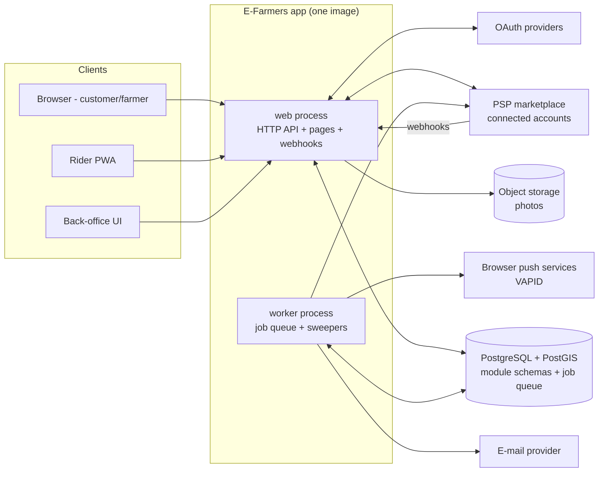
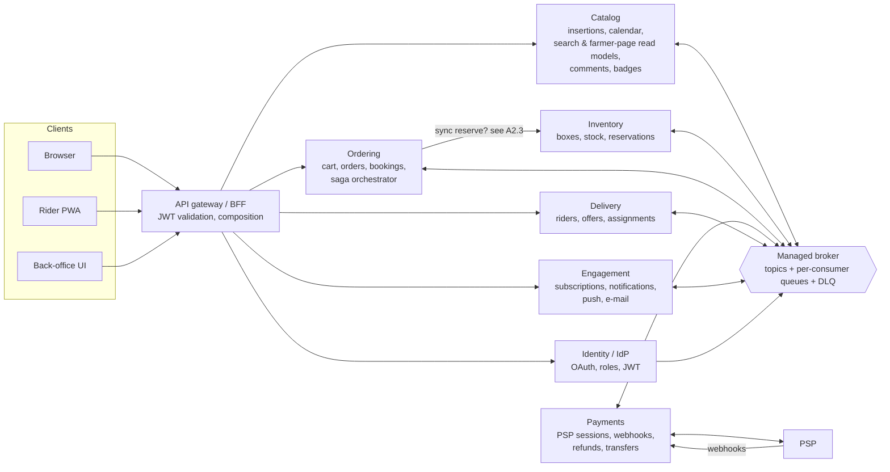
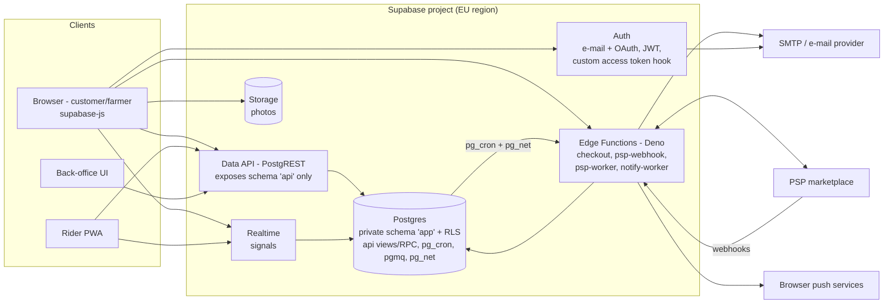

# E-Farmers – Architecture discussion notes

Running notes from the discussion between Filip and the coding assistant. Not a 1:1 transcript –
proposals, questions, answers, decisions and corrections.

Source requirements: [EFarmers.txt](../../Tasks/data/EFarmers.txt)

**How to read:** items have stable IDs – `R<n>` requirements analysis, `A<k>.<n>` architecture k,
`H<n>` runner-up/hybrid critique, `C<n>` comparison. **Decision:** = agreed; **Correction:** = an earlier
statement was wrong (says what and who found it); *(superseded → ID)* = replaced by a later item.

**Contents**
- [Run log](#run-log)
- [0. Requirements analysis](#r1) – R1 actors, R2 lifecycles, R3 hard spots, R4 assumptions, R5 candidate styles, R6 decisions, R2-C1
- [Architecture 1 – Modular monolith](#a1-1) – A1.1–A1.6 big picture, A1.7–A1.12 payouts/PSP follow-ups, A1.13–A1.18 failures,
  A1.19–A1.20 hot row & extraction, [final assessment](#a1-final)
- [Architecture 2 – Event-driven microservices](#a2-1) – A2.1–A2.6 big picture, A2.7 Commerce merge, A2.8 safe automatic actions,
  A2.9–A2.15 failures, [final assessment](#a2-final)
- [Architecture 3 – Serverless / BaaS](#a3-1) – A3.1–A3.4 big picture, A3.5–A3.10 failures, [final assessment](#a3-final)
- [Comparison & conclusion](#h1) – [H1 runner-up & hybrids](#h1), [C0 assumptions & drivers](#c0), [C1 table & rule check](#c1),
  [C2 recommendation](#c2), [C3 architecture-independent decisions](#c3), [C4 open questions](#c4)

**Result in one line:** Architecture 1 (modular monolith) recommended – wins at D1 over A2 and at D2 over A3; robust to swapping D2/D3,
depends on the broad D2 definition and on correctness ranking above time to MVP (C1).

---

<a id="run-log"></a>
## Run log
| Field | Value |
|---|---|
| Skill | architecture-exploration |
| Start | 2026-10-29 01:39 |
| End | 2026-10-29 15:22 |
| Mode | normal (deep, round-based – confirmed by user) |
| User prompts (total) | 15 |
| Rounds | Setup 1, Phase 1 1, A1 3 (+ 3 follow-ups), A2 3, A3 3, Phase 3 2 |
| Corrections | 7 – found by user 4 (R2-C1, A1.2-C1, A1.2-C2, A1.8-C1), found by assistant 3 (A1.4-C1, A1.2-C3, A3.1-C1) |
| Web-verified facts | iOS Web Push, Stripe Checkout expiry/expire, Stripe Connect holding period, Stripe rate limits, SEPA DD timing/disputes, Supabase Edge limits, RLS defaults/performance, pg_cron+pg_net, pgmq, Realtime guidance |

**Whole run (exploration + ADR) – summary, closed 2026-10-29 16:08**
| Item | Value |
|---|---|
| Run end | 2026-10-29 16:08 |
| User prompts – Task 1 (architecture exploration, this file) | 15 |
| User prompts – Task 2 (ADR, [NOTES_ADR.md](NOTES_ADR.md)) | 4 |
| User prompts – total | 19 |
| Corrections in these notes | 9 – found by the user 6 (R2-C1, A1.2-C1, A1.2-C2, A1.8-C1, and from the ADR review A1.1-C1, C3-C1), found by the assistant 3 (A1.4-C1, A1.2-C3, A3.1-C1) |
| ADR versions | 3 (v1 draft, v2 after review, v3 Accepted 2026-10-29) |
| ADR findings caught by the self-review | 8 (5 in v1, 3 during the full walk-through in v2) |
| ADR findings from the user's review | 7 – 6 real (stock-release rule too broad, 4 missing module flows, missing deployment edges, no checks for D3 / no-network rule, notifications missing in requirements, geocoding open question), 1 had a source (assumption 4 in R4) |
| ADR file | [ADR-001-architecture-style.md](ADR-001-architecture-style.md) – Accepted, both diagrams verified in mermaid.live by the user |
| Proposed skill improvements | see [NOTES_ADR.md – Final summary](NOTES_ADR.md#v3) (K4/K5/K6 changes, new K19–K21, back-porting corrections) and Run log column "Requested by the user beyond the skill's plan" |

**Setup answers (user):** 3 different styles + a hybrid only if the discussion shows it makes sense;
deep mode with understanding checks (no fast mode); no constraints given → assistant proposes
assumptions with their architectural impact, user confirms; notes in English, chat in Slovak.

| # | Time | Phase / architecture / round | Topics covered | User prompts | Requested by the user beyond the skill's plan | Corrections |
|---|---|---|---|---|---|---|
| 1 | 01:39 | Setup | Requirements read, notes created, setup questions asked | 1 | – | – |
| 2 | 08:55 | Phase 1 – requirements analysis | Actors, domain lifecycles, hard spots, assumptions with impact, candidate styles | 1 | Impact of each assumption on the architecture choice (skill asks only for confirmation of assumptions) | – |
| 3 | 09:00 | Phase 1 answers + Architecture 1 / Round 1 | A6 iOS push verified, two payment flows, booking quantity, refund triggers; modular monolith big picture, holds, webhook state machine, booking, timers, rider claim, deployables | 1 | (a) two payment flows written explicitly, (b) iOS web-push limits for riders, (c) whether an accepted booking blocks quantity, (d) inconsistency about refunds | 1 (R2-C1, found by user) |
| 4 | 09:08 | Architecture 1 / Round 1 follow-up | Payout timing vs. responsibility and A7, PSP holding limit, early hold release vs. late webhook, double refund guard | 1 | (a) fairness of payout timing and its conflict with A7 + PSP holding limit, (b) hold released by own clock before a last-second payment, (c) proof that a duplicate webhook cannot create two refunds | 2 (A1.2-C1, A1.2-C2, both found by user) |
| 5 | 09:13 | Architecture 1 / Round 1 follow-up 2 | Delayed methods for P2 (SEPA DD), network call inside DB transaction, PSP rate limit after outage | 1 | (a) delayed methods for P2, (b) PSP calls inside a DB transaction holding the order lock, (c) rate limit on recovery burst | 1 (A1.8-C1, found by user) |
| 6 | 09:26 | Architecture 1 / Round 2 – failure scenarios | Box edits under holds, missing handover/delivery timers, rider fraud & capacity, OAuth pre-account takeover, noisy neighbour & migrations, GDPR erasure | 1 | Excluding already covered PSP scenarios (user steered focus) | 1 (A1.4-C1, found by assistant) |
| 7 | 11:46 | Architecture 1 / Round 2 follow-up + Round 3 – final assessment | Hot-row throughput, first module to extract, PSP session creation after commit; final assessment | 1 | Short deep-dives into two listed-only topics (hot row, extraction order) | 1 (A1.2-C3, found by assistant) |
| 8 | 13:25 | Architecture 2 / Round 1 – big picture | Service boundaries & data ownership, broker/outbox/inbox, checkout saga with reservation states and tombstones, timers ownership, where eventual consistency is felt, deployables | 1 | Focus only on what differs from the monolith (user steered scope) | – |
| 9 | 13:51 | Architecture 2 / Round 2 – failure scenarios | Commerce merge, who handles stuck-saga alerts without ops (safe automatic actions), cancel-by-asking-the-owner (Payments, Delivery), broker outage, payout reversal ordering, JWT revocation, schema evolution, composition/debugging | 1 | Who handles alerts at night with no ops person; safe automatic actions for stuck states | – |
| 10 | 13:57 | Architecture 2 / Round 3 – final assessment | Strengths, weaknesses, 1-year risks, cost, lock-in, compliance, devil's advocate, verdict | 1 | – | – |
| 11 | 14:03 | Architecture 3 / Round 1 – big picture | Where invariants live (RPC vs. Edge Functions), security model when the client talks to the DB, timers and webhooks without a long-running process, deployables | 1 | Focus on what is new; patterns only located, not repeated (user steered scope) | – |
| 12 | 14:44 | Architecture 3 / Round 2 – failure scenarios | Query-cost DoS through the Data API and RLS cost, silent timer death, Edge CPU limit mid-batch, service-role IDOR, testing SQL logic, Realtime leaks/missed signals | 1 | – | 1 (A3.1-C1 self-found in Round 1, resolved by user decision) |
| 13 | 15:15 | Architecture 3 / Round 3 – final assessment | Strengths, weaknesses, 1-year risks, cost, lock-in, compliance, devil's advocate, verdict; hybrid candidate named for Phase 3 | 1 | – | – |
| 14 | 15:16 | Phase 3 / Round 1 – runner-up and hybrid critique, drivers proposal | H1 (A3 as runner-up, 4 hybrids), C0 assumptions + proposed driver order | 1 | – | – |
| 15 | 15:22 | Phase 3 / Round 2 + Phase 4 – comparison, recommendation, hygiene | C0.2 driver definitions, C1 table + rule check + sensitivity tests, C2–C4, contents, run log closed | 1 | (a) precise definition of D2 (which parts count), (b) sensitivity test for swapping D2/D3 – the skill does not prescribe sensitivity tests | – |
| 16 | 16:01 | After the ADR review (ADR-001 v2/v3) | Corrections A1.1-C1 and C3-C1 written back from the ADR review | – (ADR session) | User asked to record ADR-review corrections in the notes with history | 2 (A1.1-C1, C3-C1, found by user in the ADR review) |

---

## 0. Requirements analysis

<a id="r1"></a>
**R1 – Actors / roles**
- **Visitor** (anonymous): browse home, search insertions (US 5, 8), register by e-mail or OAuth (US 1, 29).
- **Customer**: default role of every registered account – cart, orders, payment, booking from the
  calendar, subscriptions, comments, notification centre (US 14–20, 22, 23, 27, 33, 35, 36).
- **Farmer**: role *added* to a customer account (US 12) – insertions, boxes, accept/decline bookings,
  badges (US 4, 9, 10, 21, 28, 31).
- **Rider**: role *added* to a customer account (US 24) – availability, delivery requests, delivery page,
  delivery status (US 25, 26, 34).
- Roles are **cumulative on one account** (one person can be customer + farmer + rider) → a farmer may
  try to buy from himself, a rider may deliver his own order (policy question, open).
- **Missing actor: platform operator / admin.** No story covers disputes, refunds, approval of farmer
  or rider upgrades, badge rules, moderation of comments. Treated as a gap (H15).

<a id="r2"></a>
**R2 – Domain concepts and lifecycles** (interpretation – see open question Q-R2)
- **Insertion** (farmer's offer of a product, US 4, 9, 10): published → modified → deleted.
  Deletion must not break carts/orders/bookings that reference it → soft delete / snapshot in orders.
- **Box** (sellable unit on an insertion, US 31; has an expiry, US 11; goes to cart, US 14–15):
  proposed interpretation = a *batch* with quantity N and an expiry date.
  available → (partially) reserved → sold out | expired | withdrawn.
- **Cart** (US 14, 15, 33) → **Order** (US 16): created → payment pending → paid → being fulfilled →
  ready for pickup / out for delivery → delivered | cancelled | refunded. A cart may contain boxes of
  several farmers → order probably splits into per-farmer parts.
- **Payment** (US 17): pending → succeeded | failed | expired → (partially) refunded.
- **Booking request** from the seasonal calendar (US 7, 18, 21, 32): requested → accepted | declined |
  expired (farmer silent) | cancelled (customer) → after acceptance: becomes an order? paid when?
- **Delivery** (US 26, 27, 34): requested → offered to available riders → assigned → picked up →
  delivered | failed | unassigned (no rider).
- **Subscription** (US 19, 20, 35), **Notification** unread → read (US 36), **Comment** (only buyers,
  US 23), **Badge** (rules undefined, US 28), **Seasonal calendar** (reference data, US 7).

<a id="r3"></a>
**R3 – Hard spots** (category → user stories)
| Category | Applies? | Stories | Why |
|---|---|---|---|
| H1 Contended limited resources | yes (moderate) | 11, 14, 16, 31 | Boxes are finite and expire; two customers can buy the last box. When to reserve: add-to-cart vs. checkout. |
| H2 Money flows | **yes – critical** | 17, 16, 27 | Multi-seller marketplace: one payment for boxes of several farmers (+ delivery fee for a rider?). Platform holding third-party money may require a payment licence (**not legal advice – verify**). Refund when a farmer cannot fulfil. |
| H3 Human approval | yes | 18, 21, 32 (+26) | Farmer accepts/declines booked boxes; deadline and what happens on silence; what is reserved/charged before approval. Rider accepting a delivery request is a second approval. |
| H4 Time-driven behaviour | yes | 11, 18, 21, 26 | Box expiry, cart hold expiry, payment-pending timeout, booking-request deadline, unassigned-delivery timeout, season windows. |
| H5 Fan-out / notifications | yes | 19, 35, 36 | New insertion → all subscribers; in-app centre + e-mail/push; duplicates, unsubscribe race. |
| H6 Assignment / matching | yes | 26, 27, 34 | Available riders receive requests; two riders claim one delivery; nobody claims; rider never shows. |
| H7 Multi-role identity & OAuth | yes | 1, 12, 24, 29, 2, 3 | Roles added at runtime (stale roles in tokens); account linking e-mail ↔ OAuth (verified e-mail only). |
| H8 Ownership-based authorization | yes | 9, 10, 31, 23, 34, 6, 30 | Only owner edits insertions/boxes; only buyers comment; only assigned rider updates delivery status. |
| H9 Integrations & webhooks | yes | 17, 29, 19, 36 | Payment gateway webhooks, OAuth providers, e-mail/push provider. |
| H10 Search & geo | yes (light) | 8, 7, 13 | Full-text over insertions; "local" implies distance filter – not stated, assumption A5. |
| H11 Realtime UX | light | 36, 26, 32 | Notification badge, rider receiving requests – signal-only is enough, durable state in DB. |
| H12 Personal data & compliance | yes | 1, 6, 27, 30 | Addresses, phone, rider identity, payment data → GDPR. |
| H13 Load profile & scale | low | – | No peaks stated; small local marketplace (assumption A4). |
| H14 Clients & API evolution | light | 25, 26 | Riders on the road → mobile web/PWA assumed. |
| H15 Operations & back-office | **yes – gap** | none | No admin stories, but refunds, stuck orders, role approval and reconciliation are needed. |

<a id="r4"></a>
**R4 – Assumptions** (status: **proposed**, waiting for user confirmation) – each with its impact on the style choice
| ID | Assumption | Impact on architecture |
|---|---|---|
| A1 | **Team**: 3–4 full-stack developers, one main language, nobody dedicated to ops. | Every extra deployable/broker/pipeline costs a big share of the team → strongly favours few deployables and managed services; microservices need ownership the team does not have. |
| A2 | **Budget & deadline**: MVP in ~4 months, infra budget in the order of tens of EUR/month [unverified range]. | Rules out self-hosted Kubernetes/brokers; favours one app + managed DB or BaaS. Time-to-MVP is a driver. |
| A3 | **Region**: one EU country (Slovakia), EUR, operator established in the EU → GDPR applies by establishment (Art. 3(1)) – **not legal advice, verify**. | Data and processors in EU region; PSP must support EU marketplaces and SEPA/cards; erasure must cover every store we add (more stores = more work). |
| A4 | **Load**: one region to start – ~5 000 customers, 100–300 farmers, 30–80 riders; peaks tens of requests/s (weekend mornings, popular farmer publishing boxes). Growth to a few regions in 2–3 years. | Scale is **not** a driver; one relational DB is enough. Contention exists only per hot box, not system-wide → solved by DB-level atomicity, not by distributed infrastructure. |
| A5 | **Locality**: search is filtered by distance from the customer; delivery only within a radius of the farm. | Needs geo queries (e.g. PostGIS or a search service) – favours a DB with geo support over adding a separate search cluster. |
| A6 | **Clients**: responsive web; riders use a mobile-friendly web/PWA (push notifications); no native app in MVP. *(amended → A6′)* | No long-lived old clients → API versioning is a minor concern; web push/e-mail integration needed. |
| A6′ | **Amended after user remark:** riders must get offers promptly. Verified: on iOS/iPadOS web push works only from **16.4+** and only for a web app **added to the Home Screen**, permission must be requested from a **user gesture**; occasional reliability problems are reported ([OneSignal](https://documentation.onesignal.com/docs/web-push-for-ios), [Pushpad](https://pushpad.xyz/blog/does-safari-on-ios-support-web-push-notifications/), [9to5mac](https://9to5mac.com/2023/02/16/iphone-web-app-new-features-ios-16-4/)). Home Screen web apps in the EU stayed available after Apple reversed its iOS 17.4 plan ([Engadget](https://www.engadget.com/apple-backtracks-on-plans-to-get-rid-of-web-apps-on-iphones-in-the-eu-195232177.html)). → Rider onboarding requires installing the PWA and granting push; "available" can be switched on only with an active push subscription; push is only a **signal** – offers are durable in the DB and visible on the rider page; offers have a timeout and are re-offered. "Immediately" = within ~1 minute (farm pickups are not second-critical – assumption). | Assumption kept (no native app in MVP), but: offer timeout + re-offer is mandatory (H6); exit plan if the pilot shows unreliable delivery: thin native wrapper around the PWA or SMS fallback for offers (cost [unverified]). Architecture-independent. |
| A7 | **Payments model**: platform is a marketplace facilitator using a PSP's marketplace/split-payout product; the platform itself does **not** hold farmers' money. **Two payment flows (confirmed by user):** **(P1) cart** – customer pays at checkout; **(P2) calendar booking** – no payment at request time, customer pays only **after the farmer accepts**, within a payment deadline. | Avoids own licensing (verify); payment state is driven by PSP webhooks → idempotent webhook handling is mandatory in every option; refund triggers see R2-C1. |
| A8 | **Delivery model**: riders are independent (community/gig); a delivery request is broadcast to available riders near the farm and the first to claim gets it; no route optimisation. | Assignment is a simple atomic claim (H6), not an optimisation engine → no need for a dedicated dispatch service. |

<a id="r5"></a>
**R5 – Candidate styles** (approved by user: **yes**, prompt 3)
1. **Modular monolith** (one deployable + background worker from the same codebase, one PostgreSQL,
   modules Identity, Catalog, Inventory, Ordering & Payment, Booking, Delivery, Notifications,
   Reputation). Fits: box stock, orders and payments need transactional consistency; small team; low load.
2. **Event-driven microservices** (service per bounded context, message broker, checkout/booking/delivery
   as sagas, transactional outbox). Fits: the order lifecycle is a long multi-step workflow across
   contexts with human steps (farmer, rider) and fan-out notifications – the style that models this most
   explicitly; evaluates what distribution costs for those hard spots.
3. **Serverless / BaaS** (managed Postgres with auth + OAuth + row-level security + realtime, edge/cloud
   functions for checkout and webhooks, scheduled functions for timers). Fits: most stories are CRUD +
   auth + notifications that BaaS gives "for free"; minimal ops; tests where the invariants (stock,
   rider claim, payment) live when there is little own server code.
- Considered and not proposed: **event sourcing + CQRS** (no audit/temporal-query requirement that would
  pay for it), **space-based** (no extreme peak, A4), **micro-frontends** (one small team, A1).
- **Hybrid**: likely candidate later = modular monolith + selected managed services (auth, push, search)
  or monolith with a durable workflow engine for the order saga – evaluated only if the discussion
  shows a need.

**Open questions for the user (Phase 1)** – answered in prompt 3
- Q-R2: Box semantics – batch with quantity + expiry (proposed) vs. single physical box; is "book a
  product from the calendar" a pre-order of a future harvest that the farmer must accept, paid only after
  acceptance (proposed)? → **Decision (user):** accepted as proposed.
- Q-R4: confirm / correct assumptions A1–A8. → **Decision (user):** confirmed, with amendments A6′ and
  the explicit two payment flows in A7.

<a id="r6"></a>
**R6 – Answers and decisions after Phase 1 (prompt 3)**
- **Decision (user):** minimal back-office (refunds, disputes, moderation) is an **implicit requirement** (H15).
- **Decision – booking and quantity** (user asked whether an accepted booking blocks quantity):
  a booking refers to a **planned box** – a box on an insertion with `available_from` in the future and a
  *planned* quantity set by the farmer (US 21 speaks of "booked boxes", so the box exists as a plan, the
  harvest does not yet). The **request does not block** anything (same abuse argument as for carts);
  **acceptance atomically decrements** the planned quantity (farmer cannot accept more than planned; to
  sell more he raises the plan). Unpaid accepted booking at its payment deadline → quantity returned.
- **Understanding check (cart reservation) – user's answer correct:** reserve at add-to-cart → A gets the
  box, B sees sold-out; reserve at checkout → B gets it, A finds out at checkout. Add-to-cart holds lock
  stock in abandoned carts, boxes can expire while held, and someone can lock the whole stock on purpose.
  **Decision (user):** hold at checkout with a short limit and check that the box does not expire before
  the limit ends. Assistant's additions: (1) the box must not expire before it can realistically be
  picked up/delivered – rule `expires_at > now() + min_fulfilment_lead` (not only > hold end);
  (2) checkout holds are also abusable → max active holds per user; (3) "short" is bounded from below by
  the PSP: e.g. a Stripe Checkout Session's `expires_at` must be **30 min – 24 h** after creation
  ([Stripe docs](https://docs.stripe.com/payments/checkout/managing-limited-inventory)) → hold TTL is
  derived from the PSP session lifetime (see A1.2), not a generic 10–15 min.

<a id="r2-c1"></a>
**R2-C1 – Correction: when does a refund actually happen?**
- **Correction (found by user):** Phase 1 said "refund when a farmer declines an order". Wrong – accept/decline
  (US 21) applies only to bookings, which are paid **after** acceptance (P2), so a decline never needs a refund.
- Real refund triggers: (1) paid cart order the farmer cannot fulfil (stock in the system ≠ physical stock,
  damaged goods); (2) payment succeeded **after** the hold/order expired and the stock is gone (late webhook,
  A1.2); (3) delivery not possible – no rider within the delivery window or delivery failed → delivery fee or
  whole order; (4) accepted and paid booking whose harvest fails before `available_from`; (5) quality
  dispute decided in back-office; (6) customer cancellation if a cancellation policy allows it (open question).

---

## Architecture 1 – Modular monolith
*(proposed by assistant)*

**Idea.** One codebase, one deployable image run as two process types (web, worker), one managed
PostgreSQL (with PostGIS) that also holds the job queue. Modules are strict internal boundaries with
own tables and a public interface; consistency-critical steps (stock, order, payment state) run in one
local ACID transaction.



### Discussion log

<a id="a1-1"></a>
**A1.1 – Modules, data ownership, communication rule**
| Module | Owns (tables) | Stories |
|---|---|---|
| Identity & Accounts | users, credentials, oauth_identities, user_roles, profiles, sessions | 1, 2, 3, 6, 12, 24, 29, 30 |
| Catalog | insertions, seasonal_calendar, search index columns (tsvector, geo) | 4, 5, 7, 8, 9, 10, 13 |
| Inventory | boxes (qty_planned/qty_available, available_from, expires_at), holds | 11, 31 |
| Ordering & Payments | carts, orders, farmer_orders (per-farmer part), payments, refunds, payouts, psp_events | 14–17, 22, 27, 33 |
| Booking | booking_requests | 18, 21, 32 |
| Delivery | rider_availability, deliveries, delivery_offers | 25, 26, 34 |
| Engagement | subscriptions, notifications, push_subscriptions | 19, 20, 35, 36 |
| Reputation | comments, badges, badge_rules | 23, 28 |
| Back-office | admin actions audit, disputes | implicit (R6) |
- **Ownership rule:** a module writes only its own tables; others call its public interface (in-process).
  Cross-module FKs on IDs allowed; cross-module joins only in dedicated read models (home page, farmer
  page) *(superseded → A1.1-C1)*. Enforced by architecture tests in CI (dependency rules between packages) – otherwise boundaries
  erode (risk for year 1).
- **Communication rule:** *synchronous in-process call* when the caller needs the result inside the same
  transaction (checkout → `Inventory.hold`, booking accept → `Inventory.allocatePlanned`); *asynchronous job*
  enqueued **in the same DB transaction** for side effects (notifications, delivery offers, e-mails, badge
  evaluation, PSP refunds/transfers).
- R1: because the queue lives in the same PostgreSQL, enqueueing is atomic with the business change →
  **no separate transactional outbox is needed** (an outbox would only duplicate the same guarantee).

<a id="a1-1-c1"></a>
**A1.1-C1 – Correction (found by the user in the ADR review, [ADR-001 v2](NOTES_ADR.md#v2)):** the read-model exception named only the
home page and farmer page, but search (US 8) and the expiring-boxes list (US 11) need box availability and expiry from Inventory.
Corrected rule: cross-module joins only in dedicated read models for the **home page, search incl. the expiring-boxes list, and the farmer
page**. Added with ADR-001 v3: Identity may enqueue an `erase_user` job that every module handles for its own data (A1.18).

<a id="a1-2"></a>
**A1.2 – H1 + H2 (flow P1): checkout holds and the payment webhook state machine** (riskiest part)
- Checkout = one transaction: lock the boxes in **ascending box_id** (prevents deadlocks between two
  multi-box checkouts), conditional decrement, all-or-nothing (if any line fails → rollback, show which
  lines are unavailable), create `order(awaiting_payment)`, one `farmer_order` per farmer, holds; then create
  the PSP session **with `expires_at` = hold expiry**.
- **Hold TTL derived from the domain (R4):** `hold_expires_at = now() + PSP minimum session lifetime`
  (Stripe: ≥ 30 min, [docs](https://docs.stripe.com/payments/checkout/managing-limited-inventory)) and the box
  must satisfy `expires_at > hold_expires_at + min_fulfilment_lead` (min lead = time farmer needs to prepare +
  delivery window; product decision). Hold shorter than the session would let a customer pay for released stock.
```sql
-- per line, in ascending box_id order, inside the checkout transaction
UPDATE inventory.boxes
   SET qty_available = qty_available - :qty
 WHERE id = :box_id AND status = 'active'
   AND available_from <= now()
   AND qty_available >= :qty
   AND expires_at > :hold_expires_at + :min_fulfilment_lead
RETURNING id;            -- 0 rows → line unavailable → ROLLBACK whole checkout
```
- **Payment webhook handler** (PSP webhooks are the source of truth, redirect only shows UI):
```text
on payment_succeeded(evt):
  tx:
    store evt in psp_events (unique evt.id)        -- audit/reconciliation, NOT the guard (R1)
    order := SELECT ... FROM orders WHERE id = evt.order_id FOR UPDATE   -- serializes with sweeper
    switch order.state:
      awaiting_payment: holds active→consumed; order→paid; enqueue(farmer notifications, delivery request if chosen)
      expired:          -- sweeper already released holds; stock may be gone
                        try conditional decrement for every line (same SQL, box_id order)
                        all ok → order→paid (consume new holds)
                        any fails → rollback lines; order→refund_pending; enqueue(refund)
      paid | fulfilling | delivered | refund_pending | refunded:  no-op   -- duplicate or second event type
      cancelled:        order→refund_pending; enqueue(refund)
on payment_failed / session_expired(evt): order awaiting_payment → expired via the same release path; else no-op
```
- **Sweeper release** *(release trigger superseded → A1.8: release only after the PSP confirms the session
  is expired)* (states R3): `active → released` returns qty; `consumed` – nothing to return;
  `released` – no-op (conditional update finds 0 rows). Both sweeper and webhook lock the **order row first**,
  so they cannot interleave.
```sql
UPDATE ordering.holds SET state = 'released'
 WHERE order_id = :order_id AND state = 'active'
RETURNING box_id, qty;   -- then: UPDATE inventory.boxes SET qty_available = qty_available + :qty WHERE id = :box_id
```
- R1 check: the `psp_events` uniqueness is **not** what makes duplicates safe – the order state machine is
  (a duplicate finds `paid` and does nothing). The table stays for audit and reconciliation only.
- **Money split (H2):** one charge on the platform's PSP account, then transfers to each farmer's (and rider's)
  connected account per `farmer_order` after fulfilment (picked up/delivered + complaint window)
  *(superseded → A1.7)*. Exact PSP
  product semantics (who is merchant of record, who holds the balance, fees) **[unverified – to verify when
  choosing a PSP]**; licensing **not legal advice – verify**.

<a id="a1-3"></a>
**A1.3 – H3 + flow P2: calendar booking**
- `booking_request`: requested → accepted | declined | expired | cancelled; after accept: awaiting_payment →
  paid | payment_expired.
- Request blocks nothing (R6). **Accept** (farmer) = one transaction: conditional decrement of the planned box
  (`qty_available >= :qty AND status='planned'`), booking → accepted, create `order(awaiting_payment)`, enqueue
  notification with payment link. 0 rows → farmer sees "not enough planned quantity".
- Deadlines (R4, product values to confirm): request deadline = `min(created_at + X, available_from − Y − lead)`
  – after it the farmer cannot accept and the request expires; payment deadline = `min(accepted_at + Y,
  available_from − lead)`. Payment session is created when the customer clicks "pay", with `expires_at`
  ≤ payment deadline (PSP minimum 30 min applies) – P2 does **not** hold a session open for days.
- Unpaid at deadline → sweeper: order expired, planned qty returned (same R3 release states as A1.2).

<a id="a1-4"></a>
**A1.4 – H4: inventory of time-driven behaviour**
| Timer | Trigger | Owner | Action | Safe twice / late? |
|---|---|---|---|---|
| Checkout hold expiry | `holds.expires_at` (= PSP session expiry) | Ordering | order→expired, release holds **only after PSP confirms `expired`** (A1.8) | conditional `state='active'`; PSP unreachable → retry next run, hold kept |
| Box expiry | `boxes.expires_at` | Inventory | **none – derived** in queries (sellable, "expiring boxes" US 11 = `expires_at` within N h) | no job → nothing to run twice |
| Booking request deadline | computed deadline | Booking | requested→expired, notify customer | conditional `state='requested'` |
| Booking payment deadline | computed deadline | Booking/Ordering | order→payment_expired, return planned qty | conditional on state |
| Delivery offer timeout | `delivery_offers.expires_at` | Delivery | re-offer (wider radius) or escalate | conditional `state='offered'` |
| Rider no-show | pickup window end | Delivery | unassign → re-offer, alert back-office | conditional `state='assigned'` |
| Payout release | delivered + complaint window *(superseded → A1.7: farmer at handover, rider at delivery)* | Ordering | create PSP transfer | idempotency key = farmer_order id |
| PSP holding limit guard | payment captured + 90 days − margin (A1.7) | Ordering | alert back-office for any untransferred funds | read-only check |
| Farmer handover deadline *(added → A1.14)* | handover window end + grace | Ordering | farmer_order → not_fulfilled, partial refund, strike, back-office | conditional `state='paid'` |
| Delivery overdue after pickup *(added → A1.14)* | picked_up_at + max transit time | Delivery | back-office case, rider suspended from new offers | conditional `state='picked_up'` |
| Stale rider availability | last activity + N h | Delivery | set unavailable | idempotent |
- **Mechanism:** one sweeper per timer type in the worker, every minute:
  `SELECT … WHERE state = X AND deadline < now() FOR UPDATE SKIP LOCKED LIMIT n`. R5: overlapping sweeper runs
  (or two worker replicas) skip each other's locked rows and conditional updates make re-runs no-ops.
  R1: no per-entity scheduled jobs in addition – they would duplicate the sweeper and go stale when deadlines
  change. Lateness ≤ 1 min is acceptable for all timers (none is second-critical).
- Time testing: deadlines are data; tests set `now` via an injected clock and run the sweeper once.

<a id="a1-5"></a>
**A1.5 – H5–H8 in the monolith**
- **H6 rider claim:** offers broadcast to available riders within radius (A8); claim =
  `UPDATE deliveries SET rider_id=:r, state='assigned' WHERE id=:d AND state='offered' RETURNING id` – 0 rows →
  "already taken". Capacity (max active deliveries per rider) checked in the same transaction with the rider's
  availability row locked. Nobody claims → offer timeout (A1.4). Push is only a signal (A6′).
- **H5 fan-out:** new insertion → one job → paged over subscribers → insert `notifications`
  with `UNIQUE(user_id, source_event_id)` (retry-safe) → per-recipient push/e-mail jobs; subscription re-checked
  at send time (unsubscribe race, US 35). Scale per A4 is trivial (thousands of rows).
- **H7 roles:** server-side sessions; roles read per request from `user_roles` → no stale roles in tokens
  (an advantage of the monolith with sessions). OAuth account linking only if the provider asserts a verified
  e-mail; otherwise a separate account.
- **H8 ownership:** enforced in queries (`WHERE id=:id AND farmer_id=:me`) → 404 for foreign resources;
  comment allowed only if a delivered/picked-up `farmer_order` of that customer with that farmer exists.

<a id="a1-6"></a>
**A1.6 – What we actually deploy**
- 1 container image → **2 process types**: `web` (≥ 2 replicas for zero-downtime deploys), `worker` (1–2 replicas,
  safe by SKIP LOCKED).
- **1 managed PostgreSQL** (PostGIS, full-text search, job queue, EU region), daily backups + PITR.
- **Object storage** for photos; **external**: PSP (marketplace), OAuth providers, e-mail provider, browser push
  services (VAPID – no extra vendor needed).
- 1 CI/CD pipeline, 1 set of migrations. No broker, no search cluster, no cache in MVP (add Redis only if
  measurements require it).

<a id="a1-r1-user"></a>
**Round 1 – user's answers (prompt 4)**
- Understanding check (why lock the order row) – **correct**: without the lock both read `awaiting_payment`;
  sweeper-first → stock back on sale + order overwritten to `paid` → box sold twice; webhook-first → paid order
  overwritten to `expired`, stock back on sale → customer paid for a cancelled order. With the lock the second
  operation sees the new state and its conditional transition does nothing.
- **Decision (user):** booking deadlines X = 48 h (farmer response), Y = 24 h (customer payment), both capped by
  `available_from` (A1.3).

<a id="a1-7"></a>
**A1.7 – Payout timing by responsibility (H2)** – user asked: is it fair to make the farmer wait for delivery,
and does holding money until delivery + 24 h contradict A7?
- **Correction A1.2-C1 (found by user):** A1.2 made the farmer wait for *delivery + complaint window*, i.e. carry
  the delivery risk he is not responsible for, and silently assumed the platform keeps the money for that time,
  which contradicts the wording of A7.
- **Verified PSP facts (Stripe as the reference PSP):** a platform can hold funds either on the **platform balance**
  before transferring (separate charges and transfers) or on the **connected account's balance** before paying out
  (manual payouts); for compliance reasons the holding period is **90 days for all countries except US (2 years) and
  Thailand (10 days)**; Stripe recommends holding only "when there's a clear purpose and a commitment to transfer them
  or pay them out when an event occurs", typical for delivery services, and advises against arbitrary holding
  ([Stripe – Connect account balances](https://docs.stripe.com/connect/account-balances)). With separate charges and
  transfers the **platform** is responsible for negative connected-account balances
  ([Stripe – separate charges and transfers](https://docs.stripe.com/docs/connect/separate-charges-and-transfers)).
- **Refined A7 wording (proposed):** the platform never holds funds on *its own* bank account – funds stay at the
  licensed PSP; the platform only **controls the release event**, which must be tied to a fulfilment event, never
  arbitrary. Whether this keeps the operator outside payment-services licensing: **not legal advice – verify** with
  a lawyer and the PSP.
- **Proposed variant – each party is paid when *its own* obligation is done:**
| Party | Responsible for | Paid when | Refund / loss after that point |
|---|---|---|---|
| Farmer | quantity, quality, ready on time | **handover**: rider picks up (farmer and rider both confirm, pickup code) or customer picks up at the farm (customer's code entered by farmer) | quality claim within 24 h after receipt → back-office → **transfer reversal** from farmer's balance; if the balance is already paid out, the platform carries the loss (negative-balance responsibility) |
| Rider | transport after pickup | **delivered** (rider confirms + customer code or photo) | lost/damaged in transport → customer refunded by platform, rider not paid, back-office case |
| Platform | matching rider, customer service | application fee kept at charge | no rider found before pickup → full refund, farmer not paid (no handover) but box returned to stock if still sellable (open question: compensation for prepared perishables) |
- Customer no-show at farm pickup → after the pickup window the farmer is paid anyway (customer's fault), no refund
  (policy – to confirm).
- **Holding duration:** P1 (cart) – hours to ~2 days (payment → handover); P2 (booking) – payment within 24 h after
  acceptance, handover at `available_from` → holding = booking horizon. **Proposed rule:** booking horizon
  `available_from ≤ now() + 60 days` → stays well inside the 90-day limit with margin for delays; plus the
  "holding limit guard" timer (A1.4) that alerts back-office before day 90.
- R1: the quality window does **not** delay the farmer's payout – it is covered by reversal; a delay would only add
  a second protection for the rare quality case at the cost of every farmer's cash flow.

<a id="a1-8"></a>
**A1.8 – Late webhook vs. early hold release** – user: the sweeper releases by our clock, but the customer may
pay in the last second and the webhook arrives a minute later.
- **Correction A1.2-C2 (found by user):** yes – releasing at `expires_at` by our own clock creates a window
  where the payment is already confirmed at the PSP but our sweeper returns the stock. Each such case where someone
  else buys the box in between = an avoidable refund; frequency grows with webhook delays (our endpoint down → PSP
  retries for hours).
- **Fix: the PSP decides, not our clock.** At `expires_at` the sweeper asks the PSP
  *(transaction structure superseded → A1.11 – the PSP calls must not run inside the DB transaction)*:
```text
release_expired_checkout(order):           -- inside sweeper, order row FOR UPDATE
  s := psp.retrieve_session(order.psp_session_id)
  switch s.status:
    open:     r := psp.expire_session(s.id)          -- Stripe: only 'open' can be expired; else error
              if r is error → re-read status, loop once
              else → release holds, order→expired
    expired:  release holds, order→expired
    complete: process exactly like payment_succeeded (A1.2, branch awaiting_payment)
  PSP unreachable → do nothing, retry next run (hold stays – safe direction)
```
  Source: Stripe "A Checkout Session can be expired when it is in one of these statuses: `open`" and the call
  returns an error if already expired/not expirable ([Stripe API – expire](https://docs.stripe.com/api/checkout/sessions/expire)).
- Result: stock is released only after the PSP guarantees no payment can complete → the "late success" refund
  disappears in the normal flow. The webhook branch `expired` stays (R3 – every state must be handled) but becomes
  "should not happen → reconcile + alert", not an expected path.
- Cost: one PSP read per abandoned checkout (A4 volume trivial). Risk: PSP outage keeps stock held longer – the safe
  direction (no oversell, no refund).
- **Trap – delayed payment methods:** with methods like SEPA Direct Debit a session can be `complete` while the
  payment is still unpaid and succeeds/fails days later [unverified detail – verify in PSP docs]. → **Decision
  (proposed):** P1 allows only immediately confirmed methods (cards, wallets) because stock is held; delayed methods
  at most for P2 if deadlines allow.

<a id="a1-9"></a>
**A1.9 – Duplicate webhook in state `cancelled` cannot create two refunds** (user asked to show the transition)
```sql
-- webhook handler, order row already locked FOR UPDATE
UPDATE ordering.orders SET state = 'refund_pending'
 WHERE id = :order_id AND state = 'cancelled'
RETURNING id;
-- 1 row  → INSERT INTO ordering.refunds(id, order_id, amount, state) VALUES (:new_id, :order_id, :amount, 'requested');
--          enqueue(refund_job, :new_id)              -- same transaction
-- 0 rows → duplicate (order is already refund_pending / refunded) → nothing
```
- Two different failures, two different guards (R1 – not redundant):
  1. **Duplicate webhook** → the transition `cancelled → refund_pending` succeeds once; the second delivery finds
     `refund_pending` (or `refunded`) and does nothing → only one `refunds` row, one job.
  2. **Refund job retried** (crash after calling the PSP, before marking done) → PSP call uses
     `Idempotency-Key = refunds.id` → the PSP returns the same refund instead of creating a new one. Keys are kept by
     the PSP only for a limited time (Stripe ~24 h **[unverified]**) → a retry after that window first lists refunds
     of the payment by `metadata.refund_id` before creating one.
- Extra guard in the schema: `UNIQUE(order_id) WHERE reason = 'order_cancelled'` on `refunds` – a bug in the handler
  then fails loudly instead of refunding twice.
- How the `cancelled` + payment success combination arises at all: customer cancels an unpaid order → we first call
  `expire_session`; if it fails because the session is already `complete`, the order is **not** cancelled but processed
  as paid. So `cancelled` + success is again a "should not happen" state handled for safety (R3).

<a id="a1-r1b-user"></a>
**Round 1 follow-up – user's answers (prompt 5)**
- **Decision (user):** payouts by responsibility (A1.7) accepted – farmer at handover, rider at delivery, quality
  claims via transfer reversal; booking horizon 60 days; alert before day 90.
- **Decision (user):** P1 allows only immediately confirmed payment methods.
- Understanding check (PSP down 2 h) – **correct**: holds in abandoned checkouts stay blocked because the sweeper does
  not release without the PSP's answer; releasing without knowing whether the payment went through could sell the box
  twice and cause refunds – money correctness has priority over availability; during the outage new checkouts cannot be
  created anyway; cost for the farmer: stock temporarily unsellable, a box close to expiry may be lost.

<a id="a1-10"></a>
**A1.10 – Delayed payment methods (SEPA Direct Debit) for P2?** – user: P2 has up to 60 days between payment and
handover, so a delayed method could make sense.
- Verified facts (Stripe): SEPA DD success/failure notification can take **up to 14 business days** (≈ 5 on average);
  the payer can dispute a debit **without giving a reason for 8 weeks** and such disputes are **automatically honoured**,
  up to 13 months for unauthorised debits; a refund before the window closes does not stop a later dispute (double-credit
  risk) ([Stripe – SEPA DD disputes](https://support.stripe.com/questions/sepa-direct-debit-payment-disputes),
  [Stripe – SEPA DD timing](https://stripe.com/br/resources/more/time-processes-sepa-direct-debit-payments),
  [Stripe – SEPA DD behaviour changes](https://support.stripe.com/questions/changes-to-sepa-direct-debit-payment-behavior)).
- Analysis: the confirmation delay itself fits P2 (time exists until `available_from`). The problem is the **8-week
  no-reason dispute**: the farmer is paid at handover (A1.7), the customer can take the money back after receiving the
  goods → the platform carries the loss (negative-balance responsibility, A1.7) or the farmer is reversed for a delivery
  he fulfilled – both conflict with the agreed responsibility model.
- Extra states needed: `payment_processing` (submitted, not confirmed) between `awaiting_payment` and `paid`; the
  24 h deadline Y then applies to **submission**, not settlement; failure after up to 14 business days → release planned
  quantity and notify the farmer.
- **Assistant's position:** MVP – P2 also cards/wallets only. Re-evaluate SEPA DD later only if card fees matter, with
  conditions: (1) `available_from − accepted_at ≥ 14 business days + margin` (confirmed before handover), (2) the platform
  explicitly accepts dispute risk for 8 weeks after debit (limits per customer, only customers with history). → waiting for
  user decision.

<a id="a1-11"></a>
**A1.11 – No network calls inside a DB transaction** – user found that the A1.8 pseudo-code calls
`retrieve_session` / `expire_session` while holding the order row lock in an open transaction.
- **Correction A1.8-C1 (found by user):** with a slow or unreachable PSP every call waits for its timeout while
  (1) the sweeper holds a DB connection and the row lock for that whole time; (2) the webhook for the same order blocks
  on the lock → its HTTP request times out → the PSP retries it (more load); (3) web requests touching the order (customer
  refreshing "payment status", cancel) block too → web connection pool exhausted → whole site degrades, not just checkout;
  (4) long transactions hold back vacuum. One external dependency turns into a DB-wide outage.
- **Fix – three phases: claim (short tx) → call PSP (no tx) → apply terminal fact (short tx, conditional):**
```text
-- Phase 1: claim a batch, short transaction, no network
UPDATE ordering.orders
   SET release_check_at = now() + least(interval '1 min' * 2 ^ release_attempts, interval '30 min'),
       release_attempts = release_attempts + 1
 WHERE id IN (SELECT id FROM ordering.orders
               WHERE state = 'awaiting_payment'
                 AND hold_expires_at < now() - interval '2 min'   -- let PSP's own expired webhook win first (optimisation)
                 AND release_check_at <= now()
               ORDER BY hold_expires_at
               LIMIT :batch
               FOR UPDATE SKIP LOCKED)
RETURNING id, psp_session_id;
COMMIT;                                     -- no lock held from here on

-- Phase 2: network, outside any transaction; timeout 5 s; rate limiter + circuit breaker
for each claimed (id, session):
  s := psp.retrieve_session(session)
  if s.status = 'open':
     r := psp.expire_session(session)
     s := r.ok ? r.session : psp.retrieve_session(session)     -- error = already expired/complete
  outcome := s.status                       -- only terminal values are passed on: 'expired' | 'complete'
  on timeout / 5xx / 429 → skip; release_check_at already pushed (backoff)

-- Phase 3: apply, short transaction
BEGIN;
SELECT state FROM ordering.orders WHERE id = :id FOR UPDATE;
IF outcome = 'expired'  AND state = 'awaiting_payment' THEN release holds (A1.2 SQL); state := 'expired';
IF outcome = 'complete' THEN apply_payment_succeeded(:id);   -- same function as the webhook; no-op unless awaiting_payment/expired
-- any other state: the webhook was faster → nothing
COMMIT;
```
- **Why applying later is safe:** phase 3 applies only **terminal** PSP facts. `expired` and `complete` cannot change
  afterwards at the PSP, so whatever happened in our DB between phase 2 and 3 (a webhook processed the same fact) is caught
  by the conditional transition on the locked row. A non-terminal answer (`open`) is never applied.
- R1: the claim in phase 1 (`release_check_at` push) is **not** a correctness guard – two workers calling the PSP for the
  same session is harmless (second `expire` errors → re-read → `expired`); it exists for backoff and to avoid wasted calls.
- R1: the "wait 2 min after expiry" filter is an optimisation (PSP's `checkout.session.expired` webhook usually resolves
  the order first, saving two API calls), not a guard.
- **Same rule everywhere (architecture-independent):** webhook handlers only store + transition (no outbound calls);
  refunds, transfers and session creation run in jobs outside transactions with idempotency keys. Safety nets limiting the
  blast radius of a future bug: `lock_timeout`, `statement_timeout`, `idle_in_transaction_session_timeout` on the app role.

<a id="a1-12"></a>
**A1.12 – PSP rate limit after recovery**
- Verified (Stripe): live mode **100 operations/s per account**, most endpoints **25 requests/s by default**; exceeding →
  HTTP 429 ([Stripe – rate limits](https://docs.stripe.com/rate-limits)). Read/write split of 100+100 appears only in
  third-party sources **[unverified]**.
- Size of the burst (A4): abandoned checkouts in 2 h – tens to low hundreds **[assumption]** → ≤ 2 calls each → a few
  hundred calls; many are resolved by the PSP's own `expired` webhooks arriving after recovery (phase 1 waits 2 min).
- Real risk is not the sweeper alone but the **shared budget**: the same per-account limit is used by customer checkouts
  (session creation), refunds and transfers that also queued up during the outage.
- **Mechanism:** one client-side token bucket per PSP account shared by all workers (stored in Postgres/advisory-lock
  counter – no Redis needed at A4) with priorities: customer-facing session creation > webhook-driven work > refunds/transfers
  > sweeper. Sweeper capped at ~5 req/s. On 429 respect `Retry-After`/exponential backoff (A1.11 phase 1 already pushes
  `release_check_at`). **Circuit breaker:** after N consecutive failures the sweeper skips whole batches and sends one probe
  per minute instead of N timeouts per batch.
- Order of recovery: oldest `hold_expires_at` first; boxes close to expiry could be prioritised (they lose value first).

<a id="a1-r1c-user"></a>
**Round 1 follow-up 2 – user's answers (prompt 6)**
- **Decision (user):** MVP – P2 also cards/wallets only; SEPA DD later under the conditions of A1.10.
- Understanding check (expire times out but was executed) – **correct**: the error path re-reads the session; if the PSP
  answers, `expired` is terminal → phase 3 releases holds in the same run; if not, the run is skipped, the order stays
  `awaiting_payment` with stock blocked until either the PSP `expired` webhook or the next sweeper run after backoff
  resolves it; whichever comes second finds the state ≠ `awaiting_payment` and does nothing. Result is always the same
  (expired order, stock back), only the time differs.
- User asked Round 2 to skip PSP outage, sweeper/webhook race and duplicate refunds (already covered in A1.8–A1.12).

### Round 2 – failure scenarios (modular monolith)

<a id="a1-13"></a>
**A1.13 – Farmer edits or deletes a box/insertion while holds and paid orders exist** (US 9, 10, 31)
- Scenario: box qty 10 – 6 paid (not handed over), 2 in active holds, 2 available. Farmer opens the edit form (sees 2),
  meanwhile a customer checks out 1, farmer saves "available = 2" → lost update → 1 unit oversold. Or the farmer deletes the
  insertion → paid orders point to nothing; or changes the price during someone's checkout.
- Consequence: oversell → refunds charged to the farmer's reliability; orphaned orders; amount at PSP ≠ order.
- Fix:
  - Farmer changes stock only as a **delta** ("+3 / −2"), never an absolute value; reduction cannot go below 0
    available, i.e. never below what is sold or held:
```sql
UPDATE inventory.boxes
   SET qty_available = qty_available + :delta, qty_total = qty_total + :delta
 WHERE id = :box_id AND farmer_id = :me AND status IN ('active','planned')
   AND qty_available + :delta >= 0
RETURNING qty_available;      -- 0 rows → "you can remove at most <qty_available>"
-- schema: CHECK (qty_available >= 0) – catches a future code path that forgets the WHERE (different failure, R1)
```
  - Fewer units physically than already sold → farmer must **cancel specific farmer_orders** (farmer-attributed
    cancellation → refund, strike); the system never silently picks victims.
  - Delete = **withdraw** (`status='withdrawn'`): blocks new holds (hold SQL already requires `status='active'`); existing
    active holds and paid orders remain obligations (UI shows "N open orders"); hard delete never.
  - Order lines **snapshot** price, title, unit and farmer at checkout; the PSP session amount is computed from the snapshot
    → a price edit never changes a running checkout.
  - Shortening `expires_at` below a committed handover window of a paid order is rejected.
- Box states (R3): planned, active, withdrawn, sold_out (derived: `qty_available = 0`), expired (derived from `expires_at`).

<a id="a1-14"></a>
**A1.14 – Paid order is never handed over / rider disappears after pickup**
- **Correction A1.4-C1 (found by assistant):** the timer inventory (A1.4) had no deadline for the **farmer's handover**
  of a paid order and none for **delivery after pickup** – a paid order could stay `paid` forever with the customer's money
  held (and the 90-day guard only alerting).
- Scenario: farmer ignores a paid order (ill, forgot, sold elsewhere); rider picks up and never delivers.
- Consequence: customer waits indefinitely; money held without a release event (contradicts A1.7 "clear purpose").
- Fix – two new timers (added to A1.4):
  - **Handover deadline** = end of the handover window chosen at checkout (farm pickup slot or rider pickup slot) + grace →
    `farmer_order: paid → not_fulfilled`, **partial refund** of that farmer_order (one charge, several farmer_orders →
    refund per farmer_order amount), linked delivery cancelled, farmer strike, back-office notified.
  - **Delivery overdue** = `picked_up_at + max transit time` (derived from delivery radius, A5) → back-office case, rider
    blocked from new offers; customer refunded by the platform per A1.7 (farmer already paid at handover).
- Consequence for the model: **delivery is per farmer_order** (different farms = different pickups) – needs user confirmation
  (fee per farmer vs. per order).

<a id="a1-15"></a>
**A1.15 – Rider: fake confirmations, self-dealing, capacity race**
- Scenarios: (a) rider marks "picked up/delivered" without doing it → gets paid (A1.7 pays at delivery); (b) multi-role
  account: rider claims delivery of **his own** order or of **his own farm's** order → the two-party check collapses into
  one person; (c) rider with max 3 active deliveries claims two offers at the same moment from two devices → 4 active.
- Fix:
  - Two-party confirmations: pickup = farmer enters the rider's code (or vice versa); delivered = customer's 4-digit code
    shown in the customer's app (photo fallback if customer allowed "leave at door").
  - Claim forbids self-dealing: `AND :rider_id NOT IN (order.customer_id, farmer_order.farmer_id)`.
  - Capacity: a unique index cannot count → lock the rider's availability row, then count:
```sql
BEGIN;
SELECT max_active FROM delivery.rider_availability WHERE rider_id = :r AND status = 'available' FOR UPDATE;  -- serializes claims of one rider
SELECT count(*) FROM delivery.deliveries WHERE rider_id = :r AND state IN ('assigned','picked_up');          -- must be < max_active
UPDATE delivery.deliveries SET rider_id = :r, state = 'assigned', assigned_at = now()
 WHERE id = :d AND state = 'offered' RETURNING id;                                                          -- 0 rows → taken by someone else
COMMIT;
```
  - Rider no-show after claim → existing timer (A1.4); overdue after pickup → A1.14.
- Open policy: customer not at home → return to farmer / leave at door / donate (perishables) – who pays.

<a id="a1-16"></a>
**A1.16 – OAuth pre-account takeover** (US 1, 29)
- Scenario: attacker registers `victim@gmail.com` with a password (never verifies); victim later uses "Sign in with Google";
  the system auto-links by e-mail → attacker still knows the password and shares the account (addresses, orders; later as
  farmer – insertions, maybe payout settings).
- Fix: an e-mail/password account is **not usable until the e-mail is verified**; auto-link only when **both** sides are
  verified (provider asserts `email_verified`); an OAuth login matching an **unverified** password account takes it over –
  password removed, all sessions revoked (OAuth proved control of the mailbox); e-mail change requires verification of the
  new address; server-side sessions make revocation immediate (A1.5). Payout details live at the PSP (connected account
  onboarding with its own verification) – never editable in our app alone.

<a id="a1-17"></a>
**A1.17 – Noisy neighbour, migrations and blast radius (style-specific)**
- Scenarios: Saturday 8:00 a popular farmer publishes boxes → fan-out to thousands of subscribers + push sends + search +
  checkouts on the same Postgres and the same worker; a migration `CREATE INDEX` without `CONCURRENTLY` (or a table-rewriting
  `ALTER`) locks `boxes` → every checkout hangs; an OOM/bug in an unrelated module crashes the only web process type.
- Consequence: checkout and payment jobs (refunds, transfers, order notifications) delayed or down because of bulk work.
- Fix:
  - **Separate job queues with own concurrency**: `critical` (payment/order/delivery transitions) and `bulk` (fan-out, push,
    e-mail, badges); bulk processed in batches of ~500 rows per transaction.
  - **Separate DB roles/pools** for web and worker with connection limits and `statement_timeout`; the worker can never starve
    web connections.
  - **Migrations**: expand/contract, `CREATE INDEX CONCURRENTLY`, `lock_timeout` ≈ 2 s on the migration role (fail fast instead
    of queueing behind and blocking traffic), no deploys during the weekend-morning peak (A4).
  - Blast radius: ≥ 2 web replicas, health checks, one-click rollback, feature flags for new modules; accepted residual risk of
    one deployable.
- Fairness note: notification batches give the first batch a head start on scarce boxes – shuffle recipients or publish at a
  stated time (product decision, low priority).

<a id="a1-18"></a>
**A1.18 – GDPR erasure with open orders and retention duties** (H12)
- Scenario: a customer (or farmer) requests erasure while having paid orders in progress, comments, and invoices that must be
  kept for accounting.
- Fix: erasure = **pseudonymisation** of the person (name, e-mail, phone, addresses replaced) + deletion of OAuth identities,
  sessions, push subscriptions, profile photos (**object storage files deleted by a job – deleting the DB row does not delete
  the file**), e-mail provider contact; financial records kept with minimal data for the legal retention period (period
  **[unverified] – verify with an accountant/lawyer, not legal advice**); comments kept with anonymised author; erasure blocked
  until open orders/deliveries/payouts are settled; backups expire by their retention (document it); PSP connected account
  closed through the PSP (their own retention). One database = one place to cover – an advantage of this style.

<a id="a1-r2-rest"></a>
**Other relevant questions (not expanded):** webhook signature verified on the raw body; redirect never marks "paid"; hot row
when hundreds hit one box at publish time (ms locks – fine at A4); push subscription `410 Gone` cleanup; time zones/DST in
pickup windows (Europe/Bratislava); badge awarded twice (`UNIQUE(farmer_id, badge_id)`); role revoked with active insertions;
IDOR on order/delivery endpoints; PII in logs; daily reconciliation of PSP charges/transfers vs. farmer_orders; first module to
extract (Engagement – pure event consumer).

<a id="a1-r2-user"></a>
**Round 2 – user's answers (prompt 7)**
- **Decision (user):** delivery is **per farmer_order** – each with its own rider and its own delivery fee (A1.14).
- Understanding check (rider capacity without the rider-row lock) – **correct**: write skew – both transactions run
  `count(*)` under READ COMMITTED, each sees 2 (the other's change is uncommitted), both pass `< 3`, each updates a
  *different* delivery row so they do not block each other → 4 active deliveries. `state='offered'` protects one row
  against two riders, not a sum across rows; only a lock on a shared row (rider) or SERIALIZABLE helps.
- User asked for short answers to two listed-only topics: hot row (A1.19) and first module to extract (A1.20).

<a id="a1-19"></a>
**A1.19 – Hot row at publish time: how many checkouts per second can one box take?**
- Throughput of one box ≈ **1 / (time the box row stays locked)**; the lock is held from the conditional `UPDATE` until
  `COMMIT` of the checkout transaction. Losers (sold out) also wait for the lock, then get 0 rows quickly.
- What the hold time depends on: (1) statements executed **after** the box `UPDATE` in the same transaction (put the box
  decrements last, just before commit); (2) app↔DB round trips while the lock is held (one CTE/stored procedure instead of
  N statements); (3) **commit latency** (WAL fsync; synchronous replica in another zone adds its round trip); (4) multi-box
  checkouts holding several hot rows; (5) no network calls inside (A1.11).
- Order of magnitude: a few ms per hold → **hundreds of checkouts/s on one box [estimate, unverified – measure with a load
  test]**. A4 expects tens of attempts in the first minute → two orders of magnitude of headroom. Escape hatch if ever needed:
  split the box stock into N sub-rows (buckets) and decrement any bucket with stock – not needed for MVP.

<a id="a1-2-c3"></a>
**A1.2-C3 – Correction (found by assistant): PSP session creation must follow the commit**
- A1.2 said "then create the PSP session" without stating where. After A1.11 (no network inside a transaction) it must run
  **after** the checkout commit → new state between commit and session: `awaiting_session`.
- States (R3): session created and stored → normal flow; creation failed with a definite error → release holds, order →
  `expired`, customer sees "try again"; **timeout/unknown** → the session may exist at the PSP without us knowing → retry
  creation with the same `Idempotency-Key = order_id` (returns the same session if it was created; key lifetime limited, see
  A1.9 [unverified]) and store it; only then the A1.11 release path applies. Never release an `awaiting_session` order
  whose creation outcome is unknown.

<a id="a1-20"></a>
**A1.20 – Which module to extract first if the monolith stops being enough**
- First: **Engagement** (subscriptions, notification centre, push, e-mail). Reasons: it is already a pure consumer of jobs
  (A1.1 async rule) – the seam exists; it has the burstiest, least critical load (fan-out, A1.17); its failure never touches
  money or stock; its data (subscriptions, notifications) needs no transaction with other modules; external rate limits
  (push services, e-mail provider) are its own concern. Migration: job enqueue → outbox + broker/HTTP, event carries the
  insertion data it needs, `subscriptions` table moves with it.
- Second candidate: the **search read side** of Catalog (if Postgres FTS/PostGIS stops being enough) → a search engine fed
  by events, eventually consistent – acceptable for search.
- **Not** Inventory/Ordering/Booking/Delivery: their invariants are single-statement atomic in one DB (A1.2, A1.13, A1.15);
  splitting them introduces sagas and compensations for exactly the flows that are hardest.
- Caveat: "monolith stops being enough" at A4 scale will most likely be **organisational** (several teams), not load; for
  load the first steps are a bigger DB instance and a read replica for search/home page, not extraction.

<a id="a1-final"></a>
### Architecture 1 – Final assessment

**Strengths**
- Stock, order, hold and payment transitions are local ACID transactions; the hardest invariants are single conditional
  statements (A1.2, A1.13, A1.15).
- Job queue in the same DB → side effects enqueued atomically, no outbox (A1.1).
- Timers are sweepers with conditional transitions, testable with an injected clock (A1.4).
- Server-side sessions → no stale roles, immediate revocation (A1.5, A1.16).
- One store for personal data → erasure in one place (A1.18).
- Smallest operational footprint: 1 image, 2 process types, 1 managed Postgres (A1.6); fits A1/A2.
- Geo + full-text in Postgres covers A5 without another store (A1.6).
- Hot-row headroom ~two orders of magnitude over A4 (A1.19).

**Weaknesses**
- Module boundaries hold only with CI-enforced rules – otherwise erosion (A1.1).
- Shared DB and worker → noisy-neighbour effects need explicit queues/pools (A1.17).
- One deployable → a bad deploy or OOM affects everything (A1.17).
- Everything touching the PSP, riders and push is distributed anyway – state machines, backoff, rate limiting and a 3-phase
  sweeper were needed regardless of the style (A1.8–A1.12, A1.2-C3).
- DB scales vertically only (irrelevant at A4).

**Risks / what will hurt after one year** (most severe first)
1. **Support/back-office load** from stuck and exceptional states (not_fulfilled, overdue deliveries, quality claims,
   reversals) – needs admin tooling and daily PSP reconciliation from day one (A1.14, A1.7, A1.r2-rest).
2. **Boundary erosion** – cross-module joins "just this once" turn it into a big ball of mud, blocking A1.20 (A1.1).
3. **Table growth/bloat** – notifications, psp_events, finished jobs → retention and partitioning policies (A1.4, A1.5).
4. **PSP coupling** – reconciliation drift, rate-limit sharing, the PSP's marketplace model is hard to change (A1.7, A1.12).
5. **Rider push reliability on iOS** – may force a native wrapper or SMS (A6′).
6. **Migrations on busy tables** at peak (A1.17).

**Cost & team (relative, estimate 2026-10-29)** – baseline **×1**: 1 image, 2 process types, 1 managed Postgres, object
storage, 1 CI/CD pipeline; 3–4 developers without a dedicated ops person; infra in the order of tens of EUR/month
**[unverified range]**.

**Lock-in & exit** – portable: container + standard Postgres (any cloud or VPS; days of effort). Sticky: the **PSP
marketplace model** (connected accounts, farmers' onboarding/KYC at the PSP – switching PSP means re-onboarding every farmer:
weeks plus farmer friction); the job-queue library (moderate). OAuth providers and e-mail are easy to swap.

**Compliance impact** – one EU-region DB, few processors (hosting, PSP, e-mail provider, OAuth providers, browser push
services – Web Push payloads are encrypted, keep content minimal); erasure in one place (A1.18); legal retention periods to
verify (not legal advice).

**Devil's advocate – what is left of the promise "simple and consistent"?** Consistency holds only inside the database; the
money flow, rider work and notifications cross process boundaries anyway, so a meaningful part of the design (A1.8–A1.12,
A1.2-C3) is distributed-systems work inside a monolith. "Modular" is a promise kept by discipline and CI, not by the runtime.
What remains – and it is the core – is that every invariant that can oversell or double-assign (stock, booking quantity,
rider claim and capacity, order state) is one conditional statement on one row inside one transaction, with one deployable
and one place to debug.

**Verdict** – the right choice for a small team, regional load and money correctness as the top concern (A1–A4, A7). It
stops being right when several independent teams need independent deployments or a module has a load profile that disturbs
checkout despite separate queues; the growth path is to extract Engagement first (A1.20).

<a id="a1-r3-user"></a>
**Round 3 – user's answers (prompt 8)**
- Understanding check (extracting Inventory first) – **correct**: we would lose the single ACID transaction in which checkout
  creates the order and conditionally decrements stock all-or-nothing; it would have to be replaced by a saga (order created
  pending, Inventory reserves in its own DB, compensations on any failure) plus idempotent commands, outbox and per-step timeouts.
- **Decision (user):** agrees with the monolith verdict; nothing disputed.
- User asked Architecture 2 to cover only what differs from the monolith: service boundaries and data ownership, broker,
  checkout as a saga, where the user feels eventual consistency. Unchanged and not repeated: webhook state machine (A1.2,
  A1.8–A1.11), payouts by responsibility (A1.7), deadlines (A1.3), timers semantics (A1.4, A1.14), rider claim/capacity SQL
  (A1.15 – now local to the Delivery service), OAuth linking rules (A1.16).

---

## Architecture 2 – Event-driven microservices
*(proposed by assistant)*

**Idea.** One service per bounded context with its own database; services communicate through a message broker (events +
commands) using a transactional outbox; long flows (checkout, booking, delivery) are sagas orchestrated by the service that
owns the flow's state. Pages combine data via a BFF and read models.



### Discussion log

<a id="a2-1"></a>
**A2.1 – Service boundaries and data ownership** (boundaries cut by *consistency needs*, not by nouns)
| Service | Owns | Publishes (examples) | Consumes / read models | Stories |
|---|---|---|---|---|
| Identity (IdP) | accounts, credentials, OAuth links, roles | UserRegistered, RoleGranted/Revoked, UserErased | – | 1–3, 6, 12, 24, 29, 30 |
| Catalog | insertions, seasonal calendar, comments, badges; **read models**: search (incl. availability), farmer page, purchases-per-customer (for US 23) | InsertionPublished/Changed/Withdrawn | StockChanged (Inventory), FarmerOrderHandedOver (Ordering), RoleGranted | 4, 5, 7–10, 13, 23, 28 |
| Inventory | boxes, qty, planned qty, reservations | StockChanged, StockReserved/Rejected/Released, ReservationConfirmed/ConfirmFailed | ReserveStock, ReleaseStock, ConfirmReservation, AllocatePlanned (commands) | 11, 31 |
| Ordering | carts, orders, farmer_orders, **bookings**, saga state | OrderPaid, FarmerOrderReady, FarmerOrderHandedOver, OrderExpired, BookingAccepted… | Stock*, Payment*, Delivery* | 14–18, 21, 22, 32, 33 |
| Payments | PSP sessions, psp_events, refunds, transfers, payout ledger | PaymentSucceeded/Failed, SessionExpired, RefundCompleted | CreateSession, Refund, ReleasePayout (commands) | 17 |
| Delivery | rider availability, offers, deliveries | DeliveryAssigned/PickedUp/Delivered/Failed | DeliveryRequested (from Ordering) | 25–27, 34 |
| Engagement | subscriptions, notifications, push subscriptions | – | InsertionPublished, Order*/Booking*/Delivery* | 19, 20, 35, 36 |
- **Merged on purpose** (fewer sagas): Booking into Ordering (a booking becomes an order – same lifecycle); comments and badges
  into Catalog (they are farmer-profile data); back-office is a UI over the BFF, not a service.
- **Open choice (A2.Q1):** Inventory separate (as above) vs. merged with Ordering into one *Commerce* service – merging keeps the
  stock + order transaction local (A1.2) and removes the checkout saga, at the cost of a bigger service.
- Rule: no service reads another's database; cross-service reads only via events → local read model, or via the BFF.

<a id="a2-2"></a>
**A2.2 – Broker, outbox, inbox**
- Volume at A4: a few messages per second at peak → a **managed** queue/pub-sub (managed RabbitMQ or a cloud pub/sub) is
  proportional; a log-based platform (Kafka) is ops overkill. Delivery is **at-least-once**, **unordered across keys** and
  possibly unordered within a key on redelivery – vendor guarantees **[unverified – check the chosen product]**.
- **Outbox** in every producing service: event row inserted in the same local transaction as the state change; a relay
  (in-process background thread per service) publishes and marks sent. Needed now – unlike A1.1, the broker is not inside the
  service's database.
- **Inbox (processed message IDs)** only where the handler has no natural idempotency. R1: state-machine handlers with conditional
  transitions (most of Ordering, Inventory, Delivery) are already idempotent; inserts with natural unique keys (notifications
  `UNIQUE(user_id, source_event_id)`) too. Inbox only for handlers with external side effects without a key.
- ACK after commit; poison messages → DLQ with alert; re-drive tool in back-office (re-driving is safe because handlers are
  state-guarded).
- Events carry the data consumers need (e.g. InsertionPublished includes title, farmer, location) → consumers do not call back.

<a id="a2-3"></a>
**A2.3 – Checkout as an orchestrated saga** (riskiest part)
- Orchestrator = **Ordering**, saga state persisted in `orders`/`farmer_orders` (no in-memory state). Steps:
  1. Ordering: order `pending_reservation` + command `ReserveStock(order_id, lines)` (outbox).
  2. Inventory: all-or-nothing conditional decrements **locally** (same SQL as A1.2, box_id order) → `StockReserved` / `StockRejected`.
  3. Ordering: `awaiting_session` → command `CreateSession` → Payments creates the PSP session after its own commit with
     `Idempotency-Key = order_id` (A1.2-C3) → `SessionCreated(url)`.
  4. PSP webhook → Payments → `PaymentSucceeded` → Ordering: `paid` (**pivot** – from here only forward recovery) →
     `ConfirmReservation` → Inventory: reserved → consumed; Ordering → `DeliveryRequested` per farmer_order (A1.14 decision).
  5. Expiry: Ordering asks Payments to expire the session (A1.8/A1.11 logic now lives in Payments) → `SessionExpired` →
     Ordering: `expired` → `ReleaseStock`.
- **Inventory never releases on its own clock** (lesson A1.8). Stuck saga safety (R4): the only domain-derived bound is the
  box's `expires_at` – after it the stock is worthless anyway; before it a **stuck-saga detector** in Ordering alerts
  back-office (reservation older than session lifetime + margin) instead of auto-releasing. R1: no extra Inventory TTL.
- **Compensation can overtake the action** (ReleaseStock processed before a delayed or redelivered ReserveStock) → Inventory
  keeps a reservation row per `order_id` incl. **tombstones**. All states (R3) with the effect on quantity:
```text
on ReserveStock(order_id, lines):            -- tx, reservation row FOR UPDATE (or insert)
  absent    → conditional decrements (box_id order); all ok → state=reserved, emit StockReserved   [qty −n]
                                          any fails → state=rejected, emit StockRejected          [qty unchanged]
  reserved  → re-emit StockReserved                                                               [no change]
  rejected  → re-emit StockRejected                                                               [no change]
  released  → (tombstone or earlier release) emit StockRejected(reason=cancelled)                 [no change]
  consumed  → re-emit StockReserved (late duplicate)                                              [no change]

on ReleaseStock(order_id):
  absent    → insert tombstone state=released (lines empty) – a late Reserve will be rejected     [no change]
  reserved  → return quantities, state=released, emit StockReleased                               [qty +n]
  released | rejected → re-emit StockReleased                                                     [no change]
  consumed  → refuse, emit ReleaseRefused – sold stock is never returned by a compensation;
              Ordering goes to the refund path if it really needs to cancel                       [no change]

on ConfirmReservation(order_id):              -- after the pivot (payment succeeded)
  reserved  → consumed, emit ReservationConfirmed                                                 [no change]
  consumed  → re-emit ReservationConfirmed                                                        [no change]
  released | rejected | absent(→ tombstone) → emit ConfirmFailed → Ordering: try a fresh ReserveStock
              under a new reservation id; rejected again → refund (forward recovery)                [per branch]
```
- **Sync or async for step 2 (open choice A2.Q2):** the customer is waiting on the "Pay" button. Async = spinner + polling/
  realtime until `SessionCreated` (seconds normally, longer if Inventory lags). Sync = Ordering calls Inventory over HTTP with
  `Idempotency-Key = order_id` and a short timeout; on timeout the outcome is unknown → fall back to the async path (a later
  `ReleaseStock` is safe thanks to tombstones). Assistant's position: **sync reserve with async fallback** – checkout cannot
  work without Inventory anyway, so the temporal coupling costs nothing extra while the UX stays immediate.
- Booking accept (P2) is a smaller saga of the same shape: `AllocatePlanned` → `PlannedAllocated/Rejected`; the farmer sees
  "processing" until the reply.

<a id="a2-4"></a>
**A2.4 – Timers: who owns which deadline now**
| Timer (from A1.4/A1.14) | Owner service | Trigger source | Note |
|---|---|---|---|
| Checkout session expiry → release | Payments (asks PSP) → Ordering (release command) | own sweeper in Payments | Inventory does not own a TTL (A2.3) |
| Stuck saga detector | Ordering | sweeper | alert, not auto-release |
| Booking request / payment deadlines | Ordering | sweeper | unchanged semantics (A1.3) |
| Handover deadline | Ordering | sweeper | partial refund via `Refund` command to Payments |
| Offer timeout, rider no-show, overdue delivery, stale availability | Delivery | sweeper | unchanged semantics |
| Payout release | Payments | **events** (`FarmerOrderHandedOver`, `DeliveryDelivered`) | event-driven, not a timer; idempotency key = farmer_order / delivery id |
| PSP holding limit guard | Payments | sweeper | |
| Box expiry | Inventory + Catalog read model | **derived** from `expires_at` in queries | the read model stores `expires_at`, never an "expired" flag |
- Each sweeper is local to its service (SKIP LOCKED within its own DB) – the A1.4 mechanism survives per service; a timer that
  changes another service's state does it by command, so the target must be idempotent (state-guarded).

<a id="a2-5"></a>
**A2.5 – Where the user feels eventual consistency**
| Place | What the user sees | Lag source | Mitigation |
|---|---|---|---|
| Search / home / farmer page (US 5, 8, 13) | box shown as available although sold out | Catalog read model fed by StockChanged | "sold out" detected at checkout (authoritative in Inventory); show "last units" hints; acceptable |
| Checkout click (US 16, 17) | spinner before the payment page | reserve + session creation across 3 services | sync reserve (A2.Q2); target < 2 s |
| Return from PSP (US 17, 22) | "confirming payment…", order history shows pending | webhook → Payments → event → Ordering | status page polls Ordering; also present in the monolith but with one hop less |
| Farmer accepts booking (US 21, 32) | "processing" before accepted/insufficient quantity | AllocatePlanned round trip | optimistic UI with final state pushed |
| Role upgrade (US 12, 24) | new farmer cannot publish for a while | role in **JWT** until refresh (new compared to A1.5 sessions) | force token refresh in the upgrade response; short access-token TTL; revocation = deny-list until expiry |
| Comment after purchase (US 23) | "you can comment after purchase" right after delivery | Catalog purchases read model fed by FarmerOrderHandedOver | seconds; message "available shortly" |
| Notification centre / new insertion (US 19, 36) | notifications arrive later | Engagement consumer lag | expected for notifications |
| Erasure (H12) | – (operator) | must reach 7 databases + read models + broker retention | UserErased event + per-service erasure confirmation table in Identity |

<a id="a2-6"></a>
**A2.6 – What we actually deploy**
- **7 services** (Identity may be a hosted/self-hosted IdP instead of own code) + **BFF/API gateway** = 8 deployables, each
  with its own pipeline, ≥ 2 replicas for the user-facing ones.
- **7 databases** – realistically 7 logical databases on **one managed Postgres cluster** for cost → independence of deploys and
  schemas, but **not** of availability/performance (shared cluster = shared failure; noted as "false isolation").
- **Managed broker** (topics, per-consumer queues, DLQs); outbox relay per service.
- **Observability stack**: distributed tracing with correlation id = order_id, central logs, saga timeline view for
  back-office ("I paid and don't see my order").
- Contract tests for events/commands; event schema versioning (additive changes, versioned types).
- Same external services as A1.6 (PSP, OAuth, e-mail, push, object storage).
- Relative cost (estimate 2026-10-29): infra **×3–5** of A1 **[unverified]**, pipelines ×8, and realistically more people than
  A1's 3–4 developers to own 8 deployables (or the same team spread thin). *(after A2.7: 6 services + BFF = 7 deployables)*

<a id="a2-r1-user"></a>
**Round 1 – user's answers (prompt 9)**
- Understanding check (why a tombstone) – **correct**: Reserve is slow / stuck in the broker → the saga step times out → saga
  cancelled → ReleaseStock arrives first (no ordering guarantee) → without a tombstone nothing happens → the late ReserveStock
  decrements stock for an order that no longer exists. Nobody notices: the saga is closed as cancelled, the detector looks only for
  stuck sagas and Inventory never releases on its own clock → stock silently blocked until the box expires.

<a id="a2-7"></a>
**A2.7 – Decision (user): Inventory merged with Ordering into _Commerce_** (A2.Q1) – consistent with "boundaries by consistency
needs". The checkout stock decrement is again a local ACID transaction (A1.2) inside Commerce; A2.Q2 (sync vs. async reserve) is
void. **A2.3 is kept as the documented cost of separating Inventory** (for the comparison). Services now: Identity, Catalog,
Commerce (Inventory + Ordering + Booking), Payments, Delivery, Engagement + BFF = 7 deployables. Remaining sagas: Commerce ↔ Payments
(session, payment, refund, payout) and Commerce ↔ Delivery.

<a id="a2-8"></a>
**A2.8 – Who handles stuck-saga alerts without an ops person? Safe automatic actions** (user's question)
- Problem: with A1 (no ops person) an alert at 23:00 on Friday is read on Monday → stock blocked ~60 h; perishable boxes may
  expire meanwhile (farmer's loss), customers wait for an answer.
- **Rule for automatic remediation – allowed only if one of these holds:**
  1. it **re-sends the same intent** (idempotent command/event re-delivery, re-drive from outbox/DLQ) – cannot create a new effect;
  2. it **applies a terminal fact obtained from the owner of that fact** (Payments says the session is `expired`; Delivery says the
     delivery is `cancelled`) – the same transition the normal path would make.
  Never allowed: deciding money or stock from **absence** of an answer (timeouts) – that is exactly the A1.8 / A2.3 failure.
- **Automatic ladder for every stuck saga:** (a) re-send last command with backoff; (b) query the owner's read API for a terminal
  fact and apply it; (c) only if no terminal fact can be obtained → keep the safe state (stock held, no refund) and alert.
- **Alert routing by money risk** (proposal): page immediately only for "customer charged but order not paid/confirmed" (money
  at risk, customer-facing); everything else (blocked stock, pending payout, refund retrying) → next business morning, with an
  automatic message to the affected customer/farmer ("we are checking…") to cut support load. Light on-call = phone alerts for the
  money-at-risk class only, rotated among the 3–4 developers, and an extra watch during the Saturday-morning peak (A4).
- Architecture-independent: the same rule applies to the monolith's stuck states (A1.14) → candidate for C3.
- Waiting for user confirmation of the alert routing.

### Round 2 – failure scenarios (event-driven microservices)

<a id="a2-9"></a>
**A2.9 – A step owned by another service is cancelled by our own clock (Commerce ↔ Payments)** (riskiest)
- Scenario: Commerce waits for `SessionCreated`; Payments is slow (PSP latency, its queue lagging). Commerce's step timeout fires →
  order cancelled, stock released. Payments then processes the delayed `CreateSession`, the customer (still on the page) pays →
  `PaymentSucceeded` for a cancelled order whose stock was sold to someone else → refund; worst case at scale = oversell + refunds.
- Consequence: the A1.8 bug reappears one level up – the payment step is cancelled by a clock that does not own it.
- **Fix: cancel by asking the owner.** Commerce never cancels a Payments step itself; it sends `CancelCheckout(order_id)` and releases
  stock only after `CheckoutCancelled`. Payments decides atomically on its own session record, including a tombstone (same pattern as
  A2.3, now for sessions). States (R3):
```text
Payments on CreateSession(order_id):          -- session row FOR UPDATE / insert
  absent           → create at PSP after commit (Idempotency-Key = order_id) → SessionCreated
  creating|open    → re-emit SessionCreated (when known)
  cancelled        → (tombstone) refuse → CheckoutCancelled           -- cancel overtook create
  paid             → re-emit PaymentSucceeded
  expired          → re-emit SessionExpired

Payments on CancelCheckout(order_id):
  absent           → insert tombstone 'cancelled' → CheckoutCancelled  -- late CreateSession will be refused
  creating         → mark cancel_requested; when creation result known: open → expire (A1.11 phases) → CheckoutCancelled
                                                                         unknown → keep retrying (never cancel on unknown)
  open             → expire at PSP (A1.11 3-phase); PSP 'expired' → CheckoutCancelled; PSP 'complete' → PaymentSucceeded
  paid             → refuse → PaymentSucceeded (Commerce must go forward: confirm or refund)
  expired|cancelled→ re-emit CheckoutCancelled

Commerce on CheckoutCancelled: awaiting_* → expired, release stock (local)        | other states: no-op
Commerce on PaymentSucceeded : awaiting_* → paid | expired → re-reserve or refund  | paid…: no-op
```
- Payments guarantees **exclusivity**: for one order it emits either `PaymentSucceeded` or `CheckoutCancelled/SessionExpired`, never
  both as final outcomes, because both are decided under the same session row lock from terminal PSP facts. Commerce relies on that
  instead of its own clock. Commerce's step timeout only triggers the "ask" (`CancelCheckout`) and the A2.8 ladder.

<a id="a2-10"></a>
**A2.10 – Handover deadline vs. a delayed `DeliveryPickedUp` (Commerce ↔ Delivery)**
- Scenario: Commerce's handover-deadline timer (A1.14) fires; the rider actually picked up 2 minutes earlier but `DeliveryPickedUp`
  is still in the broker. Commerce marks the farmer_order `not_fulfilled`, refunds the customer, strikes the farmer – then the rider
  delivers. Customer has goods + refund, farmer unpaid although he handed over (contradicts A1.7).
- Same root cause as A2.9: a decision taken from a **read model / absence of an event** instead of the owner's state.
- **Fix:** the timer sends `CancelDelivery(farmer_order_id)`; **Delivery** decides atomically on its row: `offered`/`assigned` →
  `cancelled` → `DeliveryCancelled` → Commerce refunds and strikes; `picked_up`/`delivered` → refuse → re-emit `DeliveryPickedUp`
  → Commerce treats the farmer_order as handed over. Absent (request not yet processed) → tombstone `cancelled` so a late
  `DeliveryRequested` is refused (no rider is sent for a refunded order). Farm pickup by the customer has no Delivery step → decided
  locally in Commerce.

<a id="a2-11"></a>
**A2.11 – Payout vs. reversal arriving out of order (Commerce/back-office ↔ Payments)**
- Scenario: a quality claim is decided quickly; `ReverseTransfer(farmer_order)` reaches Payments before `ReleasePayout(farmer_order)`
  (redelivery, different queues) → reversal of a non-existent transfer = no-op → the transfer is then executed → farmer paid despite
  the upheld claim.
- **Fix:** payout ledger per farmer_order in Payments with all states (R3): absent / pending / transferred / reversal_pending /
  reversed / cancelled. `ReverseTransfer` on `absent`/`pending` → `cancelled` (tombstone, no transfer will ever be created);
  on `transferred` → PSP reversal with idempotency key → `reversed`; `ReleasePayout` on `cancelled` → refused. Commands carry the
  business id; the ledger, not message order, decides.

<a id="a2-12"></a>
**A2.12 – Broker outage**
- Scenario: the managed broker is unavailable for 30 min on Saturday morning.
- Consequence: outboxes grow (no loss); checkouts reserve stock locally in Commerce but `CreateSession` never reaches Payments →
  customers spin, stock is held for sessions that do not exist; Commerce cannot even cancel (A2.9 requires Payments' answer);
  PSP webhooks are accepted by Payments but `PaymentSucceeded` cannot reach Commerce. The broker is a **new single point of failure**
  that the monolith did not have.
- Fix: HA managed broker; **outbox age as a health signal** – when the oldest unsent outbox row > N s, Commerce stops accepting new
  checkouts ("temporarily unavailable") instead of holding stock for doomed sessions; after recovery the outbox drains in order of
  creation, the A2.9 state machines absorb duplicates; alert in the money-at-risk class only if `PaymentSucceeded` is stuck.

<a id="a2-13"></a>
**A2.13 – Stale roles and revocation with JWTs**
- Scenario: back-office bans a fraudulent farmer; his access token (validated locally by every service) keeps working until it
  expires; or a role is granted and the client keeps the old token (A2.5).
- R6 semantics: a JWT is a **snapshot of claims at issue time**, validated without contacting Identity → revocation is not immediate
  by design.
- Fix: short access-token TTL (≈ 5 min **[product choice]**), refresh tokens revocable at Identity; `RoleRevoked/UserBlocked` event →
  every service keeps a small deny-list `(user_id, not_before)` and rejects tokens issued earlier; sensitive actions (payout data) are
  at the PSP anyway (A1.16).

<a id="a2-14"></a>
**A2.14 – Event schema evolution → distributed monolith**
- Scenario: Commerce renames a field in `OrderPaid`; Engagement and Catalog break; the fix requires deploying three services together;
  DLQ messages in the old format are re-driven after the change.
- Fix: additive changes only; renames via expand/contract (both fields for a period); versioned event types (`OrderPaid.v2`); tolerant
  readers; consumer-driven contract tests in CI of the producer; support period of an old version ≥ max message age (DLQ retention).
  Check: if two services must always be deployed together, their boundary is wrong (merge them, as in A2.7).

<a id="a2-15"></a>
**A2.15 – "I paid and don't see my order" – composition and debugging**
- Scenario: order history (US 22) is composed in the BFF from Commerce + Payments + Delivery; Delivery is down → the whole page fails;
  support cannot see where a flow stopped.
- Fix: composition with **partial degradation** (show the order, mark delivery status "unavailable"); correlation id = `order_id` in
  every message and log; saga timeline in back-office (events per order from all services); DLQ dashboard. Local development: compose
  file with all services + broker + IdP, or contract stubs – a real productivity cost for 3–4 developers.

<a id="a2-r2-rest"></a>
**Other relevant questions (not expanded):** exact ordering/duplicate guarantees of the chosen broker; re-driving old DLQ messages
after a compensation already ran (state guards make it safe – verify per handler); read model rebuild for a new consumer (broker
retention vs. snapshot export); outbox relay lag monitoring; one shared Postgres cluster = false isolation; GDPR erasure fan-out with
per-service confirmation; Engagement re-drive causing duplicate pushes (unique keys); clock differences between services (each uses
its own DB `now()`).

<a id="a2-r2-user"></a>
**Round 2 – user's answers (prompt 10)**
- Understanding check (why not decide from Commerce's read model of delivery status) – **correct**: the read model is a delayed copy;
  a missing `DeliveryPickedUp` does not mean the pickup did not happen – the event may still be in the broker; refunding from it is a
  decision based on missing information. **General principle (user's wording):** money and stock are always decided by the **owner
  of the fact, over its authoritative state, atomically**; read models are for display, not for irreversible decisions.
- **Decision (user):** alert routing by money risk (A2.8) confirmed; the automatic-remediation rule belongs to C3 (valid for every
  architecture).

<a id="a2-final"></a>
### Architecture 2 – Final assessment
*(after the A2.7 merge: Identity, Catalog, Commerce, Payments, Delivery, Engagement + BFF)*

**Strengths**
- Data ownership enforced by the runtime, not by discipline – no service can join another's tables (A2.1 vs. A1.1).
- Non-critical bursts are structurally isolated: Engagement fan-out cannot starve checkout (solves A1.17 by design).
- PSP concerns (sessions, webhooks, rate limits, payout ledger) isolated in Payments with one clear owner (A2.9, A2.11).
- Independent deploys and scaling per service; a growth path for several teams.
- Flows are explicit (commands/events, saga timeline) – good audit trail when built (A2.15).

**Weaknesses**
- Every cross-service decision about money needs an "ask the owner" protocol with tombstones and exclusivity guarantees
  (A2.9–A2.11); separating Inventory would have needed the same for stock (A2.3 – documented cost).
- The broker is a new single point of failure for checkout (A2.12).
- JWT snapshot semantics → stale roles and delayed revocation, deny-lists in every service (A2.13).
- Eventual consistency visible to users in 7 places (A2.5).
- Event schema evolution and contract testing (A2.14); debugging and local development of 7 deployables (A2.15).
- Isolation partly false: one shared Postgres cluster (A2.6).

**Risks / what will hurt after one year** (most severe first)
1. **Operational load on a 3–4 person team** owning 7 deployables, a broker and an observability stack – features slow down (A1, A2.6).
2. **Stuck flows and support cases** multiplied by the number of cross-service steps; the A2.8 ladder must be built for each saga.
3. **Boundary churn / distributed monolith** – A2.7 already showed boundaries move; each move is a data migration between services (A2.14).
4. **Read model drift and rebuilds** (new consumer, bug in projection) without a retained event history.
5. **Security configuration drift** – token validation, deny-lists and authorization implemented 6 times (A2.13).
6. **Cost overrun** compared to A1 for no user-visible gain at A4 scale.

**Cost & team (relative, estimate 2026-10-29)** – 7 deployables, 7 pipelines, managed broker, IdP, tracing/logging stack; infra
**×3–5 of A1 [unverified]**; to benefit from the style realistically 2+ teams (≈ 6–10 developers); with 3–4 developers each person
owns ~2 services plus platform work.

**Lock-in & exit** – PSP lock-in as in A1; broker product (moderate – hidden behind the outbox relay and a thin messaging library);
hosted IdP (export of password hashes and OAuth links **[verify per vendor]**). Exit to a modular monolith is feasible (all services
on Postgres, boundaries already defined) – weeks to months of merging and rewriting sagas into local transactions.

**Compliance impact** – personal data spread over 6 databases, read models, broker retention, central logs and traces → erasure
needs a `UserErased` fan-out with per-service confirmation (A2.5); more processors (broker, observability, IdP vendors) → more DPAs
and region checks; PII must be kept out of event payloads where possible (IDs instead of names/addresses).

**Devil's advocate – what is left of the promise "independent teams, independent scaling, fault isolation"?** There are no
independent teams (A1); scaling is not a driver (A4); the most coupled parts had to be merged back (A2.7); fault isolation holds for
Engagement but not for checkout, which depends on Commerce, Payments **and** the broker at the same time. What remains is a clean,
runtime-enforced map of ownership and a set of protocols (ask the owner, tombstones, payout ledger) – valuable, but they can be had
inside a modular monolith for a fraction of the cost.

**Verdict** – the right choice when E-Farmers has several teams with independent release cadences, modules with very different
load or availability needs (e.g. a national rollout with real-time rider tracking), or a need to isolate payments for regulatory
reasons. Under A1–A4 it pays the full price of distribution for benefits the system does not yet need.

<a id="a2-r3-user"></a>
**Round 3 – user's answers (prompt 11)**
- Understanding check (which assumption change would make microservices win) – **user's answer:** change A8 + A4 – nationwide
  rollout with **live GPS tracking** of riders (positions every few seconds from thousands of riders) – a completely different load
  profile (many small writes) that would slow checkout in a shared Postgres. Then extracting Delivery, or at least location tracking,
  into its own service with its own store pays off; the deciding mechanisms are **load isolation and independent scaling**; positions
  tolerate eventual consistency, so distribution does not hurt there. → Recorded as a "would change if" condition for C2.
- **Decision (user):** nothing disputed in the Architecture 2 assessment.
- User asked Architecture 3 to locate the existing patterns (tombstones, ask the owner, conditional transitions) rather than repeat
  them, and to focus on: where the invariants live, the security model when the client talks directly to the database, and how
  timers and webhooks run without an own long-running process.

---

## Architecture 3 – Serverless / BaaS
*(proposed by assistant)*

**Idea.** A managed backend platform provides Postgres, auth (e-mail + OAuth), an auto-generated REST API over the database,
row-level security, realtime, file storage, serverless functions, a scheduler and a queue. The browser talks to the database API
directly for reads and simple writes; everything else runs in SQL functions or serverless functions. **Reference platform: Supabase**
(chosen because it is Postgres – the A1 SQL, PostGIS and full-text carry over; a document-store BaaS such as Firebase was not
proposed because hot-document transactions, joins and geo queries fit this domain poorly **[unverified for current limits]**).



### Discussion log

<a id="a3-1"></a>
**A3.1 – Where the invariants live**
| Invariant / flow | Lives in | Pattern (where it was defined) |
|---|---|---|
| Stock decrement at checkout, all-or-nothing, box_id order | SQL function `api.checkout()` (RPC, one transaction) | conditional UPDATE (A1.2) |
| Farmer stock change as delta, withdraw instead of delete | RPC `api.adjust_box_stock()`, `api.withdraw_insertion()` | A1.13 |
| Booking accept (planned qty) | RPC `api.accept_booking()` | A1.3 |
| Rider claim + capacity + no self-dealing | RPC `api.claim_delivery()` locking the rider row | A1.15 |
| Order/payment state machine | private SQL function `app.apply_psp_event()` called by the webhook Edge Function with the service role | A1.2, A1.9 |
| PSP session creation, expire, refunds, transfers (network) | Edge Functions, outside any DB transaction; result applied by a private SQL function | 3 phases (A1.11), idempotency keys (A1.2-C3) |
| Payout ledger with tombstones | SQL tables + private functions | A2.11 (single DB → no ordering problem between services, but kept for retried jobs) |
| Notifications fan-out | trigger enqueues a pgmq message in the same transaction → worker Edge Function | A1.1 "no outbox needed" holds (queue in the same DB) |
- Consequence: the **same SQL as in A1** – only the *home* moves from application code to PL/pgSQL migrations, and the HTTP glue to
  Edge Functions. "Ask the owner" stays trivial (one DB, owner = the function that holds the row lock); tombstones are needed only where
  an external system (PSP) is involved.
- **Rule:** the client never gets INSERT/UPDATE/DELETE grants on tables that carry an invariant (boxes, holds, orders, deliveries, payouts);
  it can only call RPCs. Direct table writes are allowed only for self-owned, invariant-free data (profile, cart lines, subscriptions,
  notification read flag).
- Checkout flow: browser → Edge Function `checkout` (user JWT) → calls RPC `api.checkout` (commits holds) → creates PSP session with
  `Idempotency-Key = order_id` → stores it via a private function → returns the PSP URL. Edge limits: **2 s CPU per request, 150 s (free) /
  400 s (paid) wall clock, 256 MB** ([Supabase – Edge Function limits](https://supabase.com/docs/guides/functions/limits)) – fine for
  one checkout; PSP latency counts as I/O, not CPU.

```sql
-- riskiest: an RPC that runs with elevated rights must re-implement every check RLS would have done
create function api.checkout(p_cart_id uuid)
returns uuid
language plpgsql
security definer                 -- runs as owner → RLS is bypassed inside
set search_path = ''             -- no hijacking through objects in other schemas
as $$
declare
  v_uid   uuid := auth.uid();
  v_order uuid;
  l       record;
begin
  if v_uid is null then raise exception 'not authenticated' using errcode = '28000'; end if;
  perform 1 from app.carts where id = p_cart_id and customer_id = v_uid for update;   -- ownership checked explicitly
  if not found then raise exception 'not found' using errcode = 'P0002'; end if;      -- 404, not 403
  insert into app.orders(customer_id, state, hold_expires_at)
    values (v_uid, 'awaiting_session', now() + interval '30 minutes') returning id into v_order;
  for l in select box_id, qty from app.cart_lines where cart_id = p_cart_id order by box_id loop
    update app.boxes set qty_available = qty_available - l.qty
     where id = l.box_id and status = 'active' and qty_available >= l.qty
       and expires_at > now() + interval '30 minutes' + app.min_fulfilment_lead();
    if not found then raise exception 'unavailable:%', l.box_id; end if;             -- exception → whole function rolls back
    insert into app.holds(order_id, box_id, qty, state) values (v_order, l.box_id, l.qty, 'active');
  end loop;
  -- farmer_orders, price snapshots (A1.13) omitted
  return v_order;
end $$;
revoke execute on function api.checkout(uuid) from public, anon;   -- functions are executable by PUBLIC by default
grant  execute on function api.checkout(uuid) to authenticated;   -- (superseded → A3.1-C1: grant to service_role only, uid as parameter)
```
- **Open issue in the snippet (found by assistant while writing it, for Round 2):** because `api.checkout` is granted to `authenticated`,
  a client can call it **directly**, bypassing the `checkout` Edge Function → holds without any PSP session (stock blocked by a script).
  Options: (a) grant execute only to `service_role`, pass the user id verified by the Edge Function as a parameter (then `auth.uid()` is not
  available inside); (b) keep it callable, rely on the `awaiting_session` sweeper (A1.2-C3) with a short timeout + max active holds per user.
  Assistant's position: (a) – the RPC that holds scarce stock should have exactly one caller.

<a id="a3-2"></a>
**A3.2 – Security model when the client talks to the database (R6 semantics)**
- **Exposure:** the Data API exposes the configured schemas (by default `public`); a table there is reachable with the anon key unless RLS
  denies it. RLS is enabled by default for tables created in the Dashboard, **not** for tables created by SQL/migrations; with RLS on and no
  policy, nothing is reachable ([Supabase – RLS](https://supabase.com/docs/guides/auth/row-level-security); exact default grants to
  `anon`/`authenticated` for new tables reported by third-party sources – **[unverified]**).
- **Decision (proposed): expose only schema `api`** (views + RPCs); base tables live in `app`, which is not exposed. A forgotten RLS policy on
  an `app` table then does not leak by itself.
- **Views** run with the owner's rights and bypass RLS unless created `with (security_invoker = true)` (Postgres 15+) → every view in `api`
  is security_invoker; CI lint fails otherwise.
- **Functions** are executable by PUBLIC by default; a SECURITY DEFINER function in an exposed schema is callable by `anon`/`authenticated`
  and bypasses RLS → `ALTER DEFAULT PRIVILEGES REVOKE EXECUTE ON FUNCTIONS FROM PUBLIC`, explicit grants per function, `set search_path = ''`,
  explicit `auth.uid()` checks inside (A3.1 snippet).
- **RLS is per row; column privileges are per role, not per user.** Data visible only to some users of the same role must live in a separate
  table: `profiles_public` (name, farm, badges) vs. `profiles_private` (phone, address) readable by the owner, by the farmer of the customer's
  paid farmer_order, and by the rider of an **active** delivery only (policy with `EXISTS` on deliveries – index needed).
- **Roles:** a custom access token hook can add the user's roles to the JWT ([Supabase – custom access token hook](https://supabase.com/docs/guides/auth/auth-hooks/custom-access-token-hook));
  claims change only when a token is issued/refreshed → stale roles as in A2.13 (default access-token lifetime ~1 h per third-party sources –
  **[unverified]**). **Decision (proposed): policies and RPCs read roles from `app.user_roles` by `auth.uid()`**, the JWT claim is used only
  for UI hints → grant and revocation take effect on the next request.
- **service_role key** bypasses RLS → only in Edge Function secrets, never in clients; Edge Functions that act for a user call the DB with the
  user's JWT, not the service key.
- CI guard: a migration test that fails if any table in an exposed schema has `rowsecurity = false`, any view lacks `security_invoker`, or any
  function in `api` is executable by `anon` without being on an allow-list. Supabase's Security Advisor/linter exists but only flags issues when
  someone looks; it does not block CLI/CI migrations (third-party report – **[unverified]**).

<a id="a3-3"></a>
**A3.3 – Timers and webhooks without an own long-running process**
- **Webhooks:** PSP → Edge Function `psp-webhook`: verify the signature on the **raw body**, insert the event and call `app.apply_psp_event()`
  (state machine, A1.2/A1.9) in one short transaction; no outbound calls in the handler (A1.11). Respond 2xx only after commit.
- **Pure-DB timers** (booking deadlines, handover deadline, delivery offer timeout, rider no-show, overdue delivery, stale availability – A1.4,
  A1.14): **pg_cron runs SQL sweepers every minute** inside Postgres – the A1.4 mechanism unchanged (conditional transitions, SKIP LOCKED).
- **Timers that need the network** (expire PSP sessions – A1.11, refunds, transfers, push/e-mail): pg_cron enqueues work into **pgmq** (or
  selects due rows) and triggers a worker Edge Function via **pg_net** HTTP POST; scheduling Edge Functions with pg_cron + pg_net is the
  documented pattern ([Supabase – scheduling Edge Functions](https://supabase.com/docs/guides/functions/schedule-functions)).
- **R5 – overlapping runs:** pg_cron fires every minute whether or not the previous Edge invocation finished; pg_net is fire-and-forget
  **[unverified: no automatic retry]**. Durability therefore comes from the **queue**, not from the trigger: pgmq messages become visible again
  after the visibility timeout if not deleted ([Supabase – PGMQ](https://supabase.com/docs/guides/queues/pgmq)) → two overlapping workers
  never process the same message inside one visibility window; a crashed worker's message reappears. Visibility timeout must exceed the
  worker's wall clock (≥ 150/400 s) and the batch size must fit into 2 s CPU.
- **No built-in DLQ / retry limit in pgmq** (community source – **[unverified]**) → use `read_ct`: after N reads move to `app.dead_jobs` +
  alert (A2.8 routing).
- PSP rate limiting (A1.12): the token bucket in Postgres works the same; Edge workers check it before each call.
- **Realtime** = signals only (notification badge, rider offers, payment status page); state is always re-read from the API after reconnect.

<a id="a3-4"></a>
**A3.4 – What we actually deploy / maintain**
- **1 Supabase project** in an EU region (Postgres + Auth + Data API + Realtime + Storage + Edge runtime + pg_cron + pgmq + pg_net) –
  managed; plus **static front-end hosting** (CDN).
- Code artefacts: **SQL migrations** (tables, RLS policies, RPCs, triggers, cron jobs – the core business logic), **~4–6 Edge Functions**
  (checkout, psp-webhook, psp-worker, notify-worker, maybe admin actions), the front-end.
- External: PSP, own **SMTP provider** for auth e-mails (platform default SMTP is meant for testing and rate-limited – **[unverified]**),
  OAuth providers, browser push services (VAPID keys in Edge secrets).
- 1–2 pipelines (migrations + functions, front-end); local stack via the Supabase CLI (Docker).
- Relative infra cost (estimate 2026-10-29): close to A1 at A4 scale (one paid project tier + compute add-on) **[unverified – pricing drivers:
  database compute size, MAU, egress, function invocations]**.

<a id="a3-r1-user"></a>
**Round 1 – user's answers (prompt 12)**
- Understanding check (RLS UPDATE policy on boxes) – **correct**: the policy limits *which rows* the farmer may change, not *which values*
  he writes; with an UPDATE grant he can set any absolute `qty_available` → lost update (form shows 2, one unit sells, he saves 2) →
  oversell. **RLS guarantees access (who), not business invariants or valid state transitions (what)** – those belong in RPCs with delta
  changes and conditions; the client must not have the UPDATE grant at all.
- **Decision (user):** (a) expose only schema `api` (views + RPCs), tables in `app` – accepted knowing it weakens the BaaS promise;
  (b) checkout RPC executable only by `service_role` (resolves the open issue in A3.1 – call it **A3.1-C1**: the snippet's grant to
  `authenticated` was wrong; the Edge Function passes the uid taken from the verified JWT); roles are read from `app.user_roles`, not from
  the JWT claim.

### Round 2 – failure scenarios (serverless / BaaS)

<a id="a3-5"></a>
**A3.5 – Query-cost DoS through the Data API and expensive RLS policies**
- Scenario: the Data API lets any (even anonymous) client compose queries over exposed views: arbitrary filters, ordering on unindexed
  columns, embedded resources, large ranges. Someone (or a buggy front-end) sends `api.insertions_view?order=description&limit=10000`
  in a loop; or the `profiles_private` policy (`EXISTS` over deliveries/farmer_orders) is evaluated per row on a large scan. The same
  Postgres also runs checkout RPCs, pg_cron sweepers, Realtime and Auth → **one bad query pattern slows everything**, including payments.
- Facts: a policy calling `auth.uid()` can be evaluated per row; wrapping as `(select auth.uid())` lets the planner run it once as an
  initPlan – only valid when the value does not depend on the row ([Supabase – RLS performance](https://supabase.com/docs/guides/troubleshooting/rls-performance-and-best-practices-Z5Jjwv),
  [Splinter – auth_rls_initplan](https://supabase.github.io/splinter/0003_auth_rls_initplan)); the linter does not look inside helper
  functions called by policies (community source – [unverified]).
- Fix:
  - Search and listing go through **RPCs with fixed query shapes** (`api.search_insertions(q, lat, lon, radius, page)`), not through
    raw view filtering; exposed views only for small, owner-scoped reads.
  - Per-role `statement_timeout` for `anon`/`authenticated` (e.g. 2–3 s), API max-rows limit, indexes on every column used in policies,
    `(select auth.uid())` in policies, `EXPLAIN` of each policy in CI on seeded data.
  - Rate limiting in front of the Data API (CDN/WAF or platform feature – **[verify what the platform offers]**).
- This is the BaaS version of the noisy-neighbour problem (A1.17), but the "neighbour" is **any internet client**.

<a id="a3-6"></a>
**A3.6 – Silent timer death (no process to crash visibly)**
- Scenario: a migration hard-codes the staging Edge Function URL in a pg_cron job, a Vault secret is rotated, or the worker function
  starts failing on deploy. pg_cron keeps firing, pg_net posts into the void (fire-and-forget), nobody gets an exception. Session expiry,
  refunds and transfers stop; pure-SQL sweepers keep working, so the system *looks* alive. Discovered when farmers ask about payouts.
- Consequence: stock stays held (the safe direction, A1.8) but money flows stop silently – a money-at-risk class (A2.8).
- Fix:
  - URLs and keys only from Vault per environment, never in migrations; post-deploy smoke test that triggers each worker once.
  - **Heartbeat table**: every worker run writes `last_success_at`; a pure-SQL pg_cron check (no network) raises an alert row when
    `now() - last_success_at > 5 min`, and an **external** uptime monitor polls a health RPC reading that table – because an alert sent by
    the same broken path will not arrive.
  - Monitor `cron.job_run_details` failures and queue depth/age per pgmq queue.

<a id="a3-7"></a>
**A3.7 – Edge Function limits mid-batch → partial work and duplicates**
- Scenario: a popular farmer publishes; `notify-worker` takes 3 000 subscribers from pgmq and sends Web Push (payload encryption per
  recipient is CPU work). The **2 s CPU** limit (or 150/400 s wall clock) kills the invocation after 1 800 sends; nothing was acknowledged,
  so after the visibility timeout all messages reappear and the first 1 800 recipients get the push **twice**. Same shape for PSP transfers
  if the worker is killed between the PSP call and recording the result.
- Fix:
  - Small batches (e.g. 50 messages per invocation – tune by measurement), one pgmq message per recipient (fan-out step only inserts
    `notifications` rows and enqueues).
  - **Per-item idempotency**, not per-batch: before sending, `UPDATE notifications SET push_sent_at = now() WHERE id = :id AND push_sent_at
    IS NULL RETURNING id` – 0 rows → skip; delete the pgmq message right after each item. Accepts "at most one push lost on a crash
    between mark and send" (notification still in the centre) instead of duplicates – the right trade-off for push, the opposite of money.
  - Money calls keep the PSP idempotency key (A1.9), so a killed worker's retry cannot pay twice.
- Limits source: [Supabase – Edge Function limits](https://supabase.com/docs/guides/functions/limits). CPU cost per encrypted push
  **[unverified – measure]**.

<a id="a3-8"></a>
**A3.8 – service_role in Edge Functions → IDOR by trusting the request body**
- Scenario: after decision (b) the `checkout` Edge Function calls the RPC with the service role and a user id parameter. A later function
  (`admin-refund`, `notify-test`, `update-delivery`) copies the pattern but reads `user_id`/`order_id` from the JSON body without checking
  the caller → any logged-in user acts as anyone else, with RLS bypassed.
- Fix:
  - One shared helper `callerFromRequest(req)` that verifies the JWT and returns the uid; the uid passed to service-role RPCs comes **only**
    from it; code review rule + lint: the service-role client may be constructed only in one module.
  - Service-role RPCs re-check ownership/role from `app.*` tables (`order.customer_id = p_uid`, `app.user_roles` admin) – the function, not
    the caller, owns authorization.
  - Prefer the user's JWT for everything that does not need elevated rights (RLS then applies as a second line).
  - Negative tests: every Edge Function called with another user's ids must return 404 (A1.5 rule).

<a id="a3-9"></a>
**A3.9 – Business logic in SQL: tests that pass while the property is broken (R7)**
- Scenario: a migration `create or replace function api.claim_delivery` is copied from an older version and silently drops the capacity
  check; no compiler complains. RLS tests "rider cannot see other riders' deliveries" pass because a denial returns **0 rows, not an error** –
  also when the query is wrong for another reason.
- Fix:
  - pgTAP (or SQL test runner) tests per role, setting `request.jwt.claims` to impersonate customer/farmer/rider/anon; each policy tested
    **positively and negatively** with exact row counts (sees exactly own 2 rows, not "0 rows of the other").
  - Property tests for invariants (R7): concurrent claims with a capacity of 3 must leave **exactly** ≤ 3 active deliveries, run with real
    parallel sessions – not tolerated by retries.
  - Functions kept as **one file per function** in the repo (declarative definition) and migrations generated from diffs, so a review shows
    the real change **[verify tooling: Supabase CLI declarative schemas]**.
  - Time as a parameter: sweepers take `p_now timestamptz default now()` for tests (`now()` is constant inside a transaction).

<a id="a3-10"></a>
**A3.10 – Realtime: leaked addresses or missed rider offers**
- Scenario: rider offers are pushed with Postgres Changes on `deliveries`; the payload contains the pickup address and customer data, and
  the subscription filter is client-side → riders see more than they should; or the rider's phone sleeps, the WebSocket drops, the offer
  event is missed and never re-sent.
- Facts: Supabase recommends **Broadcast** over Postgres Changes for scalability and security; Postgres Changes is processed on a single
  thread to keep ordering; private channels use Realtime Authorization policies
  ([Supabase – subscribing to database changes](https://supabase.com/docs/guides/realtime/subscribing-to-database-changes),
  [Supabase – Realtime benchmarks](https://cloud.snap.com/docs/guides/realtime/benchmarks)).
- Fix: trigger broadcasts a **minimal signal** (`offer_id`, no PII) on a **private per-rider channel**; the client fetches details through
  an RPC that applies the address rule (A3.2); on every reconnect/foreground the rider app re-fetches open offers (durable state, A6′);
  Web Push stays the wake-up signal.

<a id="a3-r2-rest"></a>
**Other relevant questions (not expanded):** auth e-mail sending limits at a registration peak (own SMTP – A3.4) blocking verification and
therefore OAuth linking (A1.16); OAuth redirect URLs per environment; local vs. production differences of cron → function calls; storage
policies for photos (bucket RLS, deleting files on erasure – A1.18); project pause/plan limits; Postgres major-version upgrades done by the
platform; connection limits from Edge Functions (pooler mode); backup/PITR availability per plan; secrets rotation; exporting auth users with
password hashes for an exit **[verify]**.

<a id="a3-r2-user"></a>
**Round 2 – user's answers (prompt 13)**
- Understanding check (why money uses the opposite order than push) – **correct**: "mark, then send" loses at most one push on a crash,
  acceptable because the notification stays in the centre. With money the same order would leave the DB saying "transfer done" while the PSP
  never executed it; the retry never runs because the record says done → farmer silently unpaid. Therefore: call the PSP with an idempotency
  key first, record the result afterwards; after a crash the call is repeated with the same key, the PSP returns the original result, no second
  transfer → effectively exactly once. (Assistant's note: "exactly once" holds within the PSP's key retention window; beyond it the
  list-before-create check from A1.9 applies.)
- **Decision (user):** no deeper dive; proceed to the final assessment.

<a id="a3-final"></a>
### Architecture 3 – Final assessment
*(after decisions: only schema `api` exposed, checkout RPC for `service_role` only, roles read from `app.user_roles`)*

**Strengths**
- The invariants are the same single-DB SQL as A1 (stock, booking quantity, rider claim/capacity, order state machine) – one transaction,
  no sagas (A3.1).
- Queue (pgmq) in the same database → side effects enqueued atomically, no outbox (A3.1).
- Lowest operational effort: no servers, managed Postgres, auth with OAuth and e-mail verification, realtime, storage, scheduler (A3.4).
- Realtime signals for the notification centre and rider offers come built in (A3.10).
- Infra cost close to A1 at A4 scale (A3.4, [unverified]).
- Invariant-free CRUD (profile, cart lines, subscriptions, read flags) needs almost no backend code.

**Weaknesses**
- Security is configuration with permissive defaults: exposed schemas, tables created without RLS by migrations, views bypassing RLS,
  functions executable by PUBLIC, `service_role` bypassing everything – safety relies on schema layout and CI guards (A3.2, A3.8).
- Core business logic in PL/pgSQL: weaker tooling for review, testing and debugging; RLS denials look like empty results (A3.9).
- No long-running process: timers and network work via pg_cron + pg_net + pgmq + Edge Functions with CPU/wall-clock limits; failures are
  silent by default (A3.6, A3.7).
- Any internet client can generate database load through the Data API (A3.5).
- After the hardening decisions the client no longer talks to tables – it calls an API we write in SQL (A3.2, A3.r1-user).

**Risks / what will hurt after one year** (most severe first)
1. **Security regression through a migration** – one new table, view or function exposed with default rights leaks personal data or allows
   writes past RPCs (A3.2); CI guards must stay complete as the schema grows.
2. **Maintainability and skill concentration** – a growing PL/pgSQL codebase that only one or two people on a 3–4 person team are fluent in
   (A3.9).
3. **Silent background failures** – money flows stop while the site looks healthy (A3.6).
4. **Shared database as the only compute** – query load from clients, RLS cost, cron, realtime and checkout compete; tuning options are
   limited to the plan's compute sizes (A3.5).
5. **Platform changes** – pricing, plan limits, deprecations of platform features the design depends on (Edge runtime, pg_net, hooks)
   **[verify periodically]**.
6. **Exit cost grows** with every use of a platform-specific feature (Auth hooks, Realtime authorization, Storage policies).

**Cost & team (relative, estimate 2026-10-29)** – infra **≈ ×1–1.5 of A1 [unverified]**; 1–2 pipelines; no ops person needed; the same
3–4 developers, but at least two of them strong in Postgres, RLS and PL/pgSQL. Work moves from operating servers to securing and testing SQL.

**Lock-in & exit** – portable: the data, tables, RLS policies and SQL functions (standard Postgres; pg_cron and pgmq are open-source
extensions – availability on another managed Postgres **[verify]**). Sticky: Auth (users, OAuth configuration, password hashes –
exportability **[verify]**; otherwise forced password resets), Realtime authorization, Storage policies, Edge Functions (Deno – portable
code, platform-specific glue). Exit options: self-host the open-source stack **[verify feature parity]** or move to A1 – keep the SQL,
replace Edge Functions by application code and Auth by own sessions: weeks to a few months.

**Compliance impact** – EU region; processors: the BaaS vendor (and its cloud subprocessors), PSP, SMTP provider, OAuth providers, push
services – DPA with the vendor **[verify]**. Personal data sits in the app tables, the auth schema, Storage and platform logs; erasure must
cover the auth user, pseudonymisation of app data (A1.18) and Storage objects; platform log retention **[verify]**. Fewer stores than A2,
about the same as A1.

**Devil's advocate – what is left of the promise "less code, faster, the client talks to the database"?** For the money and stock core,
nothing: every invariant needed an RPC, checkout needed an Edge Function with the service role, search needed fixed-shape RPCs, and the
public schema had to be closed. What remains is real but peripheral: managed auth/OAuth/e-mail flows, realtime, storage, no servers to run,
and quick CRUD for invariant-free data. BaaS saves **operations**, not **design work** – the hard parts of E-Farmers are the same SQL as in
the monolith, written in a language with weaker tooling and protected by configuration instead of code.

**Verdict** – a good choice for a very small team with strong SQL skills that wants zero operations and a fast MVP, or for a prototype to
validate demand. For E-Farmers it is viable, but the money/stock core turns most of the BaaS conveniences off; compared with A1 it trades
application code and an explicit server for SQL code and security-by-configuration. **Hybrid worth critiquing in Phase 3:** modular
monolith (A1) on a managed Postgres, possibly using only selected managed pieces (auth, storage) – the A1 core with less ops.

---

## Comparison & conclusion

<a id="a3-r3-user"></a>
**Architecture 3 Round 3 – user's answers (prompt 14)**
- Understanding check (A1 + managed Auth from a BaaS) – **correct**: A1 has server-side sessions and reads roles from the DB on every
  request, so role changes and blocking apply immediately; with managed Auth identity is carried by a foreign JWT → stale roles and delayed
  revocation return until the token expires (as A2.13); OAuth account linking is controlled by the provider, so the A1.16 protection depends
  on behaviour we do not control and must verify; and there are two identity stores to keep in sync.
- **Decision (user):** nothing unclear in the A3 assessment; proceed to Phase 3.

<a id="h1"></a>
### H1 – Critique of the runner-up / hybrid

**Runner-up: Architecture 3 – Serverless / BaaS** (closer to A1 than A2: same single-DB SQL core, lower ops). All known costs:
- What it really adds over A1: no servers to operate (A3.4); managed auth/OAuth/e-mail flows, realtime and storage out of the box (A3.4,
  A3.10); quick CRUD for invariant-free data.
- What it costs:
  - Every invariant still needs an RPC; checkout needs an Edge Function with the service role; the public schema had to be closed
    (A3.1, A3.1-C1, A3.2) – the "client talks to the DB" promise is gone for the core.
  - Security by configuration with permissive defaults + CI guards that must stay complete (A3.2); service-role IDOR risk (A3.8).
  - Query-cost DoS from any internet client on the only database (A3.5).
  - Silent failure of cron/pg_net-driven money work (A3.6); Edge CPU/wall-clock limits → partial batches (A3.7).
  - Core logic in PL/pgSQL with weaker review/test/debug tooling; skill concentration (A3.9).
  - JWT-based identity – solved only by reading roles from a table (A3.r1-user); provider-controlled OAuth linking (A3.r3-user).
  - Lock-in: Auth (password-hash export [verify]), Realtime authorization, Storage policies, platform-specific glue; exit to A1 weeks–months
    (A3-final).
- **Verdict:** a credible option for a zero-ops team with strong SQL skills or for a prototype; for E-Farmers it saves operations but not
  design work and moves the protection of money/stock from code to configuration – it stays the runner-up.

**Architecture 2 (third):** fully assessed in A2-final – pays the full price of distribution (broker SPOF, ask-the-owner protocols,
JWT revocation, schema evolution, ×3–5 infra) for team/scale benefits the system does not need under A1–A4.

**Hybrids considered:**
| Hybrid | What it would add | What it costs | Verdict |
|---|---|---|---|
| H-a: A1 on a managed Postgres service | managed backups/PITR, upgrades | nothing new – **this is already A1** (A1.6) | not a separate option |
| H-b: A1 + managed Auth from a BaaS | hosted login/OAuth/e-mail flows | stale roles + delayed revocation via foreign JWT, OAuth linking controlled by the provider (A1.16 depends on it), two identity stores to sync, login depends on an external service (A3.r3-user) | **rejected** – loses A1's strongest security property (A1.5) |
| H-c: A1 using a BaaS project only as Postgres hosting (Data API off) | possibly cheaper/easier DB hosting, Storage | paying for a platform with its main features switched off; risk the exposed API is not really off (grants, API settings) – must be verified | neutral – a hosting choice, not an architecture; decide on price/region/DPA |
| H-d: A1 + durable workflow engine for the order flow | explicit workflow history, retries | one more stateful deployable and programming model; the order flow is already a DB state machine + sweepers (A1.2, A1.4) | **rejected for now** – pays off only with many cross-service flows (A2) |
- **Growth hybrid (not now):** A1 + later extraction of Engagement (A1.20) or of rider location tracking when the user's A2 condition
  occurs (A2.r3-user) – this is A1's evolution path, not a competing option.

<a id="c0"></a>
### C0 – Assumptions and decision drivers

**Assumptions** (confirmed by the user, prompts 3–14)
1. Team 3–4 full-stack developers, no dedicated ops (A1).
2. MVP in ~4 months, infra budget tens of EUR/month [unverified range] (A2).
3. One EU country (SK), EUR, GDPR by establishment – not legal advice (A3).
4. ~5 000 customers, 100–300 farmers, 30–80 riders, peaks tens of req/s; growth to a few regions in 2–3 years (A4).
5. Search by distance, delivery within a radius of the farm (A5).
6. Responsive web + rider PWA with Web Push (iOS: Home Screen install required); push is only a signal, offers are durable (A6′).
7. Marketplace via the PSP's connected-accounts model; two payment flows: P1 cart paid at checkout, P2 booking paid within 24 h after
   acceptance; only immediately confirmed methods (cards/wallets) in MVP (A7, A1.10).
8. Independent riders, broadcast offers, first claim wins; delivery per farmer_order with its own rider and fee (A8, A1.14).
9. Payouts by responsibility: farmer at handover, rider at delivery, quality claims via reversal; booking horizon ≤ 60 days, alert before
   day 90 (A1.7).
10. Booking deadlines X = 48 h, Y = 24 h capped by `available_from` (A1.3).
11. Minimal back-office is an implicit requirement; alerts routed by money risk (R6, A2.8).

**Decision drivers – order confirmed by the user (prompt 15) with the D2 definition below and the sensitivity test in C1**
| # | Driver | Why this rank |
|---|---|---|
| D1 | **Correctness of money and stock** – no oversell, no double/lost payment, refund or payout; decisions by the owner of the fact | errors are irreversible and hit customers/farmers financially; every hard discussion (A1.8, A1.11, A2.9–A2.11, A3.6) was about this |
| D2 | **Operability for 3–4 developers without ops** – number of deployables, stuck-state handling at night, debuggability | a design the team cannot run correctly is not correct in practice (A2.8, A2-final risk 1) |
| D3 | **Security and privacy by construction** – default-safe authorization, immediate revocation, erasure scope | personal data and money; regressions must be hard to introduce (A1.16, A2.13, A3.2) |
| D4 | **Time to MVP** (~4 months) | business constraint, but below correctness and safety |
| D5 | **Cost** (relative infra + people) | small budget, but all options are affordable at A4 except A2's people cost (covered by D2) |
| D6 | **Evolvability and exit** – growth path, lock-in | matters in 2–3 years (A4 growth), not for the MVP |
- Not a driver: raw scalability – A4 load is two orders of magnitude below the hot-row limit (A1.19).

<a id="c0-1"></a>
**C0.1 – User's conditions and answers (prompt 15)**
- **Decision (user):** hybrid verdicts accepted, H-c is a hosting choice, not an architecture.
- Understanding check (D4 first) – **correct**: A3 would probably win (ready auth, almost free CRUD, no servers); risky for a marketplace
  with money because speed would rank above correctness of money/stock and security, whose errors are irreversible (sold goods, charged
  money, leaked personal data), and the saved time returns as exit cost. → recorded as a "would change if" condition in C2.
- Condition 1: define D2 precisely – a narrow definition ("no servers") could make A3 win, a broader one A1.
- Condition 2: sensitivity test – does the winner change if D2 and D3 are swapped?

<a id="c0-2"></a>
**C0.2 – Precise driver definitions** (to avoid double counting)
- **D1 Correctness of money and stock** = whether the design keeps the invariants (no oversell, no double/lost payment, refund, payout,
  no double assignment) when components behave as specified, including crashes, retries, duplicates and reordering. Measured by: where
  the decisions are taken (owner of the fact, atomically), how many cross-component decision points need extra protocols.
- **D2 Operability for 3–4 developers without ops** = the team's ability to keep the system running correctly over time. **Broad
  definition, four parts:** (a) number and kind of things to operate (deployables, stores, brokers, platforms); (b) **detectability** – do
  failures surface loudly or silently; (c) **testability and debuggability of the core logic** (language/tooling, local reproduction,
  time-dependent behaviour); (d) handling of stuck states without a night shift.
  - Why broad: D2's rank reason is "a design the team cannot run correctly is not correct in practice" – silent failures and untestable core
    logic undermine exactly that; "number of servers" alone is mostly a cost proxy and is covered by D5. Silent failures that only *delay*
    money (A3.6) are counted here, not in D1, because they do not produce wrong amounts.
- **D3 Security and privacy by construction** = default-safe authorization (a forgotten check leaks nothing), immediate revocation, ownership
  checks, number of places holding personal data (erasure scope).
- **D4–D6** as in the table above.

<a id="c1"></a>
### C1 – Comparison table
*(ratings: Strong / Acceptable / Weak; costs relative, estimate 2026-10-29)*

| Driver | A1 – Modular monolith | A2 – Event-driven microservices | A3 – Serverless / BaaS |
|---|---|---|---|
| **D1** Money & stock correctness | **Strong** – every invariant is one conditional statement in one transaction; PSP facts applied only when terminal (A1.2, A1.11, A1.15) | **Acceptable** – correct only with ask-the-owner protocols, tombstones and a payout ledger at every cross-service decision; more places where one bug costs money (A2.9–A2.11, A2.3) | **Strong** – the same SQL invariants in one DB, same idempotency keys (A3.1, A3.7) |
| **D2** Operability (broad) | **Strong** – 2 process types + 1 DB; a crashed worker is a visible process failure; core logic in app code, tested with an injected clock; needs queues/pools discipline (A1.4, A1.6, A1.17) | **Weak** – 7 deployables, broker SPOF, sagas to debug, a remediation ladder per saga, local dev of all services (A2.6, A2.8, A2.12, A2.15) | **Acceptable** – fewest things to run (A3.4), but cron/pg_net/Edge failures are silent by default, core logic in PL/pgSQL with weaker tooling, Edge limits cause partial batches (A3.6, A3.7, A3.9) |
| **D3** Security & privacy | **Strong** – server-side sessions, roles read per request, ownership in queries, one store for erasure (A1.5, A1.16, A1.18) | **Acceptable** – JWT snapshots need deny-lists, authorization implemented in 6 services, erasure fan-out over many stores (A2.13, A2.5) | **Acceptable** – permissive defaults closed by schema layout + CI guards; service-role IDOR risk; regressions possible through any migration (A3.2, A3.8) |
| **D4** Time to MVP | **Acceptable** – auth/OAuth, push, back-office to be built with standard libraries | **Weak** – platform work (broker, outbox, contracts, tracing) before features | **Strong** – auth, OAuth, CRUD, realtime, storage ready; core RPCs are the same work as A1 |
| **D5** Cost | **Strong** – ×1 infra, 3–4 developers | **Weak** – ×3–5 infra [unverified], realistically 6–10 developers | **Strong** – ≈ ×1–1.5 infra [unverified], 3–4 developers with strong SQL |
| **D6** Evolvability & exit | **Strong** – portable (container + Postgres), extraction path Engagement → location tracking (A1.20, A2.r3-user) | **Strong** – ready for several teams and independent scaling; exit to a monolith feasible (A2-final) | **Acceptable** – SQL portable, Auth/Realtime/Storage sticky, exit weeks–months, password-hash export [verify] (A3-final) |

**Decision rule:** compare driver by driver in the priority order D1 → D6; the first driver where two options differ decides between them.

**Rule check (mechanical)**
- A1 vs. A2: D1 Strong vs. Acceptable → **A1 wins at D1**.
- A1 vs. A3: D1 Strong = Strong → D2 Strong vs. Acceptable → **A1 wins at D2**.
- A3 vs. A2 (for the runner-up): D1 Strong vs. Acceptable → **A3 wins at D1** → ranking A1 > A3 > A2, consistent with H1.
- Winner under the rule: **A1** = the recommended option. ✔

**Sensitivity tests**
| Test | Order / definition | A1 vs. A3 decided at | Winner |
|---|---|---|---|
| Baseline | D1, D2, D3, … with broad D2 | D2 (Strong vs. Acceptable) | A1 |
| Swap D2/D3 (user's condition 2) | D1, D3, D2, … | D3 (Strong vs. Acceptable) | **A1 – unchanged** → order D2/D3 kept as proposed |
| Narrow D2 = only (a) "things to operate" | D1, D2narrow, D3 | D2narrow: A3 Strong vs. A1 Acceptable | **A3** |
| Narrow D2 and swapped with D3 | D1, D3, D2narrow | D3 (Strong vs. Acceptable) | A1 |
| Stricter D1 for A3 (count A3.6 silent money stops as a correctness defect) | baseline | D1 (Strong vs. Acceptable) | A1 |
| D4 first (user's understanding check) | D4, D1, … | D4 (A3 Strong vs. A1 Acceptable) | **A3** |
- Conclusion: the winner is **robust to the D2/D3 order**. It depends on two things that must stay explicit: (1) the **broad definition of
  D2** – with a narrow D2 placed above D3, A3 would win; the broad definition is justified in C0.2; (2) **correctness ranking above time to
  MVP** – with D4 first, A3 would win (C0.1).

<a id="c2"></a>
### C2 – Recommendation

**Chosen option: Architecture 1 – Modular monolith** on a managed EU Postgres (the hosting provider is a separate choice, H-c).
What it concretely includes:
- **Processes:** one image → `web` (≥ 2 replicas) and `worker` (1–2 replicas) with two job queues, `critical` and `bulk`, own DB roles/pools,
  `statement_timeout`, `lock_timeout`, `idle_in_transaction_session_timeout` (A1.6, A1.11, A1.17).
- **Stores:** one Postgres with PostGIS + full-text + job queue; object storage for photos; no broker, no cache, no search cluster (A1.6).
- **Modules** with own tables and CI-enforced boundaries: Identity, Catalog, Inventory, Ordering & Payments, Booking, Delivery, Engagement,
  Reputation, Back-office (A1.1).
- **Key rules:** stock decremented by conditional statements in box_id order, holds at checkout with TTL = PSP session lifetime (A1.2);
  release only on terminal PSP facts, no network inside transactions, 3-phase sweepers, PSP session after commit with idempotency key
  (A1.8, A1.11, A1.2-C3); state-machine webhooks and two-guard refunds (A1.9); stock as delta, withdraw not delete (A1.13); handover and
  delivery-overdue timers (A1.14); rider-row lock for capacity, no self-dealing, two-party confirmations (A1.15); server-side sessions, roles
  per request, verified-only OAuth linking (A1.5, A1.16); PSP token bucket with priorities and circuit breaker (A1.12); heartbeats for every
  worker type (A3.6 lesson applies to A1's worker too).
- **Why:** it is the only option that is Strong on D1, D2 and D3 at once – the money/stock invariants are single atomic statements, the team
  of 3–4 can run and debug it, and authorization is safe by construction; it is also the cheapest (D5) and keeps an extraction path (D6).
  It loses only on D4 (time to MVP) to A3.

**Would change if**
| Condition | Then | Linked assumption |
|---|---|---|
| Several teams with independent release cadences | extract services along the A2.1 boundaries, Engagement first (A1.20) | C0 #1 (team) |
| Nationwide rollout with live GPS tracking of riders (user's condition) | extract Delivery / location tracking with its own store; load isolation and independent scaling | C0 #4, #8 |
| Time to market dominates (prototype to validate demand) and the team is strong in SQL | A3 (BaaS) – accepting C1's D4-first result | C0 #2 |
| Team shrinks to 1–2 people with no capacity to run anything | A3, or A1 on a fully managed PaaS | C0 #1 |
| Load × 100 with heavy contention on single boxes | stay A1: bucketed stock rows (A1.19), read replica for search/home | C0 #4 |
| Regulation or the PSP requires isolating payment handling | extract Payments as a separate service with the A2.9/A2.11 protocols | C0 #7, #9 |
| iOS Web Push proves unreliable for riders | no architecture change: native wrapper or SMS fallback (A6′) | C0 #6 |

<a id="c3"></a>
### C3 – Architecture-independent decisions
| Area | Decision | Source IDs |
|---|---|---|
| Stock reservation | Hold at checkout, not at add-to-cart; box sellable only if `expires_at > hold end + min_fulfilment_lead`; max active holds per user | R6, A1.2 |
| Hold TTL | Derived from the PSP session lifetime (Stripe ≥ 30 min), never a generic value | R6, A1.2 |
| Payment truth | PSP webhook is the source of truth; order state machine makes duplicates no-ops; event table only for audit | A1.2 |
| Releasing stock | Only after a terminal PSP fact (`expired`/`complete`); never on our own clock or on a timeout *(superseded → C3-C1)* | A1.8, A1.11 |
| Network calls | Never inside a DB transaction; claim → call → apply terminal fact; PSP session after commit with `Idempotency-Key = order_id` | A1.11, A1.2-C3 |
| Who decides | Money and stock are decided by the owner of the fact over its authoritative state, atomically; read models only for display | A2.r2-user, A2.9, A2.10 |
| Automatic remediation | Allowed only to re-send the same intent or apply a terminal fact from its owner; otherwise keep the safe state and alert | A2.8 |
| Alerting | Page immediately only for "charged but not paid/confirmed"; the rest next business morning + automatic message to the affected party; heartbeats per worker + external monitor | A2.8, A3.6 |
| Refunds | State transition + PSP idempotency key (two different guards); list-before-create after the key window | A1.9 |
| Payouts | By responsibility: farmer at handover, rider at delivery, quality claims via reversal; release tied to fulfilment events; holding < 90 days; booking horizon 60 days | A1.7 |
| Payment methods | MVP: cards/wallets only for P1 and P2; SEPA DD later under conditions | A1.10 |
| Payment flows | P1 pay at checkout; P2 pay within 24 h after acceptance; farmer 48 h to respond; both capped by `available_from` | A7, A1.3 |
| Bookings | Request blocks nothing; acceptance decrements planned quantity atomically | R6, A1.3 |
| Stock editing | Delta changes only; withdraw instead of delete; price/title snapshot in order lines | A1.13 |
| Fulfilment timers | Handover deadline and delivery-overdue deadline with partial refunds; delivery per farmer_order with own rider and fee | A1.14 |
| Rider assignment | Conditional claim; capacity via lock on the rider row (no write skew); no self-dealing; two-party confirmation codes | A1.15 |
| Identity | Verified e-mail before use; OAuth auto-link only verified↔verified; OAuth takes over an unverified password account | A1.16 |
| Rider client | PWA with Web Push as a signal only; offers durable with timeout and re-offer | A6′ |
| Notifications | Per-recipient idempotency (mark before send); at most one lost push accepted, never duplicates | A3.7 |
| PSP rate limit | Shared token bucket with priorities; circuit breaker; backoff on 429 | A1.12 |
| Privacy | Erasure = pseudonymisation + deletion of identities, sessions, push subscriptions, stored files; blocked while orders are open | A1.18 |
| Back-office | Minimal back-office from day one (refunds, disputes, moderation, stuck states) + daily PSP reconciliation | R6, A1-final |

<a id="c3-c1"></a>
**C3-C1 – Correction (found by the user in the ADR review, [ADR-001 v2](NOTES_ADR.md#v2)):** the "Releasing stock" row was too broad –
it ignored stock held without any PSP session. Corrected rule:
- stock held for an order whose PSP session exists or may exist (created, or creation outcome unknown) → only after a terminal PSP fact
  (`expired`/`complete`), never on our own clock or on a timeout (A1.8, A1.11); unknown creation outcome → retry with the same
  idempotency key, never release (A1.2-C3);
- stock held without a PSP session → released by the domain rule: definite session-creation error → release holds (A1.2-C3); accepted
  booking unpaid at its payment deadline → planned quantity returned (A1.3).

<a id="c4"></a>
### C4 – Open questions and assumptions to verify

**With the client / product owner**
- Cancellation policy for customers (R2-C1 #6) – incl. whether perishable goods are excluded from withdrawal (see legal).
- Customer not at home on delivery; customer no-show at farm pickup (farmer paid?) (A1.7, A1.15).
- Compensation for a farmer's prepared perishables when no rider is found (A1.7).
- Delivery fee level per farmer_order (A1.14 decision) – acceptable for multi-farmer carts?
- Badge rules (US 28); approval/KYC of the farmer and rider role upgrades (US 12, 24) in the back-office.
- Product values: `min_fulfilment_lead`, handover windows, max transit time, max active deliveries per rider, offer timeout, quality claim
  window (24 h), access-token/session lifetimes.
- Fairness of notifications for scarce boxes (A1.17).

**Legal / compliance (not legal advice – verify)**
- Whether the PSP connected-accounts model with event-tied release keeps the operator outside payment-services licensing (A7, A1.7).
- Accounting retention period for order/payment records (A1.18).
- DPAs and EU regions for hosting, PSP, e-mail provider (A3, H-c).
- Consumer-rights rules for distance selling of perishable food (right of withdrawal exemptions) [verify].
- Status of independent riders under platform-work rules [verify].

**During implementation**
- PSP idempotency-key retention (Stripe ~24 h [unverified]) (A1.9); delayed-method behaviour of sessions (A1.8).
- Load test of the hot-row checkout path (A1.19).
- iOS Web Push reliability in a rider pilot (A6′).
- Choice of the Postgres job-queue library and its locking semantics (A1.1, A1.4).
- PostGIS + full-text search performance on realistic data (A5).
- Postgres hosting provider: price, EU region, PITR, DPA (H-c).
- Infra cost ranges marked [unverified] in C1.
