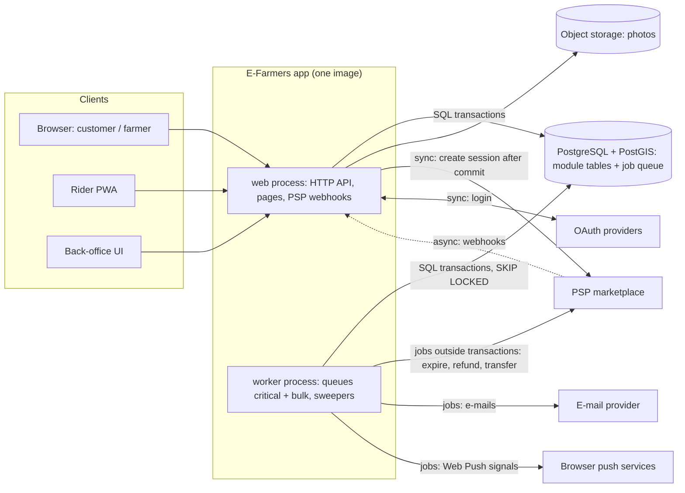
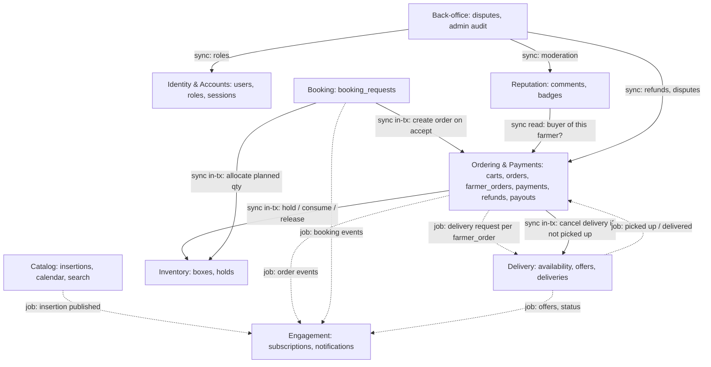
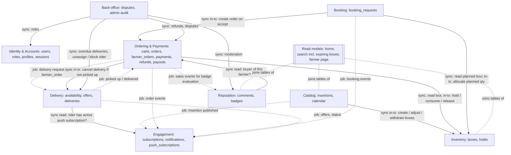

# Transcript – run with the skills (after)

Source: `C:/Users/Fifov/.claude/projects/c--Users-Fifov-Documents-MATFYZ-2mAIN-AI-AI4SE-Labs-2026/26b4f7c2-84bf-4d82-aaef-6e1577a16513.jsonl` (Claude Code session log, read-only).
Generated by a script: user and assistant text kept verbatim and in order; tool calls shortened to one line each (`[tool: …]`, with result status); internal reasoning blocks, tool outputs and automatic system reminders omitted; IDE context (selected lines / opened file) shortened to one line.

## User

Prečítaj požiadavky v Week_05_Designing/Tasks/data/EFarmers.txt a poďme spolu prebrať rôzne architektúry, ktoré by tento systém mohli implementovať. Chcem ich prebrať do hĺbky, vrátane trade-offov a náročných miest implementácie. Poznámky si priebežne píš do Week_05_Designing/Task_3/run_after/NOTES.md.

## Assistant

> [tool: Skill architecture-exploration → ok]
> [tool: Bash Read requirements, notes template, list task dir → ok]
> [tool: Bash Read Task_3 README and list tools → ok]
Now I'll create the notes file from the template and record the start time.
> [tool: Write Week_05_Designing/Task_3/run_after/NOTES.md → ok]
Požiadavky som prečítal a založil som poznámky v [NOTES.md](Week_05_Designing/Task_3/run_after/NOTES.md) (zatiaľ len Run log).

**Prvý dojem zo systému:** Na pohľad je to CRUD e-shop, ale niekoľko miest bude pri implementácii náročných:
- **Boxy majú obmedzené množstvo a expirujú** (US 11, 14, 31). Hrozí overselling a treba riešiť, čo sa stane s položkami v košíku, keď box expiruje.
- **Rezervácia z kalendára** (US 18, 21, 32): farmár ju musí prijať alebo odmietnuť, takže vzniká stavový automat s deadlinmi.
- **Platba** (US 17): webhooky od platobnej brány, idempotencia a refund, ak farmár objednávku odmietne.
- **Doručenie riderom** (US 26, 27, 34): treba riadera priradiť objednávke a nesmie vzniknúť situácia, že dvaja prevezmú tú istú objednávku.
- **Notifikácie odberateľom** (US 19, 36): fan-out pri každej novej insertion.
- **Jeden účet má viac rolí** (customer → farmer / rider, US 12, 24).

Kým začneme, potrebujem od teba pár údajov k nastaveniu:

1. **Počet architektúr:** Navrhujem **3 rôzne štýly a prípadne hybrid**. Súhlasíš, alebo chceš iný počet?
2. **Cieľ:** Chceš to prebrať do hĺbky, teda po kolách s otázkami na porozumenie (to vyplýva z tvojej požiadavky)? Alebo radšej **rýchly režim**, kde je jedna architektúra = jedno kolo?
3. **Obmedzenia:** Čo platí pre tento projekt? Ak nič neurčíš, navrhnem predpoklady sám a v ďalšom kole ti ich dám potvrdiť.
   - veľkosť tímu (napr. 3–5 študentov / malá firma?)
   - rozpočet a deadline
   - región (jedna krajina v EÚ, teda GDPR a SEPA platby?)
   - očakávaná záťaž (jedno mesto alebo celý štát?)
   - klienti (len web, alebo aj mobilná appka pre riderov?)
4. **Poznámky:** Mám ich písať po anglicky (predvolené), alebo po slovensky?

## User

<pasted_content id="8417">
1) Áno, 3 rôzne štýly a hybrid, ak sa počas diskusie ukáže ako zmysluplný.

2) Do hĺbky, po kolách s otázkami na porozumenie. Rýchly režim nechcem.

3) Obmedzenia zo zadania nevyplývajú. Navrhni predpoklady sám (tím, rozpočet a deadline, región, záťaž, klienti) a ku každému napíš, ako ovplyvní výber architektúry. Potvrdím ich alebo upravím.

4) Poznámky po anglicky, so mnou komunikuj po slovensky.
</pasted_content id="8417">

## Assistant

> [tool: Bash Read hard-spots checklist and assessment template → ok]
> [tool: Bash Get current time → ok]
> [tool: Edit Week_05_Designing/Task_3/run_after/NOTES.md → ok]
## Fáza 1 – Analýza požiadaviek

Plná verzia je v [NOTES.md](Week_05_Designing/Task_3/run_after/NOTES.md) (R1–R5). Tu je to podstatné.

**1. Aktéri (R1).** Visitor, Customer, Farmer, Rider.
- Customer je základná rola každého účtu. Farmer a Rider sa k nej **pridávajú** (US 12, 24), takže jedna osoba môže mať naraz všetky tri roly.
- **Chýba admin/operátor.** Žiadna story nerieši refundy, spory, schvaľovanie farmárov, pravidlá pre badge ani moderovanie komentárov. Prevádzka sa bez toho nezaobíde, preto to evidujem ako medzeru.

**2. Životné cykly (R2).** Najviac stavov má **Order**:
- vytvorená → čaká na platbu → zaplatená → vybavuje sa → vyzdvihnutie/doručovanie → doručená | zrušená | refundovaná.
- Popri nej bežia stavy **Payment**, **Booking request** (requested → accepted / declined / expired / cancelled) a **Delivery** (offered → assigned → picked up → delivered / failed / unassigned).
- Košík s boxami od viacerých farmárov sa takmer určite rozpadne na čiastkové objednávky po farmároch.

**3. Ťažké miesta (R3), zoradené podľa rizika:**
- **H2 Peniaze (kritické).** Jedna platba ide viacerým farmárom a možno aj riderovi. Ak by platforma sama držala peniaze tretích strán, môže potrebovať licenciu platobnej inštitúcie (*nie je to právna rada, treba overiť*).
- **H1 Boxy.** Majú obmedzené množstvo a expirujú (US 11, 14, 31), takže hrozí overselling.
- **H3 + H4 Ľudské schválenie a časovače.** Farmár prijíma rezervácie, rider prijíma doručenia. Expiruje box, košík, čakajúca platba aj rezervácia, na ktorú farmár nereaguje.
- **H6 Priradenie ridera.** Dvaja rideri môžu naraz kliknúť na tú istú zásielku, alebo ju nevezme nikto.
- Ďalej: **H5** fan-out notifikácií odberateľom, **H7** OAuth + pridávanie rolí (rola v tokene môže byť zastaraná), **H8** vlastníctvo (komentovať smie len ten, kto u farmára kúpil), **H12** GDPR.
- **H13 Záťaž** je nízka. Výkon teda nebude rozhodovať.

**4. Predpoklady (R4)**, ku každému dopad na architektúru:

| ID | Predpoklad | Dopad |
|---|---|---|
| A1 | Tím 3–4 full-stack vývojári, nikto na ops | Každý ďalší deployable alebo broker zaťaží tím → menej deployables, managed služby |
| A2 | MVP za ~4 mesiace, infra rádovo desiatky €/mes [neoverené] | Vylučuje vlastný Kubernetes a brokery. Rozhoduje čas do MVP |
| A3 | Jedna krajina EÚ (SK), EUR, GDPR podľa sídla (čl. 3 ods. 1, overiť) | EU región. Každé ďalšie úložisko = ďalšie miesto na výmaz údajov |
| A4 | ~5 000 zákazníkov, 100–300 farmárov, 30–80 riderov, špičky v desiatkach req/s | Škálovanie nerozhoduje. Súperenie je len o jednotlivé boxy, stačí atomicita v DB |
| A5 | Vyhľadávanie podľa vzdialenosti, doručenie v okruhu farmy | Treba geo dotazy. Uprednostňuje DB s podporou geo (napr. PostGIS) pred samostatným search clusterom |
| A6 | Web + PWA pre riderov, žiadna natívna appka | Verzovanie API je okrajové. Treba web push a e-mail |
| A7 | Marketplace cez split-payout produkt platobnej brány, platforma peniaze nedrží, platí sa pri checkoute | Webhooky sú zdroj pravdy, idempotencia je povinná v každej variante |
| A8 | Nezávislí rideri, požiadavka sa rozošle dostupným riderom, vyhráva prvý | Stačí atomický „claim“, netreba dispatch engine |

**5. Kandidátne štýly (R5):**
1. **Modulárny monolit.** Jeden deployable + worker z rovnakého kódu, jeden PostgreSQL. Sklad, objednávka a platba žijú v jednej transakčnej doméne.
2. **Event-driven mikroslužby.** Message broker, ságy a outbox. Životný cyklus objednávky je dlhý workflow cez viac kontextov s ľudskými krokmi a tento štýl ho modeluje najexplicitnejšie. Ukážeme si, koľko za to zaplatíme.
3. **Serverless / BaaS.** Managed Postgres + auth/OAuth + row-level security + realtime + funkcie a plánovače. Väčšina stories je CRUD a auth, ktoré BaaS dá skoro zadarmo. Zaujímavá otázka je, kde potom žijú invarianty (sklad, claim ridera, platba).
- Zvážil som aj event sourcing/CQRS, space-based a micro-frontends a vyradil som ich. Dôvody sú v poznámkach.
- Hybrid zvážime len vtedy, keď si ho diskusia vyžiada. Pravdepodobný kandidát je monolit + vybrané managed služby alebo durable workflow engine.

### Otázky pre teba

1. **Predpoklady A1–A8:** Potvrdzuješ ich, alebo niektoré upravíš? Najväčší vplyv majú A1/A2 (tím, rozpočet) a A7 (model platieb).
2. **Význam boxu a rezervácie:** Navrhujem, že **box = dávka s množstvom N a dátumom expirácie**. **Rezervácia z kalendára = predobjednávka budúcej úrody**, ktorú farmár prijme alebo odmietne a ktorá sa **platí až po prijatí**. Súhlasíš, alebo to chápeš inak?
3. **Kontrola porozumenia:** Zákazník A si dá posledný box paradajok do košíka. O minútu ho zákazník B kúpi cez checkout. Kto dostane box, ak rezervujeme **pri pridaní do košíka**, a kto, ak **až pri checkoute**? A prečo je rezervácia pri pridaní do košíka v kombinácii s expiráciou boxov (US 11) zvlášť nebezpečná?

## User

<pasted_content id="8417">
Predpoklady A1–A8 potvrdzujem s dvomi poznámkami:
- A7: pri košíku sa platí pri checkoute, ale pri rezervácii z kalendára podľa tvojho návrhu až po prijatí farmárom. Zapíš to výslovne ako dva rôzne platobné toky.
- A6: rider musí dostať ponuku doručenia okamžite. Web push má na iOS obmedzenia (len pri nainštalovanej PWA). Stačí to pre ridera, alebo to mení predpoklad? Ak to nevieš overiť, označ to ako neoverené.

Medzeru s adminom potvrdzujem: počítajme s minimálnym back-office (refundy, spory, moderovanie) ako s implicitnou požiadavkou.

Box a rezervácia: súhlasím s tvojím chápaním. Doplň ešte, či prijatá rezervácia blokuje nejaké množstvo, alebo ide o úrodu, ktorá zatiaľ ako box neexistuje.

Jedna nezrovnalosť: v úvode píšeš o refunde, "ak farmár objednávku odmietne". Prijímanie a odmietanie (US 21) sa ale týka len rezervácií, ktoré sa podľa tvojho návrhu platia až po prijatí. Kedy teda refund reálne nastane?

Kontrolná otázka: ak sa rezervuje pri pridaní do košíka, box dostane A a B pri checkoute uvidí, že je vypredaný. Ak sa rezervuje až pri checkoute, box dostane B a A zistí pri svojom checkoute, že box už nie je dostupný. Rezervácia pri pridaní do košíka je nebezpečná, lebo veľa košíkov sa opustí a tovar v nich ostane zablokovaný. Pri boxoch s expiráciou môže box v opustenom košíku exspirovať skôr, ako sa rezervácia uvoľní, takže sa vôbec nepredá. Navyše by mohol niekto zámerne zablokovať celý sklad. Preto by som rezervoval až pri checkoute s krátkym limitom a pri checkoute kontroloval, že box neexspiruje skôr, ako limit vyprší.

Môžeme pokračovať na prvú architektúru.
</pasted_content id="8417">

## Assistant

> [tool: ToolSearch select:WebSearch,WebFetch → ok]
> [tool: WebSearch iOS web push notifications home screen web app requirement Safari 16.4 limitations → ok]
> [tool: WebSearch EU Digital Markets Act iOS 17.4 home screen web apps PWA removed reversed Apple → ok]
> [tool: WebSearch Stripe Checkout Session expires_at minimum 30 minutes maximum 24 hours → ok]
> [tool: Bash Get current time → ok]
> [tool: Edit Week_05_Designing/Task_3/run_after/NOTES.md → ok]
> [tool: Edit Week_05_Designing/Task_3/run_after/NOTES.md → ok]
> [tool: Edit Week_05_Designing/Task_3/run_after/NOTES.md → ok]
> [tool: Edit Week_05_Designing/Task_3/run_after/NOTES.md → ok]
> [tool: Edit Week_05_Designing/Task_3/run_after/NOTES.md → ok]
> [tool: Edit Week_05_Designing/Task_3/run_after/NOTES.md → ok]
Odpovede k tvojim poznámkam a prvé kolo modulárneho monolitu sú zapísané v [NOTES.md](Week_05_Designing/Task_3/run_after/NOTES.md) (R6, R2-C1, A6′, A1.1–A1.6).

## Odpovede na tvoje poznámky

**A7 – dva platobné toky.** Zapísané výslovne ako **P1** a **P2**:
- **P1 (košík):** platí sa pri checkoute.
- **P2 (rezervácia z kalendára):** pri žiadosti sa neplatí nič. Platí sa až po prijatí farmárom, a to v rámci platobného deadlinu.

**A6 – web push na iOS (overené).**
- Funguje od iOS 16.4, ale **iba keď je PWA pridaná na plochu**. O povolenie treba požiadať po akcii používateľa (user gesture). Hlásia sa aj občasné výpadky doručovania.
- V EÚ zostali PWA na ploche dostupné, lebo Apple svoj plán z iOS 17.4 stiahol.
- Predpoklad A6 nemením, len ho upravujem na **A6′**:
  - Pri onboardingu ridera je inštalácia PWA a povolenie push povinné. Prepnúť sa na „available“ sa dá len s aktívnou push subscription.
  - Push je **iba signál**. Ponuky sú uložené v DB, majú timeout a pri nevyzdvihnutí sa ponúknu znova.
  - Ak pilot ukáže nespoľahlivé doručovanie, záložný plán je tenký natívny wrapper alebo SMS.
  - Za „okamžite“ považujem do ~1 minúty. Zásielky z farmy nie sú kritické na sekundy (to je môj predpoklad).

**Prijatá rezervácia a množstvo.**
- US 21 hovorí o „booked boxes“. Box teda existuje ako **plánovaný box**: má `available_from` v budúcnosti a plánované množstvo. Úroda zatiaľ neexistuje.
- **Žiadosť nič neblokuje.** Platí rovnaký argument o zneužití ako pri košíku.
- **Prijatie atomicky odpočíta** plánované množstvo, takže farmár nemôže prijať viac, než naplánoval.
- Ak zákazník nezaplatí do deadlinu, množstvo sa vráti.

**Refund – máš pravdu, to bola chyba.** Zapísal som ju ako **Correction R2-C1** (našiel si ju ty). Odmietnutie sa týka iba rezervácií, ktoré sa platia až po prijatí, takže pri ňom nikdy nie je čo refundovať. Refund reálne nastane, keď:
1. farmár nedokáže splniť zaplatenú objednávku z košíka (fyzický sklad sa nezhoduje so systémom),
2. platba príde **po** expirácii holdu a tovar už medzitým kúpil niekto iný,
3. sa nenájde rider alebo doručenie zlyhá,
4. sa pokazí úroda pri zaplatenej rezervácii,
5. back-office rozhodne spor v prospech zákazníka,
6. zákazník stornuje objednávku, ak to storno politika dovolí (zatiaľ otvorené).

**Kontrolná otázka – odpoveď je správna.** Doplním tri veci:
- Box nesmie expirovať skôr, než ho reálne stihneme vyzdvihnúť alebo doručiť. Podmienka je teda `expires_at > now + min_fulfilment_lead`, nielen „expiruje až po konci holdu“.
- Aj hold pri checkoute sa dá zneužiť, preto obmedzíme počet aktívnych holdov na používateľa.
- „Krátky limit“ zdola ohraničuje platobná brána. Napríklad pri Stripe musí Checkout Session platiť **30 min až 24 h**. Hold preto nemôže trvať 10 minút, keď session žije 30 minút, inak by zákazník zaplatil za už uvoľnený tovar.

---

## Architektúra 1 – Modulárny monolit, kolo 1: celkový obraz

**1. Štruktúra (A1.1).**
- Jeden image, ktorý beží ako dva typy procesov (`web` a `worker`), a jeden PostgreSQL s PostGIS.
- Deväť modulov, každý vlastní svoje tabuľky: Identity, Catalog, Inventory, Ordering & Payments, Booking, Delivery, Engagement, Reputation, Back-office.
- **Komunikácia:**
  - Synchrónne in-process volanie, keď výsledok potrebujem v tej istej transakcii (checkout → `Inventory.hold`).
  - Asynchrónny job pre vedľajšie efekty (notifikácie, ponuky riderom, refundy).
- Job queue je v tej istej DB, takže zaradenie jobu je atomické s biznis zmenou. **Outbox preto netreba**, len by duplikoval tú istú garanciu (R1).
- Hranice modulov stráži architektonický test v CI. Bez neho sa časom rozpadnú.

**2. Checkout a webhook (A1.2), najrizikovejšie miesto.**
- Checkout beží v jednej transakcii. Boxy zamykám **zoradené podľa `box_id`**, aby dva checkouty s viacerými boxmi nevytvorili deadlock. Odpočítanie je podmienené a platí všetko alebo nič.
- Vytvorí sa objednávka, čiastková objednávka pre každého farmára a holdy. PSP session dostane `expires_at` rovnaké ako hold.

```sql
UPDATE inventory.boxes SET qty_available = qty_available - :qty
 WHERE id = :box_id AND status='active' AND available_from <= now()
   AND qty_available >= :qty
   AND expires_at > :hold_expires_at + :min_fulfilment_lead
RETURNING id;   -- 0 riadkov → ROLLBACK celého checkoutu
```

- Webhook je zdroj pravdy a spracúva sa ako **stavový automat nad objednávkou**:

| Stav objednávky | Čo urobí webhook |
|---|---|
| `awaiting_payment` | spotrebuje holdy, objednávka → paid |
| `expired` | skúsi tovar znova rezervovať; ak to nejde, → refund |
| `paid` a ďalšie | nič (duplicita) |
| `cancelled` | → refund |

- Tabuľka spracovaných eventov je len audit. Duplicity bezpečne odfiltruje samotný stavový automat (R1).

**3. Rezervácia, tok P2 (A1.3).**
- Prijatie rezervácie = podmienené odpočítanie plánovaného boxu + vytvorenie objednávky `awaiting_payment` v jednej transakcii.
- Deadliny počítam z domény: `deadline žiadosti = min(created + X, available_from − Y − lead)` a `deadline platby = min(accepted + Y, available_from − lead)`.
- PSP session sa vytvorí až po kliknutí na „zaplatiť“. Pri P2 teda nedržíme session otvorenú celé dni.

**4. Časovače (A1.4).** V poznámkach je ich osem, každý so spúšťačom, vlastníkom a akciou.
- **Expirácia boxu nepotrebuje žiadny job.** Je odvodená z `expires_at` priamo v dotazoch, aj zoznam „expiring boxes“ (US 11).
- Ostatné časovače obsluhuje **sweeper každú minútu** cez `FOR UPDATE SKIP LOCKED` s podmieneným update.
  - Prekrývajúce sa behy alebo dva workery si neprekážajú (R5).
  - Popri sweeperoch nedávam plánované joby pre každú entitu. Duplikovali by ich a pri zmene deadlinu by zastarali (R1).

**5. Ďalšie ťažké miesta (A1.5).**
- **Claim ridera:** `UPDATE … WHERE state='offered'`. Ak sa zmení 0 riadkov, zásielku už vzal niekto iný.
- **Fan-out notifikácií:** `UNIQUE(user_id, source_event_id)` zabezpečí, že retry nevytvorí duplicitu. Pred odoslaním znova kontrolujem odber, kvôli súbehu s odhlásením (US 35).
- **Roly:** sessions na serveri, roly sa čítajú pri každom requeste. **Problém so zastaranou rolou v tokene tu nevzniká**, to je výhoda monolitu.
- **Vlastníctvo:** kontrolujem ho priamo v dotaze, cudzí zdroj vráti 404.

**6. Čo nasadzujeme (A1.6).**
- 1 image (2 typy procesov), 1 managed Postgres v EÚ, object storage na fotky.
- Externé služby: PSP, OAuth, e-mail, VAPID push.
- Žiadny broker, cache ani search cluster.

### Otázky

1. **Kontrola porozumenia:** Sweeper aj webhook začínajú tým, že zamknú **riadok objednávky** (`FOR UPDATE`). Opíš konkrétnu zlú postupnosť krokov, ktorá by nastala, keby ho nezamykali: hold práve expiruje a v tej istej sekunde príde `payment_succeeded`. Aký by bol výsledok pre sklad a pre peniaze?
2. **Rozhodnutie o rezerváciách:** Aké hodnoty majú mať X (ako dlho má farmár na odpoveď) a Y (ako dlho má zákazník na zaplatenie)? Navrhujem **X = 48 h, Y = 24 h**, obe orezané podľa `available_from`.
3. **Rozhodnutie o výplatách:** Kedy dostane farmár peniaze? Navrhujem **až po doručení alebo vyzdvihnutí a uplynutí 24 h okna na reklamáciu**. Alternatívou je hneď po zaplatení, čo je jednoduchšie, ale refund by sa potom musel vymáhať od farmára.

Zdroje: [Stripe – limited inventory / expires_at](https://docs.stripe.com/payments/checkout/managing-limited-inventory), [OneSignal – Web push for iOS](https://documentation.onesignal.com/docs/web-push-for-ios), [Pushpad – iOS web push](https://pushpad.xyz/blog/does-safari-on-ios-support-web-push-notifications/), [9to5mac – iOS 16.4 web apps](https://9to5mac.com/2023/02/16/iphone-web-app-new-features-ios-16-4/), [Engadget – Apple backtracks on EU web apps](https://www.engadget.com/apple-backtracks-on-plans-to-get-rid-of-web-apps-on-iphones-in-the-eu-195232177.html)

## User

<pasted_content id="8417">
Kontrolná otázka: bez zámku si sweeper aj webhook naraz prečítajú awaiting_payment. Ak skončí prvý sweeper, vráti tovar do skladu a objednávku označí expired. Webhook ju potom prepíše na paid. Zákazník zaplatil, ale tovar je späť v predaji a môže ho kúpiť niekto iný, takže box je predaný dvakrát. Ak skončí prvý webhook, objednávka je paid, ale sweeper ju prepíše na expired a vráti tovar: zákazník zaplatil, objednávka je zrušená a tovar je znova v predaji. So zámkom sa operácie zoradia a druhá už vidí nový stav, takže jej podmienený prechod nič nespraví.

Rezervácie: X = 48 h a Y = 24 h, orezané podľa available_from, súhlasím.

Výplaty: dve otázky, kým rozhodnem.
- Je férové, aby farmár čakal až na doručenie a 24 h okno, keď za samotné doručenie nezodpovedá?
- Ak peniaze ležia na účte platformy až do doručenia + 24 h, nie je to v rozpore s A7 (platforma peniaze nedrží)? Ako dlho ich môžeme pri split-payout produkte držať, kým to začne byť problém?
Navrhni variant, ktorý berie do úvahy, kto za čo zodpovedá, a potom rozhodnem.

Ďalšie otázky k checkoutu:
1) Sweeper uvoľní hold podľa našich hodín, ale zákazník mohol zaplatiť v poslednej sekunde a webhook príde o minútu neskôr. Neuvoľňuješ hold priskoro? Ako často tým vznikne zbytočný refund a dá sa tomu predísť?
2) Pri stave cancelled webhook spustí refund. Čo ak ten istý webhook príde dvakrát, nevzniknú dva refundy? Ukáž, ktorý prechod stavu tomu zabráni.
</pasted_content id="8417">

## Assistant

> [tool: WebSearch Stripe Connect separate charges and transfers how long can platform hold funds before transfer 90 days Europe → ok]
> [tool: WebFetch url, prompt → ok]
> [tool: WebFetch url, prompt → ok]
> [tool: Bash Get current time → ok]
> [tool: Edit Week_05_Designing/Task_3/run_after/NOTES.md → ok]
> [tool: Edit Week_05_Designing/Task_3/run_after/NOTES.md → ok]
> [tool: Edit Week_05_Designing/Task_3/run_after/NOTES.md → ok]
> [tool: Edit Week_05_Designing/Task_3/run_after/NOTES.md → ok]
> [tool: Edit Week_05_Designing/Task_3/run_after/NOTES.md → ok]
> [tool: Edit Week_05_Designing/Task_3/run_after/NOTES.md → ok]
> [tool: Edit Week_05_Designing/Task_3/run_after/NOTES.md → ok]
Odpovede sú zapísané v [NOTES.md](Week_05_Designing/Task_3/run_after/NOTES.md) ako A1.7 až A1.9. Pribudli dve korekcie, obe si našiel ty.

**Kontrolná otázka:** Odpoveď je správna, obe poradia aj dôsledky máš presne. Zapísané.

**Rezervácie:** X = 48 h a Y = 24 h som zapísal ako rozhodnutie.

---

## Výplaty (A1.7)

**Fér to nie je, máš pravdu (Correction A1.2-C1).** Môj návrh nechal farmára niesť riziko doručenia, za ktoré nezodpovedá. Zároveň potichu predpokladal, že platforma drží peniaze, čo je v rozpore s A7.

**Čo hovorí Stripe, ktorý beriem ako referenčnú PSP (overené):**
- Platforma môže držať peniaze na dvoch miestach:
  - na **svojom balance** pred transferom (model *separate charges and transfers*),
  - na **balance farmárovho účtu** pred výplatou (*manual payouts*).
- Zo zákonných dôvodov ich môže držať **najviac 90 dní**. To platí pre všetky krajiny okrem USA (2 roky) a Thajska (10 dní).
- Stripe odporúča držať peniaze iba s jasným účelom a záväzkom vyplatiť ich, keď nastane konkrétna udalosť. Doručovacie služby uvádza ako typický príklad. Svojvoľné držanie neodporúča.
- Pri modeli separate charges and transfers znáša **platforma** záporné zostatky farmárov.

**Navrhujem upresniť A7:** Platforma nikdy nedrží peniaze na vlastnom účte. Peniaze ležia u licencovanej PSP a platforma len určuje, kedy sa uvoľnia. Uvoľnenie musí byť vždy naviazané na udalosť plnenia. Či to stačí na to, aby prevádzkovateľ nepotreboval licenciu, *nie je právna rada, treba overiť*.

**Variant podľa zodpovednosti:** každý dostane zaplatené, keď splní **svoj** záväzok.

| Kto | Zodpovedá za | Kedy dostane peniaze | Čo ak je problém neskôr |
|---|---|---|---|
| Farmár | množstvo, kvalitu, pripravenie načas | pri **odovzdaní**: rider prevezme tovar (potvrdia obaja, pickup kód), alebo zákazník vyzdvihne na farme | reklamácia kvality do 24 h → back-office → **transfer reversal** z farmárovho balance |
| Rider | prepravu po prevzatí | po **doručení** (kód zákazníka alebo fotka) | strata alebo poškodenie → zákazníkovi refunduje platforma, rider nedostane fee |
| Platforma | nájdenie ridera, podporu | poplatok si strhne pri platbe | nenájde sa rider → plný refund, farmár nedostane nič (k odovzdaniu nedošlo), box sa vráti do skladu |

- **Reklamačné okno nebrzdí výplatu.** Pokrýva ho reversal (R1). Ak už farmár peniaze vybral, stratu nesie platforma. To je vedomé riziko, ktoré platíme za férový cash flow farmárov.
- **Ako dlho peniaze ležia:**
  - P1 (košík): hodiny až zhruba 2 dni.
  - P2 (rezervácia): až do `available_from`. Preto navrhujem horizont rezervácie **najviac 60 dní dopredu**, aby sme mali rezervu voči limitu 90 dní.
  - Pridal som časovač, ktorý upozorní back-office, ak by sa niekde blížil 90. deň.

---

## Checkout 1: uvoľňujem hold priskoro? (A1.8)

**Áno, je to chyba (Correction A1.2-C2).** Keď sweeper uvoľní hold podľa našich hodín, vzniká okno, v ktorom je platba v PSP už potvrdená, ale tovar sa vracia do predaja. Ak box v tom okne kúpi niekto iný, nasleduje zbytočný refund. Takých prípadov pribúda, keď webhooky meškajú, napríklad keď náš endpoint nebeží a PSP opakuje doručenie celé hodiny.

**Oprava: o uvoľnení rozhoduje PSP, nie naše hodiny.**

```text
pri expires_at (zámok na objednávke):
  s := psp.retrieve_session(...)
  open     → psp.expire_session(); úspech → uvoľni holdy; chyba → znova prečítaj stav
  expired  → uvoľni holdy
  complete → spracuj ako payment_succeeded
  PSP nedostupná → nerob nič, skús o minútu (hold zostane – bezpečný smer)
```

- Stripe dovoľuje expirovať session len v stave `open`. Inak volanie vráti chybu (overené). Keď teda expirácia prejde, platba sa už dokončiť nedá.
- V bežnom toku tak zbytočný refund **zmizne úplne**.
- Vetva `expired` vo webhooku zostáva, lebo každý stav treba obslúžiť (R3). Nie je to však očakávaná cesta. Ak nastane, spustí sa rekonciliácia a alert.
- **Pasca:** pri oneskorených platobných metódach, napríklad SEPA inkaso, môže byť session `complete`, hoci platba príde až o niekoľko dní *[detail neoverený]*. Návrh: **P1 povolí iba okamžité metódy (karty, peňaženky)**.

## Checkout 2: dva refundy (A1.9)

Zabránia im dve rôzne poistky a každá rieši inú poruchu, takže nejde o duplicitu (R1).

```sql
UPDATE ordering.orders SET state='refund_pending'
 WHERE id=:order_id AND state='cancelled' RETURNING id;
-- 1 riadok → INSERT refunds(...) + enqueue(refund_job) v tej istej transakcii
-- 0 riadkov → duplicitný webhook → nič
```

1. **Duplicitný webhook:** Prechod `cancelled → refund_pending` sa podarí len raz. Druhé doručenie už vidí `refund_pending` a nič neurobí, takže vznikne jeden riadok v `refunds` a jeden job.
2. **Retry refund jobu:** Job môže spadnúť po volaní PSP, ešte pred označením hotovo. Preto volá PSP s `Idempotency-Key = refunds.id`. Kľúče však PSP drží len obmedzený čas (Stripe približne 24 h *[neoverené]*). Neskorý retry si preto najprv overí existujúce refundy podľa `metadata.refund_id`.

Navyše pridávam partial unique index na `refunds`. Chyba v handleri potom spadne nahlas namiesto dvojitého refundu.

Kombinácia `cancelled` + platba by v skutočnosti nemala nastať. Storno totiž najprv volá `expire_session`. Ak to zlyhá, lebo session je už `complete`, objednávka sa nezruší a spracuje sa ako zaplatená.

---

### Otázky

1. **Výplaty:** Prijímaš variant podľa zodpovednosti (farmár pri odovzdaní, rider pri doručení, reklamácie cez reversal) a horizont rezervácie 60 dní?
2. **Platobné metódy:** Súhlasíš, že P1 povolí iba okamžité metódy?
3. **Kontrola porozumenia:** PSP je 2 hodiny nedostupná. Čo sa počas toho deje s boxmi v opustených checkoutoch? A prečo je to podľa mňa bezpečný smer, hoci pre farmára nie ideálny?

Po týchto odpovediach prejdem na **kolo 2: scenáre zlyhania** monolitu.

Zdroje: [Stripe – Connect account balances (holding funds, 90 dní)](https://docs.stripe.com/connect/account-balances), [Stripe – separate charges and transfers](https://docs.stripe.com/docs/connect/separate-charges-and-transfers), [Stripe API – expire Checkout Session](https://docs.stripe.com/api/checkout/sessions/expire)

## User

<pasted_content id="8417">
Výplaty: variant podľa zodpovednosti prijímam (farmár pri odovzdaní, rider pri doručení, reklamácie cez reversal), aj horizont rezervácie 60 dní a alert pred 90. dňom.

Platobné metódy: pri P1 súhlasím, iba okamžité metódy. A čo pri P2? Tam je medzi platbou a odovzdaním až do 60 dní, takže by oneskorené metódy ako SEPA mohli dávať zmysel. Alebo nie?

Kontrolná otázka: počas výpadku PSP ostanú boxy v opustených checkoutoch zablokované, lebo sweeper bez odpovede PSP hold neuvoľní. Je to bezpečný smer, lebo uvoľnenie bez istoty, či platba prešla, by mohlo viesť k predaju toho istého boxu dvakrát a k refundom. Správnosť peňazí má prednosť pred dostupnosťou. Navyše počas výpadku nejde vytvoriť ani nový checkout, takže blokovanie veľa nepokazí. Pre farmára to nie je ideálne: tovar je dočasne nepredajný a box blízko expirácie môže prepadnúť.

Problém v tvojom pseudokóde: sweeper volá psp.retrieve_session a expire_session, kým drží zámok na objednávke v otvorenej DB transakcii. Pri pomalej alebo nedostupnej PSP každé volanie čaká na timeout. Čo sa medzitým stane s DB spojeniami a s webhookom, ktorý čaká na ten istý zámok? Prepíš to tak, aby sieťové volanie nebežalo v DB transakcii, a ukáž, ako sa potom stav bezpečne aplikuje.

A ešte: keď sa PSP po 2 hodinách vráti, sweeper naraz zavolá retrieve a expire pre všetky nahromadené sessions. Nenarazíme na rate limit PSP?
</pasted_content id="8417">

## Assistant

> [tool: WebSearch Stripe API rate limit live mode 100 operations per second read write → ok]
> [tool: WebSearch Stripe SEPA Direct Debit how long to confirm payment business days dispute 8 weeks unconditional refund → ok]
> [tool: Bash Get current time → ok]
> [tool: Edit Week_05_Designing/Task_3/run_after/NOTES.md → ok]
> [tool: Edit Week_05_Designing/Task_3/run_after/NOTES.md → ok]
> [tool: Edit Week_05_Designing/Task_3/run_after/NOTES.md → ok]
> [tool: Edit Week_05_Designing/Task_3/run_after/NOTES.md → ok]
Všetko je zapísané v [NOTES.md](Week_05_Designing/Task_3/run_after/NOTES.md) ako A1.10 až A1.12. Pribudla jedna korekcia (A1.8-C1), ktorú si našiel ty.

**Tvoje rozhodnutia:** výplaty podľa zodpovednosti, horizont rezervácie 60 dní, alert pred 90. dňom a pri P1 iba okamžité platobné metódy. Všetko je zapísané.

**Kontrolná otázka:** Odpoveď je správna. Dôležité je hlavne „správnosť peňazí má prednosť pred dostupnosťou“ a pripomienka, že počas výpadku aj tak nevznikajú nové checkouty.

---

## P2 a SEPA inkaso (A1.10)

Samotné oneskorenie by pri P2 problém nebolo. Podľa Stripe trvá potvrdenie SEPA inkasa **až 14 pracovných dní**, v priemere asi 5. Pri P2 je čas do `available_from` dostatočný.

**Problém je inde.** Platiteľ môže inkaso **8 týždňov rozporovať bez udania dôvodu** a banka mu ho **automaticky vráti**. Pri neoprávnenom inkase je to až 13 mesiacov. Navyše refund z našej strany nebráni tomu, aby neskôr rozporoval aj tak, takže hrozí dvojité vrátenie peňazí.

To narúša model zodpovednosti, ktorý sme práve odsúhlasili. Farmár dostane peniaze pri odovzdaní a zákazník si ich po prevzatí tovaru vezme späť. Stratu potom nesie buď platforma, alebo farmár, ktorý svoj záväzok splnil. Ani jedno nie je v poriadku.

SEPA by navyše priniesla nový stav `payment_processing`. Deadline Y by sa vzťahoval na odoslanie platby, nie na jej pripísanie. Zlyhanie by prišlo až po dvoch týždňoch, a potom treba vrátiť plánované množstvo a upozorniť farmára.

**Môj postoj:**
- **MVP: aj pri P2 iba karty a peňaženky.**
- SEPA zvážiť neskôr, ak budú vysoké poplatky za karty. Podmienky:
  - medzi prijatím a `available_from` je ≥ 14 pracovných dní s rezervou,
  - platforma vedome prevezme 8-týždňové riziko, s limitom na zákazníka a len pre zákazníkov s históriou.

## Sieťové volanie v DB transakcii (A1.11)

Máš pravdu, toto je vážna chyba (**Correction A1.8-C1**). Pri pomalej alebo nedostupnej PSP sa reťazovo stane toto:
1. Každé volanie čaká na timeout a sweeper celý ten čas drží DB spojenie aj zámok na riadku.
2. Webhook pre tú istú objednávku čaká na zámok. Jeho HTTP request vyprší a PSP ho pošle znova, čím pridá záťaž.
3. Webové requesty, ktoré sa dotýkajú objednávky (refresh stavu platby, storno), sa tiež zablokujú. Pool spojení sa vyčerpá a **zle začne fungovať celý web**, nielen checkout.
4. Dlhé transakcie navyše brzdia vacuum.

Výpadok jednej externej služby sa tak zmení na výpadok celej databázy.

**Oprava: tri fázy.**

```text
Fáza 1 – claim (krátka tx, bez siete):
  UPDATE orders SET release_check_at = now() + backoff, release_attempts += 1
   WHERE id IN (SELECT … WHERE state='awaiting_payment'
                 AND hold_expires_at < now() - 2 min AND release_check_at <= now()
                 ORDER BY hold_expires_at LIMIT :batch FOR UPDATE SKIP LOCKED)
  RETURNING id, psp_session_id;  COMMIT;

Fáza 2 – PSP (žiadna tx, timeout 5 s, rate limiter + circuit breaker):
  retrieve → ak 'open': expire → pri chybe znova retrieve
  ďalej posúvam IBA terminálny výsledok: 'expired' | 'complete'
  timeout/5xx/429 → preskočiť (release_check_at je už posunutý = backoff)

Fáza 3 – apply (krátka tx):
  SELECT state … FOR UPDATE;
  expired  + awaiting_payment → uvoľni holdy, state='expired'
  complete → apply_payment_succeeded()   -- tá istá funkcia ako webhook
  inak nič (webhook bol rýchlejší)
```

- **Prečo je bezpečné aplikovať výsledok neskôr:** `expired` a `complete` sú v PSP **terminálne**, takže sa už nezmenia. Ak medzi fázou 2 a 3 ten istý fakt spracoval webhook, podmienený prechod na zamknutom riadku to zachytí a nič nespraví. Neterminálny `open` nikdy neaplikujem.
- **Claim vo fáze 1 nie je poistka správnosti (R1).** Dva workery volajúce PSP pre tú istú session nič nepokazia, lebo druhý `expire` vráti chybu a nasleduje opätovné čítanie. Claim slúži len na backoff a šetrenie volaní. Rovnako je len optimalizácia aj čakanie 2 minúty po expirácii: vlastný `expired` webhook z PSP väčšinou vyrieši objednávku skôr a ušetrí dve volania.
- **Pravidlo pre celý systém:** webhooky iba uložia event a zmenia stav. Refundy, transfery a vytváranie session bežia v jobs mimo transakcie, s idempotency kľúčmi. Ako ochranu pred budúcimi chybami nastavím na DB rolu `lock_timeout`, `statement_timeout` a `idle_in_transaction_session_timeout`.

## Rate limit po návrate PSP (A1.12)

- **Overené (Stripe):** live mode má **100 operácií/s na účet** a väčšina endpointov **25 req/s** predvolene. Pri prekročení vráti 429. Rozdelenie na 100 čítaní + 100 zápisov uvádzajú len tretie strany, takže je *neoverené*.
- **Veľkosť nárazu:** pri predpoklade A4 vznikne za 2 hodiny desiatky až nízke stovky opustených checkoutov. To je pár stoviek volaní a veľkú časť vyriešia `expired` webhooky, ktoré po návrate PSP dorazia samé. Samotný sweeper teda na limit nenarazí.
- **Skutočné riziko je zdieľaný rozpočet.** Do rovnakého limitu sa po výpadku hrnú aj nové checkouty zákazníkov, zadržané refundy a transfery.
- **Riešenie:**
  - Jeden spoločný token bucket na PSP účet pre všetky workery. Pri A4 stačí počítadlo v Postgrese, Redis netreba.
  - Priority: vytvorenie session pre zákazníka > práca z webhookov > refundy a transfery > sweeper.
  - Sweeper má strop asi 5 req/s.
  - Pri 429 rešpektujem `Retry-After` alebo exponenciálny backoff.
  - **Circuit breaker:** po N zlyhaniach sweeper vynechá celé dávky a posiela len jeden skúšobný request za minútu, namiesto N timeoutov v každej dávke.

---

### Otázky

1. **Rozhodnutie:** Súhlasíš, že v MVP budú aj pri P2 iba karty a peňaženky, a SEPA zvážime neskôr za uvedených podmienok?
2. **Kontrola porozumenia:** Fáza 2 dostane `open`, potom zavolá `expire`, ktorý vyprší na timeout. PSP ho však v skutočnosti vykonala. Čo spraví fáza 3 v tomto behu a čo nasledujúci beh sweepera? Aký bude výsledný stav objednávky a boxov a kedy nastane?

Ak je všetko jasné, ďalej pokračujem **kolom 2 monolitu: scenáre zlyhania**.

Zdroje: [Stripe – rate limits](https://docs.stripe.com/rate-limits), [Stripe – SEPA DD disputes](https://support.stripe.com/questions/sepa-direct-debit-payment-disputes), [Stripe – SEPA DD timing](https://stripe.com/br/resources/more/time-processes-sepa-direct-debit-payments), [Stripe – SEPA DD behavior changes](https://support.stripe.com/questions/changes-to-sepa-direct-debit-payment-behavior)

## User

<pasted_content id="8417">
Rozhodnutie: áno, v MVP aj pri P2 iba karty a peňaženky. SEPA zvážime neskôr za podmienok, ktoré si uviedol.

Kontrolná otázka: fáza 2 dostane open, zavolá expire a ten vyprší na timeout, hoci ho PSP vykonala. Podľa tvojho pseudokódu sa pri chybe znova prečíta stav. Ak PSP už odpovedá, retrieve vráti expired, čo je terminálny stav, takže fáza 3 v tom istom behu uvoľní holdy a objednávku dá do expired. Ak PSP stále neodpovedá, beh sa preskočí a objednávka ostáva awaiting_payment s blokovanými boxmi. Potom ju vyrieši to, čo príde skôr: expired webhook z PSP, alebo ďalší beh sweepera po backoffe, ktorý prečíta expired a uvoľní holdy. Ak bol prvý webhook, fáza 3 už nič nespraví, lebo stav nie je awaiting_payment. Výsledok je vždy expired objednávka a boxy späť v predaji, líši sa iba čas: hneď alebo o pár minút.

Pokračuj kolom 2 monolitu: scenáre zlyhaní. Scenáre s výpadkom PSP, súbehom sweepera a webhooku a duplicitnými refundmi sme už prebrali, tie neopakuj a sústreď sa na ostatné.
</pasted_content id="8417">

## Assistant

> [tool: Bash Read failure question bank and get time → ok]
> [tool: Edit Week_05_Designing/Task_3/run_after/NOTES.md → ok]
> [tool: Edit Week_05_Designing/Task_3/run_after/NOTES.md → ok]
> [tool: Edit Week_05_Designing/Task_3/run_after/NOTES.md → ok]
> [tool: Edit Week_05_Designing/Task_3/run_after/NOTES.md → ok]
Odpoveď na kontrolnú otázku je správna. Oba časové priebehy (PSP odpovedá / neodpovedá) aj to, kto vyhrá medzi webhookom a ďalším behom sweepera, máš presne. Zapísal som aj rozhodnutie „P2 iba karty a peňaženky“.

## Architektúra 1 – Modulárny monolit, kolo 2: scenáre zlyhania

Témy okolo PSP vynechávam. Vybral som 6 najnebezpečnejších zlyhaní, detaily a SQL sú v [NOTES.md](Week_05_Designing/Task_3/run_after/NOTES.md) (A1.13 až A1.18).

**1. Farmár upraví alebo zmaže box, kým naň existujú holdy a zaplatené objednávky (A1.13)**
- **Scenár:** Farmár otvorí formulár, kde vidí „dostupné 2“. Medzitým niekto kúpi 1 kus. Farmár uloží „2“, čím sa stratí súbežná zmena (lost update) a 1 kus je predaný dvakrát. Podobne zmazanie insertion osirotí zaplatené objednávky a zmena ceny počas checkoutu nesedí so sumou v PSP.
- **Oprava:**
  - Sklad sa mení len **o rozdiel** („+3 / −2“), nikdy nie na absolútnu hodnotu. Podmienka `qty_available + :delta >= 0` zaručí, že nejde klesnúť pod už predané a držané kusy.
  - Navyše `CHECK (qty_available >= 0)`. Ten nechráni pred tým istým, ale pred budúcim kódom, ktorý na podmienku `WHERE` zabudne (R1).
  - Zmazanie = **stiahnutie z predaja (withdraw)**: nové holdy sa zablokujú, existujúce záväzky platia ďalej.
  - Ak má farmár fyzicky menej, než predal, musí zrušiť **konkrétne** objednávky. To vedie k refundu a strike pre farmára.
  - Riadky objednávky si pri checkoute uložia kópiu ceny a názvu (snapshot).

**2. Zaplatená objednávka sa nikdy neodovzdá (A1.14) → Correction A1.4-C1 (našiel som ja)**
- **Chyba v mojom zozname časovačov:** chýbal **deadline na odovzdanie farmárom** aj **deadline na doručenie po prevzatí riderom**. Objednávka mohla zostať v stave `paid` navždy a peniaze by ležali bez udalosti, ktorá ich uvoľní. To je presne to, čo podľa A1.7 nesmie nastať.
- **Oprava:** dva nové časovače.
  - Po konci okna na odovzdanie (+ grace): `not_fulfilled`, **čiastočný refund** danej farmárskej časti objednávky, strike pre farmára, upozornenie pre back-office.
  - Po `picked_up_at + max čas prepravy`: prípad pre back-office, rider prestane dostávať ponuky a zákazníkovi vráti peniaze platforma.
- **Dôsledok pre model:** doručenie je potom **samostatné pre každú farmársku časť objednávky**, pretože každá farma je iné miesto vyzdvihnutia.

**3. Rider: falošné potvrdenia, doručenie vlastnej objednávky, súbeh pri kapacite (A1.15)**
- **Falošné potvrdenia:** prevzatie potvrdzujú obe strany (farmár zadá riderov kód) a doručenie potvrdí kód zo zákazníkovej appky.
- **Vlastná objednávka:** jeden účet môže mať viac rolí, takže rider by mohol doručovať vlastnú objednávku alebo objednávku z vlastnej farmy. Tým by sa kontrola dvoma stranami zmenila na kontrolu jednou osobou. Claim to preto zakáže: `rider ∉ {zákazník, farmár}`.
- **Kapacita (max 3 aktívne doručenia):** unikátny index nevie počítať. Preto zamknem riadok dostupnosti ridera (`FOR UPDATE`), spočítam aktívne doručenia a až potom urobím podmienený claim.

**4. Prevzatie účtu cez OAuth ešte pred registráciou obete (A1.16)**
- **Scenár:** Útočník sa zaregistruje heslom na `obet@gmail.com` a e-mail neoverí. Obeť sa neskôr prihlási cez Google a systém účty automaticky prepojí podľa e-mailu. Útočník tak zdieľa účet obete.
- **Oprava:**
  - Účet s heslom sa nedá používať pred overením e-mailu.
  - Automatické prepojenie len vtedy, keď sú obe strany overené.
  - Ak sa niekto prihlási cez OAuth na neoverený účet s heslom, OAuth účet ho **prevezme**: heslo sa zmaže a všetky sessions sa zrušia.
  - Údaje o výplatách sú len v PSP a nedajú sa zmeniť iba v našej appke.

**5. Hlučný sused, migrácie a dopad jedného nasadenia (A1.17), špecifické pre monolit**
- **Scenár:** V sobotu o 8:00 spustí obľúbený farmár predaj. Fan-out na tisíce odberateľov, push, vyhľadávanie aj checkouty bežia na tej istej DB a tom istom workeri. Alebo migrácia `CREATE INDEX` bez `CONCURRENTLY` zamkne `boxes` a všetky checkouty visia.
- **Oprava:**
  - Dve fronty jobov s vlastnou súbežnosťou: `critical` (platby, objednávky, doručenie) a `bulk` (fan-out, push, e-mail, badge).
  - Oddelené DB roly a pooly pre web a worker.
  - Migrácie cez expand/contract, s `lock_timeout` ≈ 2 s. Žiadne nasadenia v sobotu ráno.
  - ≥ 2 repliky webu a rollback jedným klikom.

**6. GDPR výmaz pri otvorených objednávkach (A1.18)**
- **Postup:** výmaz = **pseudonymizácia** osoby. Zmažú sa OAuth identity, sessions, push subscriptions a e-mailový kontakt. **Súbory v object storage maže job**, lebo zmazanie riadku v DB súbor nezmaže.
- Finančné záznamy zostanú s minimom údajov po dobu zákonnej archivácie. Dĺžku tejto doby som *neoveril*, nie je to právna rada, treba ju overiť.
- Kým sú otvorené objednávky, doručenia alebo výplaty, výmaz je zablokovaný.
- Výhoda tohto štýlu: jedna DB znamená jedno miesto, ktoré treba pokryť.

**Ďalšie relevantné otázky, ktoré som nerozvíjal:** podpis webhooku overovaný nad raw body, „hot row“ pri spustení predaja, čistenie push subscriptions po `410 Gone`, časové pásma a letný čas pri oknách vyzdvihnutia, dvojité udelenie badge, odobratie roly pri aktívnych insertions, IDOR, osobné údaje v logoch, denná rekonciliácia s PSP, ktorý modul vyčleniť ako prvý.

### Otázky

1. **Hĺbka:** Ktorý scenár chceš rozobrať podrobnejšie? Prípadne aj niektorý zo zoznamu nerozvinutých.
2. **Rozhodnutie o doručení:** Navrhujem, aby bolo doručenie **samostatné pre každú farmársku časť** (každá farma = vlastné vyzdvihnutie, vlastný rider a vlastný poplatok). Košík od 3 farmárov by teda mal 3 poplatky za doručenie. Alternatívou je jeden rider, ktorý zbiera z viacerých fariem. To je však už plánovanie trasy, ktoré A8 vylučuje. Súhlasíš?
3. **Kontrola porozumenia:** Pri kapacite ridera (scenár 3) predpovedz, čo sa stane, ak vynecháme `FOR UPDATE` na riadku ridera a necháme len `SELECT count(*)` a podmienený `UPDATE`. Rider má 2 aktívne doručenia a v tej istej chvíli klikne na dve ponuky z dvoch zariadení. Pracujeme v predvolenom READ COMMITTED. Prečo ani podmienka `state='offered'` v `UPDATE` tento prípad nezachráni?

## User

<pasted_content id="8417">
Hĺbka: z nerozvinutých tém chcem stručne (pár viet ku každej) dve:
- hot row pri spustení predaja: koľko checkoutov za sekundu zvládne jeden box a od čoho to závisí,
- ktorý modul by si vyčlenil ako prvý, ak by monolit prestal stačiť, a prečo.

Doručenie: súhlasím, samostatné pre každú farmársku časť, každá s vlastným riderom a poplatkom.

Kontrolná otázka: je to write skew. Obe transakcie spravia SELECT count(*) a každá vidí 2, lebo zmenu tej druhej ešte nevidí, takže obe prejdú kontrolou < 3. Každá potom robí UPDATE na inom riadku doručenia, takže sa navzájom neblokujú a obe uspejú. Rider má 4 aktívne doručenia. Podmienka state='offered' chráni len ten istý riadok pred dvoma ridermi, nie súčet cez viac riadkov. Pomôže iba zámok na spoločnom riadku (rider) alebo SERIALIZABLE.

Po týchto dvoch témach rovno pokračuj kolom 3: záverečné hodnotenie monolitu.
</pasted_content id="8417">

## Assistant

> [tool: Bash Get current time → ok]
> [tool: Edit Week_05_Designing/Task_3/run_after/NOTES.md → ok]
> [tool: Edit Week_05_Designing/Task_3/run_after/NOTES.md → ok]
> [tool: Edit Week_05_Designing/Task_3/run_after/NOTES.md → ok]
Odpoveď na kontrolnú otázku je správna, write skew si opísal presne. Doručenie samostatné pre každú farmársku časť som zapísal ako rozhodnutie. Všetko je v [NOTES.md](Week_05_Designing/Task_3/run_after/NOTES.md) (A1.19, A1.20, A1.2-C3, záverečné hodnotenie).

## Hot row pri spustení predaja (A1.19)

- **Jeden box zvládne približne 1 / (čas, počas ktorého je riadok zamknutý).** Zámok trvá od podmieneného `UPDATE` po `COMMIT` checkoutu.
- **Od čoho ten čas závisí:**
  - čo sa v transakcii vykoná **po** `UPDATE` boxu, preto odpočítanie boxov dávam až na koniec,
  - koľko round tripov medzi appkou a DB prebehne počas držania zámku, preto jeden CTE namiesto N príkazov,
  - latencia commitu (fsync, synchrónna replika v inej zóne),
  - koľko hot riadkov drží checkout s viacerými boxmi.
- **Odhad:** pri pár ms držania vychádzajú **stovky checkoutov za sekundu na jeden box**. Je to odhad, treba ho overiť záťažovým testom. A4 očakáva desiatky pokusov za prvú minútu, takže rezerva je zhruba dva rády.
- Ak by to raz nestačilo, sklad boxu sa dá rozdeliť do N pod-riadkov. Pre MVP to netreba.

**Pri tejto téme som našiel vlastnú chybu (Correction A1.2-C3).** Podľa A1.11 sa PSP session musí vytvárať **až po commite**. Tým vzniká stav `awaiting_session`:
- Ak vytvorenie session skončí jasnou chybou, holdy sa uvoľnia.
- Ak skončí **timeoutom**, session v PSP možno existuje. Vtedy treba retry s `Idempotency-Key = order_id`. Uvoľniť holdy pri neznámom výsledku sa nesmie.

## Ktorý modul vyčleniť ako prvý (A1.20)

- **Prvý: Engagement** (odbery, notifikácie, push, e-mail).
  - Už teraz len konzumuje joby, takže šev už existuje.
  - Má najnárazovejšiu a najmenej kritickú záťaž.
  - Jeho výpadok sa nedotkne peňazí ani skladu.
  - Jeho dáta nepotrebujú transakciu s ostatnými modulmi.
- **Druhý kandidát:** search, teda čítacia strana Catalogu. Ak by Postgres FTS prestal stačiť, nahradí ho vyhľadávací engine plnený udalosťami. Eventual consistency je pri vyhľadávaní v poriadku.
- **Nikdy ako prvé:** Inventory, Ordering, Booking ani Delivery. Ich invarianty sú dnes jeden atomický príkaz a vyčlenenie by z nich spravilo ságy.
- Pri A4 bude dôvod na vyčlenenie skôr **organizačný** (viac tímov) ako výkonnostný. Na výkon najprv stačí väčšia DB a read replika.

---

## Architektúra 1 – Modulárny monolit, kolo 3: záverečné hodnotenie

**Silné stránky**
- Sklad, holdy, objednávka, claim aj kapacita ridera sú **vždy jeden podmienený príkaz v jednej transakcii** (A1.2, A1.13, A1.15).
- Queue je v tej istej DB, takže outbox netreba (A1.1).
- Časovače sú sweepery, ktoré sa dajú testovať s injektovanými hodinami (A1.4).
- Sessions na serveri: žiadne zastarané roly a okamžitá revokácia (A1.16).
- GDPR výmaz na jednom mieste (A1.18).
- Najmenej prevádzky: 1 image, 2 typy procesov, 1 Postgres.

**Slabé stránky**
- Hranice modulov drží iba disciplína a CI (A1.1).
- Zdieľaná DB a worker spôsobujú efekt hlučného suseda (A1.17).
- Jedno nasadenie zasiahne všetko naraz.
- **Distribuovanú prácu sme robili aj tak:** pri PSP, rideroch a push sme potrebovali stavové automaty, backoff, rate limiting a sweeper v troch fázach (A1.8 až A1.12).

**Čo bude bolieť po roku**, od najvážnejšieho:
1. **Záťaž back-office** z výnimočných stavov: nesplnené objednávky, meškajúce doručenia, reklamácie, reversals. Admin nástroje a dennú rekonciliáciu s PSP treba mať od prvého dňa.
2. Erózia hraníc medzi modulmi, ktorá zablokuje vyčlenenie podľa A1.20.
3. Rast tabuliek (notifikácie, `psp_events`, hotové joby), takže treba retenciu a partitioning.
4. Viazanosť na PSP a rozchod údajov pri rekonciliácii.
5. Spoľahlivosť push na iOS pre riderov (A6′).
6. Migrácie počas špičky.

**Náklady a tím** (odhad k 2026-10-29): **×1 baseline**. 3 až 4 vývojári bez človeka na ops. Infra rádovo desiatky € mesačne, ten rozsah je *neoverený*.

**Lock-in a exit**
- Kontajner a Postgres sú prenosné, presun trvá dni.
- **Lepkavý je model PSP.** Zmena PSP znamená nový onboarding a KYC každého farmára, čo sú týždne práce a nepohodlie pre farmárov.

**Compliance:** jedna DB v EÚ a málo spracovateľov. Push payloady sú šifrované, ale aj tak v nich držím minimum obsahu. Dĺžku archivácie treba overiť, nie je to právna rada.

**Devil's advocate: čo zostane zo sľubu „jednoduché a konzistentné“?** Konzistencia platí iba vnútri DB. Peniaze, rideri a notifikácie aj tak prekračujú hranice procesu. „Modulárnosť“ je sľub disciplíny, nie runtime. Zostáva však **jadro**: všetko, čo môže spôsobiť overselling alebo dvojité priradenie, je jeden podmienený príkaz na jednom riadku, s jedným deployable a jedným miestom na debugovanie.

**Verdikt:** Je to správna voľba pre malý tím, regionálnu záťaž a situáciu, keď je správnosť peňazí na prvom mieste. Prestane byť správna, keď vznikne viac nezávislých tímov alebo keď niektorý modul naruší checkout aj napriek oddeleným frontám. Rastová cesta je vyčleniť Engagement ako prvý.

### Otázky

1. **Kontrola porozumenia:** Predstav si, že by sme proti A1.20 vyčlenili ako prvý **Inventory** do samostatnej služby s vlastnou DB. Ktorý konkrétny mechanizmus z A1.2 by sme stratili a čo by ho muselo nahradiť? Stačí 2 až 3 vety.
2. Je v hodnotení monolitu niečo nejasné alebo sporné, kým prejdeme na **architektúru 2: event-driven mikroslužby**?

## User

<pasted_content id="8417">
Kontrolná otázka: stratili by sme jednu ACID transakciu, v ktorej checkout vytvorí objednávku a zároveň podmienene odpočíta sklad, všetko alebo nič. Nahradiť by ju musela sága: objednávka vznikne v čakajúcom stave, Inventory vo svojej DB rezervuje sklad a pri zlyhaní ktoréhokoľvek kroku sa spustia kompenzácie. K tomu idempotentné príkazy, outbox a timeouty na každý krok.

V hodnotení monolitu nevidím nič sporné, súhlasím s verdiktom.

Pokračuj architektúrou 2, event-driven mikroslužby, kolo 1. Neopakuj veci, ktoré sú rovnaké ako v monolite (napr. webhook ako stavový automat, výplaty podľa zodpovednosti), a sústreď sa na to, čo sa mení: hranice služieb a vlastníctvo dát, broker, checkout ako sága a kde používateľ pocíti eventual consistency.
</pasted_content id="8417">

## Assistant

> [tool: Bash Get current time → ok]
> [tool: Edit Week_05_Designing/Task_3/run_after/NOTES.md → ok]
> [tool: Edit Week_05_Designing/Task_3/run_after/NOTES.md → ok]
> [tool: Edit Week_05_Designing/Task_3/run_after/NOTES.md → ok]
Odpoveď na kontrolnú otázku je správna. Je to presne to, čo by sme stratili, aj to, čím by sme to museli nahradiť. Detaily k architektúre 2 sú v [NOTES.md](Week_05_Designing/Task_3/run_after/NOTES.md) (A2.1–A2.6). Podľa tvojho zadania sa venujem len tomu, čo sa oproti monolitu mení.

## Architektúra 2 – Event-driven mikroslužby, kolo 1: celkový obraz

**1. Hranice služieb (A2.1).** Hranice režem podľa **potreby konzistencie**, nie podľa podstatných mien. Vychádza 7 služieb a BFF:

| Služba | Vlastní |
|---|---|
| Identity (IdP) | účty, OAuth, roly → JWT |
| Catalog | insertions, kalendár, komentáre, badge + read modely (vyhľadávanie vrátane dostupnosti, stránka farmára, nákupy zákazníka pre US 23) |
| Inventory | boxy, množstvá, rezervácie |
| Ordering | košík, objednávky, farmárske časti, **rezervácie z kalendára**, stav ság |
| Payments | PSP, webhooky, refundy, transfery |
| Delivery | rideri, ponuky, doručenia |
| Engagement | odbery, notifikácie, push, e-mail |

- **Zámerne zlúčené:** Booking patrí do Ordering, lebo rezervácia sa stane objednávkou a má rovnaký životný cyklus. Komentáre a badge patria do Catalogu. Back-office je len UI nad BFF, nie samostatná služba.
- **Pravidlo:** žiadna služba nečíta cudziu DB. Dáta iných služieb získava len cez udalosti (lokálny read model) alebo cez BFF.

**2. Broker, outbox, inbox (A2.2).**
- Pri záťaži A4 ide o pár správ za sekundu, takže stačí **managed** RabbitMQ alebo cloudový pub/sub. Kafka by bola zbytočná prevádzková záťaž.
- Doručovanie je at-least-once a poradie nie je zaručené. Presné garancie zvoleného produktu som *neoveril*.
- **Outbox je teraz nutný.** V monolite nebol potrebný, lebo fronta bola v tej istej DB. Teraz je broker mimo DB služby.
- **Inbox iba tam, kde chýba prirodzená idempotencia (R1).** Handlery postavené ako stavové automaty s podmienenými prechodmi a inserty s unikátnym kľúčom sú idempotentné samy osebe.
- ACK až po commite. Problémové správy idú do DLQ s alertom a back-office má nástroj na ich opätovné spustenie.

**3. Checkout ako sága (A2.3), najrizikovejšie miesto.**
- Ságu riadi **Ordering** a jej stav je uložený v DB, nie v pamäti. Kroky:
  `ReserveStock` → Inventory lokálne odpočíta sklad (rovnaké SQL ako A1.2) → `CreateSession` v Payments → webhook → `PaymentSucceeded`.
- Od `PaymentSucceeded` je to **pivot**: odtiaľ sa smie ísť už len dopredu (`ConfirmReservation` → `DeliveryRequested` pre každú farmársku časť).
- **Inventory nikdy neuvoľňuje sklad podľa vlastných hodín** (poučenie z A1.8). Uviaznutú ságu rieši detektor v Ordering, ktorý pošle alert, nie auto-release. Jediná hranica odvodená z domény je `expires_at` boxu, po ňom je tovar aj tak bezcenný.
- **Kompenzácia môže predbehnúť akciu**, preto Inventory drží riadok rezervácie pre každý `order_id` vrátane **tombstone**. Všetky stavy a ich dopad na množstvo:

```text
ReserveStock:  absent → odpočítaj (box_id poradie) → reserved [−n] | rejected [0]
               reserved/rejected/consumed → znovu pošli pôvodnú odpoveď [0]
               released (tombstone) → StockRejected(cancelled) [0]
ReleaseStock:  absent → tombstone released [0]   ← neskorý Reserve bude odmietnutý
               reserved → vráť množstvo, released [+n]
               released/rejected → ack [0]
               consumed → ODMIETNI (ReleaseRefused) – predaný tovar kompenzácia nevracia [0]
Confirm:       reserved → consumed; consumed → ack;
               released/rejected/absent → ConfirmFailed → Ordering skúsi novú rezerváciu, inak refund
```

**4. Časovače (A2.4).** Sémantika je rovnaká ako v A1.4, mení sa **vlastník**:
- Expiráciu session rieši Payments, deadliny Ordering, timeouty riderov Delivery.
- **Výplata prestáva byť časovač** a stáva sa reakciou na udalosti (`FarmerOrderHandedOver`, `DeliveryDelivered`).
- Read model ukladá iba `expires_at`, nikdy príznak „expired“.

**5. Kde používateľ pocíti eventual consistency (A2.5).** Najdôležitejšie miesta:
- **Vyhľadávanie a stránka farmára** ukážu vypredaný box ako dostupný. Autoritatívnu odpoveď dá až Inventory pri checkoute. To je prijateľné.
- **Klik na „Zaplatiť“** vedie cez 3 služby a zákazník medzitým vidí spinner.
- **Návrat z PSP** zobrazí „potvrdzujeme platbu…“. To existuje aj v monolite, len tu je o jeden skok viac.
- **Nový farmár nemôže chvíľu publikovať (nové oproti monolitu).** Rola je v JWT až do jeho obnovenia. Riešenie: vynútený refresh tokenu v odpovedi na upgrade, krátke TTL tokenov a deny-list pre revokáciu.
- **Komentár hneď po doručení** chvíľu nejde, lebo read model nákupov v Catalogu zaostáva.
- **GDPR výmaz** musí prejsť 7 DB, read modely aj retenciu brokera. Riešenie: udalosť `UserErased` a evidencia potvrdení z jednotlivých služieb.

**6. Čo nasadzujeme (A2.6).**
- **8 deployables**, každý s vlastnou pipeline.
- **7 logických DB, reálne na jednom managed Postgres clustri.** Nezávislé sú schémy a nasadenia, ale **dostupnosť nie**, takže ide o „falošnú izoláciu“.
- Managed broker a observability stack (tracing s `order_id` ako correlation id, časová os ságy pre back-office).
- Contract testy a verzovanie udalostí.
- **Náklady oproti monolitu: infra ×3–5 (*neoverené*), pipelines ×8.** Reálne treba viac ľudí, inak bude rovnaký tím príliš rozdelený.

### Otázky

1. **Kontrola porozumenia:** Prečo `ReleaseStock` pre **neexistujúcu** rezerváciu zapíše tombstone namiesto toho, aby nespravil nič? Popíš konkrétnu postupnosť správ, ktorá by bez tombstone skončila zablokovaným skladom, a vysvetli, prečo by si to nikto nevšimol.
2. **Rozhodnutie A2.Q1:** Má byť Inventory samostatná služba, alebo ju zlúčiť s Ordering do jednej služby *Commerce*?
   - Zlúčenie vráti lokálnu transakciu z A1.2 a checkout ságu odstráni, za cenu väčšej služby.
   - Odporúčam **zlúčiť**: jediný dôvod oddelenia by bola nezávislá škálovateľnosť, ktorú A4 nepotrebuje.
   - Ak však zlúčime, kolo 2 bude o ságach s Payments a Delivery, nie o sklade.
3. **Rozhodnutie A2.Q2:** Ak Inventory ostane samostatná, má byť rezervácia **synchrónna (HTTP s idempotency key) s async fallbackom**, alebo čisto asynchrónna so spinnerom? Odporúčam sync s fallbackom, lebo checkout bez Inventory aj tak nefunguje.

## User

<pasted_content id="8417">
Kontrolná otázka: Ordering pošle ReserveStock, Inventory je pomalé alebo správa visí v brokeri. Krok ságy vyprší, sága sa zruší a pošle ReleaseStock. Broker nezaručuje poradie, takže Release príde prvý, rezervácia ešte neexistuje a bez tombstonu sa nič nespraví. Potom dorazí oneskorený ReserveStock, Inventory odpočíta sklad a zapíše rezerváciu pre objednávku, ktorá už neexistuje. Nikto si to nevšimne: sága je v Ordering uzavretá ako zrušená, detektor hľadá iba uviaznuté ságy a Inventory podľa vlastných hodín nič neuvoľňuje. Sklad ostane potichu zablokovaný až do expirácie boxu.

A2.Q1: zlúčiť Inventory s Ordering do Commerce. Je to v súlade s tvojím pravidlom, že hranice sa režú podľa konzistencie. Analýzu ságy v A2.3 ponechaj v poznámkach ako zdokumentovanú cenu oddelenia, bude sa hodiť do porovnania. A2.Q2 tým odpadá.

Jedna otázka: detektor uviaznutých ság iba alertuje a nič automaticky neuvoľňuje. Podľa A1 nemáme človeka na prevádzku. Kto alert rieši v noci alebo cez víkend a čo sa medzitým deje s blokovaným tovarom? Je rozumné mať pre niektoré stavy bezpečnú automatickú akciu?

Pokračuj kolom 2 mikroslužieb: scenáre zlyhaní pri ságach s Payments a Delivery a ďalšie zlyhania, ktoré sú špecifické pre tento štýl.
</pasted_content id="8417">

## Assistant

> [tool: Bash Get current time → ok]
> [tool: Edit Week_05_Designing/Task_3/run_after/NOTES.md → ok]
> [tool: Edit Week_05_Designing/Task_3/run_after/NOTES.md → ok]
> [tool: Edit Week_05_Designing/Task_3/run_after/NOTES.md → ok]
Odpoveď na kontrolnú otázku je správna. Hlavne vysvetlenie, prečo si to *nikto nevšimne*, je presne pointa. Inventory a Ordering sú teraz zlúčené do služby **Commerce** a analýza ságy A2.3 zostáva v poznámkach ako zdokumentovaná cena ich oddelenia. Všetko je v [NOTES.md](Week_05_Designing/Task_3/run_after/NOTES.md) (A2.7–A2.15).

## Kto rieši alert v noci a čo je bezpečná automatická akcia (A2.8)

Máš pravdu, že s tímom bez ops si alert v piatok o 23:00 niekto prečíta až v pondelok. Tovar je dovtedy zablokovaný asi 60 h a rýchlo sa kaziaci tovar môže prepadnúť. Preto navrhujem pravidlo, kedy smie systém zasiahnuť automaticky.

**Automatická akcia je povolená iba vtedy, ak:**
1. **znova posiela ten istý zámer**, teda idempotentný re-send alebo re-drive z outboxu či DLQ, ktorý nemôže vytvoriť nový efekt, alebo
2. **aplikuje terminálny fakt od jeho vlastníka.** Napríklad Payments povie „session je expired“ a my urobíme rovnaký prechod, aký by urobila bežná cesta.

**Nikdy:** rozhodnúť o peniazoch alebo sklade na základe *chýbajúcej* odpovede, teda timeoutu. Presne z toho vznikli chyby A1.8 a A2.3.

**Postup pri každej uviaznutej ságe:**
1. znova pošli posledný príkaz s backoffom,
2. opýtaj sa vlastníka na terminálny stav a aplikuj ho,
3. až keď ho nedostaneš, nechaj bezpečný stav (sklad ostane blokovaný, refund sa nespraví) a pošli alert.

**Smerovanie alertov podľa peňažného rizika** (na potvrdenie):
- **Hneď na telefón** iba pri „zákazníkovi strhli peniaze, ale objednávka nie je zaplatená“. Telefónnu službu by si striedali 3–4 vývojári a v sobotu ráno by bola zvýšená pozornosť.
- **Ostatné** (blokovaný sklad, čakajúca výplata, refund v retry) sa riešia ráno v pracovný deň. Dotknutý zákazník alebo farmár dostane automatickú správu „preverujeme…“.
- Pravidlo nezávisí od architektúry, platí aj pre monolit. Bude to kandidát do C3.

---

## Architektúra 2 – kolo 2: scenáre zlyhania

Služby sú teraz Identity, Catalog, Commerce, Payments, Delivery, Engagement a BFF, teda 7 deployables.

**1. Krok cudzej služby zruší náš vlastný časovač (Commerce ↔ Payments, A2.9), najrizikovejšie.**
- **Scenár:** Commerce čaká na `SessionCreated`, ale Payments mešká. Timeout v Commerce zruší objednávku a uvoľní sklad. Payments potom vytvorí session, zákazník zaplatí a vznikne platba za zrušenú objednávku. Je to chyba A1.8 o úroveň vyššie.
- **Oprava: rušiť sa smie len cez vlastníka.** Commerce pošle `CancelCheckout` a sklad uvoľní až po `CheckoutCancelled`. Payments rozhodne atomicky nad svojím riadkom session, vrátane tombstone:

```text
CancelCheckout:  absent   → tombstone 'cancelled' → CheckoutCancelled (neskorý CreateSession odmietne)
                 creating → cancel_requested; po známom výsledku: open → expire; neznámy → retry, nikdy nerušiť
                 open     → expire (3 fázy A1.11): expired → CheckoutCancelled | complete → PaymentSucceeded
                 paid     → odmietni → PaymentSucceeded (Commerce ide dopredu: potvrdiť alebo refund)
CreateSession:   cancelled → odmietni → CheckoutCancelled
```

- **Payments zaručuje exkluzivitu:** pre jednu objednávku vydá *buď* úspech, *alebo* zrušenie, nikdy oboje. Timeout v Commerce už len spustí otázku smerom k Payments.

**2. Deadline na odovzdanie vs. oneskorené `DeliveryPickedUp` (A2.10).**
- **Scenár:** Časovač v Commerce vyhlási `not_fulfilled`, refunduje zákazníka a udelí farmárovi strike. Rider pritom tovar prevzal pred 2 minútami, len udalosť ešte visí v brokeri.
- **Oprava:** rovnaký vzor ako v bode 1. Commerce pošle `CancelDelivery` a Delivery rozhodne podľa stavu:
  - `offered`/`assigned` → zrušené, nasleduje refund,
  - `picked_up` → odmietne, objednávka sa považuje za odovzdanú,
  - `absent` → tombstone, aby k refundovanej objednávke neprišiel rider.

**3. Výplata vs. reversal v zlom poradí (A2.11).**
- **Scenár:** `ReverseTransfer` (reklamácia uznaná) príde skôr ako `ReleasePayout`. Reversal neexistujúceho transferu nič nespraví, potom sa transfer vykoná a farmár dostane peniaze napriek uznanej reklamácii.
- **Oprava:** payout ledger pre každú farmársku časť so všetkými stavmi. Reversal na `absent`/`pending` zapíše tombstone `cancelled` a neskorší `ReleasePayout` sa odmietne.

**4. Výpadok brokera (A2.12).**
- **Nový single point of failure, ktorý monolit nemal.** Outbox síce nič nestratí, ale Commerce rezervuje sklad pre sessions, ktoré nikdy nevzniknú. Nemôže ich ani zrušiť, lebo podľa bodu 1 potrebuje odpoveď od Payments.
- **Oprava:** HA broker a **vek outboxu ako health signál.** Keď najstarší neodoslaný riadok prekročí N sekúnd, Commerce prestane prijímať nové checkouty namiesto toho, aby blokoval sklad.

**5. JWT a revokácia (A2.13).**
- JWT je snímka claimov v čase vydania, ktorú každá služba overuje lokálne. Zabanovaný farmár preto funguje ďalej, kým token nevyprší.
- **Oprava:**
  - krátke TTL (~5 min),
  - revokovateľné refresh tokeny,
  - udalosť `UserBlocked`, po ktorej si každá služba vedie deny-list `(user_id, not_before)`.

**6. Evolúcia schém udalostí → distribuovaný monolit (A2.14).**
- Premenovanie poľa v `OrderPaid` rozbije dvoch konzumentov a nasadzovať sa musí naraz.
- **Oprava:**
  - len aditívne zmeny, premenovanie cez expand/contract,
  - verzované typy udalostí,
  - contract testy v CI producenta,
  - podpora starej verzie aspoň tak dlho, ako je najstaršia správa (retencia DLQ).
- **Test hraníc:** ak sa dve služby vždy nasadzujú spolu, hranica je zlá a treba ich zlúčiť, ako sme to urobili v A2.7.

**7. „Zaplatil som a nevidím objednávku“ (A2.15).**
- História objednávok sa skladá z 3 služieb a výpadok Delivery zhodí celú stránku.
- **Oprava:**
  - čiastočná degradácia: stránka ukáže objednávku a pri doručení „stav nedostupný“,
  - `order_id` ako correlation id všade,
  - časová os ságy v back-office.
- Lokálny vývoj so 7 službami, brokerom a IdP je skutočná cena v produktivite pre 3–4 ľudí.

**Ďalšie relevantné otázky, ktoré som nerozvíjal:** garancie zvoleného brokera, re-drive starých správ z DLQ po kompenzácii, prestavba read modelu pre nového konzumenta, monitoring oneskorenia outbox relay, falošná izolácia zdieľaného Postgres clustra, potvrdenie GDPR výmazu naprieč službami, duplicitné push notifikácie pri re-drive, rozdielne hodiny medzi službami.

### Otázky

1. **Kontrola porozumenia:** Prečo v bode 2 nestačí, aby Commerce pred refundom skontrolovalo **svoj read model** stavu doručenia, ktorý napĺňajú udalosti z Delivery? Aký všeobecný princíp z toho plynie pre všetky rozhodnutia o peniazoch v tomto štýle?
2. **Rozhodnutie:** Potvrdzuješ smerovanie alertov podľa peňažného rizika (na telefón len „strhnuté peniaze bez zaplatenej objednávky“, zvyšok ráno, plus automatická správa dotknutým)?
3. Chceš niektorý scenár rozobrať hlbšie, alebo pokračujeme **kolom 3: záverečné hodnotenie mikroslužieb**?

## User

<pasted_content id="8417">
Kontrolná otázka: read model v Commerce je oneskorená kópia, ktorú plnia udalosti z Delivery. To, že v ňom chýba DeliveryPickedUp, neznamená, že sa prevzatie nestalo, udalosť môže byť ešte v brokeri. Refund podľa read modelu by bolo rozhodnutie na základe chýbajúcej informácie. Všeobecný princíp: o peniazoch a sklade rozhoduje vždy vlastník faktu nad svojím autoritatívnym stavom a atomicky. Read modely slúžia na zobrazovanie, nie na nevratné rozhodnutia.

Smerovanie alertov podľa peňažného rizika potvrdzujem a súhlasím, že pravidlo pre automatické akcie patrí do C3, lebo platí pre každú architektúru.

Hlbšie nemusíme, pokračuj kolom 3: záverečné hodnotenie mikroslužieb.
</pasted_content id="8417">

## Assistant

> [tool: Bash Get current time → ok]
> [tool: Edit Week_05_Designing/Task_3/run_after/NOTES.md → ok]
> [tool: Edit Week_05_Designing/Task_3/run_after/NOTES.md → ok]
> [tool: Edit Week_05_Designing/Task_3/run_after/NOTES.md → ok]
Odpoveď na kontrolnú otázku je správna. Princíp „o peniazoch a sklade rozhoduje vlastník faktu nad svojím autoritatívnym stavom, read modely slúžia len na zobrazenie“ som do poznámok zapísal tvojimi slovami. Potvrdil si aj smerovanie alertov a pravidlo pre automatické akcie ide do C3. Hodnotenie je v [NOTES.md](Week_05_Designing/Task_3/run_after/NOTES.md#a2-final).

## Architektúra 2 – Event-driven mikroslužby, kolo 3: záverečné hodnotenie

Hodnotím stav po zlúčení: Identity, Catalog, Commerce, Payments, Delivery, Engagement a BFF.

**Silné stránky**
- **Vlastníctvo dát vynucuje runtime, nie disciplína.** Žiadna služba nemôže joinovať cudzie tabuľky (A2.1 vs. A1.1).
- **Nárazy z Engagement sú izolované už návrhom.** Fan-out nevyhladuje checkout, čím sa problém A1.17 vyrieši konštrukčne.
- **Celú logiku PSP má jeden vlastník, Payments:** sessions, webhooky, rate limity aj payout ledger (A2.9, A2.11).
- Nezávislé nasadenia a škálovanie, rastová cesta pre viac tímov.
- Explicitné toky a časová os ságy dávajú dobrú auditnú stopu (A2.15).

**Slabé stránky**
- **Každé rozhodnutie o peniazoch medzi službami potrebuje protokol „opýtaj sa vlastníka“** s tombstonmi a garanciou exkluzivity (A2.9–A2.11). Pri sklade by to bolo rovnaké, ak by Inventory zostala oddelená (A2.3).
- Broker je nový single point of failure pre checkout (A2.12).
- JWT je snímka, takže treba deny-listy v každej službe (A2.13).
- Eventual consistency je viditeľná na 7 miestach (A2.5).
- Evolúcia schém, debugovanie a lokálny vývoj 7 deployables (A2.14, A2.15).
- Izolácia je čiastočne falošná, lebo služby zdieľajú jeden Postgres cluster (A2.6).

**Čo bude bolieť po roku** (od najvážnejšieho)
1. **Prevádzková záťaž pre 3–4 ľudí**: 7 deployables, broker a observability. Spomalí to vývoj featur.
2. **Uviaznuté toky a support**: každý krok medzi službami je ďalšie miesto, kde niečo uviazne, a postup z A2.8 treba postaviť pre každú ságu zvlášť.
3. **Presúvanie hraníc / distribuovaný monolit.** Zlúčenie v A2.7 ukázalo, že sa hranice hýbu, a každý presun je migrácia dát medzi službami.
4. **Read modely sa rozídu so zdrojom** a bez histórie udalostí sa ťažko prestavujú.
5. **Bezpečnostná konfigurácia sa rozíde**, lebo overovanie tokenov a autorizácia sú implementované 6-krát.
6. **Náklady** bez prínosu, ktorý by používateľ pri A4 videl.

**Náklady a tím** (odhad k 2026-10-29)
- Infra **×3–5 oproti A1** (*neoverené*): 7 pipelines, broker, IdP, tracing.
- Aby sa štýl oplatil, treba reálne **2+ tímy (≈ 6–10 vývojárov)**. Pri 3–4 ľuďoch vlastní každý zhruba 2 služby a k tomu platformu.

**Lock-in a exit**
- Viazanosť na PSP je rovnaká ako v A1.
- Broker je stredne lepkavý, skrytý za outbox relay.
- Pri hostovanom IdP treba overiť, či sa dajú exportovať hashe hesiel.
- **Návrat k modulárnemu monolitu je realistický**: všetko beží na Postgrese a hranice sú hotové. Prepis ság na lokálne transakcie by trval týždne až mesiace.

**Compliance**
- Osobné údaje sú v 6 DB, read modeloch, retencii brokera, logoch aj traces. Výmaz preto vyžaduje fan-out `UserErased` s potvrdením od každej služby.
- Pribúdajú spracovatelia (broker, observability, IdP), teda viac zmlúv o spracúvaní (DPA).
- Do payloadov udalostí patria ID, nie mená a adresy.

**Devil's advocate: čo zostalo zo sľubu „nezávislé tímy, nezávislé škálovanie, izolácia chýb“?**
- Nezávislé tímy nemáme (A1) a škálovanie nie je potreba (A4).
- Najviac previazané časti sme museli zlúčiť späť (A2.7).
- Izolácia chýb platí pre Engagement, ale **nie pre checkout**, ktorý závisí naraz od Commerce, Payments aj brokera.
- Zostáva **čistá, runtime-om vynútená mapa vlastníctva** a sada protokolov: opýtaj sa vlastníka, tombstony, payout ledger. Sú cenné, ale dajú sa mať aj v modulárnom monolite za zlomok ceny.

**Verdikt:** Mikroslužby sú správna voľba, keď E-Farmers bude mať viac tímov s nezávislým release cyklom, moduly s výrazne odlišnou záťažou alebo dostupnosťou (napríklad celoštátne nasadenie so sledovaním riderov v reálnom čase), alebo regulačnú potrebu izolovať platby. Pri predpokladoch A1–A4 platíme plnú cenu distribúcie za prínosy, ktoré systém zatiaľ nepotrebuje.

### Otázky

1. **Kontrola porozumenia:** Navrhni jednu konkrétnu zmenu v predpokladoch A1–A8, po ktorej by mikroslužby (alebo aspoň vyčlenenie jednej služby) pre E-Farmers porazili monolit. Pomenuj predpoklad a mechanizmus, ktorý by vtedy prevážil. Využijeme to v porovnaní pri podmienkach, za ktorých by sa odporúčanie zmenilo.
2. Je v hodnotení niečo nejasné alebo sporné, kým prejdeme na **architektúru 3: serverless / BaaS**?

## User

<pasted_content id="8417">
Kontrolná otázka: zmena A8 a A4: celoštátne nasadenie so živým GPS sledovaním riderov, polohy každých pár sekúnd od tisícov riderov. To je záťažovo úplne iný tok (veľa malých zápisov), ktorý by v spoločnom Postgrese spomaľoval checkout. Vtedy by sa oplatilo vyčleniť Delivery, alebo aspoň sledovanie polohy, do samostatnej služby s vlastným úložiskom. Prevážil by mechanizmus izolácie záťaže a nezávislého škálovania. Polohy navyše znesú eventual consistency, takže distribúcia by tam nebolela.

V hodnotení nevidím nič sporné.

Pokračuj architektúrou 3: serverless / BaaS, kolo 1. Neopakuj všeobecné vzory, ktoré už máme (tombstony, opýtaj sa vlastníka, podmienené prechody), iba ukáž, kde v tomto štýle žijú. Sústreď sa na to, čo je nové: kde sú invarianty (sklad, claim ridera, platby), bezpečnostný model, keď klient hovorí priamo s databázou, a ako bežia časovače a webhooky bez vlastného dlhobežiaceho procesu.
</pasted_content id="8417">

## Assistant

> [tool: WebFetch url, prompt → ok]
> [tool: WebSearch Supabase tables created in public schema without RLS exposed anon authenticated default privileges data API "enable RLS" → ok]
> [tool: WebSearch Supabase custom access token hook JWT expiry default 3600 refresh role claims → ok]
> [tool: WebSearch Supabase pg_cron pg_net schedule edge function invoke every minute Supabase Queues pgmq → ok]
> [tool: WebSearch Supabase Queues pgmq durable message queue visibility timeout docs → ok]
> [tool: WebSearch Supabase views security_invoker bypass RLS functions executable by public security definer search_path → ok]
> [tool: Bash Get current time → ok]
> [tool: Edit Week_05_Designing/Task_3/run_after/NOTES.md → ok]
> [tool: Edit Week_05_Designing/Task_3/run_after/NOTES.md → ok]
> [tool: Edit Week_05_Designing/Task_3/run_after/NOTES.md → ok]
> [tool: Edit Week_05_Designing/Task_3/run_after/NOTES.md → ok]
Tvoju odpoveď (živé GPS sledovanie, teda izolácia záťaže a nezávislé škálovanie) som zapísal ako podmienku „would change if“ pre C2. Detaily k architektúre 3 sú v [NOTES.md](Week_05_Designing/Task_3/run_after/NOTES.md) v sekciách A3.1 až A3.4.

## Architektúra 3 – Serverless / BaaS, kolo 1: celkový obraz

Ako referenčnú platformu používam **Supabase**: Postgres, Auth s OAuth, auto-generované REST API (PostgREST), RLS, Realtime, Storage, Edge Functions, pg_cron, pgmq a pg_net. Dôvod je, že pod tým beží Postgres, takže SQL z A1, PostGIS aj full-text sa dajú prebrať. BaaS s dokumentovou DB (Firebase) som nenavrhol, lebo transakcie nad často zapisovanými dokumentmi, joiny ani geo dotazy tejto doméne nesedia. Aktuálne limity Firebase som *neoveroval*.

**1. Kde žijú invarianty (A3.1)**

| Invariant | Kde žije | Vzor |
|---|---|---|
| Sklad pri checkoute, zmena skladu o deltu, withdraw | RPC v SQL (`api.checkout`, `api.adjust_box_stock`) | A1.2, A1.13 |
| Prijatie rezervácie (plánované množstvo) | RPC `api.accept_booking` | A1.3 |
| Claim ridera vrátane kapacity a zákazu vlastnej objednávky | RPC `api.claim_delivery`, zamyká riadok ridera | A1.15 |
| Stavový automat objednávky a platby | privátna SQL funkcia, volá ju Edge Function pre webhook | A1.2, A1.9 |
| Všetko, čo ide po sieti (PSP session, expire, refund, transfer) | Edge Functions mimo DB transakcie, výsledok zapíše privátna SQL funkcia | 3 fázy (A1.11) |
| Fan-out notifikácií | trigger zaradí správu do pgmq v tej istej transakcii, worker ju spracuje | outbox netreba (A1.1) |

- **SQL je rovnaké ako v monolite, mení sa len jeho domov.** Logika sa presúva z aplikačného kódu do PL/pgSQL migrácií a HTTP lepidlo do Edge Functions.
- „Opýtaj sa vlastníka“ je tu triviálne, lebo všetko je v jednej DB. Tombstony treba iba na strane PSP.
- **Pravidlo:** klient nesmie mať INSERT, UPDATE ani DELETE na tabuľkách, ktoré nesú invariant (boxes, holds, orders, deliveries, payouts). Môže ich meniť len cez RPC. Priamo smie zapisovať iba vlastné dáta bez invariantu: profil, položky košíka, odbery, príznak prečítania notifikácie.

**Najrizikovejšie miesto: RPC so `security definer`.** Funkcia beží s právami vlastníka, takže **RLS v nej neplatí** a všetky kontroly musí urobiť sama. Konkrétne:
- `set search_path = ''`,
- explicitná kontrola `auth.uid()` a vlastníctva košíka (cudzí košík vráti 404),
- výnimka pri nedostupnom boxe vráti späť celú funkciu,
- `revoke execute … from public, anon`, lebo funkcie sú predvolene spustiteľné pre PUBLIC.

**Chyba v mojom vlastnom snippete:** keďže `api.checkout` je povolená pre `authenticated`, klient ju môže zavolať **priamo** a obísť Edge Function. Vzniknú tak holdy bez PSP session a skript dokáže zablokovať sklad. Navrhujem, aby RPC smela volať **len `service_role`**. Edge Function overí JWT a user id odovzdá ako parameter. RPC, ktorá drží vzácny tovar, má mať práve jedného volajúceho.

**2. Bezpečnostný model, keď klient hovorí priamo s DB (A3.2)**

Overené fakty:
- Data API vystavuje nakonfigurované schémy, predvolene `public`. Tabuľka v nich je dostupná cez anon kľúč, ak ju RLS nezakáže.
- RLS je zapnutá predvolene iba pre tabuľky **vytvorené v Dashboarde**, nie pre tie z SQL alebo migrácií.
- Keď je RLS zapnutá a nemá žiadnu policy, nič nie je dostupné.

Návrhy z toho:
- **Vystaviť iba schému `api`** (views a RPC). Tabuľky budú v nevystavenej schéme `app`, takže zabudnutá policy sama nič nevyzradí.
- **Views obchádzajú RLS**, pokiaľ nemajú `security_invoker = true`. Každý view v `api` ho preto musí mať.
- **RLS rieši riadky, nie stĺpce pre konkrétneho používateľa.** Stĺpcové práva platia pre celú rolu. Preto rozdelím profil na `profiles_public` a `profiles_private` (telefón, adresa). Súkromnú časť uvidí iba vlastník, farmár so zaplatenou objednávkou od daného zákazníka a rider **počas aktívneho** doručenia.
- **Roly:** custom access token hook síce vie pridať roly do JWT, ale menia sa až pri refreshi tokenu, takže vzniká rovnaký problém so zastaranými rolami ako v A2.13. **Návrh: policies a RPC čítajú roly z tabuľky `app.user_roles` podľa `auth.uid()`.** Claim v JWT slúži len na UI. Pridanie aj odobratie roly tak platí od ďalšieho requestu.
- `service_role` kľúč (obchádza RLS) patrí iba do secrets Edge Functions.
- **CI guard:** test spadne, ak má tabuľka vo vystavenej schéme vypnuté RLS, view nemá `security_invoker` alebo je funkcia v `api` spustiteľná pre `anon` bez allow-listu. Security Advisor v Supabase podľa správ tretích strán iba upozorňuje, migrácie neblokuje.

**3. Časovače a webhooky bez vlastného procesu (A3.3)**
- **Webhook z PSP** prijíma Edge Function. Overí podpis nad **raw body**, v jednej krátkej transakcii zapíše event a zavolá stavový automat. Odpovie 2xx až po commite.
- **Časovače čisto v DB** (deadliny rezervácií, deadline odovzdania, timeouty pre riderov) bežia ako **pg_cron sweepery každú minútu priamo v Postgrese**. Je to mechanizmus z A1.4 bez zmeny.
- **Časovače, ktoré potrebujú sieť** (expire session, refundy, transfery, push), fungujú takto: pg_cron zaradí prácu do **pgmq** a cez **pg_net** spustí worker Edge Function. Je to zdokumentovaný vzor Supabase.
- **R5, prekrývanie behov:** pg_cron spúšťa každú minútu bez ohľadu na to, či predchádzajúci beh skončil. pg_net funguje ako fire-and-forget (*neoverené*, že nemá retry). **Trvácnosť preto zabezpečuje fronta, nie spúšťač.**
  - Správa v pgmq sa po visibility timeoute znova zobrazí, takže dva workery ju v jednom okne nespracujú dvakrát.
  - Visibility timeout musí byť dlhší ako maximálna doba behu Edge Function (150 s na free, 400 s na platených plánoch). Dávka sa musí zmestiť do **2 s CPU**.
  - pgmq nemá vstavanú DLQ (*neoverené*, komunitný zdroj). Riešenie: podľa `read_ct` po N pokusoch presunúť správu do `dead_jobs` a poslať alert podľa A2.8.
- **Realtime** slúži len ako signál. Po reconnecte sa stav vždy znova načíta z API.

**4. Čo nasadzujeme (A3.4)**
- **1 Supabase projekt v EÚ** a statický frontend na CDN.
- Kód:
  - **SQL migrácie**, v ktorých je hlavná biznis logika,
  - 4–6 Edge Functions,
  - frontend.
- Externé služby:
  - PSP,
  - **vlastný SMTP**, lebo predvolený je obmedzený (*neoverené*),
  - OAuth,
  - VAPID.
- 1–2 pipelines, lokálne cez Supabase CLI.
- Náklady pri A4 približne ako A1. Presné ceny som *neoveril*. Hlavné cenové faktory: veľkosť compute, MAU, egress, počet volaní funkcií.

### Otázky

1. **Kontrola porozumenia:** Farmár má RLS policy `UPDATE on boxes using (farmer_id = auth.uid())` a UPDATE grant na tabuľku. Prečo to stále dovolí oversell, hoci RLS „funguje“ a farmár mení len svoje boxy? Čo presne RLS zaručuje a čo nie?
2. **Rozhodnutie:** Súhlasíš s dvomi návrhmi?
   - (a) Vystaviť iba schému `api` s views a RPC, tabuľky schovať do `app`.
   - (b) Checkout RPC povoliť len pre `service_role`.
   
   Upozorňujem, že (a) čiastočne berie BaaS jeho sľub „klient píše priamo do DB“. Viac k tomu v devil's advocate v kole 3.
3. **Rozhodnutie:** Roly čítať z tabuľky (zmena platí okamžite, ale pri každej policy je to lookup navyše), alebo z JWT claimu (rýchlejšie, ale zmena sa prejaví až po refreshi)? Odporúčam **tabuľku**.

Zdroje: [Supabase – Edge Function limits](https://supabase.com/docs/guides/functions/limits), [Supabase – Row Level Security](https://supabase.com/docs/guides/auth/row-level-security), [Supabase – Custom Access Token Hook](https://supabase.com/docs/guides/auth/auth-hooks/custom-access-token-hook), [Supabase – Scheduling Edge Functions](https://supabase.com/docs/guides/functions/schedule-functions), [Supabase – PGMQ](https://supabase.com/docs/guides/queues/pgmq), [Supabase – Queues API](https://supabase.com/docs/guides/queues/api), [Hardening Data API (kópia Supabase docs)](https://cloud.snap.com/docs/guides/database/hardening-data-api), [GuardLayer – security definer view](https://www.guardlayer.io/blog/supabase-security-definer-view), [Dev.to – Postgres views gotcha](https://dev.to/datadeer/postgres-views-the-hidden-security-gotcha-in-supabase-ckd), [Dev.to – pgmq DLQ & retries](https://dev.to/mwiginton/supabase-queues-in-production-dead-letter-queues-retries-and-poison-messages-with-pgmq-28dp)

## User

<pasted_content id="8417">
Kontrolná otázka: RLS policy obmedzuje len to, ktoré riadky smie farmár meniť, nie aké hodnoty do nich zapíše. S UPDATE grantom môže nastaviť qty_available na ľubovoľné absolútne číslo. Formulár mu ukazuje "dostupné 2", medzitým sa 1 kus predá a on uloží "2". Súbežná zmena sa stratí a predá sa viac, ako fyzicky existuje. RLS zaručuje prístup (kto), nie biznis invarianty ani platné prechody stavov (čo). Tie musia byť v RPC so zmenou o deltu a podmienkou, a UPDATE grant na tabuľku klient vôbec nemá mať.

Rozhodnutia:
(a) Áno, vystaviť iba schému api, tabuľky v app. Beriem na vedomie, že to oslabuje sľub BaaS.
(b) Áno, checkout RPC len pre service_role.
Roly čítať z tabuľky, súhlasím.

Pokračuj kolom 2: scenáre zlyhaní špecifické pre tento štýl.
</pasted_content id="8417">

## Assistant

> [tool: WebSearch Supabase RLS performance "(select auth.uid())" wrap function initPlan index policy columns → ok]
> [tool: WebSearch Supabase Realtime postgres_changes RLS authorization private channels broadcast recommended over postgres changes scalability → ok]
> [tool: Bash Get current time → ok]
> [tool: Edit Week_05_Designing/Task_3/run_after/NOTES.md → ok]
> [tool: Edit Week_05_Designing/Task_3/run_after/NOTES.md → ok]
> [tool: Edit Week_05_Designing/Task_3/run_after/NOTES.md → ok]
> [tool: Edit Week_05_Designing/Task_3/run_after/NOTES.md → ok]
Kontrolná otázka je správne: **RLS určuje, kto smie k riadku pristúpiť, nie čo do neho zapíše.** Tvoje rozhodnutia som zapísal: vystavujeme iba schému `api`, checkout RPC smie volať len `service_role` (moja chyba v snippete je opravená ako A3.1-C1) a roly sa čítajú z tabuľky. Všetko je v [NOTES.md](Week_05_Designing/Task_3/run_after/NOTES.md) (A3.5–A3.10).

## Architektúra 3 – Serverless / BaaS, kolo 2: scenáre zlyhania

Vybral som šesť zlyhaní, ktoré sú špecifické pre tento štýl.

**1. Drahé dotazy cez Data API a drahé RLS (A3.5)**
- **Scenár:** Data API dovoľuje akémukoľvek klientovi, aj anonymnému, poskladať si vlastný dotaz: filtre, triedenie podľa neindexovaného stĺpca, veľké rozsahy. K tomu RLS policy s `EXISTS` sa vyhodnocuje pre každý riadok.
- **Dôsledok:** Všetko beží na jednom Postgrese, teda checkout RPC, sweepery, Realtime aj Auth. Jeden zlý vzor dotazu tak spomalí aj platby. Je to hlučný sused z A1.17, lenže tentoraz je tým susedom **ktokoľvek z internetu**.
- **Overený fakt:** `auth.uid()` v policy sa môže volať pre každý riadok zvlášť. Zápis `(select auth.uid())` ho spraví len raz (initPlan). Platí to však iba vtedy, keď hodnota nezávisí od riadku.
- **Oprava:**
  - Vyhľadávanie pôjde cez **RPC s pevným tvarom dotazu**, nie cez ľubovoľné filtre nad views.
  - `statement_timeout` pre roly `anon`/`authenticated` a limit max rows.
  - Indexy na všetky stĺpce, ktoré používajú policies, a `EXPLAIN` policies v CI.
  - Rate limiting pred API. Čo z toho ponúka sama platforma, treba overiť.

**2. Časovač tichu zomrie a nikto to nevidí (A3.6)**
- **Scenár:** Migrácia natvrdo zapíše URL stagingu, alebo sa zrotuje secret. pg_cron stále tiká a pg_net posiela požiadavky do prázdna. Nepadá žiadny proces, takže nikto nedostane výnimku.
- **Dôsledok:** Čisto SQL sweepery bežia ďalej, takže systém *vyzerá* živý. Expirácie session, refundy a výplaty pritom stoja. Prvý signál príde od farmárov, ktorí sa pýtajú na peniaze.
- **Oprava:**
  - URL a kľúče iba z Vaultu, oddelene pre každé prostredie.
  - Po nasadení smoke test.
  - **Tabuľka heartbeatov:** každý worker po úspešnom behu zapíše čas. SQL kontrola bez siete vytvorí alert, ak je heartbeat starší ako 5 minút.
  - **Externý** uptime monitor, ktorý heartbeat číta cez RPC. Alert poslaný rovnakou pokazenou cestou by totiž nedorazil.

**3. Limit Edge Function uprostred dávky (A3.7)**
- **Scenár:** Worker posiela push 3 000 odberateľom. Limit **2 s CPU** ho zabije po 1 800 odoslaniach. Nič nebolo potvrdené, takže po visibility timeoute sa všetky správy vrátia a 1 800 ľudí dostane push **dvakrát**.
- **Oprava:**
  - Malé dávky a jedna správa v pgmq pre každého príjemcu.
  - **Idempotencia pre každú položku zvlášť**, nie pre celú dávku: `UPDATE … SET push_sent_at = now() WHERE id = :id AND push_sent_at IS NULL RETURNING id`. Správu z fronty zmazať hneď po každej položke.
  - Pri pushi vedome volím „radšej stratiť jeden push pri páde“ pred duplicitami. Notifikácia aj tak zostane v centre notifikácií.
  - Pri peniazoch je to naopak a chráni ich idempotency key do PSP (A1.9).

**4. `service_role` v Edge Functions a IDOR (A3.8)**
- **Scenár:** Rozhodnutie (b) zavádza vzor „service role + uid ako parameter“. Ďalšia funkcia ho skopíruje, ale `user_id` alebo `order_id` vezme z **JSON body**. Každý prihlásený používateľ tak môže konať za kohokoľvek a RLS je pritom obídené.
- **Oprava:**
  - Jeden helper `callerFromRequest(req)`, ktorý overí JWT. Uid sa berie výhradne z neho.
  - Klient so service role sa smie vytvárať iba v jednom module (pravidlo lintu).
  - RPC volané cez service role si samy znova overia vlastníctvo z tabuliek `app.*`.
  - Negatívne testy: volanie s cudzími id musí vrátiť 404.

**5. Testy logiky v SQL prejdú, hoci vlastnosť je pokazená (A3.9, R7)**
- **Scenár:** `create or replace function api.claim_delivery` skopírovaná zo staršej verzie potichu vypustí kontrolu kapacity. Kompilátor nič nehlási. RLS testy „nevidí cudzie“ prejdú, lebo zamietnutie vráti **0 riadkov, nie chybu**. To isté sa stane, aj keď je dotaz zlý z úplne iného dôvodu.
- **Oprava:**
  - pgTAP testy pre každú rolu (impersonácia cez `request.jwt.claims`), pozitívne aj negatívne, s **presným počtom** riadkov.
  - Paralelný test, ktorý dokazuje, že po súbežných claimoch je aktívnych doručení **najviac 3**.
  - Každá funkcia v samostatnom súbore, migrácie generované z diffu. Tooling na to treba overiť.
  - `p_now` ako parameter sweeperov, aby sa dali testovať.

**6. Realtime: únik adries alebo zmeškané ponuky (A3.10)**
- **Scenár:** Ponuky pre riderov idú cez Postgres Changes na `deliveries` s adresou v payloade a filtrom na strane klienta, takže rideri vidia viac, než majú. Alebo telefón zaspí, WebSocket spadne a ponuka sa stratí.
- **Overený fakt:** Supabase odporúča **Broadcast** namiesto Postgres Changes kvôli škálovaniu aj bezpečnosti. Postgres Changes beží v jednom vlákne. Privátne kanály chránia autorizačné policies.
- **Oprava:**
  - Trigger pošle **iba signál** (`offer_id`, žiadne osobné údaje) na **privátny kanál ridera**.
  - Detail ponuky si appka stiahne cez RPC s pravidlom pre adresy.
  - Pri reconnecte alebo prechode do popredia appka vždy znova načíta otvorené ponuky.

**Ďalšie relevantné otázky, ktoré som nerozvíjal:** limit e-mailov pri náraze registrácií blokuje overenie a tým aj OAuth linking, OAuth redirecty pre jednotlivé prostredia, rozdiely medzi lokálnym a produkčným prostredím pri volaní funkcií z cronu, storage policies a mazanie fotiek pri výmaze, pozastavenie projektu a limity plánu, upgrady Postgresu vykonávané platformou, limity spojení z Edge Functions, PITR podľa plánu, rotácia secrets, export používateľov s hashmi hesiel pre exit.

### Otázky

1. **Kontrola porozumenia:** Pri pushi (bod 3) som zvolil „označ ako odoslané, potom pošli“, takže pri páde sa radšej stratí jeden push než vznikne duplicita. Pri transfere farmárovi (A1.9) je poradie opačné: najprv volanie do PSP s idempotency key, až potom záznam. Vysvetli, prečo pri peniazoch nesmieme použiť poradie z pushu a čo by sa pri páde medzi krokmi stalo.
2. Chceš niektorý scenár rozobrať hlbšie, alebo pokračujeme **kolom 3: záverečné hodnotenie BaaS**?

Zdroje: [Supabase – RLS performance](https://supabase.com/docs/guides/troubleshooting/rls-performance-and-best-practices-Z5Jjwv), [Splinter – auth_rls_initplan](https://supabase.github.io/splinter/0003_auth_rls_initplan), [Dev.to – linter blind spot](https://dev.to/arvavit/the-authrlsinitplan-linter-has-a-blind-spot-security-definer-bodies-3hn5), [Supabase – subscribing to database changes](https://supabase.com/docs/guides/realtime/subscribing-to-database-changes), [Supabase – Realtime benchmarks (kópia)](https://cloud.snap.com/docs/guides/realtime/benchmarks), [Supabase – Edge Function limits](https://supabase.com/docs/guides/functions/limits)

## User

Kontrolná otázka: pri pushi "označ, potom pošli" znamená, že pri páde medzi krokmi sa push stratí (najviac raz). To je v poriadku, lebo notifikácia ostane v centre notifikácií a nejde o nič vážne. Keby sme pri peniazoch použili to isté poradie, po páde by DB tvrdila, že transfer prebehol, ale PSP ho nikdy nevykonala. Retry by sa už nespustil, lebo záznam hovorí "hotovo", a farmár by potichu nedostal peniaze. Preto pri peniazoch najprv voláme PSP s idempotency key a až potom zapíšeme výsledok. Po páde sa volanie zopakuje s tým istým kľúčom, PSP vráti pôvodný výsledok a druhý transfer nevznikne, takže efektívne to vyjde presne raz.

Hlbšie nemusíme, pokračuj kolom 3: záverečné hodnotenie BaaS.

## Assistant

> [tool: Bash Get current time → ok]
> [tool: Edit Week_05_Designing/Task_3/run_after/NOTES.md → ok]
> [tool: Edit Week_05_Designing/Task_3/run_after/NOTES.md → ok]
> [tool: Edit Week_05_Designing/Task_3/run_after/NOTES.md → ok]
Odpoveď na kontrolnú otázku je správna, presne si opísal tichý výpadok výplaty pri opačnom poradí. Jedna drobnosť: „presne raz“ platí len dovtedy, kým PSP drží idempotency kľúč. Po uplynutí tej doby nastupuje kontrola z A1.9, ktorá pred vytvorením transferu najprv vylistuje existujúce. Hodnotenie je v [NOTES.md](Week_05_Designing/Task_3/run_after/NOTES.md#a3-final).

## Architektúra 3 – Serverless / BaaS, kolo 3: záverečné hodnotenie

Hodnotím stav po tvojich rozhodnutiach: vystavená je iba schéma `api`, checkout smie volať len `service_role` a roly sa čítajú z tabuľky.

**Silné stránky**
- **Invarianty sú rovnaké SQL ako v monolite.** Všetko beží v jednej DB a jednej transakcii, ságy netreba (A3.1).
- pgmq je v tej istej DB, takže outbox netreba.
- **Najmenej prevádzky zo všetkých troch:** žiadne servery, managed Auth s OAuth a overovaním e-mailu, Realtime, Storage aj scheduler.
- Náklady sú pri A4 približne ako pri A1 (*neoverené*).
- CRUD bez invariantov (profil, košík, odbery) nepotrebuje takmer žiadny backend kód.

**Slabé stránky**
- **Bezpečnosť je konfigurácia s benevolentnými defaultmi.** Týka sa to RLS pri migráciách, views, funkcií spustiteľných pre PUBLIC aj `service_role`. Chráni nás iba rozloženie schém a CI guardy (A3.2, A3.8).
- Jadro logiky je v PL/pgSQL, ktoré má slabší tooling na review, testy a debugovanie. Zamietnutie cez RLS navyše vyzerá ako prázdny výsledok (A3.9).
- Chýba dlhobežiaci proces. Prácu nesie kombinácia cron + pg_net + pgmq + Edge Functions s limitmi a jej zlyhania sú predvolene tiché (A3.6, A3.7).
- Ktokoľvek z internetu vie generovať záťaž na DB (A3.5).

**Čo bude bolieť po roku** (od najvážnejšieho)
1. **Bezpečnostná regresia cez migráciu.** Stačí jedna nová tabuľka, view alebo funkcia s defaultnými právami.
2. **Udržiavateľnosť PL/pgSQL.** Znalosť sa sústredí na 1–2 ľudí z tímu.
3. **Tiché zlyhania na pozadí.** Peniaze prestanú tiecť, hoci web vyzerá zdravo.
4. **Jedna DB ako jediný výpočtový zdroj.** Ladiť sa dá len zmenou veľkosti compute v pláne.
5. **Zmeny platformy:** ceny, limity, ukončenie funkcií, na ktorých stojíme.
6. **Cena odchodu rastie** s každou ďalšou platformovou funkciou, ktorú použijeme.

**Náklady a tím** (odhad k 2026-10-29)
- Infra **≈ ×1–1.5 oproti A1** (*neoverené*), 1–2 pipelines, bez človeka na ops.
- Tím zostáva 3–4 ľudia, no aspoň dvaja musia byť silní v Postgrese a RLS.
- Práca sa presúva z prevádzky serverov na zabezpečenie a testovanie SQL.

**Lock-in a exit**
- Prenosné sú dáta, tabuľky, RLS a SQL funkcie. pg_cron a pgmq sú open-source, ich dostupnosť inde treba *overiť*.
- Lepkavé sú hlavne:
  - **Auth.** Export hashov hesiel som *neoveril*. Ak nepôjde, čaká nás vynútený reset hesiel všetkým používateľom.
  - Realtime autorizácia, Storage policies a Edge glue.
- **Cesta von do A1:** SQL ostane, Edge Functions sa nahradia aplikačným kódom a Auth vlastnými sessions. Odhadom týždne až pár mesiacov.

**Compliance**
- Región EÚ. Spracovatelia sú vendor so svojimi subdodávateľmi, PSP, SMTP, OAuth a push. DPA s vendorom treba *overiť*.
- Výmaz musí pokryť auth používateľa, pseudonymizáciu aplikačných dát a objekty v Storage. Retenciu logov platformy treba *overiť*.
- Počet úložísk je zhruba ako v A1, menej ako v A2.

**Devil's advocate: čo zostalo zo sľubu „menej kódu, rýchlejšie, klient hovorí priamo s DB“?**
- **Pre jadro s peniazmi a skladom nič:**
  - každý invariant potreboval RPC,
  - checkout potreboval Edge Function so service role,
  - vyhľadávanie potrebovalo RPC s pevným tvarom,
  - verejnú schému sme museli zavrieť.
- Zostáva reálny, ale okrajový prínos: managed Auth a OAuth, Realtime, Storage, žiadne servery a rýchly CRUD bez invariantov.
- **BaaS šetrí prevádzku, nie návrhovú prácu.** Ťažké časti E-Farmers sú rovnaké SQL ako v monolite, len napísané v jazyku so slabším toolingom a chránené konfiguráciou namiesto kódu.

**Verdikt:** BaaS je dobrá voľba pre veľmi malý tím so silným SQL, ktorý chce nulovú prevádzku a rýchle MVP, alebo pre prototyp na overenie dopytu. Pre E-Farmers je životaschopná, ale jadro s peniazmi a skladom vypne väčšinu jej výhod.

**Hybrid na kritiku vo fáze 3:** modulárny monolit (A1) na managed Postgrese, prípadne s vybranými managed časťami (Auth, Storage). Teda jadro z A1 s menšou prevádzkou.

### Otázky

1. **Kontrola porozumenia:** Zoberme hybrid „A1 + managed Auth od BaaS“. Ktorý konkrétny problém, ktorý sme v A1 vyriešili (A1.5, A1.16), by sa tým vrátil a prečo?
2. Je v hodnotení niečo nejasné? Ak nie, pokračujem **fázou 3: porovnanie a záver**. Začnem kritikou hybridu a druhej najlepšej možnosti a potom ti navrhnem poradie rozhodovacích kritérií (decision drivers) na potvrdenie.

## User

Kontrolná otázka: v A1 máme sessions na serveri a roly čítame z DB pri každom requeste, takže zmena roly aj blokovanie účtu platia okamžite. S managed Auth nesie identitu cudzí JWT. Vráti sa problém so zastaranou rolou a oneskorenou revokáciou, kým token nevyprší (ako A2.13). Navyše prepájanie účtov pri OAuth riadi poskytovateľ, takže ochrana proti pre-hijackingu z A1.16 závisí od jeho správania, ktoré nemáme pod kontrolou a musíme ho overiť. A pribudnú dva zdroje identít, ktoré treba synchronizovať.

V hodnotení nič nejasné nevidím. Pokračuj fázou 3: kritika hybridu a druhej najlepšej možnosti, potom navrhni poradie rozhodovacích kritérií.

## Assistant

> [tool: Bash Get current time → ok]
> [tool: Edit Week_05_Designing/Task_3/run_after/NOTES.md → ok]
> [tool: Edit Week_05_Designing/Task_3/run_after/NOTES.md → ok]
> [tool: Edit Week_05_Designing/Task_3/run_after/NOTES.md → ok]
Odpoveď na kontrolnú otázku je správna a úplná: zastaraný JWT a oneskorená revokácia, prepájanie účtov pod kontrolou poskytovateľa a dve úložiská identít. Fáza 3 je v [NOTES.md](Week_05_Designing/Task_3/run_after/NOTES.md#h1) v sekciách H1 a C0.

## Fáza 3, kolo 1: kritika druhej najlepšej možnosti a hybridov (H1)

**Druhá najlepšia možnosť je BaaS (A3), nie mikroslužby.** Má rovnaké SQL jadro v jednej DB ako A1 a menej prevádzky.

- **Čo reálne pridáva oproti A1:**
  - nulová správa serverov,
  - managed Auth, OAuth a e-mailové toky,
  - Realtime a Storage,
  - rýchly CRUD bez invariantov.
- **Čo stojí:**
  - Každý invariant potrebuje RPC a checkout Edge Function so service role. Verejnú schému sme museli zavrieť, takže sľub „klient hovorí s DB“ pre jadro neplatí (A3.1, A3.2).
  - Bezpečnosť stojí na konfigurácii s benevolentnými defaultmi a na CI guardoch, ktoré musia zostať úplné (A3.2). Hrozí IDOR cez service role (A3.8).
  - Ktokoľvek z internetu môže generovať drahé dotazy na jedinú DB (A3.5).
  - Peniaze pohybuje práca spúšťaná cez cron a pg_net, ktorá zlyháva potichu (A3.6). Limity Edge Functions vedú k čiastočne spracovaným dávkam (A3.7).
  - Logika je v PL/pgSQL so slabším toolingom a znalosť sa sústredí na málo ľudí (A3.9).
  - Lock-in cez Auth, Realtime, Storage a platformový glue. Odchod do A1 trvá týždne až mesiace.
- **Verdikt:** BaaS šetrí prevádzku, nie návrhovú prácu, a ochranu peňazí a skladu presúva z kódu do konfigurácie. Zostáva na druhom mieste.

**Mikroslužby (A2) sú tretie.** Platia plnú cenu distribúcie za prínosy, ktoré pri A1–A4 netreba (A2-final).

**Hybridy:**

| Hybrid | Verdikt |
|---|---|
| H-a: A1 na managed Postgrese | Nie je to samostatná možnosť, **toto už je A1** (A1.6). |
| H-b: A1 + managed Auth z BaaS | **Zamietnutý.** Presne z dôvodov z tvojej odpovede: stráca najsilnejšiu bezpečnostnú vlastnosť A1. |
| H-c: A1 s BaaS iba ako hosting Postgresu (Data API vypnuté) | **Neutrálny.** Je to voľba hostingu, nie architektúra. Rozhoduje cena, región a DPA. Treba overiť, že vystavené API je naozaj vypnuté. |
| H-d: A1 + durable workflow engine pre objednávky | **Zamietnutý zatiaľ.** Pridáva stavový deployable a nový programovací model, hoci tok objednávky je už stavový automat v DB so sweepermi. Oplatil by sa až pri mnohých tokoch naprieč službami. |

**Rastová cesta, nie konkurenčná možnosť:** A1 s neskorším vyčlenením Engagement (A1.20) alebo sledovania polohy riderov, ak nastane tvoja podmienka z A2.

## Návrh rozhodovacích kritérií (C0)

Predpoklady som zhrnul do 11 bodov. Sú to A1–A8 a všetky rozhodnutia z diskusie, ktoré si potvrdil.

Navrhované poradie kritérií:

| # | Kritérium | Prečo na tomto mieste |
|---|---|---|
| **D1** | **Správnosť peňazí a skladu** | Chyby sú nevratné. Každá ťažká debata (A1.8, A1.11, A2.9–A2.11, A3.6) bola o tomto. |
| **D2** | **Prevádzkovateľnosť pre 3–4 ľudí bez ops** | Návrh, ktorý tím nevie správne prevádzkovať, nie je v praxi správny (A2.8). |
| **D3** | **Bezpečnosť a súkromie už z konštrukcie** | Regresia sa má dať zaviesť len ťažko (A1.16, A2.13, A3.2). |
| **D4** | **Čas do MVP** (~4 mesiace) | Je to biznisové obmedzenie, ale stojí pod správnosťou a bezpečnosťou. |
| **D5** | **Náklady** | Pri A4 sú všetky možnosti finančne dostupné. Personálnu cenu A2 už pokrýva D2. |
| **D6** | **Evolvovateľnosť a možnosť odchodu** | Bude dôležitá o 2–3 roky, nie pre MVP. |

**Škálovateľnosť nie je kritérium.** Záťaž podľa A4 je o dva rády pod limitom hot row (A1.19).

**Rozhodovacie pravidlo:** možnosti porovnávam kritérium po kritériu v tomto poradí a rozhodne prvé, v ktorom sa líšia.

### Otázky

1. **Potvrdzuješ poradie D1–D6, alebo ho chceš upraviť?** Pri D2 a D3 som váhal. Ak pre teba bezpečnosť stojí nad prevádzkovateľnosťou, povedz.
2. **Súhlasíš s verdiktmi hybridov?** Najmä že H-c je len voľba hostingu, nie architektúra.
3. **Kontrola porozumenia:** Pri pravidle „rozhoduje prvé kritérium, v ktorom sa možnosti líšia“ si predstav, že by si **D4 (čas do MVP)** dal na prvé miesto. Ktorá možnosť by mohla vyhrať a prečo by bolo takéto poradie pre E-Farmers riskantné?

Po potvrdení pripravím porovnávaciu tabuľku (C1) a mechanicky overím, že odporúčaná možnosť podľa pravidla naozaj vyhráva. Potom nasleduje odporúčanie s podmienkami, za ktorých by sa zmenilo (C2), rozhodnutia nezávislé od architektúry (C3) a otvorené otázky (C4).

## User

<pasted_content id="8417">
Hybridy: s verdiktmi súhlasím, aj s tým, že H-c je voľba hostingu, nie architektúra.

Poradie D1–D6 v zásade potvrdzujem, ale dve podmienky:
1) Definuj presne, čo patrí do D2. Patria tam aj tiché zlyhania na pozadí, ladenie a testovateľnosť (PL/pgSQL, sweepery), alebo len počet vecí na prevádzku? Ak A1 a A3 vyjdú v D1 rovnako (rovnaké SQL jadro), rozhodne D2. Pri užšej definícii ("žiadne servery") by mohla vyhrať A3, pri širšej A1.
2) Sprav test citlivosti: zmení sa víťaz, ak vymením D2 a D3? Ak áno, rozhodnutie stojí na tom poradí a musíme ho vedome zdôvodniť. Ak nie, poradie D2/D3 nechaj, ako je.

Kontrolná otázka: pri D4 na prvom mieste by pravdepodobne vyhrala A3, lebo dáva najrýchlejšie MVP (hotový Auth, CRUD skoro zadarmo, žiadne servery). Pre marketplace s peniazmi je to riskantné: rýchlosť by mala prednosť pred správnosťou peňazí a skladu aj pred bezpečnosťou, a chyby v nich sú nevratné (predaný tovar, strhnuté peniaze, únik osobných údajov). Ušetrený čas by sa navyše vrátil v cene odchodu z platformy.

Potom priprav C1 až C4 a mechanicky over, že víťaz podľa pravidla je naozaj tá možnosť, ktorú odporúčaš.
</pasted_content id="8417">

## Assistant

> [tool: Bash List headings and anchor count in notes → ok]
> [tool: Edit Week_05_Designing/Task_3/run_after/NOTES.md → ok]
> [tool: Edit Week_05_Designing/Task_3/run_after/NOTES.md → ok]
> [tool: Edit Week_05_Designing/Task_3/run_after/NOTES.md → ok]
> [tool: Edit Week_05_Designing/Task_3/run_after/NOTES.md → ok]
> [tool: Edit Week_05_Designing/Task_3/run_after/NOTES.md → ok]
> [tool: Bash Verify anchors exist and are preceded by blank lines → ok]
Anchory sú v poriadku a odpoveď na kontrolnú otázku je správna. Fázu 3 aj upratanie poznámok som dokončil v [NOTES.md](Week_05_Designing/Task_3/run_after/NOTES.md#c1) (C0.2–C4).

**Odporúčam architektúru 1, modulárny monolit.** Toto poradie platí, aj keď vymeníš D2 a D3. Stojí však na dvoch veciach, ktoré si musíme vedome povedať: na širokej definícii D2 a na tom, že správnosť peňazí stojí nad časom do MVP.

## Tvoja podmienka 1: čo patrí do D2 (C0.2)

Beriem **širokú definíciu so štyrmi časťami**:
- (a) koľko vecí treba prevádzkovať,
- (b) **či sa zlyhania prejavia nahlas, alebo potichu**,
- (c) **ako sa dá jadro testovať a ladiť**,
- (d) ako sa riešia uviaznuté stavy bez nočnej služby.

Prečo širokú: D2 je na druhom mieste preto, že návrh, ktorý tím nevie správne prevádzkovať, nie je správny ani v praxi. Tiché zlyhania a jadro, ktoré sa nedá poriadne otestovať, podkopávajú presne toto. Samotný počet serverov je skôr náklad a ten už meria D5.

Aby som nič nepočítal dvakrát: tiché zlyhanie, ktoré peniaze len *oneskorí* (A3.6), patrí do D2. Do D1 nie, lebo nevznikne nesprávna suma.

## C1: porovnanie

| | A1 Monolit | A2 Mikroslužby | A3 BaaS |
|---|---|---|---|
| **D1** Správnosť peňazí a skladu | **Strong** – jeden atomický príkaz | **Acceptable** – treba protokoly „opýtaj sa vlastníka“ pri každom rozhodnutí medzi službami | **Strong** – rovnaké SQL |
| **D2** Prevádzkovateľnosť (široká) | **Strong** – 2 typy procesov; keď spadne proces, vidno to; logika je testovateľná | **Weak** – 7 deployables, broker ako SPOF | **Acceptable** – najmenej vecí na prevádzku, ale zlyhania sú tiché a PL/pgSQL má slabší tooling |
| **D3** Bezpečnosť | **Strong** – sessions na serveri, jedno úložisko | **Acceptable** – JWT deny-listy, autorizácia v 6 službách | **Acceptable** – bezpečnosť je konfigurácia s CI guardmi |
| **D4** Čas do MVP | Acceptable | Weak | **Strong** |
| **D5** Náklady | Strong (×1) | Weak (×3–5 *neoverené*) | Strong (×1–1.5 *neoverené*) |
| **D6** Evolúcia a exit | Strong | Strong | Acceptable |

**Mechanická kontrola pravidla:**
- A1 vs. A2: rozhodne **D1** (Strong vs. Acceptable) → vyhráva A1.
- A1 vs. A3: v D1 remíza, rozhodne **D2** (Strong vs. Acceptable) → vyhráva A1.
- A3 vs. A2: rozhodne D1 → vyhráva A3.
- Poradie je teda A1 > A3 > A2. Víťaz podľa pravidla je A1, rovnako ako moje odporúčanie. ✔

## Tvoja podmienka 2: test citlivosti

| Test | Kde sa rozhodne A1 vs. A3 | Víťaz |
|---|---|---|
| Základné poradie | D2 | A1 |
| **Výmena D2 ↔ D3** | D3 (Strong vs. Acceptable) | **A1, víťaz sa nemení** → poradie D2/D3 nechávam |
| Úzka definícia D2 („len počet vecí“) nad D3 | D2 úzka | **A3** |
| Úzka D2, ale pod D3 | D3 | A1 |
| D4 na prvom mieste (tvoja kontrolná otázka) | D4 | **A3** |

Víťaz teda **nezávisí od poradia D2 a D3**. Závisí od dvoch vedome zdôvodnených rozhodnutí: od širokej definície D2 a od toho, že správnosť je nad rýchlosťou. Oba sú zapísané v C0.

## C2: odporúčanie

**A1, modulárny monolit na managed Postgrese v EÚ.** Ktorého poskytovateľa Postgresu zvolíme, je samostatná otázka hostingu (H-c).

Čo konkrétne zahŕňa:
- `web` (≥ 2 repliky) a `worker` s frontami `critical`/`bulk`,
- jeden Postgres s PostGIS, full-textom a job queue,
- 9 modulov s hranicami, ktoré stráži CI,
- všetky pravidlá z A1.2–A1.16,
- heartbeat pre každý typ workera.

Poučenie z A3.6 o tichých zlyhaniach platí aj pre worker v A1.

**Čo by odporúčanie zmenilo:**

| Podmienka | Potom |
|---|---|
| viac tímov s nezávislým release cyklom | vyčleniť služby, Engagement ako prvý |
| celoštátne nasadenie so živým GPS riderov (tvoja podmienka) | vyčleniť Delivery alebo sledovanie polohy |
| rozhoduje čas na trh, prototyp a tím silný v SQL | A3 |
| tím klesne na 1–2 ľudí | A3, alebo A1 na plne managed PaaS |
| záťaž ×100 na jednom boxe | zostať pri A1, rozdeliť sklad do bucketov a pridať read repliku |
| regulácia vyžaduje izolovať platby | vyčleniť Payments s protokolmi z A2.9 a A2.11 |

## C3 a C4

- **C3** má 22 rozhodnutí, ktoré platia pre ľubovoľnú architektúru. Sú to kandidáti na samostatné ADR, napríklad „uvoľniť sklad len na terminálny PSP fakt“, „o peniazoch rozhoduje vlastník faktu“ alebo „automatická náprava len opakovaním toho istého zámeru alebo aplikovaním terminálneho faktu“.
- **C4** sú otvorené otázky:
  - **pre klienta:** storno politika, zákazník nie je doma, kompenzácia farmára, výška poplatku za doručenie, pravidlá pre badge, schvaľovanie rolí,
  - **právne** (*nie je to právna rada*): licencia pri modeli PSP, doba archivácie, výnimky z práva na odstúpenie pri potravinách, status riderov,
  - **implementačné:** záťažový test, pilot iOS push, výber knižnice pre job queue.

## Upratanie poznámok (fáza 4)

- Doplnil som obsah, súhrn v jednom riadku a anchor `run-log`. Všetky anchory, na ktoré odkazujú linky, existujú.
- Run log je uzavretý. Celý beh mal 15 tvojich promptov a 7 korekcií: 4 si našiel ty, 3 ja.
- V stĺpci „čo si musel vyžiadať navyše“ sú tvoje požiadavky. Zo záveru vyplýva najmä to, že **skill nepredpisuje test citlivosti poradia kritérií ani presné definície kritérií**. To je kandidát na vylepšenie skillu.

Ak chceš, môžem z týchto poznámok pripraviť **ADR** pomocou skillu `architecture-decision-record`.

## User

Áno, priprav ADR zo svojich poznámok. Ulož ho do Week_05_Designing/Task_3/run_after/ a priebežné poznámky k ADR (verzie, čo sa zmenilo a prečo) píš do Week_05_Designing/Task_3/run_after/NOTES_ADR.md. Na konci mi vypíš celý text ADR.

## Assistant

> [tool: Skill architecture-decision-record → ok]
> [tool: Bash Read ADR template and review checklist → ok]
> [tool: Bash List anchor IDs and check for mermaid renderer → ok]
> [tool: Write Week_05_Designing/Task_3/run_after/ADR-001-architecture-style.md → ok]
> [tool: Edit Week_05_Designing/Task_3/run_after/ADR-001-architecture-style.md → ok]
> [tool: Edit Week_05_Designing/Task_3/run_after/ADR-001-architecture-style.md → ok]
> [tool: Edit Week_05_Designing/Task_3/run_after/ADR-001-architecture-style.md → ok]
> [tool: Edit Week_05_Designing/Task_3/run_after/ADR-001-architecture-style.md → ok]
> [tool: Edit Week_05_Designing/Task_3/run_after/ADR-001-architecture-style.md → ok]
> [tool: Edit Week_05_Designing/Task_3/run_after/ADR-001-architecture-style.md → ok]
> [tool: Bash Check ADR anchor links and count words without diagrams → ok]
Kontrolujem rozsah ADR podľa self-review checklistu.
> [tool: Bash Count prose words excluding diagrams, links and table pipes → ok]
> [tool: Edit Week_05_Designing/Task_3/run_after/ADR-001-architecture-style.md → ok]
> [tool: Edit Week_05_Designing/Task_3/run_after/ADR-001-architecture-style.md → ok]
> [tool: Bash Recount ADR prose words → ok]
> [tool: Write Week_05_Designing/Task_3/run_after/NOTES_ADR.md → ok]
> [tool: Read Week_05_Designing/Task_3/run_after/ADR-001-architecture-style.md → ok]
> [tool: Edit Week_05_Designing/Task_3/run_after/ADR-001-architecture-style.md → ok]
> [tool: Edit Week_05_Designing/Task_3/run_after/ADR-001-architecture-style.md → ok]
> [tool: Edit Week_05_Designing/Task_3/run_after/NOTES_ADR.md → ok]
Napísané pre: vývojárov, ktorí sa pridajú k projektu, a vlastníka projektu. ADR je po anglicky ako poznámky. Ak chceš iné publikum alebo jazyk, uprav to.

ADR je v [ADR-001-architecture-style.md](Week_05_Designing/Task_3/run_after/ADR-001-architecture-style.md) a záznam verzií a self-review v [NOTES_ADR.md](Week_05_Designing/Task_3/run_after/NOTES_ADR.md). Stav je **Proposed (v1)**.

1. **Formát:** MADR s doplnkami (TL;DR, predpoklady, tabuľka „kedy prehodnotiť“, súvisiace rozhodnutia). Porovnávame viac možností do hĺbky, takže sa hodia sekcie *Decision drivers*, *Considered options* a *Confirmation*.
2. **Čo som vynechal a prečo:**
   - **Diagramy zamietnutých možností.**
   - **Plný zoznam 22 rozhodnutí z C3** som zhrnul do 8 návrhov samostatných ADR s odkazom na poznámky.
   - **Podrobné scenáre zlyhaní** v ADR nie sú, odkazujem na ne cez ID.
   - **Hybrid H-a** je totožný s A1. **H-c** je len voľba hostingu, preto je spomenutý iba v rozhodnutí.
   - **Predpoklady #10 a #11** (deadliny rezervácií, back-office) som vynechal, lebo neovplyvňujú voľbu štýlu.
3. **Tabuľky a diagramy:**
   - Porovnávacia tabuľka so slovným hodnotením.
   - Deployment view so všetkými integráciami z kontextu.
   - Module view s legendou povolených nenakreslených závislostí. Pri modulárnom monolite je hranica modulov jadro rozhodnutia.
4. **Self-review (K1–K18):**
   - ✅ 12 kontrol prešlo bez úprav.
   - 🔧 5 vecí som opravil pred zobrazením:
     - D4 nemal zdroj.
     - V hodnoteniach chýbali náklady A2.14 a A3.5.
     - Dve citované pravidlá mali neúplný zdroj.
     - Chýbala šípka Ordering → Delivery (zrušenie doručenia z A1.14).
     - Odstránil som dva duplicitné riadky rizík.
   - ⚠️ Rozsah je **2 350 slov oproti rozpočtu ~2 000** (+17 %). Duplicity som vyhodil, zvyšok je obsah, ktorý sa dá dohľadať v poznámkach.
   - ⚠️ **Mermaid diagramy som nevyrenderoval.** Lokálne nemám renderer, preto sú označené ako *[unverified render]*. Over ich, prosím, v mermaid.live alebo v náhľade na GitHube.
5. **Potrebujem tvoje rozhodnutie:**
   - Predvolené nastavenia, ktoré som zvolil bez pýtania: jazyk EN, publikum, rozsah, jeden ADR pre štýl, Deciders „Filip“.
   - Či je prekročenie rozsahu v poriadku.
   - Či odvodené šípky v module view zodpovedajú zámeru: Booking → Ordering, Delivery ↔ Ordering, Reputation → Ordering, Back-office → *.

---

# ADR-001: Architecture style of E-Farmers – Modular monolith

| | |
|---|---|
| **Status** | Proposed (under review) |
| **Date** | 2026-10-29 |
| **Deciders** | Filip (to confirm) |
| **Consulted** | AI coding assistant (Claude) |
| **Source** | [Architecture discussion notes](NOTES.md) – IDs below link to them |

> **TL;DR.** E-Farmers will be built as a **modular monolith**: one codebase run as a `web` and a `worker` process on one managed
> EU PostgreSQL that also holds the job queue. It is the only option rated Strong on all three top drivers – correctness of money and
> stock, operability for 3–4 developers without ops, and security by construction; it loses only on time to MVP to a BaaS.
> Revisit when several teams need independent releases or when live GPS tracking of riders nationwide is introduced.

## Context and problem statement
- Marketplace connecting local farmers with customers: farmers publish insertions with boxes (finite quantity, expiry date), customers
  buy from a cart or book seasonal products from a calendar, independent riders deliver.
- Roles are cumulative on one account: customer, + farmer, + rider ([R1](NOTES.md#r1)); a minimal back-office is an implicit
  requirement ([R6](NOTES.md#r6)).
- Integrations: PSP with a marketplace/connected-accounts model (payments, webhooks, refunds, transfers), OAuth providers, e-mail
  provider, browser push services (Web Push/VAPID), object storage for photos ([A1.6](NOTES.md#a1-6)).
- GDPR applies because the operator is established in the EU (Art. 3(1)) – not legal advice, verify ([R4](NOTES.md#r4)).

**Question:** which architecture style lets a small team implement E-Farmers so that money and stock stay correct?

### Requirements that shaped the decision
| Requirements / user stories | What makes them hard | Driver |
|---|---|---|
| US 11, 14, 16, 31 – boxes in carts, expiring | two customers buy the last box; holds vs. expiry ([R3](NOTES.md#r3), [A1.2](NOTES.md#a1-2)) | D1 |
| US 16, 17 – multi-farmer checkout and payment | PSP webhooks as truth, late payments, refunds, payouts per responsible party ([A1.7](NOTES.md#a1-7), [A1.8](NOTES.md#a1-8)) | D1 |
| US 18, 21, 32 – booking with farmer approval | human approval, deadlines, paid only after acceptance ([A1.3](NOTES.md#a1-3)) | D1, D2 |
| US 26, 27, 34 – rider offers and delivery | two riders claim one delivery, capacity per rider, no-shows ([A1.15](NOTES.md#a1-15)) | D1 |
| US 1, 12, 24, 29 – e-mail/OAuth login, role upgrades | stale roles, account pre-hijacking ([A1.16](NOTES.md#a1-16)) | D3 |
| Implicit back-office, team without ops | stuck states, timers, alerts at night ([A1.14](NOTES.md#a1-14), [A2.8](NOTES.md#a2-8)) | D2 |

### Assumptions
**Valid only while these hold – if one breaks, revisit.** All confirmed by the user ([C0](NOTES.md#c0)).
1. Team of 3–4 full-stack developers, no dedicated ops.
2. MVP in ~4 months; infra budget in the order of tens of EUR/month [unverified range].
3. One EU country (Slovakia), EUR.
4. ~5 000 customers, 100–300 farmers, 30–80 riders; peaks of tens of requests/s; growth to a few regions in 2–3 years.
5. Search by distance; delivery within a radius of the farm.
6. Responsive web + rider PWA; Web Push is only a signal, offers are durable ([A6′](NOTES.md#r4)).
7. PSP connected-accounts model; P1 cart paid at checkout, P2 booking paid within 24 h after acceptance; cards/wallets only in MVP.
8. Independent riders, broadcast offers, first claim wins; one delivery per farmer_order with its own rider and fee.
9. Payouts by responsibility: farmer at handover, rider at delivery; booking horizon ≤ 60 days.

## Decision drivers (in priority order)
Definitions: [C0.2](NOTES.md#c0-2).
- **D1 Correctness of money and stock** – no oversell, no double/lost payment, refund or payout, no double assignment, also under
  crashes, retries, duplicates and reordering.
- **D2 Operability for 3–4 developers without ops** – (a) things to operate, (b) whether failures surface loudly or silently,
  (c) testability and debuggability of the core logic, (d) handling stuck states without a night shift.
- **D3 Security and privacy by construction** – default-safe authorization, immediate revocation, number of stores with personal data.
- **D4 Time to MVP.**
- **D5 Cost** (relative infra + people).
- **D6 Evolvability and exit** – lowest priority: matters in 2–3 years, not for the MVP.
- Not a driver: raw scalability – the expected load is far below the single-box limit ([A1.19](NOTES.md#a1-19)).

## Considered options
- **A1 Modular monolith** – one deployable (web + worker), one PostgreSQL with module-owned tables and an in-DB job queue ([A1.1](NOTES.md#a1-1)).
- **A2 Event-driven microservices** – Identity, Catalog, Commerce (inventory + ordering + booking), Payments, Delivery, Engagement + BFF,
  managed broker, outbox, sagas ([A2.1](NOTES.md#a2-1), [A2.7](NOTES.md#a2-7)).
- **A3 Serverless / BaaS** (reference: Supabase) – Postgres with RLS, RPCs and Edge Functions; hardened: only schema `api` exposed,
  checkout RPC for the service role only, roles read from a table ([A3.1](NOTES.md#a3-1), [A3 decisions](NOTES.md#a3-r1-user)).

### Comparison
| Driver | A1 Modular monolith | A2 Microservices | A3 Serverless / BaaS |
|---|---|---|---|
| **D1** Money & stock | **Strong** – each invariant is one conditional statement in one transaction ([A1.2](NOTES.md#a1-2), [A1.15](NOTES.md#a1-15)) | **Acceptable** – needs ask-the-owner protocols, tombstones and a payout ledger at every cross-service decision ([A2.9](NOTES.md#a2-9)–[A2.11](NOTES.md#a2-11)) | **Strong** – the same SQL invariants in one DB ([A3.1](NOTES.md#a3-1)) |
| **D2** Operability | **Strong** – 2 process types + 1 DB; a crashed worker is visible; core logic in app code, tested with an injected clock ([A1.4](NOTES.md#a1-4), [A1.6](NOTES.md#a1-6)) | **Weak** – 7 deployables, broker as a single point of failure, sagas to debug, event schema evolution ([A2.6](NOTES.md#a2-6), [A2.12](NOTES.md#a2-12), [A2.14](NOTES.md#a2-14), [A2.15](NOTES.md#a2-15)) | **Acceptable** – fewest things to run, but cron/pg_net/Edge failures are silent, logic in PL/pgSQL, partial batches at function limits, any client can load the only DB ([A3.6](NOTES.md#a3-6), [A3.7](NOTES.md#a3-7), [A3.9](NOTES.md#a3-9), [A3.5](NOTES.md#a3-5)) |
| **D3** Security & privacy | **Strong** – server-side sessions, roles read per request, ownership in queries, one store ([A1.5](NOTES.md#a1-5), [A1.18](NOTES.md#a1-18)) | **Acceptable** – JWT snapshots need deny-lists, authorization in 6 services, erasure fan-out ([A2.13](NOTES.md#a2-13), [A2.5](NOTES.md#a2-5)) | **Acceptable** – permissive defaults closed by schema layout and CI guards; service-role IDOR risk ([A3.2](NOTES.md#a3-2), [A3.8](NOTES.md#a3-8)) |
| **D4** Time to MVP ([C1](NOTES.md#c1)) | **Acceptable** – auth, push, back-office built with standard libraries | **Weak** – platform work (broker, outbox, contracts, tracing) before features | **Strong** – auth, OAuth, CRUD, realtime, storage ready; the core RPCs are the same work as in A1 ([A3.4](NOTES.md#a3-4)) |
| **D5** Cost (estimate 2026-10-29, [C1](NOTES.md#c1)) | **Strong** – ×1 infra, 3–4 developers | **Weak** – ×3–5 infra [unverified], realistically 6–10 developers | **Strong** – ≈ ×1–1.5 infra [unverified], 3–4 developers strong in SQL |
| **D6** Evolvability & exit | **Strong** – container + Postgres, extraction path ([A1.20](NOTES.md#a1-20)) | **Strong** – ready for several teams; exit to a monolith feasible | **Acceptable** – Auth/Realtime/Storage sticky, exit weeks–months ([A3-final](NOTES.md#a3-final)) |

**Reading the table:** ratings are not added; compare driver by driver in priority order, the first difference decides.
A1 beats A2 at **D1** and A3 at **D2**. Sensitivity ([C1](NOTES.md#c1)): swapping D2 and D3 does not change the winner (A1 then wins at D3);
the result depends on the **broad D2 definition** (with only "things to operate" ranked above D3, A3 would win) and on **D1 ranking above
D4** (with time to MVP first, A3 would win).

## Decision outcome
**Chosen option: A1 – Modular monolith** on a managed EU PostgreSQL; the hosting provider is a separate choice ([H1](NOTES.md#h1), H-c).

What the decision includes ([C2](NOTES.md#c2)):
- **Processes:** one image → `web` (≥ 2 replicas) and `worker` (1–2 replicas) with two job queues, `critical` (payment/order/delivery
  transitions) and `bulk` (fan-out, push, e-mail, badges); separate DB roles/pools for web and worker with `statement_timeout`,
  `lock_timeout`, `idle_in_transaction_session_timeout` ([A1.17](NOTES.md#a1-17), [A1.11](NOTES.md#a1-11)).
- **Stores:** one PostgreSQL with PostGIS, full-text search and the job queue; object storage for photos; no broker, no cache, no search
  cluster in MVP ([A1.6](NOTES.md#a1-6)).
- **Modules:** Identity & Accounts, Catalog, Inventory, Ordering & Payments, Booking, Delivery, Engagement, Reputation, Back-office.
- **Key rules** (quoted from the notes):
  - "a module writes only its own tables; others call its public interface (in-process)"; "cross-module joins only in dedicated read
    models (home page, farmer page)"; enforced by architecture tests in CI ([A1.1](NOTES.md#a1-1)).
  - "*synchronous in-process call* when the caller needs the result inside the same transaction"; "*asynchronous job* enqueued **in the
    same DB transaction** for side effects" ([A1.1](NOTES.md#a1-1)).
  - Network calls: "Never inside a DB transaction; claim → call → apply terminal fact; PSP session after commit with
    `Idempotency-Key = order_id`" ([C3](NOTES.md#c3), [A1.11](NOTES.md#a1-11), [A1.2-C3](NOTES.md#a1-2-c3)).
  - Releasing stock: "Only after a terminal PSP fact (`expired`/`complete`); never on our own clock or on a timeout" ([C3](NOTES.md#c3),
    [A1.8](NOTES.md#a1-8)).
  - "Money and stock are decided by the owner of the fact over its authoritative state, atomically; read models only for display"
    ([C3](NOTES.md#c3), [A2 Round 2](NOTES.md#a2-r2-user)).
  - Server-side sessions; roles read per request from `user_roles` ([A1.5](NOTES.md#a1-5)).
  - Heartbeats for every worker type ([C2](NOTES.md#c2), lesson from [A3.6](NOTES.md#a3-6)).

#### Deployment view – processes, stores and all external integrations
[unverified render – please check in mermaid.live or the GitHub preview]



#### Module view – owned data and allowed dependencies
[unverified render – please check in mermaid.live or the GitHub preview]


Legend: solid arrow = synchronous in-process call through the target's public interface (labelled "in-tx" when inside the caller's
transaction); dashed arrow = job enqueued in the same transaction. **Allowed but undrawn:** every module may call Identity's public
interface for authentication and roles; read models for the home page and farmer page may join across modules (deliberate exception,
[A1.1](NOTES.md#a1-1)). **Any other undrawn dependency is forbidden.** The arrows Booking → Ordering, Delivery → Ordering, Ordering → Delivery (cancel),
Reputation → Ordering and Back-office → * are derived from the flows in [A1.3](NOTES.md#a1-3), [A1.7](NOTES.md#a1-7),
[A1.14](NOTES.md#a1-14), [A1.5](NOTES.md#a1-5) and [R6](NOTES.md#r6).

### Consequences
**Positive** (beyond the comparison): no transactional outbox is needed because the queue is in the same database
([A1.1](NOTES.md#a1-1)); a growth path exists – Engagement can be extracted first because it already only consumes jobs
([A1.20](NOTES.md#a1-20)).

**Negative, risks and mitigations** ([A1 final assessment](NOTES.md#a1-final))

| Negative / risk | Mitigation |
|---|---|
| Support load from exceptional states (not fulfilled, overdue deliveries, claims, reversals) | Minimal back-office from day one, daily PSP reconciliation, automatic remediation only by re-sending the same intent or applying a terminal fact ([A2.8](NOTES.md#a2-8)) |
| Noisy neighbour on the shared DB and worker | `critical`/`bulk` queues, separate pools, batches of ~500 rows ([A1.17](NOTES.md#a1-17)) |
| One deployable – a bad deploy affects everything | ≥ 2 web replicas, health checks, one-click rollback, feature flags ([A1.17](NOTES.md#a1-17)) |
| Migrations lock busy tables at peak | Expand/contract, `CREATE INDEX CONCURRENTLY`, `lock_timeout` ≈ 2 s, no deploys at the weekend-morning peak ([A1.17](NOTES.md#a1-17)) |
| Table growth (notifications, PSP events, finished jobs) | Retention and partitioning policies ([A1-final](NOTES.md#a1-final)) |
| PSP coupling: rate limit shared with checkouts, model hard to change | Shared token bucket with priorities, circuit breaker ([A1.12](NOTES.md#a1-12)); switching PSP = re-onboarding farmers (accepted) |
| Rider Web Push unreliable on iOS | Push only as a signal, durable offers with re-offer; exit: native wrapper or SMS ([A6′](NOTES.md#r4)) |

### Confirmation
| # | Check | Proves |
|---|---|---|
| 1 | Architecture test in CI: module packages depend only along the module view and its legend rules; no module writes another module's tables | boundaries hold ([A1.1](NOTES.md#a1-1)) |
| 2 | Concurrency test: N parallel checkouts on a box with quantity k → **exactly k** succeed, `qty_available = 0`; multi-box checkouts locking boxes in opposite cart order → **zero** deadlocks | no oversell, global lock order ([A1.2](NOTES.md#a1-2)) |
| 3 | Concurrency test: parallel claims by one rider with `max_active = 3` → **exactly 3** active deliveries | no write skew ([A1.15](NOTES.md#a1-15)) |
| 4 | Race test: `payment_succeeded` and hold expiry processed concurrently → order is either `paid` with consumed holds or handled by the `expired` branch; never `paid` with stock back on sale | order-row lock ([A1 Round 1](NOTES.md#a1-r1-user)) |
| 5 | Duplicate-webhook test in state `cancelled` → **exactly one** refund row and one PSP refund call | refund guards ([A1.9](NOTES.md#a1-9)) |
| 6 | Sweeper tests with an injected clock, each sweeper run twice → same final state | safe re-runs ([A1.4](NOTES.md#a1-4)) |
| 7 | Load test of the checkout path on one box | headroom over assumption 4 – target to be defined (Open question 4) ([A1.19](NOTES.md#a1-19)) |
| 8 | Heartbeat check per worker type + external uptime monitor | no silent stop of background work ([C2](NOTES.md#c2)) |

### When to revisit
| Trigger | Re-evaluate towards |
|---|---|
| Several teams with independent release cadences (breaks assumption 1) | Extract services along the A2 boundaries, Engagement first ([A1.20](NOTES.md#a1-20)) |
| Nationwide rollout with live GPS tracking of riders (breaks 4 and 8) | Extract Delivery / location tracking with its own store ([A2 Round 3](NOTES.md#a2-r3-user)) |
| Time to market dominates – prototype to validate demand, team strong in SQL (changes 2) | A3 Serverless / BaaS ([C0.1](NOTES.md#c0-1)) |
| Team shrinks to 1–2 people (breaks 1) | A3, or A1 on a fully managed PaaS ([C2](NOTES.md#c2)) |
| Load × 100 with heavy contention on single boxes (breaks 4) | Stay A1: bucketed stock rows, read replica ([A1.19](NOTES.md#a1-19)) |
| Regulation or the PSP requires isolating payment handling (changes 7, 9) | Extract Payments with the [A2.9](NOTES.md#a2-9)/[A2.11](NOTES.md#a2-11) protocols |

## Why the other options were rejected
- **A2 Microservices** – loses at D1: every cross-service money decision needs extra protocols, and it pays for team and scaling benefits
  the system does not need ([A2-final](NOTES.md#a2-final)).
- **A3 Serverless / BaaS** – runner-up; loses at D2: it saves operations but not design work and protects money/stock by configuration
  ([H1](NOTES.md#h1), [A3-final](NOTES.md#a3-final)).
- **H-b: A1 + managed Auth** – loses A1's immediate revocation and leaves OAuth linking to the provider ([H1](NOTES.md#h1)).
- **H-d: A1 + workflow engine** – one more stateful deployable for a flow that is already a DB state machine ([H1](NOTES.md#h1)).

## Related decisions (should get their own ADRs)
Status: agreed in the notes, ADRs not written yet. Full list: [C3](NOTES.md#c3).

| Proposed ADR | Already agreed | Source |
|---|---|---|
| Stock reservation | Hold at checkout with TTL derived from the PSP session lifetime; stock changed only as a delta; withdraw instead of delete | [R6](NOTES.md#r6), [A1.2](NOTES.md#a1-2), [A1.13](NOTES.md#a1-13) |
| Payment truth and refunds | PSP webhook is the source of truth; state transition + PSP idempotency key as two guards | [A1.2](NOTES.md#a1-2), [A1.9](NOTES.md#a1-9) |
| Payment flows and payouts | P1/P2 flows, cards/wallets only in MVP, payouts by responsibility, holding < 90 days | [A1.3](NOTES.md#a1-3), [A1.7](NOTES.md#a1-7), [A1.10](NOTES.md#a1-10) |
| Stuck states and alerting | Automatic remediation only by re-sending or applying a terminal fact; page only for "charged but not confirmed" | [A2.8](NOTES.md#a2-8) |
| Fulfilment and rider assignment | Handover and overdue-delivery timers; delivery per farmer_order; rider-row lock, no self-dealing, two-party codes | [A1.14](NOTES.md#a1-14), [A1.15](NOTES.md#a1-15) |
| Identity and OAuth linking | Verified e-mail before use; auto-link only verified↔verified | [A1.16](NOTES.md#a1-16) |
| Notifications and rider client | Push as a signal; per-recipient idempotency, never duplicates | [A3.7](NOTES.md#a3-7), [A6′](NOTES.md#r4) |
| Privacy and erasure | Pseudonymisation, deletion of identities and files, blocked while orders are open | [A1.18](NOTES.md#a1-18) |

## Open questions
None of these changes this decision; full list in [C4](NOTES.md#c4).
1. Whether the PSP connected-accounts model with event-tied release keeps the operator outside payment-services licensing – not legal
   advice, verify.
2. Accounting retention period for order and payment records – verify.
3. Choice of the Postgres hosting provider (price, EU region, PITR, DPA) and of the job-queue library.
4. Target for the checkout load test (Confirmation #7) and product values: minimal fulfilment lead, handover windows, maximum transit
   time, rider capacity.
5. Customer cancellation policy, customer not at home, compensation for prepared perishables.

*Format: MADR with additions (TL;DR, assumptions, revisit table, related decisions). Links point to the discussion notes.*

## User

<pasted_content id="8417">
Predvolené nastavenia potvrdzujem (angličtina, publikum, jedno ADR pre štýl, Deciders: Filip). Rozsah okolo 2 400 slov je v poriadku, ak ho úpravy výrazne nezväčšia.

Našiel som tieto problémy, oprav ich vo v2:

1) Pravidlo "Releasing stock: only after a terminal PSP fact, never on our own clock" je príliš široké. Podľa A1.3 sa pri P2 množstvo vráti po deadline platby, keď session ani nevznikla, a podľa A1.2-C3 sa holdy uvoľnia pri jasnej chybe vytvorenia session. Sformuluj pravidlo presne: pre sklad držaný otvorenou PSP session platí terminálny fakt, pre sklad bez session platia doménové deadliny.

2) Module view: prejdi každú user story cez diagram a pri každej vypíš, ktoré šípky použije. Podľa legendy je zakázané všetko nenakreslené, a ja vidím tieto chýbajúce toky:
- badge (US 28) potrebujú udalosti o predajoch, ale do Reputation nevedie žiadna šípka,
- back-office rieši meškajúce doručenia (A1.14), ale nemá šípku do Delivery,
- rider smie byť available iba s aktívnou push subscription (A6′). Kde je uložená a ako ju Delivery overí?
- vyhľadávanie (US 8, 11) potrebuje dostupnosť a expiráciu boxov z Inventory, ale výnimka pre read modely uvádza len home page a farmer page.
Do NOTES_ADR.md zapíš, prečo self-review K6 tieto toky nezachytil. Je to podklad na vylepšenie skillu.

3) Deployment view: worker maže súbory pri výmaze (A1.18), ale nemá šípku do object storage. Chýba aj externý uptime monitor z Confirmation #8.

4) Confirmation: D3 je tretie najdôležitejšie kritérium a nemá ani jednu kontrolu. Pridaj negatívne autorizačné testy (cudzí zdroj → 404, odobratá rola platí od ďalšieho requestu). Pridaj aj kontrolu pravidla "žiadne sieťové volanie v DB transakcii" (napr. PSP, e-mail a push klient v testoch zlyhajú, ak je otvorená transakcia).

5) Tabuľka požiadaviek: chýbajú notifikácie (US 19, 35, 36), hoci z nich vychádza bulk fronta a vyčlenenie Engagement ako prvého.

6) Predpoklad 4: "growth to a few regions in 2–3 years" v diskusii nezaznelo. Ak to nemá zdroj v poznámkach, odstráň to, alebo to presuň do otvorených otázok.

7) Otvorené otázky: vyhľadávanie podľa vzdialenosti (predpoklad 5) potrebuje súradnice adries. Ako vzniknú (geokódovanie cez poskytovateľa, alebo pin na mape) a aký to má dopad na náklady a GDPR?

Zapíš v2 do NOTES_ADR.md a vypíš mi iba zmenené časti.
</pasted_content id="8417">

## Assistant

> [tool: Edit Week_05_Designing/Task_3/run_after/ADR-001-architecture-style.md → ok]
> [tool: Edit Week_05_Designing/Task_3/run_after/ADR-001-architecture-style.md → ok]
> [tool: Edit Week_05_Designing/Task_3/run_after/ADR-001-architecture-style.md → ok]
> [tool: Edit Week_05_Designing/Task_3/run_after/ADR-001-architecture-style.md → ok]
> [tool: Edit Week_05_Designing/Task_3/run_after/ADR-001-architecture-style.md → ok]
> [tool: Edit Week_05_Designing/Task_3/run_after/ADR-001-architecture-style.md → ok]
> [tool: Edit Week_05_Designing/Task_3/run_after/ADR-001-architecture-style.md → ok]
> [tool: Edit Week_05_Designing/Task_3/run_after/ADR-001-architecture-style.md → ok]
> [tool: Edit Week_05_Designing/Task_3/run_after/ADR-001-architecture-style.md → ok]
> [tool: Edit Week_05_Designing/Task_3/run_after/ADR-001-architecture-style.md → ok]
> [tool: Bash Normalize dotted read-model links in module diagram → ok]
> [tool: Edit Week_05_Designing/Task_3/run_after/ADR-001-architecture-style.md → ok]
> [tool: Bash Check ADR links and recount words → ok]
> [tool: Edit Week_05_Designing/Task_3/run_after/ADR-001-architecture-style.md → ok]
> [tool: Edit Week_05_Designing/Task_3/run_after/ADR-001-architecture-style.md → ok]
> [tool: Bash Recount ADR words after trimming → ok]
Opravy v ADR sú hotové. Teraz zapisujem v2 do NOTES_ADR.md vrátane prechodu všetkých 36 user stories cez module view.
> [tool: Edit Week_05_Designing/Task_3/run_after/NOTES_ADR.md → ok]
> [tool: Edit Week_05_Designing/Task_3/run_after/NOTES_ADR.md → ok]
> [tool: Edit Week_05_Designing/Task_3/run_after/NOTES_ADR.md → ok]
> [tool: Read Week_05_Designing/Task_3/run_after/ADR-001-architecture-style.md → ok]
ADR v2 je hotové. Opravil som všetkých 7 nálezov okrem jedného: bod 6 som **neodstránil**, lebo zdroj v poznámkach má. Záznam v2 je v [NOTES_ADR.md](Week_05_Designing/Task_3/run_after/NOTES_ADR.md#v2), ADR v [ADR-001-architecture-style.md](Week_05_Designing/Task_3/run_after/ADR-001-architecture-style.md).

**Čo sa zmenilo:**
- **1) Uvoľnenie skladu:** Pravidlo je teraz rozdelené na dve vetvy a obe sú citované doslovne z C3, A1.8, A1.2-C3 a A1.3:
  - sklad viazaný na session, ktorá existuje alebo môže existovať → uvoľní sa len na terminálny fakt z PSP,
  - sklad bez session → uvoľní sa podľa jasnej chyby alebo doménového deadlinu.
- **2) Module view:** Prešiel som všetkých 36 user stories aj implicitné toky. Tabuľka je v NOTES_ADR.
  - Pridal som tvoje 4 toky. Rozšírenie výnimky pre read modely o vyhľadávanie je označené ako **„Changed by this ADR“**.
  - Prechod odhalil ďalšie 2 chýbajúce toky: Catalog → Inventory (US 9, 10, 31) a čítanie boxu z Ordering a Booking.
  - **Zostal jeden otvorený bod:** GDPR výmaz zasahuje do všetkých modulov, ale v diagrame naň nevedie žiadna šípka. Návrh pre v3 je pravidlo v legende: „Identity môže zaradiť job `erase_user`, ktorý každý modul spracuje pre svoje dáta“. Chceš to tak?
- **3) Deployment view:** worker má šípku do object storage (mazanie súborov) a pribudol externý uptime monitor, aj v kontexte.
- **4) Confirmation:** pribudli kontroly #9–#12: 404 pri cudzom zdroji, revokácia od ďalšieho requestu, OAuth linking a „klienti PSP, e-mailu a push zlyhajú pri otvorenej transakcii“.
- **5)** Pribudol riadok s notifikáciami (US 19, 35, 36).
- **6) Tento bod som nezmenil.** „Growth to a few regions in 2–3 years“ je v [NOTES.md R4](Week_05_Designing/Task_3/run_after/NOTES.md#r4) v predpoklade A4 a potvrdil si ho v 3. prompte („Predpoklady A1–A8 potvrdzujem“). Doplnil som k nemu odkaz na R4. Ak ho chceš aj tak vyhodiť, stačí povedať.
- **7)** Geokódovanie je nová otvorená otázka 6. Je označená, že v poznámkach nebola.

**Prečo K6 tieto toky nezachytil** (podklad na vylepšenie skillu, zapísané v NOTES_ADR):
1. K6 žiada len 4–6 kľúčových tokov. Vybral som tie rizikové okolo peňazí a skladu, ktoré boli už detailne navrhnuté, a „nudné“ toky mi ušli.
2. K6 prechádza iba user stories, nie predpoklady s miestom vynútenia (A6′) ani akcie back-office.
3. Výnimku pre read modely som skopíroval doslova (K4) a neoveril, ktoré stories na nej stoja.
4. K6 sa nepýta „kto vlastní dáta, ktoré tok číta“, a preto bola závislosť na `push_subscriptions` neviditeľná.

**Návrh na úpravu skillu:** K6 má prejsť všetky stories, predpoklady, vlastníkov časovačov a akcie back-office a výsledok zapísať ako tabuľku.

**Rozsah:** 2 701 slov oproti 2 350 vo v1 (+15 %). Prírastok tvoria tvoje nálezy, duplicity som orezal. Ak to je nad tvoj limit, vyhodím ďalšie veci.

**Navrhujem upraviť aj NOTES.md.** C3 tam má rovnako príliš široké pravidlo o uvoľnení skladu a A1.1 nemá v zozname read model pre vyhľadávanie. Obsah poznámok bez tvojho súhlasu nemením.

Mermaid diagramy sú stále neoverené, render treba skontrolovať.

---

## Zmenené časti ADR (v2)

**Metadáta**
```markdown
| **Deciders** | Filip |
```

**Context – integrácie**
```markdown
- Integrations: PSP with a marketplace/connected-accounts model (payments, webhooks, refunds, transfers), OAuth providers, e-mail
  provider, browser push services (Web Push/VAPID), object storage for photos ([A1.6](NOTES.md#a1-6)); an external uptime monitor
  ([A3.6](NOTES.md#a3-6), [C2](NOTES.md#c2)).
```

**Requirements – nový riadok**
```markdown
| US 19, 35, 36 – subscriptions, notification centre | fan-out to all subscribers of a farmer, unsubscribe race, retries without duplicates; bursts compete with checkout ([A1.5](NOTES.md#a1-5), [A1.17](NOTES.md#a1-17)) | D2 → `bulk` queue, Engagement extracted first |
```

**Assumption 4**
```markdown
4. ~5 000 customers, 100–300 farmers, 30–80 riders; peaks of tens of requests/s; growth to a few regions in 2–3 years
   ([R4](NOTES.md#r4), A4).
```

**Decision outcome – key rules (read models, uvoľnenie skladu)**
```markdown
  - "a module writes only its own tables; others call its public interface (in-process)"; "cross-module joins only in dedicated read
    models (home page, farmer page)" – *extended by this ADR (v2) to the search read model incl. expiring boxes, see the module view*;
    enforced by architecture tests in CI ([A1.1](NOTES.md#a1-1)).
  ...
  - Releasing stock (made precise in v2 – the C3 wording covers only stock tied to a PSP session):
    - stock held for an order whose PSP session exists or **may exist** (created, or creation outcome unknown): "Only after a terminal
      PSP fact (`expired`/`complete`); never on our own clock or on a timeout" ([C3](NOTES.md#c3), [A1.8](NOTES.md#a1-8)); unknown
      creation outcome → "retry creation with the same `Idempotency-Key = order_id`" and "never release an `awaiting_session` order whose
      creation outcome is unknown" ([A1.2-C3](NOTES.md#a1-2-c3));
    - stock held **without** a PSP session: released by the domain rule – session creation "failed with a definite error → release holds"
      ([A1.2-C3](NOTES.md#a1-2-c3)); accepted booking "unpaid at deadline → sweeper: order expired, planned qty returned"
      ([A1.3](NOTES.md#a1-3)).
```

**Deployment view – pridané riadky**
```mermaid
  MON["External uptime monitor"]
  ...
  K -->|"jobs: delete files on erasure"| OS
  MON -->|"polls health endpoint (worker heartbeats)"| W
```

**Module view – celý diagram a legenda**

```markdown
Legend: solid arrow = synchronous in-process call through the target's public interface (labelled "in-tx" when inside the caller's
transaction); dashed arrow = job enqueued in the same transaction; dotted line from *Read models* = deliberate cross-module join.
**Allowed but undrawn:** every module may call Identity's public interface for authentication, roles and profiles (incl. addresses
under its own access rules). **Read-model exception:** cross-module joins only in the read models for the home page, **search incl. the
expiring-boxes list (US 8, 11)** and the farmer page – *changed by this ADR (v2, user's request): [A1.1](NOTES.md#a1-1) names only the
home page and farmer page; search needs box availability and expiry from Inventory*. **Any other undrawn dependency is forbidden.**
Arrows not drawn in the notes are derived from their flows; sources and the walk-through of all 36 user stories:
[NOTES_ADR.md](NOTES_ADR.md#v2).
```

**Confirmation – nové riadky**
```markdown
| 9 | Negative authorization tests for every endpoint taking a resource id: another user's resource → **404**; comment without a handed-over purchase from that farmer → rejected | ownership enforced in queries ([A1.5](NOTES.md#a1-5)) |
| 10 | Revocation test: remove a role (or block a user) → the **next** request with the same session is denied | roles read per request ([A1.5](NOTES.md#a1-5)) |
| 11 | OAuth linking tests: OAuth login matching an unverified password account → password removed, all sessions revoked; unverified ↔ verified never auto-linked | no pre-account takeover ([A1.16](NOTES.md#a1-16)) |
| 12 | PSP, e-mail and push clients in tests **fail if a DB transaction is open** on the calling connection | no network call inside a transaction ([A1.11](NOTES.md#a1-11)) |
```

**Open questions – nová otázka**
```markdown
6. How coordinates for distance search and delivery radius (assumption 5) are created: geocoding through a provider (cost per request;
   addresses go to another processor → DPA, region) or a map pin set by the user (map-tiles provider, UX effort). Not in the notes; added
   in v2 at the user's request.
```

## User

<pasted_content id="8417">
Bod 6: máš pravdu, predpoklad je v R4 a potvrdil som ho. Nechaj ho tak.

GDPR výmaz: áno, pridaj do legendy pravidlo, že Identity môže zaradiť job erase_user a každý modul ho spracuje pre svoje dáta.

NOTES.md: áno, uprav C3 (pravidlo o uvoľnení skladu) a A1.1 (read model pre vyhľadávanie), ale ako Correction s odkazom na ADR v2, aby ostala história.

Rozsah okolo 2 700 slov je v poriadku.

Diagramy som overil v mermaid.live: [doplň: vykreslili sa bez chyby / chyba: ...]. Ak sú v poriadku, odstráň označenie [unverified render].

Potom sprav finálnu samokontrolu, zmeň status na Accepted s dnešným dátumom a do NOTES_ADR.md zapíš záverečný súhrn: počet verzií, nálezy, ktoré zachytila samokontrola, nálezy z môjho review a čo z toho plynie pre vylepšenie skillu. Vypíš mi iba výsledok samokontroly a súhrn, nie celé ADR.
</pasted_content id="8417">

## Assistant

> [tool: Edit Week_05_Designing/Task_3/run_after/ADR-001-architecture-style.md → ok]
> [tool: Edit Week_05_Designing/Task_3/run_after/ADR-001-architecture-style.md → ok]
> [tool: Edit Week_05_Designing/Task_3/run_after/NOTES.md → ok]
> [tool: Bash Locate A1.1 end and C3 release row in notes → ok]
> [tool: Read Week_05_Designing/Task_3/run_after/NOTES.md → ok]
> [tool: Read Week_05_Designing/Task_3/run_after/NOTES.md → ok]
> [tool: Edit Week_05_Designing/Task_3/run_after/NOTES.md → ok]
> [tool: Edit Week_05_Designing/Task_3/run_after/NOTES.md → ok]
> [tool: Edit Week_05_Designing/Task_3/run_after/NOTES.md → ok]
> [tool: Bash Link corrections in ADR and run final link/anchor/word checks → ok]
Opravy v NOTES.md a ADR sú zapísané. Teraz zapisujem v3 a záverečný súhrn do NOTES_ADR.md a uzatváram run log.
> [tool: Edit Week_05_Designing/Task_3/run_after/NOTES_ADR.md → ok]
> [tool: Edit Week_05_Designing/Task_3/run_after/NOTES_ADR.md → ok]
> [tool: Edit Week_05_Designing/Task_3/run_after/NOTES_ADR.md → ok]
> [tool: Edit Week_05_Designing/Task_3/run_after/NOTES_ADR.md → ok]
> [tool: Edit Week_05_Designing/Task_3/run_after/NOTES.md → ok]
> [tool: Bash Reorder run log rows and verify new anchors → ok]
ADR-001 je teraz **Accepted** s dátumom 2026-10-29 (v3). Nedokončená ostala len jedna vec: označenie diagramov.

**Diagramy nechávam ako `[unverified render]`.** V tvojej správe zostal nevyplnený zástupný text „[doplň: vykreslili sa bez chyby / chyba: ...]“, takže výsledok overenia nepoznám. Napíš mi, čo ukázal mermaid.live, a označenie odstránim alebo diagram opravím.

**Čo pribudlo vo v3:**
- **ADR:** do legendy som pridal pravidlo, že Identity môže zaradiť job `erase_user` a každý modul ho spracuje pre svoje dáta.
- **NOTES.md:** pridal som korekcie **A1.1-C1** (read model pre vyhľadávanie, job na výmaz) a **C3-C1** (presné pravidlo uvoľnenia skladu) s odkazom na ADR v2. Staré znenia sú označené *superseded*, takže história ostala.

## Výsledok záverečnej samokontroly (K1–K18)

| # | Výsledok | Poznámka |
|---|---|---|
| K1 | ✅ | A1 vyhráva nad A2 v D1 a nad A3 v D2, citlivosť sa nezmenila |
| K2 | ✅ | Každé hodnotenie má zdroj v poznámkach |
| K3 | ✅ | Poradie kritérií je potvrdené |
| K4 | ✅ | Citácie sedia, zmeny sú označené a zapísané v poznámkach |
| K5 | ✅ | Všetky integrácie sú v diagrame, vrátane monitora a mazania súborov |
| K6 | ✅ | Prešiel som 36 stories a implicitné toky, každý má šípku alebo pravidlo v legende |
| K7 | ✅ | Tvrdenia majú zdroj alebo sú označené |
| K8 | ✅ | Predpoklady, tabuľka „kedy prehodnotiť“ a TL;DR sú navzájom konzistentné |
| K9 | ✅ | Bez duplicít |
| K10 | ✅ | 2 735 slov, v rámci schválených ~2 700 |
| K11 | ✅ | Náklady sú relatívne a s dátumom |
| K12 | ✅ | Testy overujú presné vlastnosti |
| K13 | ✅ | Právne formulácie majú „not legal advice / verify“ |
| K14 | ⚠️ | Výsledok renderu nemám, označenie ostáva |
| K15 | ✅ | Všetky anchory existujú (overené skriptom) |
| K16 | ✅ | Súvisiace rozhodnutia majú zhrnutie, stav a zdroj |
| K17 | ✅ | 2 položky „changed/added by this ADR“, obe na tvoju žiadosť |
| K18 | ✅ | Accepted s dátumom na tvoj pokyn |

## Záverečný súhrn (zapísaný v [NOTES_ADR.md](Week_05_Designing/Task_3/run_after/NOTES_ADR.md#v3))

**Verzie: 3.** v1 bol prvý návrh, v2 vznikol z tvojho review so 7 nálezmi a v3 je finalizácia.

**Samokontrola zachytila 8 nálezov skôr, ako si ich videl:**
- **vo v1 (5):**
  - chýbal zdroj pre D4,
  - v hodnoteniach chýbali dva zdokumentované náklady,
  - dve citácie mali neúplný zdroj,
  - chýbala šípka na zrušenie doručenia a CI kontrola zakazovala závislosti, ktoré legenda povoľuje,
  - dva riadky rizík boli duplicitné.
- **vo v2 pri úplnom prechode (3):** Catalog → Inventory, čítanie boxu z Ordering a Booking, výmaz bez šípky.

**Tvoje review: 7 nálezov.** 6 bolo skutočných. U6 (predpoklad 4) mal zdroj v poznámkach.

| Nález | Ktorá kontrola ho mala chytiť | Prečo nechytila |
|---|---|---|
| Príliš široké pravidlo uvoľnenia skladu | K4 | Overuje iba presnosť citácie, nie či citované pravidlo pokrýva všetky stavy |
| 4 chýbajúce toky v module view | K6 | Vyberá len 4–6 tokov, prechádza iba stories a nepýta sa, kto vlastní čítané dáta |
| Mazanie súborov a monitor v deployment view | K5 | Porovnáva iba integrácie z kontextu, nie toky a kontroly |
| D3 a pravidlo „žiadna sieť v transakcii“ bez kontroly | K12 | Hodnotí kvalitu testov, nie ich pokrytie |
| Notifikácie chýbajú v tabuľke požiadaviek | žiadna | Nič neoveruje, že každý komponent má oporu v požiadavke |
| Otvorená otázka ku geokódovaniu | žiadna | Kontroly hľadajú tvrdenia v ADR, nie medzery v podkladoch |

**Návrhy na vylepšenie skillu:**
1. **K4:** citované pravidlo overiť aj voči všetkým stavom, ktoré riadi (ako R3 v exploration skille).
2. **K6 prepísať:** prejsť *všetky* stories, predpoklady s miestom vynútenia, vlastníkov časovačov, akcie back-office a výmaz. Pri každom čítaní dát uviesť vlastníka a šípku alebo pravidlo. Výsledok uložiť ako tabuľku.
3. **K5:** systém potrebný pre kontrolu alebo mitigáciu musí byť v deployment view.
4. **Nová K19:** každé z troch najvyšších kritérií a každé kľúčové pravidlo má aspoň jednu kontrolu.
5. **Nová K20:** každý komponent, fronta alebo cesta vyčlenenia má oporu v riadku tabuľky požiadaviek.
6. **Nová K21:** pri každom predpoklade sa opýtať, čo jeho implementácia vyžaduje a v poznámkach nezaznelo. To sa stane otvorenou otázkou.
7. **Krok 6:** korekciu z review spätne zapísať do zdrojových poznámok s odkazom na verziu ADR.
8. **Krok 0:** ak chce používateľ preskočiť otázky, zapísať defaulty ako „to confirm“. Toto fungovalo dobre, ponechať.

## User

> [IDE context: The user selected the lines 1 to 282 from c:\Users\Fifov\Documents\MATFYZ\2mAIN\AI\AI4SE_Labs_2026\Week_05_Designing\Task_3\run_after\ADR-001-architecture-style]

<pasted_content id="8417">
Diagramy som overil v mermaid.live, oba sa vykreslili bez chyby. Odstráň označenie [unverified render] a K14 zmeň na ✅. Tým je ADR hotové.

Posledné kroky testu:

1) Do Run logu v run_after/NOTES.md zapíš koniec behu (čas) a súhrn: počet mojich promptov v Task 1 a v Task 2, počet korekcií (koľko som našiel ja a koľko ty), počet verzií ADR a nálezy z review.

2) Preveď záznam tejto session do Week_05_Designing/Task_3/transcripts/after.md skriptom Task_3/tools/jsonl_to_md.py, v rovnakom formáte ako before.md. V priečinku projektu v ~/.claude/projects/ je viac JSONL súborov, vyber ten, ktorý začína mojím promptom "Prečítaj požiadavky v Week_05_Designing/Tasks/data/EFarmers.txt…". Over, že záznam obsahuje celú session, a vypíš počet riadkov a mojich správ.

3) Vráť zálohu z ../week05_backup/ späť na pôvodné miesta: Task_1/, Task_2/, Task_3/NOTES.md a Task_3/transcripts/before.md (do transcripts vedľa after.md). Nič neprepisuj: ak by cieľový súbor už existoval, zastav sa a opýtaj sa ma. Potom vypíš štruktúru Week_05_Designing a over, že záloha je prázdna. Až potom ju zmaž.
</pasted_content id="8417">

## Assistant

> [tool: Bash Remove unverified-render labels and locate K14 rows → ok]
> [tool: Edit Week_05_Designing/Task_3/run_after/NOTES_ADR.md → ok]
> [tool: Edit Week_05_Designing/Task_3/run_after/NOTES_ADR.md → ok]
> [tool: Edit Week_05_Designing/Task_3/run_after/NOTES_ADR.md → ok]
> [tool: Edit Week_05_Designing/Task_3/run_after/NOTES_ADR.md → ok]
> [tool: Bash Reorder ADR run log rows and show NOTES run log header → ok]
> [tool: Read Week_05_Designing/Task_3/run_after/NOTES.md → ok]
> [tool: Edit Week_05_Designing/Task_3/run_after/NOTES.md → ok]
> [tool: Bash Inspect converter script, folder structure and project dirs → ok]
Run log je uzavretý. Teraz hľadám JSONL tejto session pre transcript.
> [tool: Bash List session JSONLs with their first user prompt → ok]
> [tool: Bash Convert session JSONL to after.md and verify contents → ok]
> [tool: Bash Check transcript start and list backup contents → ok]
> [tool: Bash Check that no restore target already exists → ok]
> [tool: Bash Move backup files back without overwriting, list structure → ok]
> [tool: Bash Verify backup has no files, then remove empty folders → error: Exit code 2 files: 0 week05_backup week05_backup/Week_05_Designing week05_backup/Week_05_Designing/T]
Všetky tri kroky aj úpravy ADR sú hotové a záloha `../week05_backup/` je zmazaná. Jediné obmedzenie: `after.md` zachytáva session len po moment vytvorenia, posledná odpoveď v ňom chýba.

**ADR:** Označenie `[unverified render]` som z oboch diagramov odstránil. K14 je v [NOTES_ADR.md](Week_05_Designing/Task_3/run_after/NOTES_ADR.md) zmenené na ✅ (overil si v mermaid.live) a run log ADR je uzavretý o 16:08.

**1) Run log v [run_after/NOTES.md](Week_05_Designing/Task_3/run_after/NOTES.md#run-log):** Pribudla tabuľka so súhrnom celého behu, uzavretá 2026-10-29 o 16:08:
- **Tvoje prompty:** 15 v Task 1 (návrh architektúry), 4 v Task 2 (ADR), spolu 19.
- **Korekcie v poznámkach:** 9. Šesť si našiel ty (z toho dve z review ADR: A1.1-C1 a C3-C1), tri som našiel ja.
- **Verzie ADR:** 3. Posledná je v3, Accepted.
- **Nálezy pri ADR:**
  - samokontrola zachytila 8 chýb skôr, ako si ich videl,
  - tvoje review prinieslo 7 nálezov, z toho 6 skutočných; predpoklad 4 mal zdroj v R4.

**2) Prepis session:** [transcripts/after.md](Week_05_Designing/Task_3/transcripts/after.md) som vytvoril skriptom zo súboru `26b4f7c2-84bf-4d82-aaef-6e1577a16513.jsonl`. Je to jediný JSONL, ktorý začína promptom „Prečítaj požiadavky v Week_05_Designing/Tasks/data/EFarmers.txt…“; druhý súbor v priečinku patrí inej session.
- **Rozsah:** 1 971 riadkov a 19 tvojich správ, spolu to sedí s počtom promptov v run logu.
- **Kontrola úplnosti:** záznam začína tvojím prvým promptom a končí touto požiadavkou.
- Ak chceš kompletný prepis, spusti rovnaký príkaz ešte raz po skončení session.

**3) Obnova zálohy:**
- Pred presunom som overil, že žiadny z 5 cieľových súborov ešte neexistuje, takže nebolo čo prepísať.
- Súbory som presúval po jednom bez prepisovania (`mv -n`) a pri každom overil, že sa presunul.
- V zálohe potom ostali len prázdne priečinky (0 súborov), až potom som ju zmazal.
- Výsledná štruktúra `Week_05_Designing` (bez obsahu `Tasks/`):

```
Week_05_Designing
├── Task_1/NOTES.md
├── Task_2/ADR-001-architecture-style.md
├── Task_2/NOTES.md
├── Task_3/NOTES.md
├── Task_3/README.md
├── Task_3/run_after/ADR-001-architecture-style.md
├── Task_3/run_after/NOTES.md
├── Task_3/run_after/NOTES_ADR.md
├── Task_3/tools/jsonl_to_md.py
├── Task_3/transcripts/after.md
├── Task_3/transcripts/before.md
└── Tasks/
```

## User

<pasted_content id="8417">
Výborne, test je hotový. Posledná úloha: krátky porovnávací report do Week_05_Designing/Task_3/REPORT.md, po anglicky, rozsah 1 až 2 strany. Porovnaj prvý beh (transcripts/before.md, Task_1/, Task_2/, Task_3/NOTES.md) s behom so skillom (transcripts/after.md, run_after/).

Obsah:
1) Setup: rovnaký systém (EFarmers), čo skill obsahuje, ako sme zabránili úniku výsledkov prvého behu (presun mimo repa, nová session, grep) a že sa skill spustil sám, bez pomenovania.

2) Tabuľka metrík pred a po, zvlášť pre Task 1 a Task 2:
- počet mojich promptov,
- aktívny čas spočítaný z časových značiek v JSONL (pauzy dlhšie ako 30 min vynechaj a metódu popíš),
- počet slov v mojich správach (bez vložených podkladov) ako miera mojej námahy,
- koľko z 20 vecí, ktoré som v prvom behu musel vyžiadať ručne (Task_3/NOTES.md, bod b), pokryl agent sám,
- korekcie: koľko som našiel ja a koľko agent,
- počet verzií ADR, kôl review a chýb nájdených pri review; koľko chýb zachytila samokontrola skillu.

3) Kvalita výsledku: porovnaj obe finálne ADR. Rovnaké rozhodnutie? Čo má jedno a druhé nie?

4) Odpoveď na otázku zo zadania: dosiahol som cieľ rýchlejšie? Odpovedz úprimne a podlož ju číslami, aj keď je odpoveď zmiešaná.

5) Obmedzenia porovnania: ten istý systém a ten istý človek (už som tému poznal), skill vznikol z prvého behu (riziko, že je naň ušitý), report píšeš ty o vlastnom behu, iba jeden beh, a v oboch behoch som si prompty pripravoval s pomocou iného AI asistenta.

6) Medzery skillu zistené v teste a ich oprava.

Potom zapracuj zistené vylepšenia do skillov (napr. test citlivosti a definície kritérií, pravidlo "žiadne sieťové volanie v DB transakcii" v banke otázok, prepísaný K6, nové K19 až K21). V reporte uveď, že test bežal na pôvodnej verzii a čo sa po ňom zmenilo.

Nakoniec ešte raz spusti skript na after.md, aby obsahoval celú session.
</pasted_content id="8417">

## Assistant

> [tool: Bash Size up before-run artefacts → ok]
> [tool: Read Week_05_Designing/Task_3/NOTES.md → ok]
> [tool: Bash List user prompts with timestamps and word counts for both sessions → ok]
> [tool: Bash Compute active time and prompt word totals per task → ok]
> [tool: Read Week_05_Designing/Task_2/ADR-001-architecture-style.md → ok]
Mám všetky čísla z oboch sessions. Rýchlo ešte overím, či do testu nemohla uniknúť pamäť z prvého behu, a potom píšem report a úpravy skillov.
> [tool: Bash Check memory, CLAUDE.md and skill generality for leakage → ok]
> [tool: Edit .claude/skills/architecture-exploration/SKILL.md → ok]
> [tool: Edit .claude/skills/architecture-exploration/SKILL.md → ok]
> [tool: Edit .claude/skills/architecture-exploration/SKILL.md → ok]
> [tool: Edit .claude/skills/architecture-exploration/SKILL.md → ok]
Now the failure bank, assessment template and ADR skill.
> [tool: Edit .claude/skills/architecture-exploration/references/failure-question-bank.md → ok]
> [tool: Edit .claude/skills/architecture-exploration/references/failure-question-bank.md → ok]
> [tool: Edit .claude/skills/architecture-exploration/references/failure-question-bank.md → ok]
> [tool: Edit .claude/skills/architecture-exploration/references/failure-question-bank.md → ok]
> [tool: Edit .claude/skills/architecture-exploration/references/failure-question-bank.md → ok]
> [tool: Edit .claude/skills/architecture-exploration/references/failure-question-bank.md → ok]
> [tool: Edit .claude/skills/architecture-exploration/references/assessment-template.md → ok]
> [tool: Edit .claude/skills/architecture-exploration/references/assessment-template.md → ok]
> [tool: Edit .claude/skills/architecture-decision-record/references/adr-review-checklist.md → ok]
> [tool: Edit .claude/skills/architecture-decision-record/references/adr-review-checklist.md → ok]
> [tool: Edit .claude/skills/architecture-decision-record/SKILL.md → ok]
> [tool: Bash Check skill generality after edits and line totals → ok]
> [tool: Bash Neutralise domain word and re-run generality grep → ok]
> [tool: Write Week_05_Designing/Task_3/REPORT.md → ok]
> [tool: Edit Week_05_Designing/Task_3/REPORT.md → ok]
> [tool: Bash Count report words and regenerate after.md transcript → ok]
Napísané pre: vyučujúceho a spolužiakov, ktorí hodnotia Task 3. Report je po anglicky, ~1 400 slov, teda zhruba 2 strany: [REPORT.md](Week_05_Designing/Task_3/REPORT.md).

**Odpoveď na otázku zo zadania: rýchlejšie si nebol, ale vynaložil si menej námahy.**

| | Task 1 pred | Task 1 po | Task 2 pred | Task 2 po |
|---|---|---|---|---|
| Tvoje prompty | 12 | 15 | 5 | 4 |
| Aktívny čas | 42 min | 118 min | 18 min | 19 min |
| Slová v tvojich správach | 2 748 | 2 102 (−24 %) | 1 356 | 686 (−49 %) |
| Z 20 ručne vyžiadaných vecí pokryl agent sám | – | 11/11 | – | 9/9 (3 neúplné) |
| Korekcie: našiel si ty / agent | 6 / 0 | 4 / 3 | – | 2 / 0 |
| Verzie ADR / kolá review | – | – | 5 / 4 | 3 / 2 |
| Chyby ADR v review: ty / agent | – | – | 10 / 2 | 7 (6 skutočných) / 0 |
| Chyby, ktoré samokontrola zachytila skôr, než si ich videl | – | – | – | 8 |

Aktívny čas som počítal ako súčet medzier medzi udalosťami v JSONL (tvoje správy, odpovede agenta, volania nástrojov) v okne danej úlohy. Medzery dlhšie ako 30 minút som vynechal ako pauzy. Metóda je opísaná v reporte.

Task 1 trval 2,8-krát dlhšie z týchto dôvodov:
- hĺbkový režim s kontrolnou otázkou v každom kole,
- 16 webových overení faktov,
- dlhšie odpovede,
- prvý beh bol nezvyčajne rýchly, lebo si vopred pripravené prompty vkladal každé 3–5 minút.

**Kvalita výsledku:** Obe ADR majú rovnaké rozhodnutie (modulárny monolit).
- **ADR po teste je navyše konzistentnejšie:** má definície kritérií a test citlivosti, presné pravidlo uvoľnenia skladu, testy autorizácie a revokácie a prechod všetkých 36 user stories.
- **Pôvodné ADR má naopak niečo, čo nové nemá:** hybrid ako samostatný stĺpec, CI kontroly zakazujúce cudzie kľúče medzi schémami a ADR-010 o technologickom stacku.
- Niektoré doménové rozhodnutia sa líšia, hlavne platba pri rezervácii z kalendára.

**Únik výsledkov prvého behu:** Overil som, že pamäť bola prázdna, CLAUDE.md neexistuje a grep doménových slov v skilloch nenašiel nič. Prvý beh nebol nikdy commitnutý.

**Úpravy skillov:** Test bežal na pôvodnej verzii (644 riadkov), po úpravách majú skilly 715 riadkov.
- **Exploration skill:**
  - nové pravidlá R10 (žiadne sieťové volanie v DB transakcii), R11 (rozhoduje vlastník faktu) a R12 (poradie „zapíš“ a „vykonaj“ pre push vs. peniaze),
  - vo fáze 1 dopad každého predpokladu na voľbu štýlu a otázka, kto reaguje na alerty v noci,
  - vo fáze 3 presné definície kritérií a povinný test citlivosti,
  - v banke otázok nová sekcia „Operations without an ops person“ a ďalšie položky k platbám a časovačom.
- **ADR skill:**
  - K4 rozšírené o kontrolu všetkých stavov, ktoré pravidlo riadi,
  - K5 rozšírené o systémy, ktoré používajú kontroly a mitigácie,
  - K6 prepísané na úplný prechod tokmi,
  - nové K19–K21 (pokrytie kontrol, pokrytie požiadaviek, medzery v podkladoch),
  - spätný zápis korekcií do poznámok so súhlasom používateľa.
- Grep doménových slov v skilloch je po úpravách stále 0.

**Transcript:** [after.md](Week_05_Designing/Task_3/transcripts/after.md) som znova vygeneroval: má 2 073 riadkov a 20 tvojich správ. Siaha po vytvorenie reportu, len táto záverečná odpoveď v ňom nie je, lebo vznikla až po behu skriptu. Ak ju tam chceš mať, spusti skript ešte raz po skončení session.

## User

> [IDE context: The user selected the lines 1 to 99 from c:\Users\Fifov\Documents\MATFYZ\2mAIN\AI\AI4SE_Labs_2026\Week_05_Designing\Task_3\REPORT.md: # Task 3 – Before/after re]

<pasted_content id="8417">
Report je dobrý, ešte štyri úpravy:

1) Sekcia 4: "all 20 items ... came unasked" nesedí s tabuľkou (3 neúplné). Prepíš to na "all 20 were addressed unasked, 3 of them incompletely".

2) Limitations: doplň, že pomocný AI asistent, s ktorým som pripravoval prompty, poznal výsledky prvého behu. Snažil sa ich do nového behu nevnášať, ale niektoré moje review body (napr. notifikácie v tabuľke požiadaviek, geokódovanie) mohli byť touto znalosťou ovplyvnené.

3) Limitations: doplň, že aktívny čas zachytáva iba dianie v session. Čas strávený s pomocným asistentom sa započíta len vtedy, ak medzera medzi správami bola kratšia ako 30 minút.

4) Pridaj krátku sekciu "Next steps" (2–3 body):
- skutočný test generality: spustiť skilly na inom systéme z Tasks/data. Nie EventTicket, lebo skilly po neutralizácii obsahujú príklady so vstupenkami a hotelmi; vhodný je napr. Teamify alebo RecipeCove,
- zmerať rýchly režim, ktorý v teste nebol použitý,
- overiť vylepšenú verziu skillov (715 riadkov), lebo test bežal na pôvodnej.

Potom ešte raz spusti skript na after.md, aby obsahoval celú session.
</pasted_content id="8417">

## Assistant

> [tool: Bash List available systems in Tasks/data → ok]
> [tool: Edit Week_05_Designing/Task_3/REPORT.md → ok]
> [tool: Edit Week_05_Designing/Task_3/REPORT.md → ok]
> [tool: Edit Week_05_Designing/Task_3/REPORT.md → ok]
> [tool: Bash Regenerate after.md transcript from the session log → ok]
