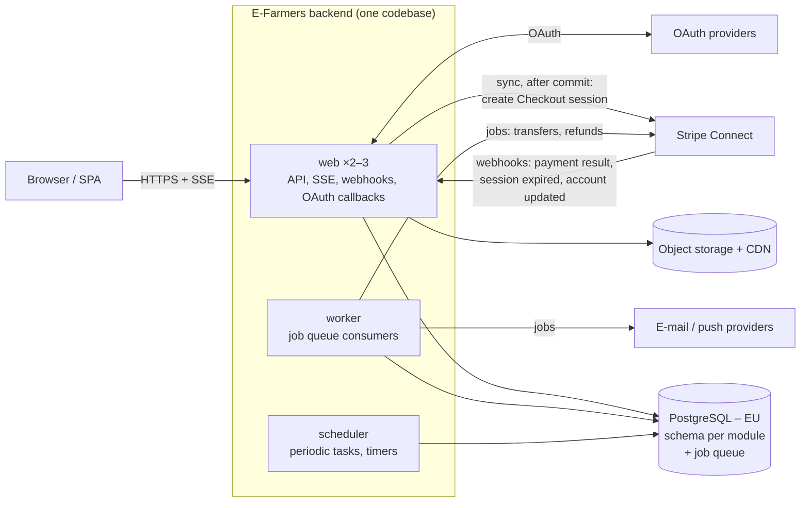
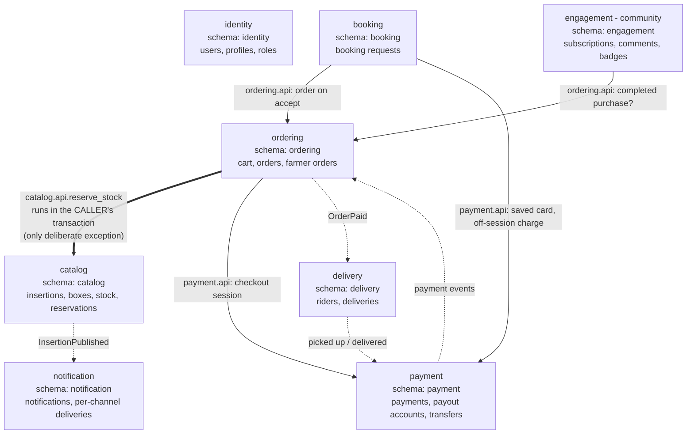

# Transcript – original run (before the skills)

Source: `C:/Users/Fifov/.claude/projects/c--Users-Fifov-Documents-MATFYZ-2mAIN-AI-AI4SE-Labs-2026/ad3caea8-5fc7-4e78-a125-fe36696b00e2.jsonl` (Claude Code session log, read-only).
Generated by a script: user and assistant text kept verbatim and in order; tool calls shortened to one line each (`[tool: …]`, with result status); internal reasoning blocks, tool outputs and automatic system reminders omitted; IDE context (selected lines / opened file) shortened to one line.

## User

> [image attached: screenshot]

pribudlo na hlavnej stranke novy week vieme ho dat k nam?https://github.com/Neltharion59/AI4SE_Labs_2026

## Assistant

> [tool: Bash Show remotes and branch status → ok]
> [tool: Bash Add upstream remote, fetch and merge new week → ok]
Áno, Week 05 je už u teba lokálne.

- Pridal som remote `upstream`, ktorý ukazuje na `Neltharion59/AI4SE_Labs_2026`, stiahol som z neho zmeny a zlúčil ich do tvojej vetvy `main`. Konflikty neboli.
- Pribudol priečinok [Week_05_Designing/Tasks/](Week_05_Designing/Tasks/) so zadaniami Task_1 až Task_3 a dátami v `data/` (CDC, EFarmers, EventTicket, NFFH, OneSport, RecipeCove, RentYourExpert, Teamify).
- Tvoja práca z Week 04 zostala nedotknutá.

Merge commit je zatiaľ iba lokálny, na tvoj fork na GitHube som ho nepushol. Ak ho tam chceš mať, spusti `git push origin main`, alebo mi povedz a pushnem ho ja.

Keď nabudúce pribudne nový týždeň, stačí spustiť `git fetch upstream && git merge upstream/main`.

## User

rozanalyzuj si to a podme na week 5

## Assistant

> [tool: Bash Read Week 05 tasks and list Week 04 layout → ok]
Week 05 som si prešiel. Má tri úlohy, ktoré na seba nadväzujú:

| Task | Čo treba spraviť | Výstup | Body |
|---|---|---|---|
| **1** | Rozobrať so mnou 3 rôzne architektúry pre tvoj projekt, aj s trade-offmi a s tým, čo bude pri implementácii bolieť | záznam konverzácie a poznámky | 1.5b |
| **2** | Z diskusie vytvoriť ADR a niekoľkokrát ho spolu upraviť (tabuľka, diagram, štruktúra) | záznam konverzácie a finálne ADR | 1.5b |
| **3** | Z Task 1 a 2 spraviť Skill, v novej session zopakovať Task 1 a 2 so skillom a porovnať priebeh bez neho a s ním | skill a krátky report | 2b |

**Ako budem písať poznámky:** od začiatku si budem viesť priebežný zápis diskusie, napríklad `Week_05_Designing/Task_1/NOTES.md`, a pri každej architektúre zapíšem aj tvoje otázky a rozhodnutia. Rovnako to budem robiť v Task 2. Tieto záznamy potom poslúžia ako vstup pre Task 3.

**Čo potrebujem od teba:** každý študent má projekt pridelený mailom a v `data/` je 8 projektov: CDC, EFarmers, EventTicket, NFFH, OneSport, RecipeCove, RentYourExpert a Teamify. **Ktorý projekt máš ty?**

Keď mi ho napíšeš, načítam požiadavky, založím súbor s poznámkami a navrhnem prvú architektúru.

## User

moi projekt je EFarmers

## Assistant

> [tool: Bash Read EFarmers requirements → ok]
> [tool: Write Week_05_Designing/Task_1/NOTES.md → ok]
Požiadavky k EFarmers som prečítal a založil som [Week_05_Designing/Task_1/NOTES.md](Week_05_Designing/Task_1/NOTES.md). Odteraz si tam budem priebežne zapisovať, čo navrhnem, na čo sa ma pýtaš a na čom sa dohodneme. Bude to podklad pre Task 2 aj Task 3.

## Čo zo zadania vyplýva

- **Roly:** jeden účet môže byť naraz zákazník, farmár aj kuriér (rider). Zákazník sa na farmára alebo ridera „upgraduje“, nejde o tri oddelené typy používateľov.
- **Dva spôsoby nákupu:**
  - košík → objednávka → platba hneď,
  - rezervácia z kalendára (booking), ktorú musí farmár prijať alebo zamietnuť.
- **Zdroj problémov pri implementácii:**
  1. Dvaja zákazníci kupujú posledný box naraz, hrozí predaj viac kusov, ako je na sklade (overselling).
  2. Platobná brána a webhooky: čo sa stane s rezervovaným tovarom, keď platba zlyhá.
  3. Časovo riadené veci, teda exspirácia boxov a nevybavené rezervácie, potrebujú plánované úlohy.
  4. Notifikácie: z jednej novej ponuky treba poslať správu všetkým odberateľom farmára.
  5. Výber voľného ridera a stavy doručenia.

**Predpoklady, ktoré v zadaní nie sú:** regionálny trh, rádovo tisíce používateľov, malý tím. Ide o peniaze, takže konzistencia dát je dôležitejšia ako extrémna škálovateľnosť.

## Plán: 3 architektúry
1. **Modulárny monolit** (navrhujem nižšie)
2. **Mikroslužby s event-driven komunikáciou** (message broker)
3. **Serverless / BaaS** (napr. Supabase/Firebase + cloud funkcie + Stripe)

## Architektúra 1: Modulárny monolit

Celý backend je jedna aplikácia, vnútri rozdelená na moduly podľa domény: identity, catalog, booking, ordering, payment, delivery, notification a engagement. K tomu jedna PostgreSQL databáza, worker na úlohy na pozadí a frontend.

**Ako rieši problémové miesta:**
- **Overselling:** sklad sa znižuje atomickým príkazom `UPDATE box SET qty = qty - n WHERE id = ? AND qty >= n` v transakcii. Ak príkaz nezmení žiadny riadok, tovar sa minul.
- **Objednávka a rezervácia skladu** sa vytvoria v jednej transakcii. Ak zákazník do N minút nezaplatí, job rezerváciu uvoľní.
- **Platba:** používa sa Stripe Checkout. Objednávku označí ako zaplatenú iba webhook od Stripe, nie redirect prehliadača. Webhook sa spracúva idempotentne podľa event id.
- **Notifikácie:** modul catalog vyšle udalosť `InsertionPublished`, notification modul na ňu reaguje a správy všetkým odberateľom rozošle worker na pozadí.

**Výhody:** najjednoduchší vývoj, testovanie aj nasadenie; jedna ACID transakcia pokryje košík, sklad aj objednávku; lacný hosting.
**Nevýhody:** škáluje sa iba ako celok; hranice modulov sa bez disciplíny časom rozmazávajú; jeden chybný deploy zhodí celú aplikáciu.

---

**Otázky na teba, aby diskusia bola poriadna:**
1. Je ti jasné, prečo stačí podmienka `qty >= n` v `UPDATE` a netreba zámok aplikácie (napr. `SELECT ... FOR UPDATE`)? Alebo to mám rozpísať?
2. Ako by sa podľa teba mal správať booking? Má farmárovo prijatie rezervácie automaticky vytvoriť objednávku a vyžiadať platbu, alebo zákazník platí až pri prevzatí?
3. Sedia ti predpoklady o škále a tíme, alebo chceš počítať s niečím väčším? To dosť ovplyvní, ako dobre obstojí architektúra 2.

Pýtaj sa na čokoľvek. Keď budeš s monolitom spokojný, prejdeme na mikroslužby.

## User

> [IDE context: The user selected the lines 1 to 15 from c:\Users\Fifov\Documents\MATFYZ\2mAIN\AI\AI4SE_Labs_2026\Week_05_Designing\Tasks\Task_1.md: # Task 1 Assignment Have yo]

<pasted_content id="94b8">
K tvojim otázkam:

1) Myslím, že to chápem. V PostgreSQL pri READ COMMITTED si UPDATE zamkne riadok a súbežná transakcia počká. Po commite prvej transakcie druhá znovu vyhodnotí WHERE nad novou verziou riadku. Ak qty >= n už neplatí, zmení 0 riadkov. SELECT ... FOR UPDATE by bol potrebný až vtedy, keď rozhodnutie závisí od viacerých čítaní. Doplň ale dve veci: čo keď košík obsahuje 3 boxy od rôznych farmárov a dvaja zákazníci ich odpisujú v opačnom poradí? Nehrozí deadlock? A ako riešiš čiastočný úspech, keď 2 boxy sú na sklade a tretí nie?

2) Navrhujem, aby rezervácia z kalendára neodpisovala sklad ani nič nepredautorizovala, kým ju farmár neprijme. Po prijatí vznikne objednávka v stave „čaká na platbu“ s lehotou napr. 24 h. Ak zákazník nezaplatí, objednávka prepadne a sklad sa vráti. Predautorizáciu karty (Stripe manual capture) som zavrhol, lebo autorizácia drží zhruba 7 dní a sezónne rezervácie môžu byť na týždne dopredu. Ak vidíš lepšie riešenie, vyvráť mi to.

3) Predpoklady sedia, ale počítaj so sezónnymi špičkami (jahody, sobotné ráno), keď je záťaž 10× vyššia a všetci kupujú tie isté boxy. Ako sa monolit správa v takej chvíli?

A dve ďalšie otázky k platbe:

4) Rezervácia skladu drží N minút, ale Stripe Checkout session má vlastnú platnosť (ak sa nemýlim, minimálne 30 minút). Čo sa stane, keď zákazník zaplatí po tom, ako job tovar uvoľnil a kúpil ho niekto iný? Ako zosúladíš tieto dva časovače?

5) E-Farmers je marketplace. Ak košík obsahuje boxy od troch farmárov, kto dostane peniaze? Vyberie platforma všetko a potom vypláca farmárom, alebo použijeme Stripe Connect? Aké to má dôsledky pre implementáciu aj právne?

Všetko, na čom sa dohodneme, zapíš do NOTES.md.
</pasted_content id="94b8">

## Assistant

> [tool: Edit Week_05_Designing/Task_1/NOTES.md → ok]
Všetko, na čom sme sa dohodli, je zapísané v [NOTES.md](Week_05_Designing/Task_1/NOTES.md), v sekcii *Discussion log* pri architektúre 1.

**1) Deadlock a čiastočný úspech.** Tvoje vysvetlenie atomického `UPDATE` je správne.
- **Deadlock reálne hrozí.** Ani jeden `UPDATE` cez viac riadkov v PostgreSQL nezaručuje poradie zamykania. Riešenie je odpisovať boxy vždy v rovnakom poradí, podľa `box_id` vzostupne. Pri rovnakom poradí zámkov nevznikne cyklus. Ako poistka sa pri chybe `40P01` celá transakcia zopakuje, najviac 3-krát.
- **Čiastočný úspech nepovolíme, rezervuje sa všetko alebo nič.** Ak niektorý `UPDATE` nezmení žiadny riadok, nasleduje ROLLBACK a zákazník dostane zoznam boxov, ktoré už nie sú dostupné. Košík si upraví a skúsi znova.

**2) Rezervácia z kalendára (booking).** Tvoja úvaha o predautorizácii (~7 dní) je správna. Dlhšie autorizácie existujú, ale len pre niektoré typy obchodníkov. Navrhujem k tomu jedno vylepšenie:
- Pri rezervácii sa vytvorí **SetupIntent**, ktorý uloží kartu so súhlasom zákazníka na neskoršiu platbu bez jeho účasti. Nič sa neblokuje, takže nehrozí ani exspirácia.
- Keď farmár rezerváciu prijme, platba sa strhne **off-session**, teda bez akcie zákazníka.
- Ak banka vyžiada 3DS, prejde sa na **tvoj postup**: objednávka „čaká na platbu“ a zákazník dostane link so 24 h lehotou.
- Doplnil som aj lehotu pre farmára: ak na rezerváciu neodpovie do 48 h, automaticky sa zamietne.

**3) Sezónne špičky.** 10× viac pri tisícoch používateľov je stále málo, takže 2–3 inštancie aplikácie bez stavu za load balancerom to zvládnu.
- Skutočné úzke hrdlo je **jeden populárny riadok**. Všetky nákupy toho istého boxu čakajú na jeho zámok jeden za druhým, takže priepustnosť závisí iba od toho, ako dlho transakcia zámok drží.
- Z toho vyplýva hlavné pravidlo: **žiadne volanie Stripe ani iná sieťová komunikácia v transakcii so skladom.**
- Sklad sa rezervuje až pri prechode na pokladňu, nie pri pridaní do košíka.
- Pomôže aj PgBouncer (pool spojení k databáze), cache na katalóg a CDN na fotky.

**4) Dva časovače.** Stripe Checkout session musí platiť 30 min až 24 h. Riešenie má tri vrstvy:
1. Iba jeden časovač: `expires_at` session sa nastaví rovnako ako platnosť rezervácie, na 30 min.
2. Sklad sa uvoľní **až keď je session mŕtva**. Spúšťačom je webhook `checkout.session.expired`, alebo job najprv session sám ukončí. Ak Stripe odpovie, že session už bola zaplatená, sklad sa neuvoľní.
3. Platba sa iba autorizuje (`capture_method=manual`). Keď príde webhook o dokončení a rezervácia ešte platí, peniaze sa strhnú. Ak rezervácia neplatí, skúsi sa sklad zarezervovať znova. Ak ani to nevyjde, **autorizácia sa zruší**. Peniaze sa vôbec nepohnú, takže netreba robiť refund.
- Toto nie je v rozpore s bodom 2, lebo peniaze sa strhnú do pár minút, nie o týždne.

**5) Peniaze v marketplace.**
- Ak by platforma vyberala všetko a sama vyplácala farmárov, držala by cudzie peniaze. V EÚ to spadá pod PSD2 (platobné služby) a hrozí povinnosť mať licenciu a AML povinnosti. To sme zamietli.
- **Zvolili sme Stripe Connect Express s modelom separate charges and transfers.** Zákazník zaplatí jednou platbou, potom ide samostatný transfer každému farmárovi, rider dostane transfer za doručenie a platforme zostane provízia. Model *destination charges* nevyhovuje, lebo pri ňom ide jedna platba iba jednému príjemcovi.
- Dôsledky pre implementáciu:
  - Model objednávky bude `Order` → `FarmerOrder` (čiastková objednávka pre každého farmára) → `OrderItem`.
  - Farmár nemôže predávať, kým nedokončí Connect onboarding. To mení user story 12 (zmena statusu na farmára).
  - Refund časti od jedného farmára znamená čiastočný refund a transfer reversal.
- **Právne:** platforma ručí za chargebacky a otázku DPH a faktúr treba overiť s účtovníkom. Toto nie je právna rada.

**Otvorená otázka:** bude jeden rider zvážať celú objednávku z viacerých fariem, alebo pôjde zvlášť pre každú čiastkovú objednávku od farmára? Je to dôležité pre cenu doručenia aj pre spôsob, ako sa vyberá rider.

Ak máš k monolitu ešte otázky, pýtaj sa, inak môžeme prejsť na **architektúru 2: mikroslužby s event-driven komunikáciou**. Pri nej uvidíš, ako bolestivo sa z jednej transakcie stane distribuovaná sága.

## User

<pasted_content id="94b8">
K otvorenej otázke o doručení: navrhujem, aby doručenie bolo samostatne pre každú FarmerOrder, teda jeden odber a jedno doručenie. Dôvody: farmári pripravujú boxy nezávisle a v inom čase, a ak jeden farmár box nepripraví, nezablokuje to ostatné. Na začiatku to nevyžaduje plánovanie trás. Cena doručenia sa vypočíta podľa vzdialenosti farma → zákazník. Výber ridera: ponuka ide všetkým dostupným riderom v okruhu a získa ju ten, kto prijme prvý, cez rovnaký atomický vzor ako pri sklade:
UPDATE delivery SET rider_id = ? WHERE id = ? AND rider_id IS NULL.
Nevýhoda je, že zákazník pri nákupe od troch farmárov zaplatí tri doručenia. Spájanie doručení by som nechal na neskôr. Súhlasíš, alebo vidíš problém?

Ďalšie otázky:

1) Tvoje 3 vrstvy pri časovačoch: ak sa sklad uvoľňuje iba vtedy, keď je session mŕtva (expired webhook alebo naše vlastné ukončenie session), kedy reálne nastane situácia, že príde platba po vypršaní rezervácie? Nie je manual capture zbytočná zložitosť? Navyše ho niektoré platobné metódy nepodporujú. A čo asynchrónne metódy ako SEPA debit, kde je platba niekoľko dní v stave "processing"? Držíme sklad celý ten čas?

2) Kedy presne odíde transfer farmárovi a riderovi? Hneď po platbe, alebo až keď rider označí objednávku ako doručenú (US 34)? Ak hneď a box sa nedoručí, treba robiť transfer reversal. Pri Express účtoch ručí za záporný zostatok farmára platforma. Ak až po doručení, ako dlho môžu peniaze ležať na účte platformy?

3) Hranice modulov: kto vlastní tabuľku box? Ak modul ordering robí UPDATE box SET qty ..., siaha do dát katalógu, a to je presne rozmazávanie hraníc, ktoré si uviedol ako nevýhodu. Ako to konkrétne vynútiš (samostatné schémy, verejné rozhranie modulu, kontrola importov v CI)?

4) Udalosť InsertionPublished: posiela sa synchrónne v rámci procesu, alebo cez frontu? Čo sa stane, keď sa transakcia commitne a proces spadne skôr, ako sa job na notifikácie zaradí do fronty? Ukáž mi, ako by vyzeral transactional outbox v tomto monolite.

Zapíš to do NOTES.md.
</pasted_content id="94b8">

## Assistant

> [tool: Edit Week_05_Designing/Task_1/NOTES.md → ok]
Celé to je zapísané v [NOTES.md](Week_05_Designing/Task_1/NOTES.md) (doručenie a Q6–Q9).

## Doručenie po jednotlivých FarmerOrder
Súhlasím. Atomický `UPDATE ... WHERE rider_id IS NULL` je tu správny vzor. Treba doplniť situácie, keď sa niečo pokazí:
- **Rider prijme a nepríde.** Doručenie bude mať stavy `OFFERED → ASSIGNED → PICKED_UP → DELIVERED`. Ak rider box nevyzdvihne do X minút od chvíle, keď ho farmár označí ako pripravený, `rider_id` sa vynuluje a ponuka ide znova ostatným.
- **Nikto neprijme.** Po T minútach sa rozšíri okruh. Ak ani potom nikto neprijme, zákazník dostane na výber osobný odber alebo vrátenie poplatku za doručenie. Výber ridera nesmie visieť donekonečna.
- **Koľko doručení môže mať rider naraz?** Treba to rozhodnúť výslovne. Ak najviac jedno, vynúti to priamo databáza čiastočným unique indexom na `delivery(rider_id) WHERE status IN ('ASSIGNED','PICKED_UP')`.
- **Vzdialenosť.** Na začiatok stačí vzdušná čiara (haversine) × 1,3 namiesto plateného routing API. Adresy fariem aj zákazníkov sa preložia na súradnice raz, pri uložení.
- **V košíku** sa už pred pokladňou ukážu tri poplatky za doručenie a zákazník si pri každom farmárovi môže zvoliť osobný odber.

## 1) Manual capture: máš pravdu
Ak platia vrstvy 1 a 2, Stripe nedovolí dokončiť platbu v session, ktorá už vypršala, a ukončenie session zlyhá, ak je už zaplatená. Pri synchrónnych metódach teda „platba po uvoľnení skladu“ nemôže nastať. **Manual capture vyhadzujeme.** Ostane iba obranný handler: ak predsa príde webhook o zaplatení pre objednávku bez rezervácie (bug alebo ručný zásah), skúsi sa sklad zarezervovať znova, inak nasleduje automatický refund a upozornenie.

**SEPA a iné asynchrónne metódy:** držať čerstvé boxy niekoľko dní nejde, lebo exspirujú. Odoslať tovar skôr, ako sú peniaze isté, je zas riskantné, lebo pri SEPA môže zákazník platbu napadnúť až 8 týždňov. **Rozhodnutie:**
- Pri okamžitom nákupe ponúkneme iba metódy s okamžitým potvrdením (karty, peňaženky).
- **SEPA iba pri rezerváciách z kalendára.** Tam sa hodí na flow so SetupIntent a SEPA mandátom z bodu Q2, lebo zber je o týždne a spracovanie platby stihne prebehnúť.

## 2) Kedy idú peniaze farmárovi a riderovi
Odoslať ich hneď nechceme, lebo za záporný zostatok farmára by ručila platforma. Dlho ich držať tiež nie, lebo by sme sa vrátili k držaniu cudzích peňazí. **Každý dostane peniaze, keď splní svoju časť:**
- **farmár** pri odovzdaní boxu (`PICKED_UP` alebo osobný odber zákazníkom); ak sa doručenie potom pokazí, nie je to jeho chyba,
- **rider** pri `DELIVERED`.

Transfery sa naviažu na pôvodnú platbu cez `source_transaction`, takže fungujú aj vtedy, keď peniaze ešte nie sú pripísané.

US 34 má problém s dôverou, lebo rider si „doručené“ označuje sám. Preto zákazník môže do 24 h doručenie potvrdiť alebo reklamovať, inak sa potvrdí automaticky. Pri reklamácii nasleduje refund a peniaze sa riderovi stiahnu (transfer reversal).

## 3) Kto vlastní `box`
**Tabuľku `box` vlastní katalóg.** Modul ordering do nej nikdy nezapisuje. Volá iba verejnú funkciu katalógu `catalog.api.reserve_stock(items, ref, uow)`, v ktorej je zoradený `UPDATE` z Q1.

Aby objednávka a rezervácia skladu boli atomické, funkcia beží v transakcii volajúceho modulu (zdieľaný unit of work). Je to vedomé previazanie modulov a zdokumentujeme ho. Pri rozdelení na služby by sa z neho stala sága, teda architektúra 2.

Ako hranice vynútiť:
- **Databáza:** každý modul má vlastnú schému a medzi schémami nie sú cudzie kľúče. `order_item` si pri nákupe uloží kópiu názvu a ceny, čo potrebujeme aj pre históriu objednávok (US 22).
- **Kód:** každý modul má verejnú časť `api/` a súkromnú `internal/`. Iné moduly smú importovať iba `api/`.
- **CI:** build zlyhá na zakázanom importe. Na to slúži `import-linter` (Python), ArchUnit (Java) alebo dependency-cruiser (TS).

## 4) Transactional outbox
Synchrónne volanie má dva zlé varianty:
- **v transakcii:** rozosielanie spomalí request a keď zlyhá notifikácia, vráti sa aj zverejnenie ponuky,
- **po commite:** ak proces spadne medzi commitom a zaradením do fronty, udalosť sa stratí.

Outbox to rieši tak, že sa udalosť zapíše do tabuľky **v tej istej transakcii** ako samotná zmena:

```python
with uow.transaction():
    insertion = repo.insert(...)
    outbox.add("InsertionPublished", {"insertion_id": insertion.id, "farmer_id": farmer_id})
```

Samostatný proces (relay) potom udalosti vyberá cez `SELECT ... WHERE processed_at IS NULL FOR UPDATE SKIP LOCKED`, odošle ich ďalej a označí ich ako spracované. Udalosť príde **aspoň raz**, teda niekedy aj dvakrát, takže handler musí byť idempotentný:

```sql
INSERT INTO notification.notification (event_id, user_id, ...)
SELECT :event_id, s.customer_id, ... FROM engagement.subscription s WHERE s.farmer_id = :farmer_id
ON CONFLICT (event_id, user_id) DO NOTHING;
```

Celá schéma a kód relay procesu sú v NOTES.md.

**Zjednodušenie, ktoré sme prijali:** ak je fronta jobov tiež v PostgreSQL (Procrastinate, pg-boss, Oban, Solid Queue), zaradenie jobu v rovnakej transakcii už samo je outbox a samostatný relay netreba. Plnohodnotný outbox potrebujeme až pri externom brokeri, teda v architektúre 2.

---

Ostáva otvorené produktové rozhodnutie, koľko doručení môže mať rider naraz.

Ak ti k monolitu nič nechýba, poďme na **architektúru 2: mikroslužby s event-driven komunikáciou**. Uvidíš na nej, ako sa zdieľaná transakcia pri `reserve_stock` zmení na ságu s kompenzáciami a prečo outbox prestane byť voliteľný.

## User

<pasted_content id="94b8">
K otvorenej otázke: v MVP môže mať rider naraz najviac jedno aktívne doručenie, takže čiastočný unique index stačí. Ak by sme neskôr povolili najviac 3, unique index to už nevynúti. Ako by si zabránil tomu, aby dva súbežné requesty videli "rider má 2 doručenia" a oba pridali tretie? Zamknutie riadku ridera, SERIALIZABLE, alebo niečo iné?

1) Časové úlohy: vypíš všetky časovo riadené veci, ktoré nám v diskusii vznikli (rezervácia skladu, odpoveď farmára na booking, vyzdvihnutie riderom, rozšírenie okruhu, potvrdenie doručenia...). Ako ich spustíš, aby pri dvoch inštanciách nebežali dvakrát? Potrebujú exspirujúce boxy (US 11) vôbec job, alebo stačí dotaz nad expires_at? A čo sa stane s exspirovaným boxom, ktorý má niekto v košíku?

2) Roly: jeden účet môže byť zákazník, farmár aj rider (US 12, 24). Ako to bude v databáze? Keďže rider tiež dostáva transfery, potrebuje aj on Connect onboarding? Kde presne sa kontroluje, že ponuku mení, maže alebo k nej pridáva boxy len jej vlastník (US 9, 10, 31), a že komentár môže pridať len ten, kto box kúpil (US 23)?

3) Registrácia e-mailom a cez OAuth (US 1, 29): používateľ sa zaregistruje e-mailom a neskôr sa prihlási cez Google s tou istou adresou. Spojíš účty automaticky? Aké je riziko, ak OAuth poskytovateľ nemá overený e-mail?

4) Notifikácie: in-app riadky cez INSERT ... SELECT sú jasné. Ak ale chceme posielať aj e-mail alebo push, je to 5 000 externých volaní. Ako riešiš rate limity poskytovateľa, opakovanie pri zlyhaní pre jednotlivého príjemcu a to, aby nikto nedostal e-mail dvakrát?

5) Zhrnutie architektúry 1: vypíš, aké procesy reálne nasadzujeme (web, worker, scheduler...) a čo z toho pri malom tíme najviac zabolí po roku prevádzky. Do NOTES.md zapíš záverečné výhody, nevýhody a riziká monolitu na základe celej diskusie, nie iba tých úvodných.
</pasted_content id="94b8">

## Assistant

> [tool: Edit Week_05_Designing/Task_1/NOTES.md → ok]
Všetko je v [NOTES.md](Week_05_Designing/Task_1/NOTES.md) v bodoch Q10–Q15. Na konci sekcie architektúry 1 je aj nové záverečné hodnotenie monolitu po celej diskusii.

## Limit „najviac 3 doručenia“
- **SERIALIZABLE zamietam.** Kvôli jednému pravidlu by každá transakcia nad týmito tabuľkami potrebovala opakovanie pri zlyhaní a padala by aj tam, kde reálne ku konfliktu nedošlo.
- **`FOR UPDATE` na riadku ridera funguje**, ale logika „prečítaj, spočítaj a zapíš“ sa rozsype po kóde.
- **Zvolil som počítadlo a rovnaký atomický vzor ako pri sklade:** rider bude mať stĺpec `active_deliveries` s `CHECK (BETWEEN 0 AND 3)` a pridelenie robí `UPDATE ... SET active_deliveries = active_deliveries + 1 WHERE user_id = ? AND active_deliveries < 3`. Ak príkaz nezmení žiadny riadok, rider už má plno.
  - Zníženie počítadla prebehne v tej istej transakcii ako prechod na `DELIVERED` alebo zrušenie.
  - Raz za noc job porovná počítadlo so skutočným počtom aktívnych doručení. To zachytí odchýlky spôsobené chybami v kóde.

## 1) Časovo riadené úlohy
Je ich 7 s termínom pre konkrétnu entitu a pár periodických:

| Čo | Lehota | Akcia |
|---|---|---|
| T1 rezervácia skladu | 30 min | ukončiť session, uvoľniť sklad |
| T2 booking čaká na farmára | 48 h | automaticky zamietnuť |
| T3 booking čaká na platbu | 24 h | objednávka prepadne |
| T4 / T5 nikto neprijal doručenie | T / T2 min | rozšíriť okruh / vzdať to |
| T6 rider nevyzdvihol | X min | odobrať riderovi, ponúknuť znova |
| T7 nepotvrdené doručenie | 24 h | potvrdiť automaticky, poslať transfer riderovi |
| T8 odznaky, T9 kontrola so Stripe | periodicky | – |

- **Úlohy pre konkrétnu entitu** sa naplánujú ako odložený job (`run_at = deadline`) v tej istej transakcii, v ktorej entita vzniká. Netreba nič periodicky prehľadávať.
- **Periodické úlohy** spúšťa knižnica fronty, ktorá zabráni duplicitnému spusteniu cez unikátny kľúč alebo advisory lock.
- **Skutočná záruka je, že dvojité spustenie nič nepokazí.** Každý job je podmienený prechod stavu, napríklad `UPDATE booking SET status='DECLINED' WHERE id=? AND status='PENDING'`. Ak medzitým farmár rezerváciu prijal, príkaz nezmení žiadny riadok a nič sa nestane.
- **Exspirujúce boxy (US 11) job nepotrebujú.** Exspirácia sa nikam neukladá, iba sa zisťuje dotazom: predajné sú boxy s `expires_at > now()` a „končiace“ tie s `expires_at` do 48 h. Stačí index na `expires_at`.
- **Exspirovaný box v košíku** sa zobrazí šedý ako nedostupný. `reserve_stock` má navyše podmienku `expires_at > now() + TTL rezervácie`, takže sa nedá kúpiť box, ktorý by exspiroval počas platby.

## 2) Roly, výplaty a autorizácia
- Každý `user` je zákazník. Ďalšie roly majú vlastné tabuľky v pomere 1:1: `farmer_profile` a `rider_profile`, lebo každá rola má iné dáta.
- **Rider potrebuje Connect onboarding.** Majiteľ účtu môže byť farmár aj rider, preto bude **jeden prepojený Stripe účet na osobu** v tabuľke `payout_account`. Kým nie je onboarding dokončený (`payouts_enabled`), rider sa nemôže prepnúť na „dostupný“.
- **Vlastníctvo** sa kontroluje v doménovej službe modulu a priamo v SQL: `UPDATE insertion ... WHERE id = ? AND farmer_id = :actor`. Ak príkaz nezmení žiadny riadok, vráti sa 404 a nie 403, aby sa neprezradilo, že ponuka existuje. Rovnako sa rieši mazanie (US 9), úprava (US 10) a pridávanie boxov (US 31). Kontrola iba v kontroléri alebo vo frontende nestačí.
- **Komentár (US 23)** je viazaný na konkrétny nákup: `comment(farmer_order_id UNIQUE, ...)`. Povolený je iba kupujúcemu a až po vyzdvihnutí alebo doručení, a na jeden nákup pripadá najviac jeden komentár.

## 3) Prepojenie e-mailu a OAuth
- Identity sa ukladajú do tabuľky `user_identity(provider, provider_subject)` a kľúčom je provider `sub`, nie e-mail.
- **Účty sa spoja automaticky iba vtedy, keď sú overené obe strany:** Google vráti `email_verified=true` a aj náš lokálny e-mail je overený.
- **Hrozí útok, pri ktorom útočník založí účet vopred.** Útočník sa zaregistruje heslom na e-mail obete, napríklad obeť@gmail.com, a ten nikdy neoverí. Keď sa obeť neskôr prihlási cez Google a účty sa spoja, heslo útočníka stále funguje.
  - Obrana: pri neoverenom lokálnom účte má prednosť OAuth a heslo aj všetky sessions sa zneplatnia.
- Ak poskytovateľ e-mail neoverí, účty sa nikdy automaticky nespoja. Používateľ sa musí prihlásiť heslom a poskytovateľa si prepojí ručne v nastaveniach.
- OAuth tok nebudeme písať sami, použijeme overenú knižnicu.

## 4) Rozosielanie e-mailov a push notifikácií
- Pribudne tabuľka `notification_delivery` s obmedzením `UNIQUE(notification_id, channel)`, teda jeden riadok pre každého príjemcu a kanál. Vďaka tomu sa každý príjemca opakuje nezávisle s exponenciálnym odstupom. Pri trvalej chybe (bounce, neplatný token) sa pokus označí ako `FAILED` a už sa neopakuje.
- **Rate limit** riešime samostatnou frontou `email` s obmedzeným počtom súbežných jobov, token bucketom a batch API poskytovateľa (FCM berie 500 príjemcov na jedno volanie).
- **Duplicitné e-maily:** doručenie práve raz cez sieť sa zaručiť nedá. Stavy pôjdu `PENDING → SENDING → SENT` a ako idempotency key poskytovateľa poslúži id doručenia. Ak poskytovateľ idempotency key nepodporuje, **vedome volíme doručenie aspoň raz**: zriedkavý duplikát je lepší ako stratená notifikácia.
- Objem zníži **digest**: viac nových ponúk v krátkom čase pôjde používateľovi ako jeden e-mail.
- Každý e-mail musí mať odkaz na odhlásenie.

## 5) Čo reálne nasadzujeme
Jeden codebase s tromi vstupnými bodmi:
- `web`: 2–3 inštancie bez stavu, API, frontend a webhooky,
- `worker`: konzumenti fronty jobov,
- `scheduler`: periodické úlohy.

K tomu jeden managed PostgreSQL s PgBouncerom, object storage s CDN a externé služby (Stripe, e-mail, FCM, OAuth, geokódovanie).

**Čo po roku prevádzky najviac zabolí:**
1. **Hraničné prípady pri peniazoch:** refundy, transfer reversals, chargebacky a nesúlad medzi Stripe a databázou. Najväčšia záťaž na podporu, preto treba admin rozhranie od prvého dňa.
2. **Množstvo stavových automatov s časovačmi.** Objednávky, rezervácie, doručenia a platby, ktoré niekde „zaseknú“, sa zle ladia. Treba históriu stavov, observability a v testoch falošné hodiny (fake clock).
3. **Všetko stojí na jednej databáze.** Tabuľky jobov a notifikácií rastú, takže treba pravidlá na mazanie starých dát. Migrácie počas sezóny nesmú zamknúť veľké tabuľky.
4. **Rozpadávanie hraníc modulov** pod tlakom termínov („len jeden join do katalógu“).
5. **Výpadky externých služieb** musia mať rozumnú náhradu. Napríklad pokladňa sa vypne so zrozumiteľnou správou a notifikácie sa pošlú neskôr.

---

Architektúra 1 je podľa mňa uzavretá. Ďalej môžeme ísť na **architektúru 2: mikroslužby s event-driven komunikáciou**. Ako prvé prerobím `reserve_stock` a vytvorenie objednávky na ságu s kompenzáciami, aby bolo vidno, čo nám zdieľaná transakcia doteraz zadarmo riešila. Môžem začať?

## User

<pasted_content id="94b8">
Súhlasím, architektúru 1 považujem za uzavretú. Jedna drobnosť na overenie: podľa mňa FCM HTTP v1 API už nemá skutočný batch endpoint a sendEachForMulticast v Admin SDK posiela pod kapotou 500 samostatných requestov. Over si to a ak mám pravdu, oprav to v NOTES.md.

Teraz architektúra 2: mikroslužby s event-driven komunikáciou. Kým prejdeš na ságu, chcem najprv celkový obraz, inak nebude mať sága kontext:

1) Zoznam služieb, aké dáta každá vlastní a prečo sú hranice práve takto. Vychádzaj z modulov monolitu. Ktoré moduly by si nechal spolu, lebo sú príliš malé alebo príliš previazané na samostatnú službu?

2) Broker: Kafka, RabbitMQ, alebo niečo iné? Prečo práve pre tento systém a jeho objem?

3) Pravidlo komunikácie: kedy synchrónne (REST/gRPC) a kedy cez udalosti? Konkrétne: košík potrebuje cenu a dostupnosť boxu z katalógu. Volá katalóg synchrónne, alebo si drží vlastnú kópiu dát?

4) Checkout ako sága krok po kroku (objednávka → rezervácia skladu → Stripe session → platba → potvrdenie). Orchestrácia alebo choreografia, a prečo? Uveď kompenzáciu pri každom kroku, ktorý môže zlyhať, a pri každom kroku aj to, čo v monolite riešila zdieľaná transakcia zadarmo.

5) Kam sa presunie to, čo sme vyriešili v monolite: ktorá služba vlastní časovače T1–T7, ktorá prijíma Stripe webhooky a ako sa služba platieb dozvie o stavoch PICKED_UP a DELIVERED, aby poslala transfery?

6) Identita: ako sa ostatné služby dozvedia, kto je prihlásený a aké má roly? Čo keď sa zákazník zmení na farmára (US 12) a v tokene má ešte starú rolu?

Na konkrétne zlyhania sa budem pýtať v ďalšom kole. Zapisuj do NOTES.md, do sekcie architektúry 2.
</pasted_content id="94b8">

## Assistant

> [tool: ToolSearch select:WebSearch → ok]
> [tool: WebSearch FCM HTTP v1 batch send deprecated sendEachForMulticast individual requests → ok]
> [tool: Edit Week_05_Designing/Task_1/NOTES.md → ok]
> [tool: Edit Week_05_Designing/Task_1/NOTES.md → ok]
Celkový obraz architektúry 2 je zapísaný v [NOTES.md](Week_05_Designing/Task_1/NOTES.md) v sekciách A2.1–A2.6. Oprava k FCM je pri Q14 v architektúre 1.

## FCM: máš pravdu
Starý batch endpoint vypli v júni 2024. `sendEach` aj `sendEachForMulticast` (max. 500 tokenov) pod kapotou posielajú **jeden HTTP v1 request na každú správu**, súbežne cez HTTP/2. Push teda znamená N requestov a rate limit aj opakovanie pre každého príjemcu platia rovnako ako pri e-maile. V poznámkach je to opravené.

Pridal som aj alternatívu: **FCM topics**, napríklad téma `farmer_<id>`, do ktorej sa zákazník prihlási, keď začne farmára sledovať. Na rozoslanie potom stačí jeden request. Stratíme ale sledovanie doručenia jednotlivým príjemcom.

## 1) Služby
Pravidlo pre hranice: služba = hranica konzistencie + dôvod meniť sa nezávisle.

| Služba | Vlastní |
|---|---|
| **Identity** (hotový IdP, napr. Keycloak) | účty, OAuth, roly |
| **Catalog** | ponuky, boxy, **sklad a rezervácie**, kalendár, stránka farmára, vyhľadávanie |
| **Ordering** | košík, objednávky, FarmerOrder, **bookingy**, **stav ságy** |
| **Payment** | jediná služba, ktorá hovorí so Stripe: sessions, refundy, Connect účty, transfery |
| **Delivery** | rideri, doručenia, geo, časovače T4–T7 |
| **Notification** | notifikácie, doručenia notifikácií, preferencie, tokeny zariadení |
| **Community** | odbery, komentáre, odznaky |

- **Spolu som nechal:**
  - košík, objednávky a booking, lebo prijatie bookingu vytvára objednávku,
  - odbery, komentáre a odznaky, lebo každá časť je samostatne priveľmi malá,
  - vyhľadávanie v katalógu.
- K tomu API gateway alebo BFF a **samostatná databáza pre každú službu** na jednom Postgres clustri.
- Úprimne: hlavná cena tejto architektúry je **6 služieb a IdP pre malý tím**.

## 2) Broker: RabbitMQ (alebo managed SNS+SQS / Pub/Sub)
Objem je stovky až tisíce udalostí za hodinu. Silné stránky Kafky (replay, obrovská priepustnosť, poradie v partíciách) tu nepotrebujeme a jej prevádzka je drahá.

Pri akomkoľvek brokeri:
- **Outbox je teraz povinný** v každej službe, ktorá udalosti produkuje.
- Každý konzument má **inbox tabuľku**, teda `processed_event(event_id)`, aby rovnakú udalosť nespracoval dvakrát.
- Na globálne poradie udalostí sa nedá spoliehať. Udalosti preto nesú `version` a stavové automaty prijmú iba platné prechody.

## 3) Synchrónne alebo cez udalosti
- **Synchrónne** iba vtedy, keď používateľ čaká a potrebuje autoritatívnu odpoveď. Najviac jeden skok, žiadne reťaze typu A→B→C.
- **Fakty** idú ako udalosti.
- **Kroky ságy** idú ako príkazy cez broker.
- **Košík si drží vlastnú kópiu dát** (`box_view`), ktorú aktualizujú udalosti z katalógu.
  - Košík tak funguje aj pri výpadku katalógu a staršie dáta nevadia, lebo košík je iba zoznam želaní.
  - Autoritatívnu cenu a stav skladu vráti až katalóg pri rezervácii.
  - Ak sa cena medzitým zmení, zákazník uvidí novú sumu pred platbou.

## 4) Checkout sága: orchestrácia v Ordering
Choreografiu som zamietol. Pri 5 krokoch s vetvením, kompenzáciami a časovačom by bola logika rozhádzaná v handleroch štyroch služieb a nikto by nevedel, v akom stave je konkrétny checkout.

| Krok | Kompenzácia | Čo dal monolit zadarmo |
|---|---|---|
| S1 Ordering vytvorí `Order(PENDING)` | – | objednávka a sklad v jednej transakcii; teraz objednávka existuje skôr, ako vieme, či je tovar na sklade, takže ju treba skryť z histórie |
| S2 Catalog rezervuje sklad (zoradené UPDATE, idempotentne podľa `order_id`) | nedostatok tovaru → `REJECTED` | **zápis hneď viditeľný (read-your-writes)**: výsledok bol hneď v requeste, teraz prehliadač čaká na asynchrónnu odpoveď |
| S3 Payment vytvorí Stripe session (idempotency key = `order_id`) | chyba Stripe → `ReleaseStock` + `FAILED` | volanie Stripe bolo triviálne; teraz zákazník čaká na redirect URL, takže treba polling alebo WebSocket |
| S4 webhook completed / expired | expired → `ReleaseStock` + `CANCELLED` | **jeden časovač na jednom mieste**; teraz rezervácia v katalógu nesmie mať vlastný krátky TTL, iba bezpečnostný 24 h s alertom |
| S5 `OrderPaid` → katalóg označí tovar ako predaný, vzniknú doručenia, idú notifikácie | **pivot: po platbe už nejde kompenzovať späť**, iba opakovať dopredu; chýbajúca rezervácia → refund | konečný stav jedným commitom; teraz ho viac služieb dosiahne postupne |

Súboj „completed verzus expired“ rieši iba Payment, podmieneným update na vlastnom riadku session. Pre každú session teda vznikne práve jeden konečný stav.

## 5) Kam sa presunulo, čo sme vyriešili v monolite
- **Časovače:**
  - T1 má Payment, lebo exspirácia session je pojem Stripe,
  - T2 a T3 má Ordering,
  - T4–T7 má Delivery,
  - T8 má Community,
  - T9 sa rozdelí medzi Payment a Delivery.
- **Webhooky Stripe** prijíma iba Payment. Platby aj Connect `account.updated` preloží na doménové udalosti.
- **Transfery** posiela Payment podľa udalostí:
  - **farmárovi** pri `DeliveryPickedUp` alebo `FarmerOrderHandedOver` (osobný odber),
  - **riderovi** pri `DeliveryCompleted`, čiže po T7.
- Sumy pre každú FarmerOrder si Payment uloží už v kroku S3. Idempotency key je `farmer_order_id` + typ transferu.
- Ak príde `Completed` pred `PickedUp`, Payment pošle oba transfery.

## 6) Identita
- IdP vydáva **krátko platný JWT (5–15 min)**. Služby overujú podpis lokálne cez JWKS, takže netreba volať Identity pri každom requeste. Kontroly vlastníctva robí každá služba sama nad vlastnými dátami.
- **Zmena zákazníka na farmára:** stará rola v tokene znamená iba to, že nové právo chvíľu chýba, čo nie je bezpečnostný problém. Frontend si po zmene roly hneď obnoví token.
  - Rola v tokene sama nikdy nedovolí publikovať. Zmena na farmára prebieha ako proces: `RoleGranted` → farmár v stave `PENDING_ONBOARDING` → `PayoutAccountEnabled` → `ACTIVE`.
- **Nebezpečný smer je odobratie roly** (suspendovaný farmár). Token má rolu ešte až 15 min, preto služby rozhodujú podľa **vlastného lokálneho stavu**, ktorý aktualizujú udalosti `FarmerSuspended` a `RoleRevoked`. Rola v tokene slúži iba ako hrubý filter.

---

Celkový obraz je hotový. Pýtaj sa na konkrétne zlyhania.

Zdroje k FCM:
- [Firebase talk: HTTP v1 API and no batch send anymore?](https://groups.google.com/g/firebase-talk/c/4GuTzvRT_10)
- [firebase-admin-node PR #2138 (sendEach / sendEachForMulticast)](https://redirect.github.com/firebase/firebase-admin-node/pull/2138)
- [firebase-admin-node issue #2488](https://www.github.com/firebase/firebase-admin-node/issues/2488)

## User

> [IDE context: The user selected the lines 424 to 525 from c:\Users\Fifov\Documents\MATFYZ\2mAIN\AI\AI4SE_Labs_2026\Week_05_Designing\Task_1\NOTES.md: ## Architecture 2 – Micr]

<pasted_content id="94b8">
Teraz konkrétne zlyhania v tvojom návrhu.

1) Kompenzácia predbehne akciu. Orchestrátor v Ordering pošle ReserveStock, ale Catalog neodpovie včas (je pomalý, alebo správa visí vo fronte). Orchestrátor po timeoute pošle ReleaseStock a objednávku zruší. Potom sa pôvodný ReserveStock predsa spracuje a sklad ostane zarezervovaný pre zrušenú objednávku. Ako tomu Catalog zabráni? Aké timeouty majú jednotlivé kroky ságy a kto ich stráži?

2) Bezpečnostný TTL 24 h: ak ReleaseStock uviazne (Payment alebo broker nefunguje), čerstvý box je blokovaný až 24 h a medzitým môže exspirovať. Je 24 h správna hodnota? Kto dostane alert a čo presne spraví? A čo sa stane s rozbehnutými ságami, keď spadne samotný Ordering? Ako pokračujú po reštarte?

3) Inbox a chybné správy: zapisuje sa processed_event v tej istej DB transakcii ako samotná zmena? Kedy sa posiela ACK do RabbitMQ, pred commitom alebo po ňom, a čo sa stane, keď proces spadne medzi nimi? Ak handler v Catalog kvôli bugu opakovane padá, správa skončí v dead-letter queue a sága stojí. Kto DLQ sleduje, ako sa správy po oprave pošlú znova a je to bezpečné?

4) Každá služba má samostatnú databázu, ale všetky sú na jednom Postgres clustri. Akú nezávislosť tým reálne získame, keď pád clustra, jeho upgrade alebo náročný dotaz jednej služby zasiahne všetky? Je to vedomý kompromis? Kedy by sa mal cluster rozdeliť?

Zapíš do NOTES.md.
</pasted_content id="94b8">

## Assistant

> [tool: Edit Week_05_Designing/Task_1/NOTES.md → ok]
Zapísané v [NOTES.md](Week_05_Designing/Task_1/NOTES.md) v sekcii *Discussion log – failure scenarios* (F1–F4) pri architektúre 2.

## 1) Kompenzácia predbehne akciu
Je to reálny problém. Broker nezaručuje poradie medzi dvoma rôznymi príkazmi.

**Riešenie: Catalog si pamätá uvoľnenia (tombstone).** Rezervácia s kľúčom `order_id` je malý stavový automat:
- `(nič) → RESERVED → SOLD | RELEASED`,
- a navyše `(nič) → RELEASED`, čo je práve tombstone.

```sql
-- ReleaseStock: funguje, aj keď rezervácia ešte neexistuje
INSERT INTO reservation (order_id, status) VALUES (:id, 'RELEASED')
ON CONFLICT (order_id) DO UPDATE SET status = 'RELEASED' WHERE reservation.status = 'RESERVED';
-- ReserveStock: najprv si „zaberie“ kľúč
INSERT INTO reservation (order_id, status) VALUES (:id, 'RESERVED') ON CONFLICT DO NOTHING;
-- 0 riadkov → existuje RELEASED → odpoveď „zamietnuté“, sklad sa nedotkne
```

- Druhá poistka je v orchestrátore. Ak mu príde `StockReserved` pre už zrušenú ságu, pošle `ReleaseStock` znova. Príkaz je idempotentný, takže opakovanie nevadí.
- Rovnaký problém má krok S3: orchestrátor to vzdá a Payment session vytvorí až neskôr. Rieši ho tombstone `CancelCheckout` v Payment, ktorý session vytvorenú po ňom hneď ukončí.

**Timeouty stráži Ordering** odloženými jobmi vo vlastnej DB, rovnako ako v Q11:

| Krok | Timeout | Čo sa stane |
|---|---|---|
| S2 rezervácia skladu | 10–15 s (zákazník čaká) | zrušiť, poslať ReleaseStock, zákazníkovi „skús znova“ |
| S3 Stripe session | 15 s | CancelCheckout + ReleaseStock |
| S4 platba | **žiadny vlastný timer na zrušenie**, rozhoduje iba Payment; po 45 min sa Ordering spýta (`ResolveSession`) | zrušenie podľa vlastných hodín by bol súboj o peniaze z Q6 |
| S5 po platbe | nič sa nezruší | opakovanie, alert po 10 min |

## 2) Bezpečnostný TTL, alerty a pád Ordering
- **24 h je zlá hodnota pre čerstvý tovar.** Nové pravidlo je `hold_until = expires_at session + 30 min`, teda asi hodina od začiatku checkoutu, a nikdy nie neskôr ako `box.expires_at`.
  - Riziko: zákazník zaplatí načas, ale udalosť sa kvôli výpadku oneskorí o viac ako 30 min. Vtedy sa sklad skúsi zarezervovať znova a ak to nevyjde, nasleduje refund. Túto cestu už máme z S5.
  - Vedome volíme **zriedkavý refund počas výpadku** namiesto boxov blokovaných celý deň.
- **Alert dostane vývojár, ktorý má práve službu** (jeden Slack alebo PagerDuty kanál, týždenné striedanie). Spustí ho:
  - akákoľvek správa v DLQ,
  - outbox lag nad 1 min,
  - sága, ktorej uplynul termín kroku,
  - každé uvoľnenie skladu cez bezpečnostný TTL,
  - nesúlad pri reconciliation.
- **Čo spraví:** opraví broker alebo službu. Outbox relay potom sám odošle nahromadené správy a oneskorené joby sa spustia hneď. Ručná práca je iba pri DLQ a pri nesúladoch v reconciliation.
- **Ak spadne Ordering, nič sa nestratí, lebo nič nie je v pamäti.** Každý prechod ságy je jedna lokálna transakcia: stav ságy, príkaz do outboxu a timeout job. Po reštarte:
  - relay dopošle príkazy, ktoré ešte neodišli,
  - odpovede čakajú v durable frontách,
  - zmeškané timeouty sa spustia hneď.

## 3) Inbox, ACK a DLQ
**Áno, `processed_event`, samotná zmena aj odpoveď do outboxu sú v jednej transakcii. ACK sa posiela striktne po commite.**
- Ak proces spadne po commite a pred ACK, broker správu doručí znova. Inbox ju rozpozná ako duplikát a pošle sa iba ACK. Odpoveď je už v outboxe, takže odíde aj tak.
- ACK pred commitom by pri páde správu stratil.

**Chyby rozdeľujeme na dva druhy:**
- prechodné (DB nedostupná, timeout): správa sa opakuje s odstupom a do DLQ nejde,
- chyba v kóde: 5 pokusov a potom DLQ.

**Sága nestojí naveky.** Termín kroku z bodu 1 vyprší a sága sa kompenzuje, takže zákazník nečaká. DLQ ovplyvňuje iba vnútornú konzistenciu.

**DLQ sleduje vývojár, ktorý má službu.** Pri našom objeme je každá správa v DLQ incident.

**Opätovné poslanie po oprave robí admin nástroj (alebo shovel) a je bezpečné.** Chránia ho inbox, tombstones, podmienené prechody a `version` pri udalostiach. Jedna poistka navyše: nástroj odmietne správy staršie ako retencia tombstonov (14 dní), tie treba posúdiť ručne.

## 4) Jeden Postgres cluster
**Čo reálne získame:**
- vlastníctvo dát, lebo Postgres nevie joinovať naprieč databázami,
- oddelené prístupové údaje a nezávislé migrácie,
- hlavne **lacné neskoršie rozdelenie**: databáza sa presunie na iný cluster dumpom alebo logickou replikáciou a zmenou connection stringu, bez zmeny kódu.

**Čo nezískame:**
- izoláciu pri páde clustra,
- izoláciu zdrojov (jedna služba môže spomaliť ostatné),
- nezávislé upgrady,
- obnovu k bodu v čase (PITR) pre jednotlivú službu.

**Áno, je to vedomý kompromis.** Pri výpadku databázy teda A2 **nie je dostupnejšia ako A1**. Zisk je iba na úrovni procesov (pád jednej služby nezhodí ostatné) a v nezávislých deployoch.

Už teraz to zmierňuje:
- vlastná DB rola pre každú službu s `CONNECTION LIMIT` a `statement_timeout`,
- samostatný PgBouncer pool pre každú službu.

**Cluster rozdeliť, keď:**
1. záťaž niektorej služby merateľne spomalí checkout (pravdepodobne prvé budú hromadné zápisy Notification alebo vyhľadávanie v Catalog),
2. Payment a Ordering budú potrebovať HA standby s rýchlym prepnutím,
3. to bude vyžadovať compliance pre platobné dáta,
4. služby budú vlastniť samostatné tímy.

---

Ak máš k A2 ešte otázky, pýtaj sa. Inak môžem pripraviť jej záverečné hodnotenie a prejsť na **architektúru 3: serverless / BaaS**.

## User

<pasted_content id="94b8">
Ďalšie kolo k architektúre 2:

5) Čítanie dát naprieč službami. Stránka farmára (US 13) potrebuje profil, ponuky z Catalog a komentáre s odznakmi z Community. História objednávok (US 22) potrebuje objednávku z Ordering, stav doručenia z Delivery a stav platby z Payment. Skladáš to synchrónne v BFF, alebo cez read model z udalostí? Čo uvidí používateľ, keď Community nebeží?

6) Zdroj pravdy pre "farmár môže publikovať". Catalog si skladá lokálny stav z RoleGranted (Identity), PayoutAccountEnabled (Payment) a FarmerSuspended. Udalosti z troch rôznych služieb môžu prísť v ľubovoľnom poradí a verzia jednej entity tu nepomôže. Čo ak sa suspendácia spracuje skôr ako aktivácia? Ako to vyriešiš?

7) Vývoj schém udalostí. Chcem pridať alebo premenovať pole v InsertionPublished, pričom producent a konzumenti sa nasadzujú v rôznom čase. Ako zabezpečíš kompatibilitu (pravidlá pre zmeny, schema registry, contract testy) a ako dlho sa podporuje stará verzia?

8) Ladenie a vývoj. Zákazník napíše "zaplatil som a objednávku nevidím". Postup krok za krokom: ako zistíš, kde sága uviazla (correlation id, tracing, tabuľka ságy, admin rozhranie)? A ako vývojár lokálne spustí 6 služieb + Keycloak + RabbitMQ a otestuje celý checkout?

9) Úprimná cena. Koľko vecí nasadzujeme, koľko CI pipeline, koľko ľudí a aké mesačné náklady na infraštruktúru v porovnaní s monolitom? Pri akých podmienkach by sa mikroslužby pre E-Farmers oplatili? Ak by sme začali monolitom, ktorú službu by si vyrezal ako prvú a prečo?

Na záver zapíš do NOTES.md záverečné hodnotenie architektúry 2 (výhody, nevýhody, riziká), rovnako ako pri monolite.
</pasted_content id="94b8">

## Assistant

> [tool: Edit Week_05_Designing/Task_1/NOTES.md → ok]
Odpovede F5–F9 a záverečné hodnotenie architektúry 2 sú v [NOTES.md](Week_05_Designing/Task_1/NOTES.md).

## 5) Čítanie dát naprieč službami
Pravidlo: **skladanie v BFF** (API composition), keď sú sekcie stránky nezávislé a zobrazujú sa vedľa seba. **Read model z udalostí**, keď treba nad spojenými dátami filtrovať, triediť alebo stránkovať.

- **Stránka farmára (US 13) sa skladá v BFF.** Volania idú paralelne a každé má timeout. Výsledok je na 60 s v cache.
  - Catalog je **kritický**, bez neho stránka nefunguje.
  - Community je **voliteľná sekcia**. Keď nebeží, stránka ukáže profil a ponuky a v sekcii komentárov napíše „dočasne nedostupné“, prípadne ukáže verziu z cache. Žiadna chyba 500.
- **História objednávok (US 22) je read model v Ordering.** Ordering už väčšinu udalostí dostáva kvôli ságe. Navyše bude odoberať `DeliveryStatusChanged` a `PaymentStatusChanged`. Stránkovanie skladaním z troch služieb by znamenalo N+1 volaní.

## 6) Kto rozhoduje, či farmár môže publikovať
Stav **neodvodzujem z poradia udalostí.** Každý fakt sa ukladá samostatne a má verziu od svojho vlastníka:

```
role_granted   + role_version      ← Identity
payout_enabled + payout_version    ← Payment
suspended      + suspend_version   ← vlastník suspendácií
can_publish = role_granted AND payout_enabled AND NOT suspended
```

- Každé pole sa prepíše iba vtedy, keď príde vyššia verzia **od toho istého zdroja**.
- Výsledok je AND nezávislých faktov, takže poradie udalostí z rôznych zdrojov nehrá rolu. Ak sa suspendácia spracuje skôr ako aktivácia, výsledok je stále správne `false`.
- Udalosti nesú celý stav (state-transfer, napríklad `{enabled: true, version: 7}`), nie iba zmenu. Sú preto idempotentné a dajú sa prehrať znova.
- Zrušenie suspendácie musí prísť ako výslovná udalosť s vyššou verziou.
- Proti strateným udalostiam pomôže nočná resynchronizácia z API zdrojových služieb.

## 7) Vývoj schém udalostí
- **Každá udalosť má obálku:** `event_id`, `schema_version`, `correlation_id`, `causation_id` a ďalšie polia.
- **Pridať voliteľné pole sa dá kedykoľvek.** Konzumenti sú tolerantní, neznáme polia ignorujú a chýbajúcim dajú predvolenú hodnotu.
- **Premenovanie** ide postupne:
  1. pridať nové pole,
  2. producent posiela obe,
  3. konzumenti prejdú na nové,
  4. staré pole sa zmaže.
- **Zmena, ktorá rozbije kompatibilitu,** dostane nový typ `InsertionPublished.v2` a počas migrácie sa posiela v1 aj v2 súčasne.
- **Poradie nasadení:** pri pridávaní môže ísť producent prvý, pri odoberaní musia ísť prvé konzumenti.
- **Nástroje:** JSON Schema alebo AsyncAPI v spoločnom `contracts` repe, kontrola kompatibility v CI a **Pact contract testy**. Tie zároveň ukážu, kto ešte starú verziu používa. Confluent registry je zameraný na Kafku, preto som ho zamietol.
- **Stará verzia sa podporuje,** kým ju podľa contract testov nikto nečíta a zároveň neuplynie maximálny vek správy v DLQ (14 dní). Prakticky aspoň jeden release cyklus a 14 dní.

## 8) „Zaplatil som a objednávku nevidím“
1. **V admin rozhraní** nájdem zákazníka a jeho objednávky vrátane skrytých `PENDING`. Tým získam `order_id`.
2. **V tabuľke ságy a jej histórii krokov** vidím, kde sága stojí, napríklad v S4 „čaká na výsledok platby“.
3. **Correlation id je `order_id`** v každej správe a v každom logu. Cez OpenTelemetry tracing a centrálne logy jedným dotazom vidím celú cestu Ordering → Catalog → Payment → webhook.
4. **V Payment** postupne overím:
   - Prišiel webhook? Ak nie, pozriem sa do Stripe dashboardu na doručenia webhookov.
   - Prišiel, ale udalosť je stále v outboxe Payment?
   - Je udalosť v DLQ služby Ordering?
5. **Oprava:** redrive z DLQ alebo admin akcia *resolve session*. Sága potom pokračuje, alebo vráti peniaze.

Zákazníkovi môžem odpovedať: platba je v Stripe, takže objednávku buď potvrdíme, alebo peniaze automaticky vrátime.

**Lokálny vývoj** stojí na `docker compose`:
- infraštruktúra: Postgres s databázou pre každú službu, RabbitMQ, Keycloak s importovaným realmom, Mailpit a Jaeger,
- **Stripe CLI** `stripe listen --forward-to`, ktoré prepošle webhooky z testovacieho režimu do lokálnych služieb,
- služba, na ktorej práve pracujem, beží z IDE; ostatných 5 beží ako hotové images z `main`. Treba asi 6–8 GB RAM a v konfigurácii sa skrátia timeouty.
- **Testy:** väčšina pokrytia sú komponentové testy s Testcontainers a contract testy. Iba pár end-to-end testov checkoutu (Playwright, testovacie karty Stripe) beží každú noc v CI.

## 9) Skutočná cena

| | Monolit | Mikroslužby |
|---|---|---|
| Nasadzované | 1 image, 3 procesy | ~9 deployovateľných častí, 15–20 bežiacich procesov |
| CI pipelines | 1 | ~8 |
| Tím | 2–4 vývojári | realisticky 5–8 vrátane DevOps na čiastočný úväzok |
| Infra mesačne (hrubý odhad) | ~€150–300 | ~€500–1 200 |

Čísla za infraštruktúru sú hrubý odhad, nie cenová ponuka. Najviac však stoja **ľudia**: veľká časť práce ide do infraštruktúrneho kódu (ságy, idempotencia, kontrakty) namiesto do funkcií.

**Mikroslužby by sa oplatili, keby:**
- viac tímov (rádovo 15+ vývojárov) blokovalo jeden druhého v jednom codebase,
- vznikli časti s veľmi odlišnými nárokmi na škálovanie, napríklad celoštátne vyhľadávanie alebo živé GPS sledovanie riderov,
- platby potrebovali regulačnú izoláciu,
- biznis potreboval nezávislé releasy, napríklad pri expanzii do ďalších krajín.

**Pri začiatku monolitom by som ako prvú vyrezal Notification.**
- Iba odoberá udalosti: nikto na ňu nečaká, nikto ju nevolá synchrónne a nemá ságu.
- Prinesie najväčší zisk izolácie, lebo rozosielanie, rate limity a opakovania odídu z hlavnej DB.
- Je to najbezpečnejšia cesta, ako zaviesť broker a outbox relay, lebo stratená notifikácia nie sú peniaze.

Catalog a Ordering by som nevyrezával ako prvé. Rozbitie zdieľanej transakcie `reserve_stock` by hneď znamenalo checkout ságu, teda najvyššie riziko.

## Záverečné hodnotenie A2 (zhrnutie)
- **Výhody:**
  - nezávislé deploye a škálovanie,
  - hranice vynútené fyzicky vlastnou databázou,
  - Stripe izolovaný v Payment,
  - pripravenosť na rast tímu.
- **Nevýhody:**
  - checkout stratí jednu transakciu a stane sa z neho sága,
  - používateľ vidí oneskorenú konzistenciu,
  - všade treba outbox, inbox a idempotenciu,
  - tracing je povinný,
  - lokálny vývoj je ťažkopádny,
  - 3–5× vyššie náklady na infraštruktúru.
- **Riziká:**
  - *distribuovaný monolit*: služby, ktoré sa kvôli skrytej previazanosti musia nasadzovať spolu,
  - nekonzistencie v peniazoch naprieč službami,
  - zlé hranice sa opravujú drahou migráciou,
  - preťaženie malého tímu prevádzkou,
  - rozbité kontrakty medzi službami.
- **Verdikt:** technicky v poriadku, ale **pre E-Farmers pri súčasnej škále sa to neoplatí**. Má zmysel ako cieľ, ku ktorému sa dá postupne dostať z monolitu (strangler, začať Notification).

---

Môžeme prejsť na **architektúru 3: serverless / BaaS**? Napríklad Supabase (Postgres, Auth, Realtime, Storage) + edge functions + Stripe. Zaujímavé bude, ktoré naše riešenia (atomické UPDATE, outbox, časovače) prežijú a čo bude bolieť, keď nemáme vlastný dlhobežiaci proces.

## User

> [IDE context: The user opened the file c:\Users\Fifov\Documents\MATFYZ\2mAIN\AI\AI4SE_Labs_2026\Week_05_Designing\Task_1\NOTES.md in the IDE. This may or may not be related t]

<pasted_content id="94b8">
Ešte drobnosť k F1: INSERT ... ON CONFLICT DO NOTHING vráti 0 riadkov nielen keď existuje RELEASED, ale aj keď existuje RESERVED alebo SOLD (napr. opakovaný príkaz). Ty to vyhodnotíš ako "zamietnuté". Rozlišuješ to? A vracia ReleaseStock pri prechode RESERVED → RELEASED aj množstvo do box.qty v tej istej transakcii? V tvojom SQL to nie je. Oprav to v NOTES.md.

Architektúru 2 považujem za uzavretú. Poďme na architektúru 3: Supabase + edge functions + Stripe. Predstav ju rovnako konkrétne a odpovedz hlavne na toto:

1) Rozdelenie: čo pokryje Supabase (Auth vrátane OAuth pre US 1 a 29, Postgres, Storage na fotky, Realtime), čo pôjde do edge functions a čo do Postgres funkcií volaných cez RPC? Aké pravidlo určuje, kde je biznis logika? Ostane nám niekde vlastný server?

2) Bezpečnosť: frontend hovorí priamo s databázou cez PostgREST, takže RLS je jediná bariéra. Napíš konkrétne RLS politiky pre:
- ponuku a jej boxy mení, maže a dopĺňa iba vlastník (US 9, 10, 31),
- komentár môže pridať iba kupujúci po vyzdvihnutí (US 23),
- zákazník vidí iba svoje objednávky,
- rider vidí iba ponuky doručení vo svojom okruhu.
Ktoré tabuľky a stĺpce nesmie klient vôbec meniť (sklad, stav platby)? Čo sa stane, keď niekto vytvorí novú tabuľku a zabudne zapnúť RLS? A ešte: funkcie v exponovanej schéme sú v Postgres štandardne volateľné cez PUBLIC. Ako zabrániš tomu, aby si klient cez RPC zavolal internú SECURITY DEFINER funkciu, napríklad mark_order_paid? Čo search_path pri SECURITY DEFINER?

3) Checkout: reserve_stock ako Postgres funkcia, potom Stripe session v edge function. Platí pravidlo "žiadne volanie Stripe v transakcii so skladom". Ako edge function bez stavu zvládne postupnosť rezervácia → session → uloženie session_id? Čo keď funkcia spadne alebo vyprší jej časový limit medzi krokmi?

4) Nemáme dlhobežiaci proces. Ako spustíme časovače T1–T7, outbox a rozosielanie notifikácií 5 000 odberateľom s rate limitom a opakovaním? pg_cron, pg_net, database webhooks, Supabase Queues (pgmq)? Aké limity majú edge functions (čas behu, pamäť) a ako ich obídeme pri dlhých úlohách?

5) Stripe webhooky v edge function: overenie podpisu (raw body), cold start, idempotencia. Ktorá časť riešenia z A1 sa prenesie bez zmeny?

Na lock-in, cenu a testovanie sa budem pýtať v ďalšom kole. Zapisuj do NOTES.md, do sekcie architektúry 3.
</pasted_content id="94b8">

## Assistant

> [tool: Edit Week_05_Designing/Task_1/NOTES.md → ok]
> [tool: Edit Week_05_Designing/Task_1/NOTES.md → ok]
Oprava F1 aj celá architektúra 3 (A3.1–A3.5) sú zapísané v [NOTES.md](Week_05_Designing/Task_1/NOTES.md).

## Oprava F1: v oboch bodoch máš pravdu
- **0 riadkov z `ON CONFLICT DO NOTHING` neznamená automaticky zamietnutie.** Riadok už existuje a odpoveď závisí od jeho stavu:
  - `RESERVED`/`SOLD` je duplicitný príkaz, takže sa znova pošle pôvodná odpoveď `StockReserved`,
  - `REJECTED` znamená znova poslať `StockReservationFailed`,
  - `RELEASED` je tombstone, takže odpoveď je „zamietnuté, objednávka zrušená“.
- **ReserveStock** po úspešnom zabratí kľúča spraví `SAVEPOINT` a potom zoradené UPDATE. Ak niektorý zlyhá, vráti sa na savepoint a uloží `REJECTED`, aby aj duplicitný príkaz dostal rovnakú odpoveď.
- **ReleaseStock** pri prechode `RESERVED → RELEASED` teraz **v tej istej transakcii vráti množstvo do `box.qty`**. Množstvá berie z `reservation_item` a boxy spracúva zoradené podľa `box_id`, v rovnakom poradí ako rezervácia, takže nehrozí deadlock.
- Uvoľnenie už predaného (`SOLD`) tovaru je bug: nič sa nespraví a ide alert.

## Architektúra 3: Supabase + Edge Functions + Stripe

### 1) Čo kam patrí
| Čo | Kam |
|---|---|
| Registrácia a prihlásenie e-mailom aj OAuth (US 1, 29) | Supabase Auth |
| Roly v JWT | Custom Access Token Hook, ale **iba pre UI** |
| Bežný CRUD vlastných dát | klient priamo cez PostgREST, chránený RLS |
| Fotky | Storage s RLS a vstavanými transformáciami obrázkov |
| Notifikácie a ponuky pre riderov naživo | Realtime |
| `start_checkout`, `reserve_stock`, `accept_delivery`, `accept_booking`, `add_stock` | **Postgres funkcie (RPC)** |
| Stripe, e-mail, push, geokódovanie | **Edge Functions** |

**Pravidlo:**
1. Ak treba atomickú zmenu našich dát, ide to do Postgres funkcie.
2. Ak treba volať externú službu alebo použiť secret, ide to do Edge Function. Tá stav mení iba cez RPC a počas externého volania nedrží transakciu.
3. Jednoduchý CRUD vlastných dát robí klient priamo.

**Vlastný server nepotrebujeme.**

Dve veci na overenie:
- **RLS rozhoduje podľa tabuliek, nie podľa claimov v JWT.** Tým odpadá problém so starou rolou v tokene z A2.6.
- Supabase podľa e-mailu automaticky prepája účty. To, ako sa zachová pri neoverenom e-maile, treba **overiť testom** na útok s vopred založeným účtom z Q13, nie predpokladať.

### 2) Bezpečnosť
Plné SQL všetkých politík je v NOTES.md (A3.2). Princípy:
- **Ponuka a box (US 9, 10, 31):** zápis má podmienku `farmer_id = (select auth.uid())`. Pri boxe sa vlastník overuje cez `EXISTS` na ponuke. Mazanie ponuky je soft delete, alebo RPC, ktorá ho odmietne, kým má ponuka aktívne rezervácie.
- **Komentár (US 23):** `WITH CHECK (author_id = uid AND private.has_completed_purchase(farmer_order_id, uid))` a `UNIQUE(farmer_order_id)`.
- **Objednávky:** zákazník smie iba `SELECT` vlastných objednávok a nevidí nedokončené `PENDING`. Politiky na INSERT, UPDATE ani DELETE neexistujú.
- **Rider:** vidí iba ponuky v okruhu cez PostGIS `ST_DWithin(r.geo, pickup_geo, offer_radius_m)`, a iba ak je aktívny a dostupný. RLS však filtruje riadky, nie stĺpce. Ponuky preto číta cez **view bez presnej adresy zákazníka** a doručenie prijme cez RPC `accept_delivery` s atomickým UPDATE z Q10.

**Klient nikdy nemení:**
- `box.qty` po vytvorení boxu: zakazuje to grant na úrovni stĺpcov a nový tovar sa pridáva cez RPC `add_stock`,
- nič v objednávkach, rezerváciách ani stavoch doručenia,
- počítadlá a oprávnenia,
- platobné dáta, ktoré sú v schéme **`private`** a PostgREST ich vôbec nesprístupní.

**Zabudnuté RLS:** Supabase štandardne dáva `anon` aj `authenticated` práva na tabuľky v `public`. **Tabuľka bez RLS je teda verejne čitateľná aj zapisovateľná**, stačí na to anon kľúč. Obrana:
1. Event trigger zapne RLS každej novej tabuľke v `public`. RLS bez politiky znamená, že prístup má nikto. Zabudnutá politika teda rozbije funkciu, nie bezpečnosť.
2. CI spadne, ak Supabase linter nájde napríklad `rls_disabled_in_public`.
3. Interné tabuľky sú od začiatku v `private`.

**SECURITY DEFINER funkcie, napríklad `mark_order_paid`:**
- Patria do neexponovanej schémy `private`, takže PostgREST na ne cez `/rpc` nepustí.
- Aj tak sa im odoberú práva: `REVOKE EXECUTE … FROM PUBLIC, anon, authenticated` a `ALTER DEFAULT PRIVILEGES IN SCHEMA private REVOKE EXECUTE ON FUNCTIONS FROM PUBLIC`.
- RPC volateľné z klienta zistia, kto volá, z `auth.uid()` a `user_id` nikdy nedostanú ako parameter.
- Každá SECURITY DEFINER funkcia má **`SET search_path = ''`** a používa plne kvalifikované mená. Inak by si útočník mohol podvrhnúť tabuľku alebo funkciu a spustiť kód s právami vlastníka funkcie.

### 3) Checkout
**Veľká výhoda oproti A2:** je tu zas jedna databáza, takže objednávka a rezervácia skladu sú **v jednej transakcii** ako v A1.

Edge Function nemá stav, stav je v riadku v DB. Každý krok je idempotentný podľa `order_id`:
1. RPC `start_checkout` vytvorí objednávku a rezerváciu so stavom `RESERVED, session_id NULL`.
2. Edge Function vytvorí Stripe session s **idempotency key = `order_id`**.
3. RPC `attach_session` spraví `UPDATE … WHERE status='RESERVED' AND session_id IS NULL`. Ak nezmení žiadny riadok, objednávka už bola uvoľnená a funkcia session v Stripe ukončí.
4. Funkcia vráti URL do prehliadača.

**Pád medzi krokmi:**
- Zákazník ešte nedostal URL, takže **nemôže zaplatiť**.
- Ak klient skúsi platbu znova, funkcia zopakuje krok 2. Stripe s rovnakým idempotency key vráti **tú istú session** a postup pokračuje.
- Ak to nikto neskúsi, pg_cron každú minútu uvoľní rezervácie bez session staršie ako 2 min.
- Rezerváciu so session uvoľníme až po jej skončení, pravidlom z Q6.
- Celý flow trvá 1–2 s, teda hlboko pod limitmi Edge Functions.

### 4) Časovače, outbox a rozosielanie bez dlhobežiaceho procesu
- **Časovače T1–T7 sú čisté SQL v pg_cron.** Sú to podmienené prechody stavu z Q11. Ak treba niečo poslať von (notifikácia, transfer, ukončenie session), v tej istej transakcii sa zavolá `pgmq.send`. To je transakčný outbox.
- **Workery:**
  - pg_cron každých ~10 s zavolá cez `pg_net` Edge Function, ktorá prečíta dávku cez `pgmq.read(vt => 60, qty => 50)`.
  - Po úspechu správu zmaže `delete`. Pri páde sa správa po vypršaní visibility timeoutu znova objaví, takže **opakovanie máme zadarmo**.
  - Odstup sa predlžuje cez `set_vt` podľa počtu pokusov `read_ct`. Pri viac ako 5 pokusoch ide správa cez `archive` do dead-letter fronty a spustí sa alert.
- **Database Webhooks zamietam pre čokoľvek dôležité.** Je to fire-and-forget, takže pri zlyhaní sa nič spoľahlivo nezopakuje.
- **Rozoslanie 5 000 odberateľom:**
  - Pri novej ponuke ide do fronty jedna `fanout` správa.
  - Worker vloží in-app notifikácie jedným hromadným `INSERT … SELECT` a e-mailové a push doručenia pošle do fronty cez `send_batch`.
  - **Rate limit vyplýva z konštrukcie:** frekvencia cronu × veľkosť dávky, napríklad každých 10 s po 50 je 5 za sekundu.
  - Model doručení z Q14 platí bez zmeny.
- **Limity Edge Functions** podľa dokumentácie Supabase (aktuálne hodnoty pre plán treba overiť): asi 256 MB pamäte, **asi 2 s CPU** na request (čakanie na I/O sa nepočíta), 150 s (free) alebo 400 s (paid) celkového času.
  - Obchádzka: nikdy jeden dlhý job. Robia sa malé dávky a fronta slúži ako checkpoint. Keď sa minie časový rozpočet, worker už neberie ďalšie správy.
  - Obrázky spracúvajú transformácie v Storage, nie Edge Functions.

### 5) Stripe webhooky
- Funkcia sa nasadí s `--no-verify-jwt`, lebo autentifikáciou je podpis Stripe.
- **Raw body:** najprv `await req.text()`, potom `constructEventAsync(...)` so `Stripe.createSubtleCryptoProvider()`, lebo WebCrypto je v Deno asynchrónne. JSON sa pred overením podpisu neparsuje.
- **Rýchle potvrdenie:** RPC v jednej transakcii zapíše udalosť do `stripe_event` (id ako PK, `ON CONFLICT DO NOTHING`) a pošle ju do `pgmq`. Hneď sa vráti 200 a spracovanie robí worker.
- **Cold start** nie je problém správnosti, lebo Stripe opakuje doručenie až 3 dni.
- **Z A1 sa bez zmeny prenesie skoro všetko podstatné:**
  - atomické UPDATE,
  - pravidlo „žiadny Stripe v transakcii so skladom“,
  - pravidlo jedného časovača,
  - SetupIntent a SEPA iba pre booking,
  - Connect a načasovanie transferov,
  - podmienené prechody stavov,
  - dátový model,
  - model doručení notifikácií,
  - myšlienka outboxu (teraz cez pgmq).
- **Mení sa:**
  - autorizácia sa presúva do RLS a grantov,
  - hranice modulov sú schémy a granty,
  - procesy nahrádza pg_cron s frontami,
  - **databázová schéma sa stáva verejným API frontendu.** To bude dôležité pri lock-in a pri verziovaní v ďalšom kole.

Pýtaj sa na lock-in, cenu a testovanie.

## User

<pasted_content id="94b8">
Kolo k architektúre 3, najprv bezpečnosť a vývoj:

1) View pre riderov: view v Postgres štandardne beží s právami svojho vlastníka a RLS podkladovej tabuľky obíde. Má tvoj view security_invoker = true? Ak áno, rider potrebuje SELECT na podkladovú tabuľku. Ako potom skryješ stĺpec s adresou zákazníka, column grantmi? Ak nie, kto vo view filtruje okruh a stav ridera? Ešte over, či na managed Supabase môžeš vytvoriť event trigger bez superuser práv. Na tom stojí tvoja obrana proti zabudnutému RLS.

2) Schéma ako verejné API: frontend a mobilná aplikácia závisia priamo od tabuliek a stĺpcov a staré verzie aplikácie ostávajú v telefónoch mesiace. Ako premenuješ stĺpec alebo rozdelíš tabuľku bez toho, aby si ich rozbil? Mali by sme klientovi sprístupniť iba samostatnú schému api s views a RPC namiesto surových tabuliek? A nie je to potom znova vlastná API vrstva, len napísaná v SQL?

3) Testovanie a review: ako otestuješ RLS politiky (pgTAP, spúšťanie pod rôznymi rolami a JWT claimami)? Ako otestuješ časovače, keď sa now() nedá jednoducho podvrhnúť? Ako prebieha code review, ladenie a logovanie PL/pgSQL funkcií? Čo sa v lokálnom prostredí cez Supabase CLI správa inak ako v produkcii (pg_cron, pg_net volajúci Edge Functions, Auth e-maily, OAuth)? Ako fungujú migrácie a prostredia (staging, branching)?

4) Worker cez pg_cron každých 10 s: ak jeden beh trvá dlhšie ako 10 s, ďalší sa spustí paralelne a rate limit "z konštrukcie" prestane platiť. Ako obmedzíš súbežnosť? Kde je uložený kľúč, ktorým pg_net volá Edge Function (Vault)? A pri 5 za sekundu trvá rozoslanie 5 000 e-mailov asi 17 minút. Je to v poriadku?

Zapíš do NOTES.md.
</pasted_content id="94b8">

## Assistant

> [tool: WebSearch Supabase event triggers postgres role supautils create event trigger without superuser → ok]
> [tool: Edit Week_05_Designing/Task_1/NOTES.md → ok]
Zapísané v [NOTES.md](Week_05_Designing/Task_1/NOTES.md) v sekcii *Discussion log – security & development (A3)*, body S1–S4.

## 1) View pre riderov a event trigger
- Máš pravdu, obyčajný view beží s právami vlastníka a RLS obíde. Supabase linter ho hlási ako `security_definer_view`.
- Ak view nastavím na `security_invoker = true`, rider potrebuje SELECT na `delivery`. Potom si tabuľku vie prečítať aj priamo cez PostgREST.
- **Column granty to nevyriešia.** Platia pre celú rolu a každý prihlásený používateľ je tá istá rola `authenticated`. Nedá sa nimi povedať, že pridelený rider adresu vidí a ostatní nie.
- To, kto čo vidí, sa líši podľa riadku a používateľa, a to rieši RLS. **Preto dáta rozdelím:**
  - `delivery` bude mať iba necitlivé údaje: oblasť vyzdvihnutia, vzdialenosť, poplatok a hrubú oblasť doručenia,
  - nová tabuľka `delivery_dropoff` (adresa, telefón) má vlastné RLS. Vidí ju iba zákazník a rider, ktorému je doručenie pridelené, a iba v stavoch `ASSIGNED`/`PICKED_UP`.
- View potom slúži už iba na pohodlie. Bezpečnosť je v tabuľkách.
- **Event trigger som overil:** od roku 2025 ho na Supabase môže vytvoriť rola `postgres` cez rozšírenie `supautils`, bez superuser práv. Treba počítať s tým, že sa nespustí pre superuser a interné rezervované roly Supabase. Migrácie z CLI bežia ako `postgres`, takže tam funguje. **CI linter preto ostáva ako druhá poistka.**

## 2) Schéma ako verejné API
- **Áno, klientom sprístupníme iba schému `api_v1`:** views s `security_invoker` a RPC. Tabuľky sú v `app` a `private` a zápisy idú cez RPC.
- **Premenovanie stĺpca:** v `app` sa stĺpec premenuje, ale view v `api_v1` drží starý názov ako alias.
- **Rozdelenie tabuľky:** view v `api_v1` spojí dve nové tabuľky.
- **Zmena, ktorá rozbije kompatibilitu,** dostane novú schému `api_v2` vedľa starej. Klient si schému vyberie hlavičkou `Accept-Profile`. Staré verzie mobilnej aplikácie ukončí kontrola minimálnej verzie.
- Realtime `postgres_changes` nefunguje nad views, takže realtime pôjde cez Broadcast z triggerov.
- **A áno, je to znova vlastná API vrstva, len v SQL.** Údržba stojí asi rovnako ako pri REST endpointoch a nástroje pre SQL sú slabšie. Z BaaS ostáva:
  - žiadny server na prevádzku,
  - Auth, Storage a Realtime v cene.

  **Sľub „žiadna API vrstva“ mobilnú aplikáciu neprežije.** `api_v1` sa oplatí zaviesť od prvého dňa.

## 3) Testovanie, review a prostredia
- **RLS testujeme cez pgTAP** (`supabase test db`). Test sa prepne na rolu cez `SET LOCAL ROLE authenticated` a nastaví JWT cez `SET LOCAL request.jwt.claims = '{"sub":...}'`.
  - Robí sa matica: tabuľka × operácia × kto ju robí (anon, vlastník, iný používateľ, suspendovaný farmár, rider mimo okruhu…).
  - **RLS zamietnutie často nie je chyba, ale 0 riadkov.** Testy preto musia kontrolovať počty riadkov, nielen výnimky.
  - Ďalší test kontroluje, že všetky tabuľky majú zapnuté RLS.
- **Čas:** `now()` je v transakcii konštantné, takže ho v teste nejde posunúť. **Funkcie s časovačmi preto dostanú čas ako parameter:** `private.expire_bookings(p_now)`. Cron ich volá s `now()` a test s ľubovoľným časom.
- **Code review:** migrácie sa iba pridávajú, takže zmenená funkcia sa v diffe objaví ako celá nová kópia. Riešia to **deklaratívne schema súbory** (`supabase/schemas/*.sql`), z ktorých `supabase db diff` vygeneruje migráciu, a review sa robí nad nimi. V CI beží `plpgsql_check`.
- **Ladenie:** v produkcii nie je debugger. Používa sa `RAISE LOG` s request id do Postgres logov. **Logy nezapisujeme do tabuľky v biznis transakcii**, lebo pri chybe sa vrátia späť spolu so všetkým ostatným.
- **Rozdiely medzi lokálnym prostredím a produkciou:**
  - pg_net volá Edge Function lokálne na inej URL (Docker sieť), takže URL musí byť v Vaulte alebo konfigurácii pre každé prostredie.
  - Auth e-maily lokálne zachytí Inbucket alebo Mailpit. **V produkcii treba vlastné SMTP**, lebo predvolené SMTP od Supabase je silno obmedzené a slúži iba na testovanie.
  - OAuth potrebuje samostatného klienta pre localhost.
  - Limity Edge Functions sa lokálne nevynucujú, preto sa záťažové testy robia na stagingu.
- **Prostredia** sú samostatné Supabase projekty (staging, prod). CI v nich spustí `supabase db push`. Branching (platená funkcia) vytvorí pre každý PR preview databázu so `seed.sql`.

## 4) Worker, kľúč a 17 minút
- **Máš pravdu.** pg_cron síce nespustí ten istý job paralelne, ale náš job iba odpáli asynchrónny `net.http_post` a hneď skončí, takže **Edge Functions sa prekrývajú.** Duplicitné správy nehrozia, to stráži visibility timeout v pgmq. Problém je rýchlosť rozosielania a počet súbežných workerov.
  1. **Lease riadky:** `UPDATE worker_lease … WHERE expires_at < now()`. Pri k riadkoch beží najviac k workerov a pri páde lease sám vyprší. Advisory locky som zamietol kvôli poolovaniu spojení.
  2. **Globálny token bucket v DB:** worker si pred každou dávkou atomicky zoberie tokeny, takže rate limit platí bez ohľadu na počet workerov.
- **Kľúč je vo Vaulte** a cron SQL ho číta z `vault.decrypted_secrets`.
  - **Nie je to service-role kľúč**, ale vyhradený `WORKER_SECRET`, ktorý worker overí v hlavičke.
  - Ak by unikol, útočník vie iba spustiť worker, čo je neškodné, a nedostane sa k celej DB.
  - Service-role kľúč má worker iba vo svojom env.
- **17 minút:**
  - In-app cez Realtime je okamžité, push trvá sekundy.
  - Hodnota 5 e-mailov za sekundu bola iba príklad. S batch API poskytovateľa (~100 príjemcov na jedno volanie) ide o sekundy až minútu.
  - Navyše som našiel **problém s férovosťou.** Pri limitovanom tovare (sobotné jahody) by prví príjemcovia mali náskok. Preto sa poradie príjemcov zamieša, hlavné kanály sú okamžité (in-app, push) a e-mail môže byť digest.
  - **17 minút je v poriadku iba pre digest, nie pre hlavný kanál.**

Zdroje k event triggerom:
- [Supabase blog: PostgreSQL Event Triggers without superuser access](https://supabase.com/blog/event-triggers-wo-superuser)
- [Supabase docs: Event Triggers](https://supabase.com/docs/guides/database/postgres/event-triggers)
- [pgEdge: supautils features](https://docs.pgedge.com/supautils/v3-2-2/features/)

Pýtaj sa na lock-in a cenu.

## User

<pasted_content id="94b8">
Posledné kolo k architektúre 3:

5) Lock-in: čo je prenositeľné a čo nie? auth.users a auth.uid() sú v každej politike, k tomu Storage, Realtime Broadcast, Edge Functions v Deno, pgmq a pg_cron. Konkrétny plán odchodu: self-hosted Supabase, alebo prechod na vlastný backend ako A1? Odhad prácnosti. Dajú sa preniesť heslá používateľov?

6) Cena: za čo presne platíme (compute, MAU, egress, volania funkcií, Realtime správy a spojenia, branching)? Hrubý mesačný odhad pri našej škále a pri 10× raste, v porovnaní s A1 a A2. Pri akom bode sa BaaS predraží?

7) Broadcast z triggerov: ak sa biznis transakcia vráti späť (rollback), odíde správa aj tak? Broadcast nie je trvalý. Čo keď bol rider 30 s offline (tunel, slabý signál) a ponuku doručenia zmeškal? Ako sa po pripojení dostane k aktuálnemu stavu? Ako je zabezpečené, že súkromný kanál zákazníka alebo ridera nepočúva niekto iný?

8) GDPR: región v EÚ, zmluva o spracúvaní údajov (DPA) a právo na vymazanie naprieč Auth, Storage, zálohami, logmi a Stripe. Čo sa vymazať nedá (napr. účtovné záznamy) a ako to riešiť?

9) Prečo práve Supabase a nie Firebase/Firestore? Stačí krátko: transakcie pre sklad, joiny, vyhľadávanie (US 8), bezpečnostné pravidlá a cenový model za čítania.

10) Kritická otázka: máme api_v1 ako vlastnú API vrstvu v SQL, biznis logiku v PL/pgSQL, lease workery a token bucket v tabuľkách a obchádzky limitov Edge Functions. Čo z pôvodného sľubu BaaS ("rýchlejšie a menej kódu") reálne ostalo? Nie je A3 v podstate A1, len napísaná v SQL a so slabšími nástrojmi? Úprimne: v čom je A3 pre E-Farmers lepšia ako A1 a v čom horšia?

Na záver zapíš do NOTES.md záverečné hodnotenie architektúry 3 (výhody, nevýhody, riziká, verdikt), rovnako ako pri A1 a A2.
</pasted_content id="94b8">

## Assistant

> [tool: WebSearch Supabase pricing Pro plan MAU egress edge function invocations realtime messages compute add-on per month → ok]
> [tool: Edit Week_05_Designing/Task_1/NOTES.md → ok]
Zapísané v [NOTES.md](Week_05_Designing/Task_1/NOTES.md) (L1–L6 a záverečné hodnotenie A3).

## 5) Lock-in
- **Dá sa preniesť:** Postgres (schéma, dáta, PL/pgSQL, RLS), pg_cron, pgmq, PostGIS a PostgREST sú open source. Kód Edge Functions v TypeScripte sa dá použiť aj inde. Súbory v Storage sú obyčajné objekty cez S3 API.
- **Nedá sa ľahko preniesť:** schéma `auth`, Realtime protokol, Custom Access Token Hook, Branching a dashboard. `auth.uid()` iba číta `request.jwt.claims`, takže sa dá napodobniť aj mimo Supabase.
- **Najväčší lock-in je štýl architektúry,** nie dodávateľ: autorizácia cez RLS a volania `supabase.from()` vo frontende.
- **Odchod A, self-hosted Supabase:** kód sa nemení, nastavenie trvá 1–2 týždne. Potom však sami prevádzkujeme asi 10 komponentov, takže lock-in vymeníme za prevádzku.
- **Odchod B, vlastný backend v štýle A1:** odhadom **2–4 človekomesiace**, najviac zaberie prepis dátovej vrstvy frontendu.
  - Postgres ostane.
  - **Trik na migráciu:** nový backend nastavuje `request.jwt.claims` pre každú transakciu, takže existujúce RLS politiky fungujú, kým sa kód postupne presúva.
  - Už teraz si to uľahčíme tým, že frontend pristupuje k dátam iba cez tenkú repository vrstvu.
- **Heslá sa preniesť dajú.** `auth.users.encrypted_password` sú štandardné bcrypt hashe a dajú sa importovať do Keycloak, Auth0 aj vlastnej tabuľky. OAuth identity sa namapujú 1:1. Stratia sa iba sessions a MFA.

## 6) Cena (Pro plán podľa sumárov cenníka, treba overiť na supabase.com)
- Platí sa $25/mesiac plus výkon (compute), MAU nad 100k, egress nad 250 GB, Edge Functions nad 2M volaní, Realtime nad 500 spojení / 5M správ, PITR, staging projekt a hodiny branchingu.

| | Naša škála | 10× rast |
|---|---|---|
| **A3** | ~€100–250 (bez PITR ~€60–120) | ~€250–500 |
| A1 | ~€150–300 | ~€300–600 |
| A2 | ~€500–1 200 | ~€1 000–2 000 |

- **Predraží sa,** keď narastie egress médií, máme veľa súbežných Realtime spojení (napríklad živé GPS riderov) alebo státisíce MAU. Orientačne: keď účet prekročí cenu polovice DevOps úväzku. Pre regionálne E-Farmers to nehrozí.

## 7) Broadcast
- **Pri rollbacku nič neodíde.** `realtime.send` zapisuje do `realtime.messages` a Realtime správy doručuje z WAL, teda iba commitnuté. Overíme to testom. Broadcast sa nikdy nesmie posielať z Edge Function pred commitom.
- **Broadcast je iba signál, zdrojom pravdy je DB.** Postup je „signál + načítanie“:
  - správa nesie iba id a `version`,
  - pri opätovnom pripojení alebo návrate aplikácie do popredia si klient načíta aktuálny stav cez `api_v1`.
  - Rider, ktorý bol 30 s offline, uvidí ponuku po načítaní, lebo je v DB stále `OFFERED`. Ak ju medzitým vzal iný rider, správne zmizla. Na pozadí riderovi navyše príde push.
- **Súkromné kanály:** `private: true` a RLS politika na `realtime.messages` cez `realtime.topic() = 'user:' || auth.uid()`. Klienti nemajú INSERT politiku, takže posielať môžu iba triggery. Verejný prístup ku kanálom je vypnutý.

## 8) GDPR (nie je to právna rada)
- **Región EÚ** sa volí pri vytvorení projektu a neskôr sa nedá zmeniť. Treba skontrolovať, v akom regióne bežia Edge Functions, a podpísať DPA so Supabase (SCC).
- **Vymazanie** robí proces `delete_account`:
  - Auth `deleteUser` bez kaskády do objednávok,
  - profily, adresy, odbery a tokeny sa zmažú,
  - komentáre sa anonymizujú,
  - **Storage sa maže cez API**, lebo zmazanie riadku v `storage.objects` súbor nevymaže,
  - v Stripe sa zmaže Customer a Connect účet sa uzavrie,
  - logy sú bez osobných údajov a s krátkou retenciou.
- **Zálohy sa upraviť nedajú.** Vypršia podľa retencie a vedieme deletion log, ktorý sa pri obnove zo zálohy znova aplikuje.
- **Nedajú sa vymazať účtovné záznamy** (čl. 17(3)(b)). Riešime to **pseudonymizáciou** (objednávka sa naviaže na tombstone používateľa) a pg_cron jobom, ktorý záznamy zmaže po uplynutí zákonnej lehoty.

## 9) Prečo nie Firestore
- **Sklad:** pri Firestore sa odporúča najviac ~1 trvalý zápis za sekundu do jedného dokumentu, takže populárny box v sobotu ráno by sa zasekol. V Postgres riadkový zámok zvládne stovky UPDATE za sekundu.
- **Joiny** Firestore nemá, takže farmárova stránka aj história objednávok by sa museli denormalizovať.
- **Vyhľadávanie (US 8)** by potrebovalo Algoliu a okruh riderov geohash knižnice. Postgres má FTS a PostGIS v cene.
- **Bezpečnostné pravidlá** majú obmedzený počet čítaní na jedno pravidlo, takže podmienka „kúpil tento box?“ by potrebovala denormalizované príznaky.
- **Cena** sa počíta za každé čítanie a zápis, takže účet je nepredvídateľný.
- Firebase má výhodu v offline synchronizácii pre mobil, čo by sa hodilo riderom. Jadro E-Farmers je však relačné a transakčné, preto Supabase.

## 10) Úprimne: čo zostalo zo sľubu BaaS
- **Reálne úspory ostali:** Auth s OAuth, Storage s CDN, Realtime s autorizáciou, managed Postgres a automatické API pre bežný CRUD.
- **Vyparilo sa:**
  - **„Žiadny backendový kód“.** Jadro (checkout, booking, výber ridera, platby, časovače, rozosielanie) má rovnako veľa logiky, len v PL/pgSQL a Deno so slabšími nástrojmi.
  - Lease riadky a token bucket sme si museli postaviť sami, kým v A1 ich dá knižnica na joby.
  - `api_v1` je API vrstva v SQL.
  - **Bezpečnostný model sa otočil.** V A1 sa k DB dostane iba backend, takže všetko je zakázané, kým to nepovolíme. V A3 je vystavené všetko, čo nezamkneme, a jedna zabudnutá politika znamená únik dát.
- **Je A3 iba A1 v SQL? Pri jadre domény z veľkej časti áno.** Aj to je zistenie: **ťažké časti E-Farmers sú doménové problémy, nie infraštruktúra**, a nijaká platforma ich nevyrieši.
- **Lepšia ako A1:** rýchlejšie MVP, menej prevádzky, Realtime v cene.
- **Horšia ako A1:** logika v PL/pgSQL, väčšia plocha na útok, ručné obchádzky, lock-in a horšie ladenie.

**Postreh pre ADR:** ponúka sa **hybrid**. Celá doménová logika a všetky zápisy ostanú v monolite A1 a Supabase slúži iba ako managed Postgres, Auth a Storage (a Realtime na signály). Frontend s ním komunikuje iba kvôli prihláseniu a súborom. Ostanú reálne úspory a odpadne jadro v PL/pgSQL aj vystavená databáza.

**Verdikt A3:** silná voľba pre rýchle MVP s tímom, ktorý dobre ovláda Postgres. Pri jadre E-Farmers, kde ide o peniaze, je bezpečnejšie mať logiku v aplikačnom jazyku. Hybrid je vážny kandidát.

---

Všetky tri architektúry sú prebrané. Ostáva sekcia *Comparison & conclusion* v NOTES.md: porovnávacia tabuľka A1/A2/A3 (prípadne aj hybrid) a záver, ktorý bude vstupom pre Task 2 (ADR). Mám ju pripraviť?

Zdroje k cenám:
- [Jetadmin: Supabase Pricing 2026 Guide](https://www.jetadmin.io/blog/supabase-pricing-2026-guide-to-plans-limits-and-real-world-costs/)
- [Verdent: Supabase pricing](https://www.verdent.ai/guides/agents/supabase-pricing)
- [Orb: Supabase pricing model](https://withorb.com/blog/supabase-pricing)

## User

<pasted_content id="94b8">
Áno, priprav ju. Predtým ešte jedna otázka k hybridu, nech ho neprijmeme bez kritiky:

Ak Supabase v hybride slúži iba ako managed Postgres, Auth a Storage, prečo nie obyčajný managed Postgres u európskeho poskytovateľa, overená auth knižnica a úložisko s S3 API? Čo nám Supabase v hybride reálne pridáva a čo nás to stojí? Konkrétne: ako monolit overí JWT od Supabase Auth? Ako sa udrží v súlade auth.users s našou tabuľkou používateľov a profilmi farmára a ridera? A čo bude s RLS, keď do DB pristupuje iba backend: necháme ju ako druhú poistku, alebo ju vypneme?

Potom priprav sekciu Comparison & conclusion:

1) Tabuľka A1, A2, A3 a hybrid podľa rovnakých kritérií: konzistencia peňazí a skladu, bezpečnostný model, rýchlosť vývoja MVP, náklady na infraštruktúru aj ľudí, prevádzková náročnosť, škálovanie, testovateľnosť, lock-in a cesta ďalšieho rastu. Ceny označ ako hrubé odhady z neoficiálnych zdrojov.

2) Ktorú architektúru odporúčaš pre E-Farmers a prečo? Za akých konkrétnych podmienok by si odporúčanie zmenil?

3) Ktoré rozhodnutia z diskusie platia pri akejkoľvek architektúre (Stripe Connect, načasovanie transferov, atomické UPDATE, podmienené prechody stavov, outbox...)?

4) Zoznam otvorených otázok a predpokladov, ktoré treba overiť s klientom alebo počas implementácie.

Skontroluj, či je NOTES.md úplný a prehľadný. Bude podkladom pre Task 2 a 3.
</pasted_content id="94b8">

## Assistant

> [tool: Grep ^#{1,3} |^\*\*(Q|F|S|L)\d+ → ok]
> [tool: Read Week_05_Designing/Task_1/NOTES.md → ok]
> [tool: Read Week_05_Designing/Task_1/NOTES.md → ok]
Upravím úvodné sekcie, aby neboli v rozpore s neskoršími rozhodnutiami, a doplním záver.
> [tool: Edit Week_05_Designing/Task_1/NOTES.md → ok]
> [tool: Edit Week_05_Designing/Task_1/NOTES.md → ok]
> [tool: Edit Week_05_Designing/Task_1/NOTES.md → ok]
> [tool: Edit Week_05_Designing/Task_1/NOTES.md → ok]
> [tool: Edit Week_05_Designing/Task_1/NOTES.md → ok]
Sekcia *Comparison & conclusion* je hotová a [NOTES.md](Week_05_Designing/Task_1/NOTES.md) som prešiel ako celok.

## Kritika hybridu (H1)
- **Čo Supabase v hybride reálne pridáva:**
  - hotový auth server (overenie e-mailu, reset hesla, OAuth, MFA, rate limiting),
  - Storage s transformáciami obrázkov a CDN,
  - Realtime s autorizáciou,
  - pg_cron a pgmq, ktoré nie sú na každom managed Postgres.
- **Čo nás to stojí:**
  - **dva svety identít:** `auth.users` verzus naši používatelia a profily,
  - backend musí overovať cudzí JWT,
  - keď Supabase Auth nebeží, nikto sa neprihlási,
  - najväčšia funkcia Supabase (PostgREST) je vypnutá, takže využívame asi tretinu platformy,
  - dodávateľ je z USA.
- **Overenie JWT v monolite:** novšie projekty s asymetrickými kľúčmi zverejňujú JWKS, takže backend overí podpis lokálne s kľúčmi v cache. Staršie projekty používajú zdieľaný HS256 secret. Kontrolujú sa `iss`, `aud`, `exp` a `sub`. **Roly sa neberú z JWT, ale z našich tabuliek.**
- **Synchronizácia:** je to tá istá DB, takže môžeme mať skutočný cudzí kľúč `app.user_account.id → auth.users.id`.
  - Riadok vytvorí trigger `AFTER INSERT ON auth.users` v tej istej transakcii ako registrácia, takže tabuľky sa nikdy nerozídu.
  - Zmenu e-mailu zachytí `AFTER UPDATE OF email`.
  - Trigger musí byť minimálny, lebo keď zlyhá, zablokuje všetky registrácie.
- **RLS:**
  - **Povinné je vypnúť Data API a odobrať granty** `anon` a `authenticated`. V hybride je skutočnou bariérou toto, nie RLS.
  - RLS ako všeobecný mechanizmus nepoužijeme a vlastníctvo kontrolujeme v dátovej vrstve ako v A1.
  - Voliteľne ho môžeme nechať ako druhú poistku na najcitlivejších tabuľkách cez `SET LOCAL app.user_id`.
- **Verdikt:** s frameworkom, ktorý má vyzretú auth (Django allauth, Devise, Spring Security), sa úspory scvrknú na dni a prevážia náklady hybridu. **Preferujem obyčajné EU managed služby.** Hybrid ostáva alternatívou, ak stack nemá dobrú auth alebo je realtime kľúčový od začiatku.

## Odporúčanie (C2)
**A1, modulárny monolit na obyčajných EU managed službách,** s pripravenými miestami na prípadný prechod na A2. Hlavný dôvod: ťažké časti E-Farmers sú doménové a A1 ich rieši najjednoduchšie (jedna transakcia, bežné nástroje, prístup do DB iba cez backend).

**Odporúčanie by som zmenil, ak:**
- tím má 1–2 ľudí a potrebuje MVP do týždňov → **A3**,
- stack nemá dobrú auth alebo je realtime kľúčový → **hybrid**,
- tím narastie na 15+ vývojárov, škálovanie sa začne rozchádzať alebo platby budú potrebovať regulačnú izoláciu → **postupne A2**,
- platforma by mala sama držať peniaze → najprv treba prehodnotiť Q5.

## Ďalší obsah sekcie
- **C1:** porovnávacia tabuľka A1/A2/A3/hybrid podľa 10 kritérií, s hviezdičkovým hodnotením a cenami označenými ako hrubé odhady z neoficiálnych zdrojov.
- **C3:** 18 rozhodnutí, ktoré platia pri akejkoľvek architektúre (Stripe Connect, transfery, booking, časovače, atomické UPDATE, outbox, autorizácia, GDPR…), každé s odkazom na bod diskusie.
- **C4:** 19 otvorených otázok rozdelených na tri skupiny: klient (booking, doručenie, provízie, mobilná aplikácia, faktúry…), právo a implementácia (stack zatiaľ nie je zvolený, Stripe limity, záťažový test populárneho riadku…).

## Kontrola NOTES.md
- Na začiatok som pridal **obsah a návod na čítanie** (číslovanie Q/F/S/L/H/C).
- **Predpoklady v sekcii 0** sú označené ako potvrdené, vrátane 10× špičiek.
- **Pôvodné „Key mechanisms“ v A1 a manual capture v Q4** sú označené ako *superseded/refined* s odkazom na neskoršie rozhodnutie, takže dokument si neprotirečí.
- Každá architektúra má záverečné hodnotenie a záver je na konci. Ako podklad pre Task 2 (ADR) aj Task 3 (skill) by to malo stačiť.

Task 1 je tým hotový. Ak chceš, môžeme začať **Task 2**: ADR z tejto diskusie, so samostatným súborom poznámok pre Task 2.

## User

> [IDE context: The user selected the lines 1 to 13 from c:\Users\Fifov\Documents\MATFYZ\2mAIN\AI\AI4SE_Labs_2026\Week_05_Designing\Tasks\Task_2.md: # Task 2 Assignment Based o]

<pasted_content id="94b8">
Task 1 je uzavretý, vďaka. Ideme na Task 2: architecture decision record (ADR) na základe diskusie z Task 1.

Pravidlá:
- Založ Week_05_Designing/Task_2/NOTES.md a priebežne doň zapisuj, čo navrhneš, čo ti vytknem a čo sme zmenili. Pri každej verzii ADR stručne uveď, čo sa zmenilo a prečo. Nemusí to byť doslovný záznam.
- ADR ulož ako samostatný Markdown súbor do Week_05_Designing/Task_2/, napríklad ADR-001-architecture-style.md. Píš ho po anglicky.
- Jediný zdroj je Task_1/NOTES.md. Nevymýšľaj nové rozhodnutia. Ak niečo v poznámkach chýba, uveď to ako otvorenú otázku.

Rozsah:
- Jedno ADR pre hlavné rozhodnutie: architektonický štýl E-Farmers. Zvažované možnosti sú A1, A2, A3 a hybrid.
- Rozhodnutia, ktoré platia pri akejkoľvek architektúre (C3: Stripe Connect, transfery, booking, outbox...), nepatria do tela ADR ako implementačný detail. Uveď ich iba ako zoznam súvisiacich rozhodnutí, ktoré by mali dostať vlastné ADR.
- Čitateľ je nový vývojár alebo tech lead, ktorý pri diskusii nebol. Z ADR musí pochopiť, prečo sme sa rozhodli takto a kedy treba rozhodnutie prehodnotiť.
- ADR má byť stručné, rádovo 2 až 4 strany.

Na začiatku odpovede mi napíš:
1) aký formát ADR si zvolil (napr. Michael Nygard alebo MADR) a prečo,
2) čo si vedome vynechal a prečo,
3) či si pridal prehľadovú tabuľku alebo diagram a prečo áno alebo nie.
</pasted_content id="94b8">

## Assistant

> [tool: Write Week_05_Designing/Task_2/ADR-001-architecture-style.md → ok]
> [tool: Write Week_05_Designing/Task_2/NOTES.md → ok]
Napísané pre nového vývojára alebo tech leada, ktorý pri diskusii nebol.

Založil som [Task_2/NOTES.md](Week_05_Designing/Task_2/NOTES.md) a prvú verziu ADR v angličtine: [ADR-001-architecture-style.md](Week_05_Designing/Task_2/ADR-001-architecture-style.md). Jediný zdroj bol Task_1/NOTES.md.

## 1) Formát: MADR
Šablónu od Michaela Nygarda (Context, Decision, Consequences) som nezvolil. Je stručná, ale nemá miesto na zvažované možnosti a ich porovnanie, a práve to je tu jadro: 4 možnosti prebrané do hĺbky.

MADR má sekcie **Decision drivers**, **Considered options**, **Pros and cons** a **Confirmation**. Čitateľ, ktorý pri diskusii nebol, z nich pochopí aj to, prečo ostatné možnosti prehrali. Nad rámec MADR som pridal:
- tabuľku **„When to revisit“**, lebo si chcel podmienky na prehodnotenie,
- zoznam **súvisiacich rozhodnutí** (ADR-002 až 009).

## 2) Čo som vedome vynechal
- **Implementačné detaily:** SQL, Stripe flow, kroky ságy, RLS politiky a tabuľka časovačov. Patria do súvisiacich ADR a dodržím tak rozsah 2–4 strany.
- **Analýzu zlyhaní A2 (F1–F9) a kolá k A3 (S1–S4, L1–L6):** zhrnul som ich do jedného či dvoch mínusov pri každej možnosti a odkázal na Task 1.
- **Jednotlivé cenové položky:** ostal iba súhrnný riadok s upozornením, že ide o hrubý odhad z neoficiálnych zdrojov.
- **GDPR a porovnanie s Firebase:** iba jedna veta alebo odkaz.
- **Žiadne nové rozhodnutia.** Technologický stack ostáva otvorenou otázkou, lebo v Task 1 sa nerozhodol.

## 3) Tabuľka a diagram: áno, oboje
- **Porovnávacia tabuľka** hodnotí 7 kritérií rozhodnutia (decision drivers) pri 4 možnostiach hviezdičkami a má riadok s cenami. V texte by sa 28 hodnotení nedalo prečítať a nováčik z tabuľky trade-off pochopí najrýchlejšie.
- **Jeden malý Mermaid diagram**, iba pre zvolenú architektúru (procesy `web`, `worker`, `scheduler`, DB a externé služby). Ukazuje, čo „monolit s 3 typmi procesov“ fyzicky znamená, a GitHub ho vykreslí. Diagramy zamietnutých možností som nepridal, iba by predĺžili text.

## Štruktúra v1
1. Metadáta
2. Context
3. Decision drivers D1–D7 (zoradené)
4. Considered options
5. **Decision outcome:** čo rozhodnutie zahŕňa, diagram, dôsledky s tabuľkou mitigácií, Confirmation a kedy rozhodnutie prehodnotiť
6. Pros/cons: tabuľka a odrážky pri každej možnosti
7. Related decisions
8. Open questions
9. Odkazy

**Na tvoje posúdenie, lebo som si nebol istý:**
- **Status** je *Accepted* a ako rozhodujúceho som uviedol teba (Filip). Ak má ADR najprv čakať na review, zmeň ho na *Proposed*.
- **Poradie kritérií D1–D7** je moja interpretácia diskusie, výslovne sme ho nedohodli.
- **Číslovanie súvisiacich ADR** je iba návrh.

Prečítaj si ADR a povedz, čo chýba, čo je navyše a čo by si štruktúroval inak. Každú zmenu zapíšem do NOTES.md ako novú verziu.

## User

<pasted_content id="94b8">
Vďaka za v1. K tvojim neistým bodom:

- Status: počas review nastav Proposed. Na Accepted ho zmeníme vo finálnej verzii, s dátumom. Deciders: Filip, consulted: coding assistant.
- Poradie kritérií: má zodpovedať tomu, čo rozhodlo v C2. Navrhujem: (1) správnosť peňazí a skladu, (2) jednoduchosť pre malý tím a rýchlosť dodania, (3) bezpečnostný model, teda DB dostupná iba cez backend, (4) prevádzková náročnosť a náklady, (5) testovateľnosť a laditeľnosť, (6) možnosť neskôr prejsť na služby, (7) škálovanie a lock-in, výslovne s najnižšou prioritou pri regionálnej škále. Napíš mi svoje pôvodné poradie a ak sa líši, vysvetli prečo. Potom ho zjednoť.
- Číslovanie súvisiacich ADR je v poriadku.

Úpravy pre v2:

1) Na začiatok pridaj krátke zhrnutie (TL;DR, 3 až 4 vety): čo sme rozhodli, hlavný dôvod a hlavný spúšťač na prehodnotenie.

2) Hviezdičková tabuľka: ak hviezdičky sčítam, aj vážene podľa poradia kritérií, vyjde víťaz A1? Ak nie, tabuľka a rozhodnutie si protirečia. Buď ku každému hodnoteniu doplň krátke zdôvodnenie, alebo hviezdičky nahraď slovnými hodnoteniami (napr. silná / prijateľná / slabá) s jednou vetou. Vyber variant, ktorý je pre nováčika čitateľnejší, a zdôvodni ho.

3) Ceny: neoverené sumy v eurách v dokumente, ktorý má platiť roky, rýchlo zastarajú. Nahraď ich relatívnym porovnaním (napr. A2 ≈ 3 až 5× A1) s dátumom odhadu a odkazom na Task 1.

4) Duplicity: skontroluj, či sa dôsledky A1 v Decision outcome neopakujú s výhodami a nevýhodami A1 v sekcii 6. Každá informácia má byť v ADR iba raz.

5) Predpoklady (regionálny trh, tisíce používateľov, tím 2 až 4 ľudia, 10× sezónne špičky) nech sú v Context výslovne uvedené ako samostatný zoznam s poznámkou, že ak prestanú platiť, ADR treba prehodnotiť.

Zapíš zmeny do NOTES.md ako v2.
</pasted_content id="94b8">

## Assistant

> [tool: Write Week_05_Designing/Task_2/ADR-001-architecture-style.md → ok]
> [tool: Edit Week_05_Designing/Task_2/NOTES.md → ok]
V2 je hotová v [ADR-001-architecture-style.md](Week_05_Designing/Task_2/ADR-001-architecture-style.md) a zmeny sú zapísané v [Task_2/NOTES.md](Week_05_Designing/Task_2/NOTES.md).

## Poradie kritérií
- **Moje pôvodné poradie:** správnosť → bezpečnosť → prevádzka a náklady → rýchlosť MVP → testovateľnosť → cesta rastu → lock-in.
- **Líšilo sa v dvoch veciach:**
  1. Bezpečnosť som dal na 2. miesto, lebo som najviac vážil zamietnutie A3 kvôli vystavenej databáze. V C2 však rozhodol argument „A1 rieši doménové problémy najjednoduchšie“, takže jednoduchosť je jadro a bezpečnosť podporný argument.
  2. Škálovanie som vôbec nemal ako samostatné kritérium, hoci sme ho preberali v Q3.
- **Prevzal som tvoje poradie.**

## Kontrola hviezdičiek: v1 si protirečila
| Súčet | A1 | Hybrid | A3 | A2 |
|---|---|---|---|---|
| Nevážený | 20 | **20** | 13 | ~10 |
| Vážený (7…1) | 80 | **83** | – | – |

**Podľa vlastnej tabuľky v1 vyhral hybrid.** Príčina: hybridu som dal ★★★ za rýchlosť MVP a nikde som nezachytil jeho náklady z H1, teda dva svety identít, cudzí JWT a prihlásenie závislé od externej služby. Pri frameworku s vyzretou auth je pritom úspora iba v dňoch.

Hodnotenia som odvodil znova, iba z Task 1. Hybrid má pri D2 (jednoduchosť) hodnotenie *Acceptable*.

**Zvolil som slovné hodnotenia Strong / Acceptable / Weak s jednou vetou zdôvodnenia v každej bunke:**
- hviezdičky zvádzajú k sčítavaniu, čo je presne pasca, do ktorej v1 padla, a potrebujú legendu,
- slovo s vetou je pre nováčika zrozumiteľné bez legendy.

Pod tabuľkou je pravidlo, že hodnotenia sa nesčítavajú a rozhoduje poradie kritérií. Dopĺňa ho veta *„A1 je jediná možnosť so Strong vo všetkých 5 najdôležitejších kritériách“*. Teraz to sedí: hybrid sa od A1 líši iba v D2.

## Ďalšie zmeny vo v2
1. **TL;DR** na začiatku: rozhodnutie, hlavný dôvod a spúšťač prehodnotenia (viac tímov alebo rozchádzajúca sa záťaž či regulácia → postupne služby, začať Notification).
2. **Ceny bez eur.** Riadok D4 je relatívny: A2 má infraštruktúru ≈ 3–5× A1 a tím ≈ 2× A1, A3 ≈ A1 alebo menej, hybrid ≈ A1. Pod tabuľkou je poznámka s dátumom odhadu (október 2026), neoficiálnymi zdrojmi a odkazmi na F9, L2 a C1.
3. **Duplicity som odstránil.**
   - Výhody a nevýhody A1 boli v v1 dvakrát, v *Consequences* aj v sekcii možností. Teraz sú iba v *Consequences*.
   - Sekciu možností som premenoval na **„Why the other options were rejected“** a ostali v nej iba detaily, ktoré v tabuľke nie sú.
   - Text v *Decision outcome* sa odvoláva na tabuľku namiesto opakovania.
4. **Predpoklady** sú v Context ako samostatný číslovaný zoznam s poznámkou „ak prestanú platiť, ADR treba prehodnotiť“. Štvrtý predpoklad (Stripe Connect, platforma nedrží peniaze) som prevzal z podmienok na zmenu odporúčania v C2. Tabuľka *When to revisit* teraz uvádza, ktorý predpoklad sa porušil.
5. **Drobnosti:**
   - Status je *Proposed*, Deciders: Filip, Consulted: coding assistant.
   - Porovnávaciu tabuľku som presunul hneď za Considered options, lebo je hlavným argumentom.
   - Nevýhodu „auth a realtime z knižníc“ som presunul do *Consequences*.

Čo ďalej upraviť?

## User

> [IDE context: The user opened the file c:\Users\Fifov\Documents\MATFYZ\2mAIN\AI\AI4SE_Labs_2026\Week_05_Designing\Task_1\NOTES.md in the IDE. This may or may not be related t]

<pasted_content id="94b8">
V2 je oveľa lepšia, hlavne oprava tabuľky. Ešte jedna nekonzistencia a potom úpravy pre v3:

0) Píšeš, že hybrid sa od A1 líši iba v D2. V H1 si ale uviedol, že prihlásenie závisí od externej služby, dodávateľ je z USA a využívame asi tretinu platformy. Neprejaví sa to pri D7 (lock-in) a pri D4 (prevádzka a dostupnosť)? Over hodnotenia hybridu proti H1 a oprav ich. Pod tabuľku doplň, že pri zhode v kritériu rozhoduje ďalšie kritérium v poradí (D1 → D2 → …), aby bolo jasné, prečo A1 vyhráva nad hybridom.

1) Druhý diagram s modulmi: súčasný diagram ukazuje procesy, teda prečo je to monolit, ale nie prečo je modulárny. Pridaj malý Mermaid diagram modulov (identity, catalog, ordering, payment, delivery, notification, community) s povolenými závislosťami cez api/. Vyznač, ktorý modul vlastní ktorú schému, a jedinú vedomú výnimku: reserve_stock beží v transakcii volajúceho (zdieľaný unit of work). Oba diagramy nech majú nadpis, z ktorého je jasné, akú úroveň ukazujú (nasadenie vs. moduly), a over, že ich GitHub vykreslí.

2) Prepojenie na požiadavky: do Context pridaj krátku tabuľku, ktoré user stories najviac ovplyvnili rozhodnutie a ku ktorému kritériu patria. Napríklad checkout a platba (US 14–17) → D1, booking (US 18, 21) → D1, notifikácie (US 19, 35, 36) → worker a outbox, doručovanie (US 25–27, 34) → časovače, registrácia a OAuth (US 1, 29) → hodnotenie hybridu. Najviac 6 riadkov.

3) Súvisiace rozhodnutia: pri každom ADR-002 až 009 doplň jednou vetou, čo sme v Task 1 už dohodli, stav (dohodnuté v Task 1, ADR zatiaľ nenapísané) a odkaz na príslušný bod v NOTES.md. Čitateľ musí vedieť, čo platí, aj keď tie ADR ešte neexistujú.

4) Confirmation: nech je konkrétne a overiteľné. Ktoré kontroly v CI a ktoré testy potvrdia, že sa rozhodnutím reálne riadime (napr. kontrola importov medzi modulmi, žiadne cudzie kľúče medzi schémami, paralelný test oversellingu)?

Zapíš zmeny do NOTES.md ako v3 a skontroluj, či má ADR stále 2 až 4 strany.
</pasted_content id="94b8">

## Assistant

> [tool: Edit Week_05_Designing/Task_2/ADR-001-architecture-style.md → ok]
> [tool: Edit Week_05_Designing/Task_2/ADR-001-architecture-style.md → ok]
> [tool: Edit Week_05_Designing/Task_2/ADR-001-architecture-style.md → ok]
> [tool: Edit Week_05_Designing/Task_2/ADR-001-architecture-style.md → ok]
> [tool: Edit Week_05_Designing/Task_2/ADR-001-architecture-style.md → ok]
> [tool: Edit Week_05_Designing/Task_2/ADR-001-architecture-style.md → ok]
> [tool: Edit Week_05_Designing/Task_2/ADR-001-architecture-style.md → ok]
> [tool: Edit Week_05_Designing/Task_2/ADR-001-architecture-style.md → ok]
> [tool: Edit Week_05_Designing/Task_2/ADR-001-architecture-style.md → ok]
Overím, či sa oba diagramy dajú vykresliť. Skúsim ich vyrenderovať mermaid-cli.
> [tool: Bash Extract Mermaid blocks and render them with mermaid-cli → error: Permission for this action was denied by the Claude Code auto mode classifier. Reason: The server-si]
> [tool: Edit Week_05_Designing/Task_2/ADR-001-architecture-style.md → ok]
> [tool: Bash Count ADR words and words inside diagrams → ok]
ADR má teraz asi 3 300 slov textu, čo je zhruba 6 strán, teda nad limitom. Prepíšem ho kompaktnejšie a obsah zachovám.
> [tool: Write Week_05_Designing/Task_2/ADR-001-architecture-style.md → ok]
> [tool: Bash Recount ADR words after trimming → ok]
> [tool: Edit Week_05_Designing/Task_2/NOTES.md → ok]
V3 je v [ADR-001-architecture-style.md](ADR-001-architecture-style.md) a zmeny sú zapísané v [NOTES.md](NOTES.md). Má asi 2 500 slov a dva diagramy, vytlačené zhruba 4–5 strán, takže je stále trochu nad tvojím limitom. Vykreslenie diagramov sa mi nepodarilo overiť.

## 0) Hodnotenie hybridu: máš pravdu
V2 ignorovala tri náklady hybridu z H1. Po kontrole proti H1 som opravil:
- **D4: Strong → Acceptable.** Infraštruktúra stojí asi ako pri A1, ale keď externá auth nebeží, nikto sa neprihlási. Navyše platíme za platformu, ktorú zväčša nevyužívame.
- **D7: Acceptable → „Acceptable, weaker than A1“.** Auth aj Storage sú naviazané na jedného dodávateľa z USA. Odchod je možný, lebo bcrypt hashe hesiel sa dajú preniesť.

Pod tabuľku som doplnil pravidlo: **kritériá sa porovnávajú postupne v poradí D1 → D2 → … a rozhoduje prvé, v ktorom sa možnosti líšia.** Hybrid a A1 sú zhodné v D1 a A1 vyhráva v D2. Je tam aj uvedené, kde prehráva A3 (D2, D3) a kde A2 (D1).

## 1) Druhý diagram: moduly
- Nadpisy diagramov hovoria, čo ukazujú: **Deployment view – prečo monolit** a **Module view – prečo modulárny**.
- Module view obsahuje 8 modulov a pri každom schému, ktorú vlastní.
  - **Plná šípka** je volanie cez `api/`.
  - **Prerušovaná** je udalosť cez outbox.
  - **Hrubá** je jediná vedomá výnimka: `reserve_stock` beží v transakcii volajúceho.
  - Pravidlo pod diagramom: čo nie je nakreslené, je zakázané.
- **Nechal som modul `booking`.** Tvoj zoznam ho nemal, ale v A1 bol v Task 1 samostatný modul a s ordering sa spojil až v A2. Engagement je označený ako „engagement – community“.

**Diagramy sú neoverené.** Chcel som ich vyrenderovať cez `mermaid-cli`, ale príkaz zablokovali povolenia, lebo sťahuje balík z npm, a nijako som to neobchádzal. Syntax som zjednotil na najštandardnejší zápis, ktorý GitHub podporuje. **Po pushnutí si diagramy prosím pozri na GitHube** alebo v náhľade Markdownu vo VS Code.

## 2) Prepojenie na požiadavky
V Context pribudla tabuľka so 6 riadkami, ktorá spája user stories s kritériami D1–D5. Riadok US 1/29 vysvetľuje, prečo D2 rozhoduje medzi A1 a hybridom. Pôvodný zoznam síl, ktoré ovplyvnili rozhodnutie, som zrušil, lebo ho tabuľka nahrádza.

## 3) Súvisiace rozhodnutia
- Pri každom ADR-002 až 009 je teraz jedna veta o tom, čo už platí.
- Status je spoločný pre všetky: *agreed in Task 1, ADR not written yet*, a do napísania ADR je záväzné to, čo sme dohodli.
- Každé má odkaz na konkrétny bod v Task 1 (napr. Q5, Q7). Q-body v NOTES.md sú tučné odseky, nie nadpisy, takže stabilné kotvy nemajú a odkazujem na ne podľa id.

## 4) Confirmation je teraz konkrétne
Tabuľka má 8 kontrol a pri každej, čo dokazuje:
1. architektonický test importov podľa šípok v module view,
2. dotaz nad `pg_constraint`, ktorý zachytí cudzí kľúč do inej schémy,
3. lint SQL na odkazy do cudzích schém,
4. paralelný test oversellingu: 50 checkoutov pri množstve 10 a košíky s boxmi v opačnom poradí,
5. paralelný test prijatia doručenia viacerými ridermi,
6. kontrola, že Stripe, e-mail ani push klient sa nevolá v otvorenej transakcii,
7. testy outboxu, časovačov a idempotencie webhookov,
8. záťažový test populárneho riadku.

Pri tom som našiel ďalšiu chybu, ktorá bola v v1 aj v2. Tvrdil som, že *všetky* externé volania idú cez joby. **V Task 1 sme sa tak nedohodli.** Stripe session sa vytvára synchrónne v requeste, až po commite transakcie so skladom (Q3, Q4). Skutočné pravidlo je „žiadne sieťové volanie v DB transakcii“ a presne to overuje kontrola č. 6.

Cieľová latencia pre záťažový test v Task 1 nikde nie je, preto som ju pridal ako otvorenú otázku č. 5 a nevymýšľal ju.

## Dĺžka
Po doplnení mala v3 asi 3 300 slov, teda zhruba 6 strán. Skrátil som ju bez straty obsahu na **~2 500 slov textu a 2 diagramy, čo je pri hustých tabuľkách 4–5 strán.** Ak chceš byť striktne pod 4 stranami, ponúkajú sa na vyškrtnutie dve sekcie, ktoré čiastočne pokrýva tabuľka alebo Task 1:
- **„Why the other options were rejected“** (~150 slov),
- **„Risks to watch“**.

Mám ich vyškrtnúť, alebo je ešte niečo ďalšie?

## User

<pasted_content id="94b8">
V3 je dobrá, ideme na finálnu verziu v4:

1) Dĺžka: neškrtaj obsah, iba duplicity. "Risks to watch" zlúč do tabuľky v Consequences a vyhoď, čo sa opakuje. "Why the other options were rejected" zredukuj na jednu vetu pri každej možnosti, zvyšok nesie tabuľka. Cieľ je okolo 2 000 slov textu.

2) Finálna kontrola konzistencie: prejdi TL;DR, porovnávaciu tabuľku, Consequences, When to revisit, Related decisions, Confirmation a oba diagramy a over, že si nikde neprotirečia. Hlavne: opravené pravidlo "žiadne sieťové volanie v DB transakcii" musí platiť všade. Deployment view musí ukazovať, že web volá Stripe synchrónne (vytvorenie session) a Stripe posiela webhooky do webu, nielen volania z workera. Vypíš, čo si pri kontrole našiel a opravil.

3) Odkazy: aby boli odkazy na Task 1 klikateľné, pridaj do Task_1/NOTES.md pred každý bod iba HTML kotvu (napr. <a id="q5"></a>), bez zmeny obsahu. V ADR potom odkazuj na tieto kotvy.

4) Status zmeň na Accepted s dnešným dátumom.

5) Do Task_2/NOTES.md pridaj záverečný záznam: prehľad verzií v1 až v4, čo sa v každej zmenilo a prečo, a ktoré chyby sa pri review našli (protirečiaca tabuľka, hodnotenie hybridu, pravidlo o externých volaniach).

Nakoniec vypíš celý text finálneho ADR sem do chatu, chcem si ho prečítať celý.
</pasted_content id="94b8">

## Assistant

Začnem kotvami v Task 1. Vkladám iba riadky `<a id>` a obsah nemením.
> [tool: Bash Insert HTML anchors before each item in Task 1 notes and verify only anchors were added → ok]
> [tool: Bash Back up Task 1 notes, insert anchors, verify only anchor lines added → ok]
> [tool: Bash Check that every anchor line follows a blank line → ok]
Všetkých 54 kotiev je na samostatnom riadku za prázdnym riadkom a ostatný obsah je nezmenený. Teraz finálne ADR.
> [tool: Write Week_05_Designing/Task_2/ADR-001-architecture-style.md → ok]
> [tool: Bash Count ADR words and verify every Task 1 anchor link exists → ok]
> [tool: Bash Count readable words excluding diagrams and link URLs → ok]
> [tool: Edit Week_05_Designing/Task_2/NOTES.md → ok]
V4 je finálna, so statusom **Accepted** a dátumom 2026-10-29. Uložená je v [ADR-001-architecture-style.md](ADR-001-architecture-style.md) a záznam všetkých verzií je v [NOTES.md](NOTES.md).

## Čo som pri kontrole konzistencie našiel a opravil
1. **Deployment view neukazoval opravené pravidlo.** Spojenie `web <--> Stripe` nemalo popis. Teraz diagram ukazuje tri šípky:
   - web → Stripe „sync, after commit: create Checkout session“,
   - Stripe → web „webhooks“,
   - worker → Stripe „jobs: transfers, refunds“.
2. **V Deployment view chýbali OAuth provideri**, hoci US 1/29 rozhodujú D2. Doplnil som ich.
3. **„Decision includes“ uvádzalo iba cestu cez outbox.** Pribudlo výslovné pravidlo s oboma cestami: synchrónne volania idú z `web` po commite, asynchrónne ako joby z transakcie.
4. **Legenda module view** teraz hovorí, že plné šípky so sieťovým volaním bežia až po commite volajúceho.
5. **Duplicity:**
   - pozitívne dôsledky opakovali D5 a D7 z tabuľky,
   - riziko „erózia hraníc“ opakovalo nevýhodu „hranice závisia od disciplíny“.

   Opakovania som odstránil a riziká zlúčil do jednej tabuľky.
6. **TL;DR** pôsobilo, akoby bol spúšťač jediný, hoci tabuľka ich má štyri. Teraz hovorí o *hlavnom* spúšťači.
7. Pri `scheduler` som doplnil „timers“, aby sedel s dôsledkami a kontrolami.

Ako konzistentné som overil:
- 8 modulov zodpovedá 8 uzlom v diagrame,
- „Notification ako prvý“ je rovnako v TL;DR, v tabuľke nevýhod aj v revisit tabuľke,
- čísla predpokladov v revisit tabuľke sedia,
- ADR-003 a kontrola č. 6 používajú rovnaké pravidlo.

## Ostatné zmeny vo v4
- **Kotvy:** do Task_1/NOTES.md som vložil 54 HTML kotiev. Diff potvrdil, že sa iný riadok nezmenil. ADR obsahuje 32 klikateľných odkazov a skript overil, že každá kotva existuje.
- **Dĺžka:** asi **2 300 slov** čitateľného textu a 2 diagramy. Je to trochu nad cieľom 2 000, lebo riziká som do tabuľky zlúčil, nie vyškrtol.
- **Diagramy** stále nie sú overené vykreslením. Po pushnutí ich prosím skontroluj na GitHube.
- V Task_2/NOTES.md je prehľad verzií v1–v4 a tri hlavné chyby z review:
  - tabuľka protirečila rozhodnutiu,
  - hodnotenie hybridu ignorovalo H1,
  - pravidlo o externých volaniach bolo zle.

  Zapísal som ich aj ako poučenie pre Task 3.

---

# ADR-001: Architecture style for E-Farmers – modular monolith

| | |
|---|---|
| **Status** | Accepted |
| **Date** | 2026-10-29 |
| **Deciders** | Filip |
| **Consulted** | AI coding assistant |
| **Source** | Architecture discussion – [Task_1/NOTES.md](../Task_1/NOTES.md) |

> **TL;DR.** E-Farmers will be a **modular monolith** with one PostgreSQL database, running on plain EU
> managed services. The hard parts of the system are domain problems: stock under contention,
> marketplace payments and timers. One codebase with one transactional database solves them most
> simply and safely, and a small team can run it. **The main trigger to revisit** is several independent
> teams, or load or regulation diverging between parts of the system. Then move gradually to services,
> starting with Notification.

## Context and problem statement

E-Farmers is a regional marketplace that connects local farmers with customers
([requirements](../Tasks/data/EFarmers.txt), 36 user stories).

- Farmers publish *insertions* with sellable *boxes*.
- Customers buy boxes through a cart and an online payment, or *book* seasonal products from a
  calendar. The farmer then accepts or declines the booking.
- *Riders* deliver orders to customers' homes.
- One account can be customer, farmer and rider at once.
- Integrations: Stripe, e-mail and push providers, OAuth. Personal data is processed in the EU, so GDPR
  applies.

**Question:** which architecture style gives correct money and stock handling and fast, simple delivery
for a small team, while leaving a path for growth?

### Requirements that shaped the decision

| User stories | What makes them hard | Driver / consequence |
|---|---|---|
| US 14–17, 33 – cart, order, payment | Stock and order must change together. One cart pays several farmers. | **D1** – one ACID transaction |
| US 18, 21, 32 – booking, farmer accepts/declines | Human approval, deadlines, deferred payment | **D1**, **D5** – timers as testable state transitions |
| US 24–27, 34 – riders and delivery | Two riders accept at once; pickup and confirmation deadlines | **D1** (atomic assignment), **D5** (timers) |
| US 19, 20, 35, 36 – subscriptions, notifications | One insertion notifies N subscribers via external providers | **D4** – worker + outbox; Notification is the first module to extract |
| US 4, 9, 10, 23, 31 – owner-only edits, comments by buyers | Authorization per owner and purchase | **D3** – checks in the backend; main reason A3 rates *Weak* |
| US 1, 29 – e-mail and OAuth registration | Auth from a library or a hosted service | **D2** – decides between A1 and the hybrid |

### Assumptions

**This decision is valid only while these assumptions hold. If any of them stops holding, revisit this
ADR.**

1. Regional marketplace: low thousands of users and low hundreds of farmers.
2. Seasonal peaks of about **10× normal load**, concentrated on the same boxes.
3. A small team of **2–4 developers** with limited operations capacity.
4. Marketplace payments go through **Stripe Connect**. The platform does not hold third-party funds itself.

## Decision drivers (in priority order)

1. **D1** – Correctness of money and stock: no overselling, no paid order without goods.
2. **D2** – Simplicity for a small team and speed of delivery.
3. **D3** – Security model: the database is reachable only through the backend, so access is denied by default.
4. **D4** – Operating burden and cost.
5. **D5** – Testability and debuggability of business logic with timers.
6. **D6** – Path to services later.
7. **D7** – Scaling and vendor lock-in. Explicitly the lowest priority at regional scale.

## Considered options

- **A1 – Modular monolith:** one backend split into domain modules, one PostgreSQL database with a
  schema per module, a background worker.
- **A2 – Microservices, event-driven:** 6 services plus an off-the-shelf IdP. Each service has its own
  database, services talk through RabbitMQ, and checkout is an orchestrated saga.
- **A3 – Serverless / BaaS (Supabase):** the frontend talks directly to Postgres via the auto-API,
  protected by RLS. Logic sits in SQL functions and Edge Functions; background work uses
  `pg_cron`/`pgmq`.
- **Hybrid:** A1 for all domain logic. Supabase provides only managed Postgres, Auth and Storage, and
  its auto-API is switched off.

### Comparison

Ratings: **Strong**, **Acceptable** or **Weak** under the assumptions above.

| Driver | A1 Modular monolith | A2 Microservices | A3 Supabase BaaS | Hybrid |
|---|---|---|---|---|
| **D1** Money & stock | **Strong** – one ACID transaction | **Weak** – saga, compensations, tombstones | **Strong** – one DB, transactions in SQL functions | **Strong** – as A1 |
| **D2** Simplicity & delivery | **Strong** – one codebase, auth from the framework library | **Weak** – outbox, inbox, contracts and tracing before any feature | **Acceptable** – fast CRUD, but core logic in PL/pgSQL and hand-made workers | **Acceptable** – A1 plus a second identity store to sync and a foreign JWT |
| **D3** Security model | **Strong** – only the backend touches the DB | **Acceptable** – private DBs, checks repeated in every service | **Weak** – exposed DB; one forgotten policy means a leak | **Strong** – auto-API off, grants revoked |
| **D4** Ops & cost* | **Strong** – 3 process types, 1 DB; baseline | **Weak** – ~9 deployables; infra ≈ 3–5× A1, team ≈ 2× | **Strong** – no servers; infra ≈ A1 or lower | **Acceptable** – infra ≈ A1, but nobody can log in when the external auth is down; we pay for an unused platform |
| **D5** Testability | **Strong** – standard tooling, fake clock | **Acceptable** – contract tests, tracing, heavy local setup | **Weak** – pgTAP, PL/pgSQL, poor debugging | **Strong** – as A1 |
| **D6** Path to services | **Strong** – module seams and outbox ready | **Strong** – already distributed | **Weak** – exit means rewriting the core (≈ 2–4 developer-months) | **Strong** – as A1 |
| **D7** Scaling & lock-in | **Acceptable** – scales as a whole, enough for 10× peaks; minimal lock-in | **Strong** – scales per service (shared DB cluster caveat) | **Weak** – platform limits, locked into the architectural style | **Acceptable, weaker than A1** – Auth and Storage tied to one US vendor; bcrypt hashes portable |

\* *Relative estimates (October 2026) from unofficial pricing summaries – Task 1
[F9](../Task_1/NOTES.md#f9), [L2](../Task_1/NOTES.md#l2), [C1](../Task_1/NOTES.md#c1). Absolute figures
are omitted because they age quickly. Re-check them before budgeting.*

**Reading the table.** Ratings are not added up. Options are compared **driver by driver in priority
order** (D1 → D2 → …): the first driver where they differ decides, and lower drivers only break ties.

- A1 is the only option rated *Strong* in all of the top five drivers.
- **Hybrid vs. A1:** tie on D1. A1 wins at **D2**. The hybrid is also weaker on D4 and D7.
- **A3** loses at D2 and D3.
- **A2** loses at D1.

## Decision outcome

**Chosen option: A1 – modular monolith on plain EU managed services.**

Reasons: see the comparison. The real bottleneck at peak is one "hot" box row. Its throughput depends on
how long the lock is held, not on the architecture ([Q3](../Task_1/NOTES.md#q3)).

The decision includes:
- **8 modules**, each with its own PostgreSQL schema and a public `api/` (module view below).
- **3 process types from one codebase:** `web` (2–3 stateless replicas), `worker`, `scheduler`.
- **Rule: no network I/O inside a DB transaction.**
  - Synchronous external calls run in `web`, after the transaction commits. Example: creating the Stripe
    Checkout session after stock is reserved.
  - Asynchronous side effects are enqueued as jobs inside the business transaction (the PostgreSQL job
    queue is the transactional outbox), and `worker` executes them. Examples: e-mail, push, transfers.
- **Managed EU infrastructure:** PostgreSQL, S3-compatible storage with a CDN, the framework's auth
  library with OAuth, SSE for the notification centre and rider offers, and Stripe Connect Express.

#### Deployment view – why it is a *monolith* (processes and infrastructure)



#### Module view – why it is *modular* (boundaries and allowed dependencies)



Legend:
- **Solid arrow:** call through the target module's `api/`. If the call goes over the network, it runs
  after the caller's transaction commits.
- **Dashed arrow:** domain event through the job queue (outbox).
- **Bold arrow:** the shared transaction (unit of work), [Q8](../Task_1/NOTES.md#q8).
- All modules read the current user and roles via `identity.api`; those arrows are not drawn.
- **Any dependency not drawn is forbidden.**
- There are no cross-schema foreign keys. Order items store price and name snapshots.

### Consequences

**Positive:**
- Overselling and double rider assignment are prevented by atomic conditional updates in one transaction.
- The outbox comes for free with the job queue.
- Timers are conditional state transitions, so they are safe on several instances.
- The footprint is small: 3 process types and 1 database.

**Negative, risks and mitigations** ([A1 final assessment](../Task_1/NOTES.md#a1-final)):

| Negative / risk | Mitigation |
|---|---|
| The application scales only as a whole, so notification fan-out competes with checkout. | Separate job queues with limited concurrency. Extract Notification first. |
| One deploy for everything. | CI with tests, staged rollout. |
| Module boundaries rely on discipline and can erode under deadline pressure. | Confirmation checks 1–3. The shared transaction is documented as the only exception. |
| A single database. | Lock-safe migrations, retention for job and notification tables, point-in-time recovery. |
| Auth and realtime are built from libraries. | The framework's mature auth library; SSE is enough at our connection counts. |
| Money edge cases: refunds, transfer reversals, disputes. | Nightly Stripe ↔ DB reconciliation; admin back-office from day one. |
| State machines get stuck (orders, bookings, deliveries). | State-history tables, alerts on stuck entities, fake clock in tests. |
| External services fail (Stripe, e-mail, OAuth). | Graceful degradation: checkout disabled with a clear message, notifications retried later. |

### Confirmation

These checks run in CI on every pull request; #8 runs before launch.

| # | Check | Proves |
|---|---|---|
| 1 | **Architecture test** (import-linter / ArchUnit / dependency-cruiser, depending on the stack): imports only through `api/` and only along the module-view arrows. | D6 |
| 2 | **Migration test:** a query over `pg_constraint` fails if a foreign key points into another module's schema. | D6 |
| 3 | **SQL lint:** a module's queries must not reference another module's schema. | D6 |
| 4 | **Parallel overselling test** (Testcontainers, real Postgres): 50 concurrent checkouts for a box with quantity 10. Exactly 10 succeed and stock never goes negative. Multi-box carts in opposite order finish without deadlocks after retries. | D1 |
| 5 | **Parallel rider-accept test:** N riders accept the same delivery and exactly one wins. | D1 |
| 6 | **No network I/O in a transaction:** the Stripe, e-mail and push clients throw in tests when called with a DB transaction open. | D1 |
| 7 | **Outbox and timer tests:** a rollback enqueues no job; each timer transition is run with a fake clock and twice gives no extra effect; a duplicate Stripe webhook causes one effect. | D1, D5 |
| 8 | **Hot-row load test:** one box at a 10× peak meets the agreed latency target. | Assumption 2 |

### When to revisit

| Trigger (usually a broken assumption) | Re-evaluate towards |
|---|---|
| About 15+ developers in 3+ teams; scaling diverges (national scale, live rider GPS); payments need regulatory isolation (assumptions 1–3) | **A2, incrementally:** Notification → Payment → Delivery |
| 1–2 developers must validate the idea within weeks; mostly CRUD; strong SQL skills | **A3**, as a throw-away prototype |
| The chosen stack lacks mature auth/OAuth, or realtime becomes central | **Hybrid** |
| The platform has to hold funds itself (assumption 4) | **Revisit the payment model first** |

## Why the other options were rejected

- **A2:** it replaces the single checkout transaction with a saga and needs outbox, inbox and tracing
  everywhere. On a shared database cluster it is no more available than A1 – costs without benefits at
  our size ([F1–F9](../Task_1/NOTES.md#f1)).
- **A3:** for the core domain it is largely A1 written in SQL, with an exposed database and an API layer
  rebuilt as versioned SQL views ([L6](../Task_1/NOTES.md#l6)).
- **Hybrid:** with mature framework auth, it saves days but adds a second identity store and a login
  dependency on an external service ([H1](../Task_1/NOTES.md#h1)).

## Related decisions (should get their own ADRs)

**Status of all of them:** *agreed in Task 1, ADR not written yet.* Until an ADR exists, the agreed
decision below is binding, and the linked Task 1 point is the full source.

| Proposed ADR | Already agreed in Task 1 | Source |
|---|---|---|
| ADR-002 Marketplace payments | Stripe Connect Express with separate charges and transfers. The farmer is paid on hand-over and the rider on delivery. | [Q5](../Task_1/NOTES.md#q5), [Q7](../Task_1/NOTES.md#q7) |
| ADR-003 Checkout and stock reservation | Atomic, sorted, all-or-nothing reservation at checkout with no network I/O inside the transaction. Stock is released only after the Stripe session ends. Instant payment methods only, without manual capture. | [Q1](../Task_1/NOTES.md#q1), [Q3](../Task_1/NOTES.md#q3), [Q4](../Task_1/NOTES.md#q4), [Q6](../Task_1/NOTES.md#q6) |
| ADR-004 Booking payment flow | The card is saved at booking and charged off-session when the farmer accepts, with a 24 h payment-link fallback. The farmer must answer within 48 h. SEPA is allowed only here. | [Q2](../Task_1/NOTES.md#q2), [Q6](../Task_1/NOTES.md#q6) |
| ADR-005 Background processing and timers | Transactional outbox via the job queue with idempotent consumers. Every timer is a conditional state transition. | [Q9](../Task_1/NOTES.md#q9), [Q11](../Task_1/NOTES.md#q11) |
| ADR-006 Delivery and dispatch | One delivery per farmer order. The first atomic accept wins. At most one active delivery per rider in the MVP. Dispatch has a terminal give-up state. | [Delivery model](../Task_1/NOTES.md#delivery-model), [Q10](../Task_1/NOTES.md#q10), [Q11](../Task_1/NOTES.md#q11) |
| ADR-007 Identity, roles, authorization | Roles live in profile tables and are read from the DB, not the token. Ownership is enforced in the query and answers 404. Accounts are linked only when both e-mails are verified. | [Q12](../Task_1/NOTES.md#q12), [Q13](../Task_1/NOTES.md#q13) |
| ADR-008 Notification delivery | One delivery record per recipient and channel, with per-recipient retry, rate limit, digest and shuffled recipients. | [Q14](../Task_1/NOTES.md#q14), [S4](../Task_1/NOTES.md#s4) |
| ADR-009 Personal data (GDPR) | Data stays in the EU. An erasure process covers all stores; accounting records are pseudonymised. | [L4](../Task_1/NOTES.md#l4) |

## Open questions

These do not change the decision. The full list is in [Task 1, C4](../Task_1/NOTES.md#c4).

1. **The technology stack is not chosen yet.** It determines the auth library, the job queue and the
   architecture-test tool, and it needs its own ADR.
2. **The assumptions** (scale, peaks, team) must be confirmed with the client.
3. **Is a mobile app planned?** If yes, API versioning matters from day one.
4. **Legal confirmation** is needed that Connect with separate charges and transfers keeps the platform
   outside PSD2 licensing.
5. **The latency target** for check #8 must be agreed with the client.

*Format: [MADR](https://adr.github.io/madr/). Full discussion: [Task_1/NOTES.md](../Task_1/NOTES.md) –
[A1](../Task_1/NOTES.md#q1), [A2](../Task_1/NOTES.md#a2-1), [A3](../Task_1/NOTES.md#a3-1),
[comparison](../Task_1/NOTES.md#c1).*

## User

<pasted_content id="94b8">
Prečítal som celé ADR. Je veľmi dobré, ale našiel som jednu skutočnú nekonzistenciu a pár drobností. Toto bude posledná verzia v5:

1) Module view protirečí kontrole č. 3. Notifikácia o novej ponuke potrebuje zoznam odberateľov farmára, a tí sú v schéme engagement. V Task 1 (Q9) to rieši INSERT ... SELECT FROM engagement.subscription priamo z modulu notification, čo kontrola č. 3 zakazuje. A keďže platí "čo nie je nakreslené, je zakázané", rozosielanie, ako sme ho navrhli, je podľa ADR zakázané. Rozhodni, ako to bude: notification volá engagement.api (odberatelia farmára), alebo udalosť pôjde cez engagement? Dokresli to. Do ADR-008 doplň, že cross-schema INSERT ... SELECT z Q9 sa nahrádza volaním cez api.

2) S tým súvisí: notifikačné centrum (US 36) zobrazuje aj prijatie alebo zamietnutie bookingu (US 21, 32) a stav objednávky a doručenia. Odznaky (US 28) potrebujú udalosti o predajoch. Tieto toky v diagrame chýbajú. Buď ich dokresli, alebo do legendy pridaj výslovné pravidlo, napr. "notification a engagement smú odoberať doménové udalosti všetkých modulov; tieto šípky nie sú nakreslené". Pravidlo "čo nie je nakreslené, je zakázané" s tým musí zostať v súlade.

3) SSE: v Decision outcome a v Consequences je SSE pre notifikačné centrum a ponuky pre riderov. Bolo to dohodnuté v Task 1? Ak áno, uveď zdroj. Ak nie, je to nové rozhodnutie a patrí medzi otvorené otázky.

4) Drobnosti:
- Deployment view: chýba geokódovanie adries, ktoré sme v Task 1 uviedli medzi externými službami.
- Open questions hovoria, že stack potrebuje vlastné ADR, ale v Related decisions chýba. Pridaj riadok ADR-010 Technology stack so stavom "not decided yet".
- Kontrola č. 4: "finish without deadlocks after retries" je nejasné. Zoradené zamykanie má deadlocku zabrániť a retry na 40P01 je iba poistka. Preformuluj to tak, aby test overoval, že nenastal žiadny deadlock.
- Context: GDPR sa neuplatňuje preto, že dáta spracúvame v EÚ, ale preto, že platforma pôsobí v EÚ a slúži používateľom v EÚ. Oprav formuláciu.

Zapíš v5 do NOTES.md, vrátane toho, že review našlo nesúlad medzi diagramom a kontrolou č. 3. Vypíš mi iba zmenené časti, nie celé ADR.
</pasted_content id="94b8">

## Assistant

> [tool: Edit Week_05_Designing/Task_2/ADR-001-architecture-style.md → ok]
> [tool: Edit Week_05_Designing/Task_2/ADR-001-architecture-style.md → ok]
> [tool: Edit Week_05_Designing/Task_2/ADR-001-architecture-style.md → ok]
> [tool: Edit Week_05_Designing/Task_2/ADR-001-architecture-style.md → ok]
> [tool: Edit Week_05_Designing/Task_2/ADR-001-architecture-style.md → ok]
> [tool: Edit Week_05_Designing/Task_2/ADR-001-architecture-style.md → ok]
> [tool: Edit Week_05_Designing/Task_2/ADR-001-architecture-style.md → ok]
> [tool: Edit Week_05_Designing/Task_2/ADR-001-architecture-style.md → ok]
> [tool: Edit Week_05_Designing/Task_2/ADR-001-architecture-style.md → ok]
> [tool: Edit Week_05_Designing/Task_2/ADR-001-architecture-style.md → ok]
> [tool: Edit Week_05_Designing/Task_2/ADR-001-architecture-style.md → ok]
> [tool: Edit Week_05_Designing/Task_2/ADR-001-architecture-style.md → ok]
> [tool: Edit Week_05_Designing/Task_2/NOTES.md → ok]
> [tool: Edit Week_05_Designing/Task_2/NOTES.md → ok]
> [tool: Edit Week_05_Designing/Task_2/NOTES.md → ok]
> [tool: Bash Verify all ADR anchor links exist and recount words → ok]
V5 je hotová. Zmeny sú v [ADR-001-architecture-style.md](ADR-001-architecture-style.md) a v [NOTES.md](NOTES.md). Všetky odkazy na kotvy v Task 1 som overil skriptom a ADR má teraz asi 2 500 slov textu. Vykreslenie diagramov stále nie je overené, takže ich po pushnutí treba skontrolovať na GitHube.

## Zmenené časti

**1) Module view: rozosielanie notifikácií cez `engagement.api`.** Nesúlad diagramu s kontrolou č. 3 je v NOTES.md zapísaný ako nález review.
- Rozhodol som, že notification volá `engagement.api` a načíta odberateľov farmára po dávkach. Engagement tak ostáva vlastníkom odberov.
- Cestu udalosti cez engagement som zamietol: v monolite pridáva udalosti a jeden skok navyše bez prínosu.
- Cena tohto riešenia: jeden hromadný príkaz z Q9 sa zmení na dávkové čítanie a inserty, čo pri ≤ 5 000 odberateľoch nevadí.
- Task_1/NOTES.md som neupravoval, lebo zaznamenáva diskusiu tak, ako prebehla. Zmenu nesie riadok ADR-008.

```mermaid
    NOTI -->|"engagement.api: subscribers of farmer"| ENG
```

**2) Nenakreslené toky udalostí: nové pravidlo v legende module view**

```markdown
- **Two kinds of allowed dependencies are not drawn**, to keep the diagram readable:
  1. Every module may read the current user and roles via `identity.api`.
  2. **`notification` and `engagement` may subscribe to domain events of any module.** Examples: the
     notification centre shows booking accepted/declined (US 21, 32) and order or delivery status;
     badges (US 28) react to sales. This applies to events only, never to direct calls. Event types are
     published as part of the producer's `api/`.
- **Any other dependency not drawn is forbidden.**
```

Kontrola č. 1 v Confirmation teraz znie: *„…only along the module-view arrows or the two legend rules.“*

**3) SSE.** V Task 1 je SSE iba v odporúčaní C2 a nikde sa neanalyzovalo. Okrem toho som v Consequences našiel nepodložené tvrdenie *„SSE is enough at our connection counts“* a nahradil ho.
- Decision outcome: `…SSE for the notification centre and rider offers ([C2]; capacity not verified yet, see open question 6)…`
- Consequences, mitigácia: *„The framework's mature auth library. SSE carries only signals, and the client fetches current state after reconnect ("signal + fetch", [L3]). Capacity is still to be verified (open question 6).“*
- Nová otvorená otázka:
  > 6. **SSE details.** Task 1 named SSE in the recommendation ([C2]) without analysing it. Still to verify: the number of concurrent connections at peak, behaviour behind the load balancer with 2–3 `web` replicas, and reconnect / missed-event handling.

**4) Drobnosti**
- **Deployment view: pribudlo geokódovanie.** Šípka ide z celého monolitu, lebo v Task 1 sa nerozhodlo, ktorý proces ho volá:
  ```mermaid
      Monolith -->|"geocode addresses on save<br/>(outside a transaction)"| GEO["Geocoding provider"]
  ```
- **Related decisions:**
  - Stav je rozlíšený: *„Status of ADR-002 to ADR-009: agreed in Task 1… **ADR-010:** not decided yet.“*
  - ADR-008 má doplnené: *„**Changed by this ADR:** subscribers are read in batches through `engagement.api`. This replaces the cross-schema `INSERT … SELECT FROM engagement.subscription` from Q9.“* a odkaz na Q9.
  - Nový riadok: *„ADR-010 Technology stack | **Not decided yet.** The stack determines the auth library, the job queue library and the architecture-test tool. | C4 #14“*
  - Otvorená otázka 1 je skrátená na *„The technology stack is not chosen yet (ADR-010).“*
- **Kontrola č. 4:** *„…Concurrent multi-box carts listing the same boxes in opposite order must produce **zero deadlock errors** (SQLSTATE `40P01`). Sorted locking must prevent deadlocks; the retry on `40P01` is only a safety net and must not fire in this test.“*
- **Context:** *„Integrations: Stripe, e-mail and push providers, OAuth, geocoding.“* a *„The platform operates in the EU and serves users in the EU, so GDPR applies.“*

## Záznam v Task_2/NOTES.md
- Kolo review 4 → v5 so všetkými bodmi vrátane zamietnutej alternatívy.
- Riadok v5 v prehľade verzií.
- Dve nové poučenia pre Task 3:
  - každý tok user story treba prejsť cez module view aj CI kontroly,
  - každé tvrdenie v ADR musí mať zdroj v Task 1, inak patrí medzi otvorené otázky.

## User

> [IDE context: The user selected the lines 1 to 12 from c:\Users\Fifov\Documents\MATFYZ\2mAIN\AI\AI4SE_Labs_2026\Week_05_Designing\Tasks\Task_3.md: # Task 3 Assignment It is t]

<pasted_content id="94b8">
Task 2 je hotový, vďaka. Ideme na Task 3: z Task 1 a Task 2 vytvoríme skill (alebo sadu skillov) pre tento typ úloh: z požiadaviek navrhnúť niekoľko architektúr, prebrať ich do hĺbky, vybrať jednu a napísať ADR. Potom skill otestujem v novej session na rovnakej úlohe a porovnáme výsledky.

Krok 1, do skillu zatiaľ nič nepíš.
Dôkladne prejdi záznamy: Task_3/transcripts/before.md, Task_1/NOTES.md, Task_2/NOTES.md a ADR-001. Vypíš mi:
a) priebeh oboch taskov po krokoch a koľko mojich promptov stál každý krok,
b) čo som musel vyžiadať ručne, hoci sa to dalo spraviť hneď na začiatku (napr. predpoklady, failure scenáre, porovnanie podľa poradia kritérií, module view),
c) všetky chyby, ktoré sa našli pri review, a ku každej pravidlo, ktoré by jej zabránilo,
d) čo fungovalo a treba to zachovať (debata po kolách, poznámky s ID, overovanie faktov zo zdrojov...).

Krok 2: navrhni štruktúru skillu alebo skillov a počkaj na moje schválenie. Požiadavky:
- Formát podľa tvojho nástroja (napr. pri Claude Code .claude/skills/<názov>/SKILL.md s frontmatter name a description). Description musí jasne povedať, kedy sa má skill použiť.
- Navrhujem dva skilly: jeden na návrh a debatu architektúr (Task 1), druhý na ADR (Task 2). Ak vidíš lepšie rozdelenie, zdôvodni ho.
- SKILL.md má byť stručný postup, rádovo do 300 riadkov. Detaily patria do references/: checklist ťažkých miest systému, banka otázok na zlyhania podľa architektonického štýlu, šablóna NOTES.md, šablóna ADR a review checklist pre ADR.
- Skill musí byť všeobecný. Nesmie obsahovať riešenia špecifické pre E-Farmers (Stripe Connect, booking, rideri...), iba všeobecné kategórie a otázky. Inak by test na rovnakom systéme len skopíroval staré odpovede a na inom systéme by skill nepomohol.
- Z debaty sa nesmie stať monológ. Pri Task 1 má skill predstavovať architektúry po jednej, klásť mi cielené otázky, zaujímať stanovisko a čakať na moju odpoveď, lebo cieľom je, aby som architektúre rozumel. Zároveň má vopred pokryť to, čo som v pôvodnom behu musel vyžiadať ručne, aby bol nový beh rýchlejší.
- Chyby z review ADR (tabuľka protirečiaca rozhodnutiu, hodnotenia ignorujúce skoršiu kritiku, nesprávne pravidlo, diagram v rozpore s CI kontrolou, tvrdenia bez zdroja) premeň na kontroly, ktoré skill urobí sám skôr, ako mi ADR ukáže.

Priebeh zapisuj do Week_05_Designing/Task_3/NOTES.md.
</pasted_content id="94b8">

## Assistant

> [tool: Bash List Task 3 folder, transcripts and existing .claude dir → error: Exit code 2 ls: cannot access 'Task_3': No such file or directory ls: cannot access 'Task_3/transcri]
> [tool: Glob **/*before* → ok]
> [tool: Write Week_05_Designing/Task_3/NOTES.md → ok]
Analýza je zapísaná v [Task_3/NOTES.md](../Task_3/NOTES.md). Najprv jedno upozornenie: **`Task_3/transcripts/before.md` neexistuje.** Analýzu som preto spravil z Task_1/NOTES.md, Task_2/NOTES.md, ADR-001 a z histórie tejto session, ktorú mám celú v kontexte. Na porovnávací report bude záznam potrebný. **Prosím exportuj túto session** (`/export`) do `Week_05_Designing/Task_3/transcripts/before.md` a po teste rovnako `after.md`.

## Krok 1

### a) Priebeh a cena v tvojich promptoch
| Krok | Prompty |
|---|---|
| Setup (rozbor Week 05, výber projektu) | 2 |
| A1: 3 kolá (Q1–Q5, Q6–Q9, Q10–Q15 + záverečné hodnotenie) | 3 |
| A2: celkový obraz, zlyhania F1–F4, F5–F9 + záverečné hodnotenie | 3 |
| A3: celkový obraz (spolu s opravou SQL v F1), bezpečnosť S1–S4, L1–L6 + záverečné hodnotenie | 3 |
| Hybrid a porovnanie C1–C4 | 1 |
| **Task 1 spolu** | **10** (+2 setup) |
| ADR: zadanie → v1, potom 4 kolá review → v5 | **5** |

Každý tvoj prompt mal 5–10 odborných otázok, takže **hlavnú prácu na hĺbke diskusie si odviedol ty.**

### b) Čo si musel vyžiadať ručne
**Task 1:**
- scenáre zlyhaní pre každú architektúru,
- úplný zoznam časovačov,
- procesy pri nasadení a „čo zabolí po roku“,
- záverečné hodnotenie každej architektúry,
- čítanie dát naprieč službami, stav z viacerých zdrojov, vývoj schém, ladenie a lokálny vývoj,
- skutočná cena a lock-in s plánom odchodu,
- GDPR,
- porovnanie s alternatívnym produktom (Firebase),
- otázka *„čo ostalo zo sľubu“*,
- kritika hybridu,
- porovnávacia tabuľka, odporúčanie s podmienkami zmeny, rozhodnutia nezávislé od architektúry a otvorené otázky.

**Task 2:**
- predpoklady a TL;DR,
- poradie kritérií podľa skutočného zdôvodnenia a pravidlo pri zhode,
- relatívne ceny,
- tabuľka user stories → kritériá,
- module view,
- konkrétne Confirmation,
- stav súvisiacich ADR,
- kotvy na odkazy.

### c) Chyby a pravidlá, ktoré by im zabránili
Kompletná tabuľka 18 chýb je v NOTES.md. Najdôležitejšie:

| Chyba | Pravidlo |
|---|---|
| Manual capture ako zbytočná tretia vrstva | Pri každom ochrannom mechanizme uviesť, aké zlyhanie rieši, a či ho už nerieši skoršia vrstva |
| Zastaraný fakt o FCM batch | Tvrdenia o externých API, limitoch a cenách overiť v aktuálnej dokumentácii, inak ich označiť ako neoverené |
| SQL s tombstonom (nerozlíšené stavy, nevrátený sklad) | Pri idempotentnej alebo kompenzačnej operácii vymenovať všetky existujúce stavy a vplyv na každý invariant |
| 24 h TTL pri čerstvom tovare | Timeouty odvodiť z doménových obmedzení, nie z predvolených hodnôt |
| „Rate limit z konštrukcie“ | Pri asynchrónnom spúšťaní výslovne overiť súbežnosť |
| View obchádzal RLS a column granty nerozlíšia používateľov | Overiť skutočnú sémantiku bezpečnostného mechanizmu |
| Tabuľka protirečila rozhodnutiu | Slovné hodnotenia, výslovné rozhodovacie pravidlo a mechanická kontrola, že víťaz podľa neho vyhráva |
| Hodnotenie hybridu ignorovalo H1 | Každé hodnotenie musí mať ID zdroja; druhú najlepšiu možnosť overiť proti všetkým jej nevýhodám |
| Zle citované pravidlo o externých volaniach | Rozhodnutia citovať presne s ID zdroja |
| Diagramy v rozpore s textom a CI kontrolou | Prejsť toky user stories cez diagram aj kontroly; každá integrácia v diagrame; pravidlá pre nenakreslené hrany |
| Nepodložené tvrdenie o SSE | Tvrdenie bez ID zdroja patrí medzi otvorené otázky |
| Duplicity a dĺžka nad limit | Kontrola duplicít a rozpočet slov pred ukázaním |
| Test toleroval deadlock | Test overuje vlastnosť, nie poistku |

### d) Čo fungovalo
- **jedna architektúra naraz, po kolách**, so zaujatím stanoviska vrátane priznania „máš pravdu“ a protinávrhov,
- **NOTES s ID** (Q/F/S/L/H/C), riadkami *Decision* a značkami *Correction* a *superseded*,
- záverečné hodnotenie každej architektúry,
- **overovanie faktov so zdrojmi**,
- konkrétne SQL a stavové automaty na overenie, či architektúre rozumieš,
- úprimná kritika architektúr („distributed monolith“, „A1 v SQL“),
- MADR so slovnými hodnoteniami a zápisom verzií,
- pravidlo „čo chýba, je otvorená otázka“.

## Krok 2: návrh štruktúry (čaká na tvoje schválenie)

**Rozdelenie na dva skilly je správne, súhlasím.** Zodpovedajú dvom rôznym spúšťačom: ADR sa dá písať aj z existujúcich poznámok bez debaty. Tretí skill nenavrhujem. Spoločné konvencie (ID poznámok) definuje prvý skill a druhý ich iba číta.

**Umiestnenie:** `AI4SE_Labs_2026/.claude/skills/`, odkiaľ ich Claude Code v novej session automaticky načíta. Do `Task_3/` dám README s odkazom na skilly, aby boli súčasťou odovzdania.

```
.claude/skills/
├── architecture-exploration/
│   ├── SKILL.md                      (~250 riadkov – postup)
│   └── references/
│       ├── hard-spots-checklist.md   (všeobecné kategórie ťažkých miest + otázky na ne)
│       ├── failure-question-bank.md  (otázky podľa štýlu: monolit, mikroslužby/event-driven,
│       │                              serverless/BaaS + prierezové: idempotencia, poradie, timery,
│       │                              bezpečnosť, vývoj schém, prevádzka, cena, lock-in, compliance)
│       ├── assessment-template.md    (záverečné hodnotenie architektúry + sekcia porovnania)
│       └── notes-template.md         (štruktúra NOTES.md, schéma ID, Decision/Correction/superseded, kotvy)
└── architecture-decision-record/
    ├── SKILL.md                      (~200 riadkov)
    └── references/
        ├── adr-template.md           (MADR + TL;DR, predpoklady, sledovanie požiadaviek, kritériá,
        │                              slovné porovnanie + rozhodovacie pravidlo, 2 úrovne diagramov,
        │                              dôsledky a riziká, Confirmation, revisit, súvisiace rozhodnutia, otvorené otázky)
        └── adr-review-checklist.md   (samokontroly z E7–E18, ktoré skill spraví pred ukázaním)
```

**`architecture-exploration`**
- *description:* „Use when the user wants to design or compare architectures for a system from requirements (user stories, SRS) – proposing several architecture styles, discussing them in depth one at a time, and recommending one. Not for writing the ADR itself.“
- **Postup:**
  1. **Setup:** založí NOTES.md podľa šablóny, opýta sa na požiadavky, jazyk a počet architektúr.
  2. **Analýza požiadaviek:** aktéri, doménové pojmy, ťažké miesta podľa checklistu a **výslovné predpoklady, ktoré dá potvrdiť hneď.**
  3. **Výber kandidátov:** navrhne 3 odlišné štýly a možný hybrid, ty potvrdíš.
  4. **Slučka pre každú architektúru:**
     - celkový obraz,
     - ako rieši každé ťažké miesto,
     - **vopred** pokryje kategórie z banky otázok, ktoré si v pôvodnom behu musel vyžiadať,
     - každé kolo končí 2–3 cielenými otázkami a čaká na odpoveď,
     - keď máš pravdu, zapíše *Correction*,
     - na konci záverečné hodnotenie podľa šablóny.
  5. **Porovnanie:** kritika druhej najlepšej možnosti alebo hybridu, tabuľka, odporúčanie s podmienkami zmeny, rozhodnutia nezávislé od architektúry a otvorené otázky.
  6. **Kontrola poznámok.**
- **Pravidlá proti monológu:**
  - najviac jedna architektúra na kolo,
  - pri každom tvrdení stanovisko,
  - neprechádzať ďalej bez tvojho súhlasu,
  - jedna otázka v kole musí overiť, že mechanizmu rozumieš (napr. „vysvetli mi, prečo…“).
- **Pravidlá pre fakty z E1–E6:** overovanie externých faktov, enumerácia stavov pri kompenzáciách, timeouty z domény, súbežnosť pri asynchrónnych spúšťačoch.

**`architecture-decision-record`**
- *description:* „Use when the user wants to write, review or revise an Architecture Decision Record (ADR) from an architecture discussion or notes. Uses the notes as the only source; missing information becomes an open question.“
- **Postup:**
  1. Načíta poznámky.
  2. Navrhne poradie kritérií odvodené zo zdôvodnenia v poznámkach a **dá ti ho potvrdiť.**
  3. Napíše draft podľa šablóny.
  4. **Pred ukázaním spraví samokontrolu podľa review checklistu:**
     - víťaz podľa rozhodovacieho pravidla,
     - pri každom hodnotení a tvrdení ID zdroja,
     - pravidlá citované presne,
     - diagram, text a CI kontroly v súlade a prechod tokov user stories,
     - duplicity a počet slov,
     - funkčnosť kotiev,
     - pokus o vykreslenie Mermaid.
  5. Výsledok samokontroly ti ukáže spolu s prehľadom: formát, čo vynechal, aké vizuály a prečo.
  6. Ďalšie verzie zapisuje do NOTES.md s tým, čo sa zmenilo a prečo.
  7. Finalizácia: Accepted a dátum.

**Všeobecnosť:** žiadne E-Farmers riešenia (Stripe, booking, rideri). Príklady v references budú iba všeobecné kategórie, napríklad „platby tretím stranám / marketplace“ alebo „obmedzený tovar pod súbežným prístupom“, aby test na rovnakom systéme nekopíroval staré odpovede.

**Ako test spravíme férovo:**
- nová session bez prístupu k Task_1 a Task_2 notes (skill o nich nevie),
- výstupy pôjdu do iného priečinka, napríklad `Task_3/run_after/`,
- porovnávať budeme počet tvojich promptov, počet chýb nájdených pri review a pokrytie tém z bodu b).

Schvaľuješ štruktúru, alebo niečo zmeniť?

## User

> [IDE context: The user selected the lines 1 to 13 from c:\Users\Fifov\Documents\MATFYZ\2mAIN\AI\AI4SE_Labs_2026\Week_05_Designing\Tasks\Task_2.md: # Task 2 Assignment Based o]

<pasted_content id="94b8">
Záznam je exportovaný v Week_05_Designing/Task_3/transcripts/before.md, over prosím, že obsahuje celú konverzáciu od začiatku Task 1.

Analýza je výborná. Štruktúru schvaľujem s týmito úpravami:

1) Všeobecnosť: zakázané sú doménové riešenia E-Farmers (Stripe Connect, booking, rideri, konkrétne časovače). Všeobecné technické pasce však do banky otázok patria a majú byť konkrétne, inak bude skill vágny. Napríklad: kompenzácia predbehne akciu (tombstone), ACK pred commitom alebo po ňom, outbox a inbox, view obchádzajúci RLS, funkcie volateľné cez PUBLIC, stará rola v JWT, pre-hijacking účtu pri OAuth, nesúlad časovača rezervácie a platobnej brány, držanie peňazí tretích strán v marketplace (licencie). Pri každej otázke uveď, aké zlyhanie odhaľuje.

2) Description: sprav ich výraznejšie, aby sa skill spustil aj vtedy, keď ho nepomenujem. Pridaj typické frázy v angličtine aj slovenčine (napr. "navrhni architektúru", "porovnaj architektúry", "ktorú architektúru zvoliť", "napíš ADR", "rozhodnutie o architektúre"). V novej session ho najprv skúsim bez pomenovania a zapíšem, či sa spustil.

3) Rozpočet kôl: pri každej architektúre najviac 3 kolá (1. celkový obraz a riešenie ťažkých miest, 2. scenáre zlyhaní z banky otázok, 3. záverečné hodnotenie). Kolo nesmie byť stena textu: najviac 5 až 7 bodov a 2 až 3 otázky na mňa. Ak poviem "rýchly režim", nech kolá spojí a pýta sa iba na rozhodnutia, ktoré odo mňa potrebuje.

4) Záznam behu: do šablóny NOTES.md pridaj sekciu Run log. Skill do nej zapíše čas začiatku a konca, každé kolo, počet mojich promptov a čo som musel vyžiadať navyše. Bude to podklad pre porovnávací report.

5) Jazyk: inštrukcie skillu píš po anglicky, ale s používateľom nech skill komunikuje v jeho jazyku. Jazyk ADR určí používateľ, predvolene angličtina.

6) Neoveriteľné veci: ak sa diagram nedá vykresliť, skill ho označí ako neoverený a požiada ma o kontrolu v mermaid.live. Rovnako fakty, ktoré bez prístupu na web nevie overiť, označí ako neoverené.

7) Prepojenie skillov: exploration musí na konci vytvoriť sekciu Comparison & conclusion v tvare, ktorý ADR skill očakáva. ADR skill musí fungovať aj s cudzími poznámkami. Ak v nich chýba niečo potrebné (možnosti, zdôvodnenie, predpoklady), opýta sa namiesto domýšľania.

Potom skilly napíš. Na konci mi ukáž:
- strom súborov a počet riadkov každého súboru,
- tabuľku: každá chyba E1–E18 → ktoré pravidlo v ktorom súbore jej zabráni,
- tabuľku: každá položka z bodu b) (čo som vyžiadal ručne) → kde ju skill pokryje sám,
- výsledok grepu na pojmy E-Farmers (Stripe, booking, rider, farmer, insertion) s vysvetlením prípadných nálezov.
Zapíš to do Task_3/NOTES.md a do Task_3 pridaj README s odkazom na skilly.
</pasted_content id="94b8">

## Assistant

> [tool: Bash Inspect exported transcript size, start and end → error: Exit code 1 /usr/bin/bash: line 1: cd: C:/Users/Fifov/Documents/MATFYZ/2mAIN/AI/AI4SE_Labs_2026/Week]
> [tool: Glob **/before*.md → ok]
> [tool: Glob **/*.txt → ok]
Najprv overím export záznamu.
> [tool: Bash List Week 05 folders and git status to locate exported transcript → ok]
Súbor `transcripts/before.md` na disku zatiaľ nie je, priečinok `transcripts/` neexistuje. Vrátim sa k tomu na konci. Teraz píšem skilly.
> [tool: Write .claude/skills/architecture-exploration/SKILL.md → ok]
> [tool: Write .claude/skills/architecture-exploration/references/hard-spots-checklist.md → ok]
> [tool: Write .claude/skills/architecture-exploration/references/failure-question-bank.md → ok]
> [tool: Write .claude/skills/architecture-exploration/references/assessment-template.md → ok]
> [tool: Write .claude/skills/architecture-exploration/references/notes-template.md → ok]
> [tool: Write .claude/skills/architecture-decision-record/SKILL.md → ok]
> [tool: Write .claude/skills/architecture-decision-record/references/adr-template.md → ok]
> [tool: Write .claude/skills/architecture-decision-record/references/adr-review-checklist.md → ok]
> [tool: Bash Line counts of skill files and grep for E-Farmers terms → ok]
> [tool: Bash Grep for borderline domain-flavoured words in the skills → ok]
> [tool: Write Week_05_Designing/Task_3/README.md → ok]
> [tool: Edit Week_05_Designing/Task_3/NOTES.md → ok]
> [tool: Edit Week_05_Designing/Task_3/NOTES.md → ok]
Oba skilly sú napísané v `.claude/skills/`, odkiaľ ich Claude Code v novej session načíta sám. Záznam pôvodného behu na disku stále chýba.

## Záznam `before.md` som nenašiel
Overil som to: priečinok `Week_05_Designing/Task_3/transcripts/` neexistuje a `before.md` nie je nikde v repe. Export pravdepodobne skončil inde. Prosím, sprav ho znova do `Week_05_Designing/Task_3/transcripts/before.md`, potom ho skontrolujem. Bez neho porovnávací report nespravíme.

## Strom súborov a počet riadkov
```
.claude/skills/
├── architecture-exploration/
│   ├── SKILL.md                                  140
│   └── references/
│       ├── hard-spots-checklist.md                25   (15 kategórií, každá so signálmi v požiadavkách a otázkami)
│       ├── failure-question-bank.md              134   (prierezové otázky + monolit / mikroslužby / BaaS / hybrid)
│       ├── assessment-template.md                 63   (záverečné hodnotenie + Comparison & conclusion pre ADR skill)
│       └── notes-template.md                      83   (ID, Decision/Correction/superseded, kotvy, Run log)
└── architecture-decision-record/
    ├── SKILL.md                                   88
    └── references/
        ├── adr-template.md                        86   (MADR + všetko, čo pribudlo počas review)
        └── adr-review-checklist.md                25   (samokontroly K1–K18)
                                          spolu   644
```
README s odkazmi je v [Task_3/README.md](../Week_05_Designing/Task_3/README.md).

**Tvoje úpravy som zapracoval takto:**
1. **Všeobecnosť:** banka otázok má konkrétne technické pasce, pri každej s *reveals* (aké zlyhanie odhalí): tombstony, ACK po commite, outbox a inbox, view s právami vlastníka, `PUBLIC` execute, `search_path`, stará rola v JWT, OAuth pre-hijacking, dva časovače rezervácie a platobnej brány, licencie pri držaní cudzích peňazí, deprecované batch API a ďalšie.
2. **Description** obsahujú frázy v angličtine aj slovenčine.
3. **Rozpočet kôl:** najviac 3 kolá na architektúru, v každom 5–7 bodov a 2–3 otázky, potom stop. Je tu aj „rýchly režim“ a v každom kole aspoň jedna otázka, ktorá overí, či rozumieš.
4. **Run log** v šablóne poznámok: čas začiatku a konca, kolá, počet tvojich promptov a čo si musel vyžiadať navyše.
5. **Jazyk:** inštrukcie sú po anglicky, komunikácia v tvojom jazyku, ADR predvolene po anglicky.
6. **Neoverené veci** sa označia `[unverified]`, diagramy s výzvou skontrolovať ich v mermaid.live.
7. **Prepojenie skillov:** Comparison & conclusion má pevný tvar (H1, C0–C4) a ADR skill sa pri cudzích poznámkach pýta na to, čo chýba.

## Chyby E1–E18 a pravidlá, ktoré im zabránia
| Chyba | Pravidlo | Súbor |
|---|---|---|
| E1 zbytočná ochranná vrstva | R1 | exploration/SKILL.md |
| E2 zastaraný fakt o API | pravidlo 8 + R2, poznámka v banke | exploration/SKILL.md, bank §A |
| E3 kompenzačné SQL | R3 (všetky stavy a invarianty) + pravidlo pre snippety + otázka o tombstonoch | SKILL.md, notes-template, bank §C |
| E4 24 h TTL | R4 (timeouty z domény) | SKILL.md, bank §A/§C |
| E5 prekrývajúce sa workery | R5 | SKILL.md, bank §A/§D |
| E6 RLS a view, column granty | R6 | SKILL.md, bank §D |
| E7 tabuľka protirečí rozhodnutiu | kontrola pravidla vo fáze 3 + K1 | exploration/SKILL.md, assessment-template, checklist |
| E8 hodnotenie druhej najlepšej možnosti ignoruje kritiku | fáza 3, krok 1 + K2 | exploration/SKILL.md, checklist |
| E9 zle citované pravidlo | ADR pravidlo 3 + K4 | decision-record/SKILL.md, checklist |
| E10 deployment view | K5 + návod v šablóne | checklist, adr-template |
| E11 diagram verzus CI kontrola | K6 (prechod tokov) + pravidlo legendy + otázka v banke §B | checklist, adr-template, bank |
| E12 tvrdenie bez zdroja | ADR pravidlo 2 + K7 | decision-record/SKILL.md, checklist |
| E13 poradie kritérií | ADR krok 1 + K3 + exploration fáza 3 | oba SKILL.md, checklist |
| E14 duplicity a dĺžka | K9, K10 | checklist |
| E15 absolútne ceny | R9 + K11 | SKILL.md, checklist, adr-template |
| E16 test toleroval deadlock | R7 + K12 | SKILL.md, checklist |
| E17 právna formulácia | R8 + K13 | SKILL.md, checklist |
| E18 neoverený Mermaid | ADR pravidlo 5 + K14 | decision-record/SKILL.md, checklist |

## Čo si vyžiadal ručne a kde to skill pokryje sám
| # | Ručne vyžiadané | Pokrytie v skille |
|---|---|---|
| 1 | scenáre zlyhaní | kolo 2 + banka otázok |
| 2 | zoznam časovačov | kolo 1 („proactively include“) + H4 |
| 3 | procesy a „čo zabolí po roku“ | kolo 1 + kolo 3 |
| 4 | záverečné hodnotenie | kolo 3 + assessment-template §1 |
| 5 | čítanie naprieč službami, stav z viacerých zdrojov, schémy, ladenie, identita | banka §C (+ §A) |
| 6 | cena, lock-in a odchod | assessment-template + R9 + banka |
| 7 | GDPR | H12 + banka §A + „Compliance impact“ |
| 8 | porovnanie s alternatívnym produktom | banka §D |
| 9 | „čo ostalo zo sľubu“ | kolo 3 „Devil's advocate“ |
| 10 | kritika hybridu | fáza 3, krok 1 + H1 + banka §E |
| 11 | C1–C4 a upratanie poznámok | fáza 3 a 4 + kontrakt C0–C4 |
| 12 | predpoklady | fáza 1 (potvrdiť) + C0 + adr-template |
| 13 | TL;DR | adr-template |
| 14 | poradie kritérií a pravidlo pri zhode | fáza 3 + ADR krok 1 + K1, K3 |
| 15 | relatívne ceny | R9 + K11 |
| 16 | user stories → kritériá | adr-template |
| 17 | module view | ADR krok 2 + adr-template + K6 |
| 18 | konkrétne Confirmation | adr-template + K12 |
| 19 | stav súvisiacich ADR | adr-template + K16 |
| 20 | kotvy | fáza 4 + notes-template + K15 |

## Grep na pojmy E-Farmers
`grep -rniE "stripe|booking|rider|farmer|insertion|e-?farmers" .claude/skills` → **žiadne nálezy.**

Pre úplnosť som pustil aj širší grep. Našiel tieto slová a nechal som ich zámerne, lebo sú to všeobecné kategórie, nie riešenia E-Farmers:
- `book` je signál pre rezervácie v checkliste,
- `seasonal` je signál pre špičky,
- `dispatch` a `radius` sú signály pre kategórie priraďovania a geo,
- `perishable` je príklad doménového obmedzenia pre timeouty,
- `marketplace` a `PSD2` sú všeobecná regulačná pasca pri držaní cudzích peňazí,
- `delivery` znamená doručenie správ alebo notifikácií.

Ak chceš ešte prísnejšiu neutralitu, `perishable` a `seasonal` sa dajú nahradiť abstraktnejšími príkladmi.

Všetko je zapísané v [Task_3/NOTES.md](../Week_05_Designing/Task_3/NOTES.md). Pri teste ti odporúčam:
- spustiť **novú session v koreni repa**,
- najprv bez pomenovania skillu,
- výstupy dávať do `Task_3/run_after/`.

## User

> [IDE context: The user opened the file c:\Users\Fifov\Documents\MATFYZ\2mAIN\AI\AI4SE_Labs_2026\Week_05_Designing\Task_3\README.md in the IDE. This may or may not be related ]

<pasted_content id="94b8">
Príkaz /export spustiť neviem, sprav to prosím za mňa zo záznamu na disku:

1) Nájdi uložený záznam tejto session. Pri Claude Code je to JSONL súbor v ~/.claude/projects/<priečinok tohto projektu>/. Ak ich je viac, vyber ten, ktorý obsahuje začiatok práce na Task 1 a túto aktuálnu konverzáciu. Ak používam iný nástroj, nájdi históriu chatu tam, kde ju ukladá, a povedz mi, kde si ju našiel.

2) Preveď celú konverzáciu do Markdownu do Week_05_Designing/Task_3/transcripts/before.md (priečinok vytvor):
- každú správu označ ako "## User" alebo "## Assistant" a zachovaj poradie,
- text mojich správ a tvojich odpovedí zachovaj celý a nemeň ho,
- volania nástrojov a ich výstupy skráť na jeden riadok (napr. "[tool: edit Task_1/NOTES.md]"), aby bol záznam čitateľný,
- ak bola konverzácia medzitým skomprimovaná, použi plný pôvodný záznam zo súboru, nie zhrnutie.

3) Over a vypíš mi:
- cestu k zdrojovému súboru,
- počet riadkov v before.md a počet mojich správ,
- prvých 5 riadkov mojej prvej správy a poslednej správy,
- či záznam obsahuje celý Task 1 aj Task 2 od začiatku.

Zdrojový súbor needituj, iba z neho čítaj.
</pasted_content id="94b8">

## Assistant

> [tool: Bash List Claude Code project session folders and files → ok]
Session `ad3caea8-…` sa zhoduje s ID tejto konverzácie. Najprv iba čítam štruktúru súboru.
> [tool: Bash Inspect JSONL entry and content-block types read-only → ok]
> [tool: Bash List user text blocks with line index to identify real user messages → ok]
> [tool: Write C:/Users/Fifov/AppData/Local/Temp/claude/c--Users-Fifov-Documents-MATFYZ-2mAIN-AI-AI4SE-Labs-2026/ad3caea8-5fc7-4e78-a125-fe36696b00e2/scratchpad/jsonl_to_md.py → ok]
> [tool: Bash Convert session JSONL to before.md and confirm the source is unchanged → ok]
> [tool: Bash Check duplicates, first and last user message, and key milestones → ok]
> [tool: Bash Verify assistant replies appear once and count unique tool calls → ok]
> [tool: Bash Show first lines of the last user message and the first Task 1 discussion message → ok]
Záznam je v [Week_05_Designing/Task_3/transcripts/before.md](../Week_05_Designing/Task_3/transcripts/before.md) a obsahuje celý Task 1 aj Task 2 od začiatku.

## 1) Zdroj
`C:\Users\Fifov\.claude\projects\c--Users-Fifov-Documents-MATFYZ-2mAIN-AI-AI4SE-Labs-2026\ad3caea8-5fc7-4e78-a125-fe36696b00e2.jsonl`

- Je to **jediný záznam** v priečinku projektu a jeho ID sa zhoduje s touto session.
- **Kompakcia nenastala:** žiadny záznam nie je zhrnutie (`isCompactSummary`), takže text je pôvodný a plný.
- Zo súboru som iba čítal. Kontrolný súčet SHA1 sedel pred konverziou aj po nej.

## 2) Konverzia
Spravil ju skript `jsonl_to_md.py` v scratchpade (`C:\Users\Fifov\AppData\Local\Temp\claude\…\scratchpad\jsonl_to_md.py`).
- Sekcie `## User` a `## Assistant` sú v pôvodnom poradí. Text tvojich správ aj mojich odpovedí je **doslovný**.
- Každé volanie nástroja je jeden riadok s výsledkom, napríklad `> [tool: Edit Week_05_Designing/Task_1/NOTES.md → ok]`. Chyby sú označené, napríklad zablokovaný `mermaid-cli` ako `→ error: …`.
- Kontext z IDE (označené riadky, otvorený súbor) som skrátil na jeden riadok `> [IDE context: …]`. Nie je to tvoj text, iba automatická príloha.
- Snímka obrazovky je ako `> [image attached: screenshot]`.
- **Vynechal som** interné bloky uvažovania, plné výstupy nástrojov a systémové pripomienky. Text tvojich správ ostal nezmenený vrátane obalu `<pasted_content>`. Vysvetlenie je aj v hlavičke súboru.

## 3) Overenie
| | |
|---|---|
| Riadky v before.md | **2 091** |
| Tvoje správy | **21** (a 21 sekcií Assistant, ktoré sa striedajú) |
| Volania nástrojov | 95 riadkov `[tool: …]` |

**Prvá správa** (je to jediný riadok, obsahuje aj screenshot):
```
> [image attached: screenshot]

pribudlo na hlavnej stranke novy week vieme ho dat k nam?https://github.com/Neltharion59/AI4SE_Labs_2026
```

**Posledná správa** (prvých 5 riadkov textu):
```
<pasted_content id="94b8">
Príkaz /export spustiť neviem, sprav to prosím za mňa zo záznamu na disku:
1) Nájdi uložený záznam tejto session. Pri Claude Code je to JSONL súbor v ~/.claude/projects/<priečinok tohto projektu>/. …
2) Preveď celú konverzáciu do Markdownu do Week_05_Designing/Task_3/transcripts/before.md (priečinok vytvor):
- každú správu označ ako "## User" alebo "## Assistant" a zachovaj poradie,
```

**Celý Task 1 aj Task 2 sú v zázname.**
- Záznam začína synchronizáciou Week 05, potom nasleduje „rozanalyzuj si to…“ a „moi projekt je EFarmers“.
- Task 1 ide od 4. správy („K tvojim otázkam…“) po hybrid a C1–C4.
- Task 2 začína na riadku 1097 („Task 1 je uzavretý… Ideme na Task 2“) a ide po v5.
- Kontrolné frázy (prvý návrh A1, v2 až v5 ADR, Task 3 krok 1) sa nachádzajú **každá práve raz**, takže odpovede nie sú zdvojené.

Záznam navyše obsahuje aj začiatok Task 3 (návrh a napísanie skillov) a túto žiadosť. Neobsahuje túto moju odpoveď, lebo vznikla až po konverzii. Pri porovnaní budeme z Task 3 počítať iba časť Task 1 a Task 2. Pred finálnym reportom môžem skript spustiť znova, ak chceš mať v zázname celý Task 3.

## User

> [IDE context: The user opened the file c:\Users\Fifov\Documents\MATFYZ\2mAIN\AI\AI4SE_Labs_2026\Week_05_Designing\Task_3\transcripts\before.md in the IDE. This may or may not]

<pasted_content id="94b8">
Výborne, záznam je v poriadku. Dokonči prosím zvyšné kroky, v tomto poradí:

1) Neutralita skillov: "perishable" a podobné príklady nahraď alebo doplň príkladmi z iných domén (napr. vstupenky, hotelové izby, flash sale), aby nič v skilloch nepripomínalo potraviny ani farmy. Test pôjde na rovnakom systéme, takže nechcem žiadnu nápovedu. Vypíš, čo si zmenil.

2) Skript na konverziu: ulož jsonl_to_md.py do repa, do Week_05_Designing/Task_3/tools/, a do Task_3/README.md dopíš, ako ho spustiť. Rovnako budeme prevádzať aj záznam novej session do after.md a scratchpad sa môže zmazať.

3) Spusti skript ešte raz, aby before.md obsahoval aj celý doterajší Task 3 (návrh a písanie skillov).

4) Príprava na test v novej session: presuň (nemaž) mimo repa do ../week05_backup/ tieto položky: Week_05_Designing/Task_1/, Week_05_Designing/Task_2/, Week_05_Designing/Task_3/NOTES.md a Week_05_Designing/Task_3/transcripts/. Nechaj .claude/skills/, Task_3/README.md, Task_3/tools/ a Week_05_Designing/Tasks/ (zadania a dáta). Vytvor prázdny priečinok Week_05_Designing/Task_3/run_after/.

5) Over grepom v celom repe okrem .claude/skills (Stripe, ADR-001, modular monolith, E-Farmers, EFarmers), že nezostalo nič zo záverov Task 1 a 2. Pozri aj do CLAUDE.md, ak existuje. Nálezy v Tasks/ (zadania a samotné požiadavky) sú v poriadku, ostatné mi vysvetli. Nakoniec vypíš štruktúru Week_05_Designing.
</pasted_content id="94b8">

## Assistant

> [tool: Grep perish|seasonal|\bbook\b|calendar|radius|dispatch|marketplace|seller|stock|harvest|food|farm|fresh|expiry|scarce → ok]
> [tool: Edit .claude/skills/architecture-exploration/SKILL.md → ok]
> [tool: Edit .claude/skills/architecture-exploration/references/hard-spots-checklist.md → ok]
> [tool: Edit .claude/skills/architecture-exploration/references/hard-spots-checklist.md → ok]
> [tool: Edit .claude/skills/architecture-exploration/references/hard-spots-checklist.md → ok]
> [tool: Edit .claude/skills/architecture-exploration/references/hard-spots-checklist.md → ok]
> [tool: Edit .claude/skills/architecture-exploration/references/hard-spots-checklist.md → ok]
> [tool: Edit .claude/skills/architecture-exploration/references/failure-question-bank.md → ok]
> [tool: Edit .claude/skills/architecture-exploration/references/failure-question-bank.md → ok]
> [tool: Edit .claude/skills/architecture-exploration/SKILL.md → ok]
> [tool: Bash Re-check skills for food/farm terms and copy converter script into repo → ok]
Skript má zatiaľ natvrdo nadpis „before“. Pridám voliteľný parameter s nadpisom, aby fungoval aj pre after.md.
> [tool: Edit Week_05_Designing/Task_3/tools/jsonl_to_md.py → ok]
> [tool: Edit Week_05_Designing/Task_3/tools/jsonl_to_md.py → ok]
> [tool: Edit Week_05_Designing/Task_3/README.md → ok]
> [tool: Edit Week_05_Designing/Task_3/NOTES.md → ok]
> [tool: Bash Regenerate before.md with the repo script including Task 3 so far → ok]
